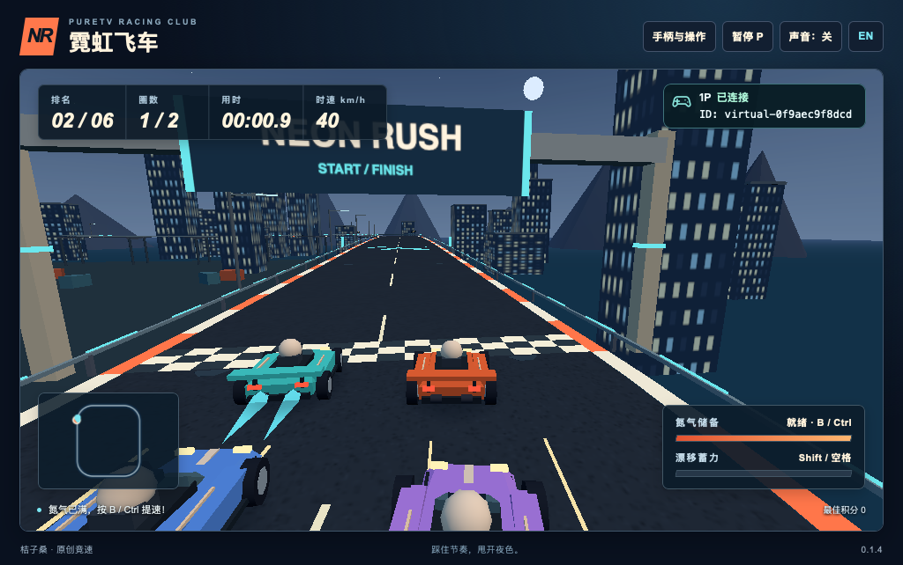

# 霓虹飞车 · macOS 0.1.4

独立 Mac 客户端，包含三条赛道、六车竞速和漂移／氮气玩法。需要 macOS 11 或更新版本及支持 WebGL 的图形环境；通用安装包包含 Apple 芯片和 Intel 代码，不需要 Android 模拟器、ADB 或另装 Python。0.1.4 在连接 pureTV 手柄后显示手柄图标、1P 和完整客户端 ID，菜单、竞速及暂停画面均可查看；断线后自动移除，重连显示原 ID。左右转向、默认63485及切换窗口保持连接的行为不变。

## 下载与安装

- [下载 macOS 通用 DMG](https://github.com/ecojust/pureTV/releases/download/gameplay-icons-2026.11.21/neon-rush-macos.dmg)，打开后将 `Neon Rush.app` 拖入“应用程序”。
- [下载 macOS 通用 ZIP](https://github.com/ecojust/pureTV/releases/download/gameplay-icons-2026.11.21/neon-rush-macos.zip)，解压后将游戏移入“应用程序”。
- [本次图标更新的文件校验与签名记录](https://github.com/ecojust/pureTV/releases/download/gameplay-icons-2026.11.21/macos-game-icons.json) · [0.1.4 玩法验证记录](docs/verification-0.1.4/README.md)

首次打开时，允许 Neon Rush 访问本地网络，以便 pureTV 手柄发现并连接游戏。若曾拒绝，可在系统设置的“隐私与安全性 → 本地网络”中重新允许。



## 连接pureTV手柄

让 Mac 与手柄处在同一局域网，打开游戏，按手柄 GPIO23 搜索键。Mac 0.1.2 起默认 TCP 端口为 `63485`；仅启动时被占用才选择备用端口，界面和 Bonjour 均显示实际端口，运行期间保持不变。当前固件仅在发现恰好一个 `_puretv._tcp` 服务时自动连接；同网同时运行多个游戏服务时，请先关闭其他接收服务。界面显示实际IPv4地址、端口和发现状态；手动配网也可填写该地址。

连接卡片显示手柄实际上报的 `controller_id`，并在竞速时保留于右上方。当前协议没有上报 RSSI，因此不显示信号强度。

- START开始、暂停或继续；LEFT／RIGHT转向，DOWN刹车。
- A／X按住漂移，配合转向，正常松开获得小喷；B／Y使用氮气。
- UP参与九键协议；本作自动加油，无需持续按住。
- 断线、隐藏、最小化、失焦或睡眠时清除输入并暂停。Mac 0.1.2 起，窗口切换和系统授权弹窗保留监听、发现与现有 TCP 连接；后台仍回复 ACK，但按键不会操作游戏。
- 回到游戏后先松开按键，再按 START 继续；不会自动恢复驾驶。真正断线后重连原端口，退出游戏时关闭监听并撤销发现。

键盘也可操作：方向键转向／刹车，Shift或空格漂移，B或Ctrl氮气，Enter开始，P暂停，R重开；Control-Command-F切换全屏。语言和最佳积分保存在Mac本机。

原版虚拟手柄可用于联调（开发电脑需要Python3）：

```sh
python3 puretv-joystick/bridge.py Mac的局域网IP --port 游戏显示的端口
```

浏览器打开 `http://127.0.0.1:8767/`，点“连接游戏”。游戏本身不需要该桥接程序或浏览器。完整协议见[手柄规范](../../../../puretv-joystick/README.md)和[游戏客户端接入要求](../../../../docs/guide/development.md#游戏客户端开发兼容手柄的要求)。

## 构建

Mac安装Xcode命令行工具后，在仓库根目录执行：

```sh
python3 resource/apps/neon-rush/macos/build.py --output /tmp/neon-rush-macos-build
```

输出通用 `.app`、ZIP、DMG、SHA256清单和准确构建输入记录。构建输出需位于仓库外；最终经验证的ZIP／DMG才放入本目录。游戏资源、Three.js及字体均随应用提供，保留原许可；网页只从应用内的环回HTTP服务加载。

应用使用ad-hoc签名，未做Apple公证；首次打开可能需要在“系统设置→隐私与安全性”选择“仍要打开”。这与pureTV管理器既有Mac包的签名方式一致。

## 验证

```sh
node --test resource/apps/neon-rush/macos/tests/web-bridge.test.mjs
xcrun swiftc -swift-version 5 resource/apps/neon-rush/macos/Sources/ControllerServer.swift resource/apps/neon-rush/macos/tests/ControllerServerTests.swift -o /tmp/neon-controller-tests
/tmp/neon-controller-tests
```

原生验收由 `tests/verify-native.py` 驱动实际AppKit／WKWebView应用，使用原Python SDK与原虚拟手柄页面发送普通按键，通过只读诊断快照检查游戏；不写入游戏状态或修改时钟。[最终工作流 43847934677](https://github.com/ecojust/pureTV/actions/runs/43847934677) 已验证同一份通用包：

- Apple 芯片原生、默认端口被占用的备用端口模式、Rosetta 下的 Intel 程序各通过 11 组验收，包括左右屏幕转向、真实驾驶、三轮窗口切换保持连接、原版虚拟手柄网页；各完成 6 次菜单／竞速／暂停／断线／重连 ID 观测，与原 SDK 的实际连接 ID 一致。
- 原生 Intel 云端运行机缺少 WebGL，通过安装包及 7 组通信／生命周期检查和菜单 ID 检查，未在该机验证 3D 驾驶或竞速画面的标识。
- 两个平台各通过 27 项协议测试，网页桥接通过 14 项测试。

最低部署版本为 macOS 11，实际 CI 使用较新系统；未实测 macOS 11、实体 Intel 显卡或 ESP32 实物手柄。详细范围与原始记录见[验证说明](docs/verification-0.1.4/README.md)，[0.1.3 转向修复记录](docs/verification-0.1.3/README.md)继续保留。
