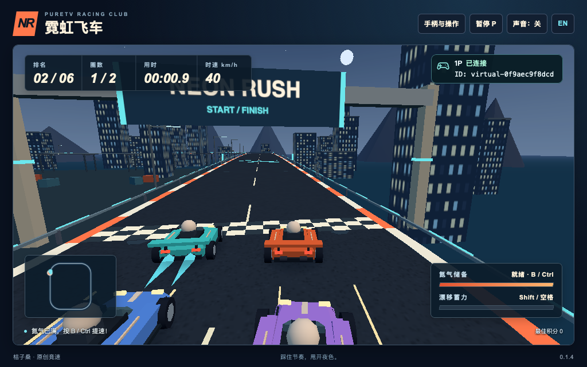

# macOS 0.1.4 · 手柄客户端标识

[工作流 43847934677](https://github.com/ecojust/pureTV/actions/runs/43847934677) 的构建、ARM／Intel 原生验收与导出全部成功。实际构建提交为 `37f180164803c035e2fa9127580ada96c7cc1cec`，与生产冻结提交 `802c48bcec9d060bdce691045330c822c4f1cf83` 仅相差一行测试夹具依赖复制；游戏、原生接收端、SDK 和正式 Mac 验收代码没有因此改动。应用版本为 **0.1.4 / build 4**。

## 本次行为

真实 Wi-Fi 手柄连接时，侧边显示手柄图标、1P 和完整 `controller_id`。菜单和暂停时显示在连接面板中，竞速时移至右上方；断线隐藏，重连恢复同一客户端 ID。UI 只读取已有缓存，没有增加会消费按键的原生快照调用。当前协议没有 RSSI，不显示推算信号强度。



## 原生验证范围

测试运行实际 AppKit／WKWebView 安装副本，由原 Python SDK 通过真实 TCP 发送普通输入。只读 DOM 诊断核对手柄 SVG、1P、完整文本和可见区域；显示 ID 必须等于原始线上 `hello.controller_id` 及原生接收端 ID。游戏状态和时钟没有被测试写入。

| 模式 | TCP 端口 | 验收组数 | 客户端标识观测 |
| --- | ---: | ---: | --- |
| ARM 原生 | 63485 | 11 / 11 | 菜单、真实竞速、暂停、断线、重连前后共 6 次 |
| ARM，预先占用 63485 | 51495 | 11 / 11 | 同上 6 次，备用端口全周期保持 |
| Rosetta 执行 x86_64，英文 | 63485 | 11 / 11 | 同上 6 次 |
| Intel 原生云端 | 63485 | 7 / 7 | 仅菜单连接 ID；该机无法创建 WebGL |

三种有图形环境的模式继续验证左右屏幕转向、28 秒实际驾驶、漂移／氮气、断线取消、按住同步后安全重连和原版虚拟手柄网页。每种模式都完成三轮真实窗口切换，端口、TCP 连接与 session 保持，后台输入被隔离。ARM 原生／占端口／Rosetta／Intel 分别收到 **388/388、383/383、381/381、108/108** 个同序号 ACK。

Intel 原生报告状态为 `limited_graphics`：安装包、协议、通信、生命周期和菜单标识已检查；没有把菜单证据计为竞速或虚拟网页玩法通过。完整 x86_64 图形流程在 Rosetta 下验证，不能替代实体 Intel 显卡测试。

两种平台各通过 27 项 Swift 协议测试；WebView 桥接 14 项通过。游戏 npm 测试 54 项通过、0 失败、2 项跳过；跳过项需要显式最终资产与输出路径，本次原生画面另有真实证据。生成资产一致性检查通过。

已直接目视 12 张原生 PNG，包括中文菜单／竞速／暂停／断线／重连、备用端口、英文 Rosetta 和 Intel 无 WebGL 菜单。图标和完整 ID 清晰可读、未省略或裁切，断线卡片消失。具体图片、散列和范围见 [visual-review.json](visual-review.json)；此记录不声称人工查看了所有导出图片。

## 构建与来源

自动导出分支为 `build-assets/neon-rush-macos-43847934677-attempt-1`，不可变导出提交为 `47ba14f8b88bd085a91debb4f02c8e382d789e17`。独立审计逐字节核验 **141 份导出文件、70 份构建输入、ZIP 内 26 份应用文件**，以及四个原生报告的实际二进制、12 个验收源和 6 个执行源副本。ZIP 内共享组件等于冻结源码；通用二进制包含 arm64 和 x86_64。

| 包 | 字节数 | SHA256 |
| --- | ---: | --- |
| NeonRush-0.1.4-macos-universal.dmg | 896788 | `353c5d146ef3c4553825a66ea7b1d89393ac9d1b1b3334f4be2c9ff3f94614aa` |
| NeonRush-0.1.4-macos-universal.zip | 562164 | `c81bab5cbbb80a9dd6b941cee6f51ece3868d9d618fcf0cf72912302e0d507b8` |

[下载与安装](../../README.md) · [全部八个历史及当前安装包校验](../../SHA256SUMS.txt) · [本次原始包校验清单](package-SHA256SUMS.txt)

原始证据位于 `evidence/`；[导出清单](export-manifest.json)、[构建清单](build-manifest.json)、[完整 CI 日志](ci-workflow.log)、[审计脚本](export-audit.py)、[审计结果](export-audit.json)、[结构化验证摘要](verification.json)和[工作流最终状态](latest-run.json)保留原始来源。导出清单中的 `packages/` 文件已分别放入 Mac 根目录及本验证目录，包字节未改变。可在临时目录归档不可变导出提交，运行：

```sh
python3 export-audit.py --export /tmp/neon-export --repo /path/to/pureTV --output /tmp/neon-audit.json
```

首次工作流 [43844671574](https://github.com/ecojust/pureTV/actions/runs/43844671574) 在打包前失败：共享 HTML 新引用了 `puretv-controller.js`，原 `runtime-hooks` 临时测试目录未复制该依赖，三个子测试出现 404。只补齐夹具复制项后，原有测试全部通过，再执行上述新工作流。首次完整 CI 日志、空包导出清单及本地修复前后源码／日志完整保留于 [attempt-1-ci](attempt-1-ci/failure.json)，不作为原生验收成功证据。

安装包使用 **ad-hoc 签名，未做 Apple 公证**。部署目标为 macOS 11，实际 CI 使用较新系统；未实测 macOS 11、实体 ESP32、电视、手机或实体 Intel 显卡。安装包随仓库存放，本记录不代表创建了 GitHub Release 或上传应用服务器。
