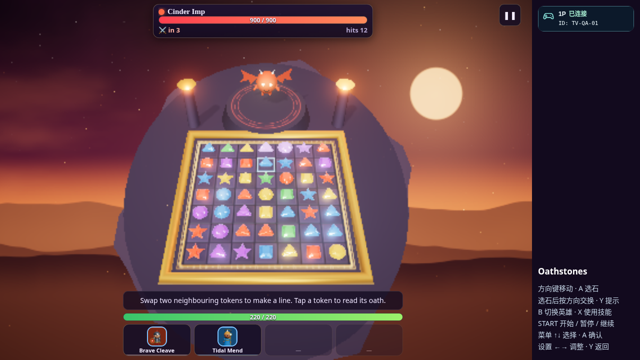

# Oathstones · 誓约宝石

从营地选择战役，确认战斗简报后进入七乘七的誓约棋盘。交换相邻棋子，让颜色、形状或英雄誓约达成连锁；技能、招募、英雄升级、队伍编成、战利品和存档沿用原作规则。

| 手柄 | 操作 |
| --- | --- |
| 方向键 | 移动光标，选中棋子后向相邻方向交换 |
| A | 选中或取消选中棋子 |
| Y | 显示原游戏提供的可走交换 |
| B / X | 轮换队伍中的英雄 / 施放该英雄的已充能技能 |
| START | 主菜单开始；游戏中暂停；暂停后明确继续 |

在菜单中按上下键选择、A 确认、Y 返回，设置页可用左右键调整数值。失焦或手柄断连会暂停游戏。重连后松开按键，再按 START 继续。

离线入口为 `dist/tv.html`，需要 WebGL 2。使用原版 Three.js r165 随包渲染，运行时不连接 CDN。

`npm ci` 安装构建依赖，`npm test` 运行原作模型测试，`npm run build` 生成游戏，`npm run build:check` 逐字节核对生成物。

[原作及固定提交](https://github.com/triptych/web-games-andrew/tree/a7051c34fe2e7550fd206e6272f758df171855b0/game-108) · [许可证与第三方声明](NOTICE.md) · [逐文件来源](docs/source-changes.json) · [手柄测试计划](qa-plan.json)

失焦、手柄断线或系统暂停时，游戏暂停音乐和音效的 AudioContext。重新获得焦点或重连时仍保持静音，恢复游玩后才重新发声。

Chromium 156 在 960 × 540 及 1280 × 720 检查了实际游戏操作、失焦、持 START 重连，以及游戏自身音频上下文的挂起和显式恢复。另有同一音频源码的独立验证，静音期间音频时钟保持不变。两种尺寸均通过提示和方向输入，完成了消除与实际战斗回合。原作的 150 项模型检查通过。[游戏运行记录](docs/browser/report.json) · [音频观测](docs/audio-lifecycle.json) · [构建、源码及图像校验](docs/verification.json)

<!-- puzzle-downloads -->
## 安装包 0.1.0

| 平台 | 安装文件 |
| --- | --- |
| Android TV | [APK](https://github.com/ecojust/pureTV/releases/download/joystick-oathstones-v0.1.0/oathstones-0.1.0.apk) |
| macOS | [DMG](https://github.com/ecojust/pureTV/releases/download/joystick-oathstones-v0.1.0/Oathstones-0.1.0-macos-universal.dmg) · [ZIP](https://github.com/ecojust/pureTV/releases/download/joystick-oathstones-v0.1.0/Oathstones-0.1.0-macos-universal.zip) |
| Windows x64 | [安装版 EXE](https://github.com/ecojust/pureTV/releases/download/joystick-oathstones-v0.1.0/Oathstones-0.1.0-windows-x64-setup.exe) · [便携 ZIP](https://github.com/ecojust/pureTV/releases/download/joystick-oathstones-v0.1.0/Oathstones-0.1.0-windows-x64.zip) |

Android TV 和 Windows x64 均已通过默认端口和端口占用两种手柄实玩测试。macOS 通用包为预览版，Apple Silicon 原生、Apple Silicon 端口占用以及 Rosetta 2 三种模式均已实玩通过。托管 Intel Mac 未提供可用的游戏图形加速，Intel 实体机游玩仍待验证。 macOS 包采用 ad-hoc 签名，尚未经过 Apple 公证。实体电视和 ESP32 实物手柄仍待验证。

[SHA-256 校验](SHA256SUMS.txt) · [平台验收记录](packages.json)
