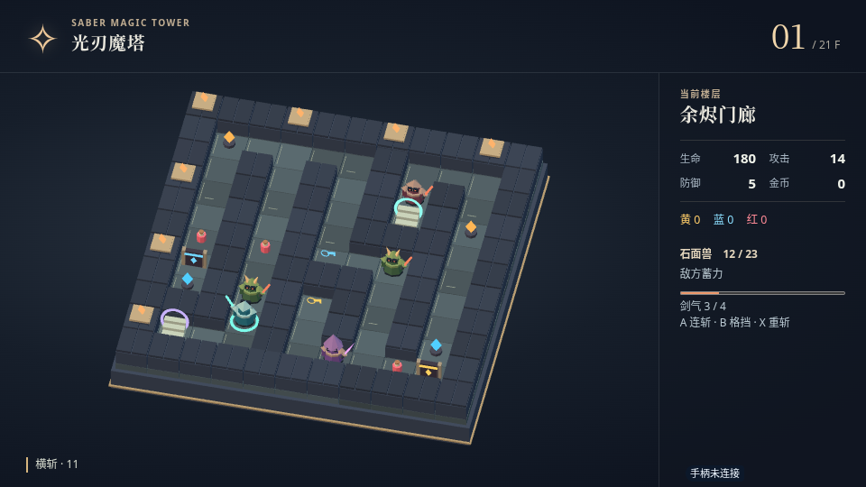

# 光刃魔塔 · Saber Magic Tower

[Android TV 0.1.0 签名 APK](saber-magic-tower-0.1.0.apk?raw=true) · [扫码连接手机](../../docs/guide/README.md#在电视上扫码加入) · [在电脑上游玩](../../docs/guide/README.md#在电脑上玩)

单人 3D 楼层探索 RPG。二十一层魔塔各有固定布局与往返楼梯。在岔路寻找钥匙与补给，击败第 7、14 层的统领，最后战胜第 21 层的永夜之王，走上王冠所在的格子通关。

## 游玩

在本目录运行 `npm ci`、`npm run build`，用支持 WebGL 2 的浏览器打开 `dist/tv.html`。网页可离线游玩。pureTV 原生宿主使用同一份页面，并提供手机扫码与 Wi-Fi 手柄连接。进入或离开楼层时自动保存角色和全塔已取得的物品，标题页可继续。战败可从最近的楼层入口重试。

| 操作 | 手柄 | 键盘 |
| --- | --- | --- |
| 移动、选择菜单 | 方向键 | 方向键 |
| 确认、连斩 | A，决斗中可按住 | Z |
| 格挡、关闭手册 | B | X |
| 重斩 | X | C |
| 怪物手册 | Y | V |
| 开始、暂停、恢复 | START | P |

连续轻斩的第三击造成额外伤害。重斩消耗两点剑气，轻斩和成功格挡补充剑气。观察敌方蓄力条，在攻击到来前按格挡可以免伤并强化下一击。打开手册时决斗暂停。失焦或当前手柄断开时游戏暂停，恢复后按 START 继续。

黄色、蓝色与红色钥匙各开一扇同色门。琥珀晶石增加攻击，蔚蓝晶石增加防御，红药增加生命。金币可在商人处购买补给或升级装备。已经收集的道具和击败的敌人会保存在对应楼层。

## 制作与验证

光刃连击、重斩与限时格挡参考 Vheissu 的 Saber Battle。本作独立编写了地图、战斗、模型和动画，按经典 21 层魔塔的资源规划方式设计新关卡。参考版本、依赖及许可见 [upstream.json](upstream.json) 和 [NOTICE.md](NOTICE.md)。

- `npm test` 验证 21 层通关、三场首领战、钥匙消耗、往返楼梯、格挡、失败冻结和存档读取。
- `npm run build:check` 将重建的页面和许可文件与 `dist/` 逐字节比较。
- 浏览器实玩检查见 [tests/browser.py](tests/browser.py)。启动 HTTP 静态服务器后传入页面 URL 和截图输出目录。脚本使用真实键盘事件，连接变化使用浏览器中的宿主桥模拟。

本轮 Linux Chromium / SwiftShader 已在 720×480、960×540 与 1280×720 完成第一层实玩与连接变化检查。1280×720 还通过 Wi-Fi 桥输入击败敌人，用手机桥输入恢复并移动。完整 21 层通关由规则测试验证。实体电视、实体手机与实体手柄待测。[验证记录](docs/browser-verification.json)
