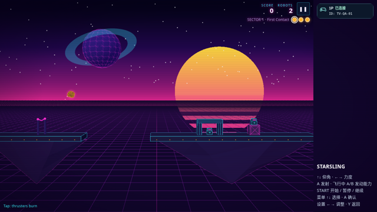

# STARSLING · 星际弹弓

0.1.1 含后台与断线时暂停音频的修正。

每个星区给定一组小行星。先调整弹弓仰角和力度，再发射小行星拆除空间站，清除机器人以解锁后续星区。岩石加速、重铁下砸、冰块分裂和炸弹引爆沿用原作的碰撞与伤害规则。

| 手柄 | 操作 |
| --- | --- |
| ↑ / ↓ | 提高 / 降低仰角 |
| ← / → | 减小 / 增大发射力度 |
| A | 发射，飞行中再次按 A 发动特殊能力 |
| B | 飞行中发动当前小行星的能力 |
| START | 主菜单开始；游戏中暂停；暂停后明确继续 |

在菜单中按上下键选择、A 确认、Y 返回，设置页可用左右键调整数值。失焦或手柄断连会暂停游戏。重连后松开按键，再按 START 继续。

离线入口为 `dist/tv.html`，需要 WebGL 2。使用原版 Three.js r165 随包渲染，运行时不连接 CDN。

`npm ci` 安装构建依赖，`npm test` 运行原作模型测试，`npm run build` 生成游戏，`npm run build:check` 逐字节核对生成物。

[原作及固定提交](https://github.com/triptych/web-games-andrew/tree/a7051c34fe2e7550fd206e6272f758df171855b0/game-102) · [许可证与第三方声明](NOTICE.md) · [逐文件来源](docs/source-changes.json) · [手柄测试计划](qa-plan.json)

原作 149 项模型检查通过。Chromium 156 在 960 × 540、1280 × 720 两种分辨率使用 Wi-Fi 手柄接口夹具，通过六步手柄计划、失焦暂停、保持 START 重连后继续暂停，以及主动恢复。网页运行期间未发出外部网络请求。[逐步游戏数值](docs/browser/report.json) · [浏览器脚本](tests/browser.mjs) · [构建及验证摘要](docs/verification.json)

失焦、手柄断线或系统暂停时，游戏暂停音乐和音效的 AudioContext。重新获得焦点或重连时仍保持静音，恢复游玩后才重新发声。
