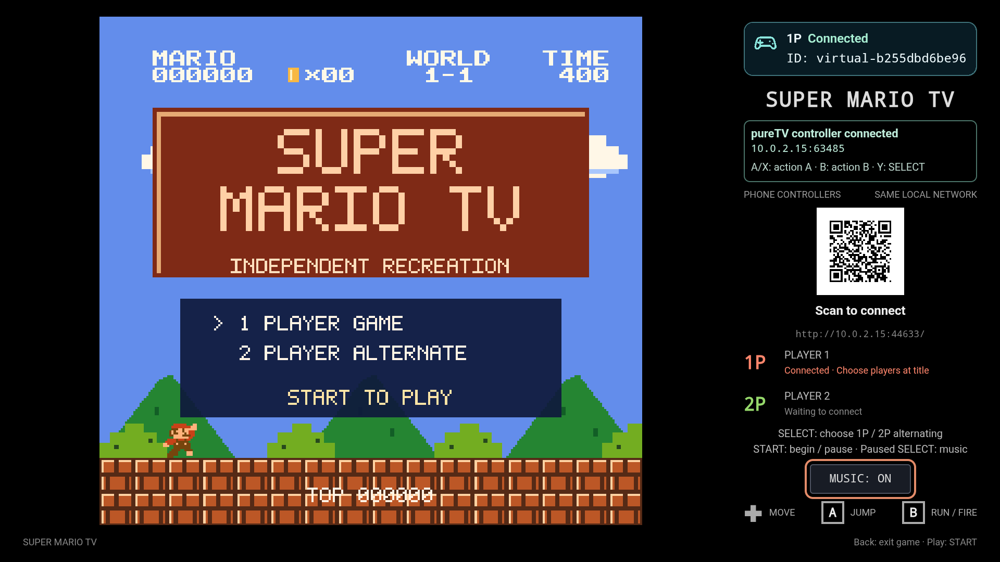
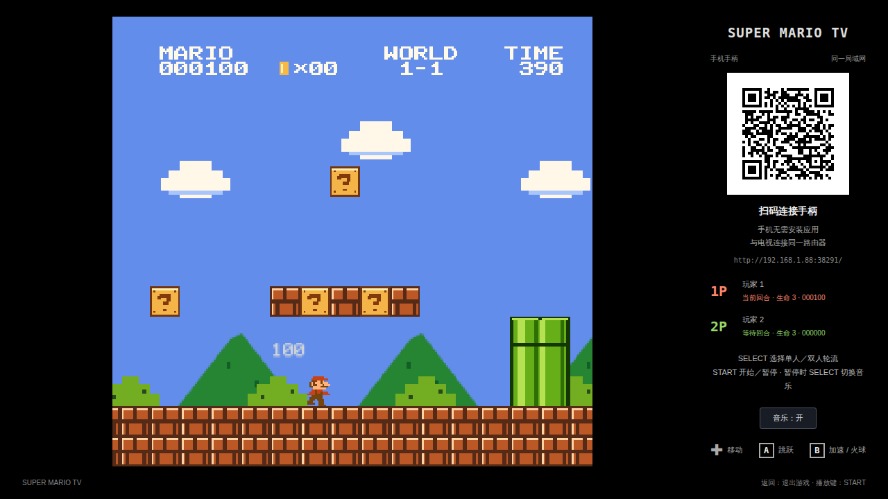
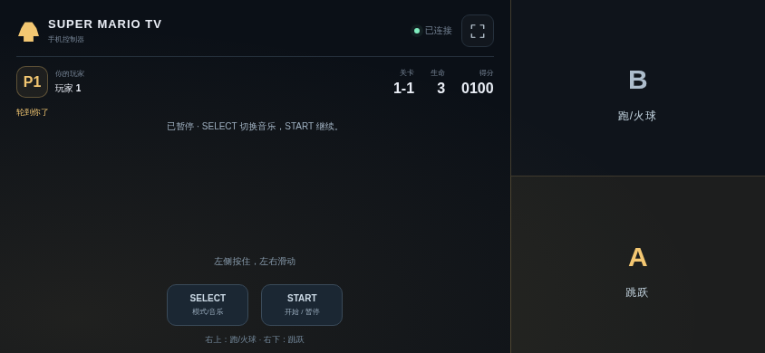
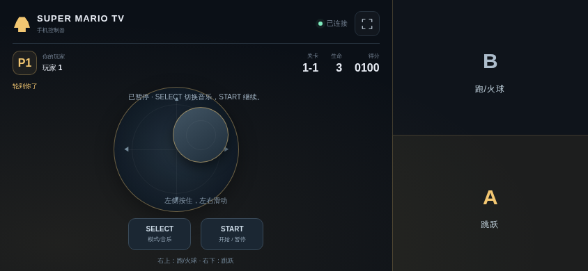

# 超级玛丽 TV

<!-- apk-resource:start -->
[Android TV 0.5.9 · APK](super-mario-0.5.9.apk?raw=1) · [macOS · DMG](https://github.com/ecojust/pureTV/releases/download/games-zh-cn-2026.11.25/super-mario-macos.dmg) · [Windows x64 · 安装程序](https://github.com/ecojust/pureTV/releases/download/games-zh-cn-2026.11.25/super-mario-windows-x64-setup.exe)
<!-- apk-resource:end -->

历史安装包（Android 0.5.8） · [Android 0.5.8 APK](super-mario-0.5.8.apk?raw=1) · [Windows x64](https://github.com/ecojust/pureTV/releases/download/gameplay-icons-2026.11.21/super-mario-windows-x64-setup.exe) · [macOS](https://github.com/ecojust/pureTV/releases/download/gameplay-icons-2026.11.21/super-mario-macos.dmg) · [图标与安装验证](docs/releases/0.5.8/android-icon-receipt.json) · [文件校验](SHA256SUMS.txt) · [0.5.7 实玩录像](docs/releases/0.5.7/gameplay.mp4?raw=1)

## 历史 Android 版本 0.5.7 · 手柄与手机连接

[下载签名 APK](super-mario-0.5.7.apk?raw=1) · [校验值](SHA256SUMS.txt) · [安装包与源码](resource.json)

首帧绘制失败后，手机仍可连接并看到房间状态。在 720 × 480 电视上，二维码和两个玩家席位都能完整显示。可用键盘、pureTV Wi-Fi 手柄，或用同一局域网内的手机扫描电视房间二维码。连接标识区分玩家，连接与断开时保留游戏画布尺寸。[连接手柄指南](../../docs/guide/README.md#安装游戏与连接手柄)

此签名 APK 已在 Android TV 模拟器上从 0.5.6 成功覆盖安装，验证记录可追溯至已发布的 0.5.4。原版手柄 SDK 通过 9 项检查，实际发出的 99 条消息全部收到同序号确认。[游戏截图](docs/releases/0.5.7/gameplay.png) · [Android 玩法录像](docs/releases/0.5.7/gameplay.mp4?raw=1) · [验证记录与测试范围](docs/releases/0.5.7/verification.json)

[中文](README.md) · [English](README.en.md)

<!-- controller-client-status:start -->
## 历史版本 0.5.4 · 手柄连接标识

<!-- previous-apk-resource:start -->
[下载签名 APK](super-mario-0.5.4.apk?raw=1) · [校验值](SHA256SUMS.txt) · [签名与来源](resource.json) · [源码](src/) · [图标](logo.svg)
<!-- previous-apk-resource:end -->

Android **0.5.4 / versionCode 6**：手柄连接后，侧边显示手柄图标、玩家席位（按游戏人数显示 1P/2P）和设备完整连接 ID；断开后隐藏。默认 TCP 端口仍为 **63485**。当前手柄固件未上报 RSSI，因此不显示信号强弱。

[连接截图](docs/releases/0.5.4/connected.png) · [连接状态专项录像](docs/releases/0.5.4/controller-status.mp4?raw=1) · [版本验证](docs/releases/0.5.4/verification.json) · [20 款更新记录](../../docs/controller-client-status/README.md)

安装包沿用原发布证书。本轮在 Android TV 模拟器中验证连接身份、断开／重连状态及同证书覆盖安装；截图和录像记录菜单中的连接状态专项，没有重做完整玩法验收。未改规则模型按精确哈希复用历史依据，旧版报告继续保留。尚未验证实体电视、手机、ESP32 或带已有存档的升级与数据保留。


<!-- controller-client-status:end -->

以《超级马力欧兄弟 1》为参考的独立重写：8 个世界、32 关，地面、地下、水下与城堡；包含顶砖、蘑菇变身、火球、龟壳、管道、旗杆与桥斧。

当前版本 **0.5.8**，适用于 Android 8.0 及以上电视，包名 `com.ecojust.supermariotv`。电视显示游戏与房间二维码，手机扫码作为手柄。
<!-- visual-release:start -->
## 历史：0.5.2 视觉更新与验证

以下保留 **0.5.2** 发布时的视觉更新、源码和验收记录；这些旧版结果不代表本轮 pureTV 手柄更新已经通过验收。当时沿用 0.5.0／0.5.1 的 pureTV 发布证书。逐款改动、检查范围和实机验证状态见[0.5.2 视觉更新记录](../../docs/game-visuals-0.5.2.md)。

按 1985 年 FC/NES《Super Mario Bros.》分别绘制小形态、大形态的站立／跑步／跳跃／蹲伏姿态，以及火焰和路易吉配色，避免把小形态直接拉高充当大形态。保留对应 NES 像素比例与二维场景；这些是独立绘制的姿态，不代表全部角色动画已逐帧复刻。

具体还原范围见[参考说明](docs/reference.md)。

<!-- final-verification -->
当时冻结源码 0752b658aecbb1322cb7294e3176500639db1b54 已通过 Android CI 40843467072：280 项模型／渲染行为回归、36 个兼容场景、131 个手柄场景及 18 个双语集成场景；Cozy Island 输入运行时 9／9、两款 WebGL 1 渲染脚本及 Coast Kart 道具攻防专项也通过。Android 构建、lint、体积和 staging 成功，15 个模块实际执行 JUnit 任务（含全部 9 款游戏），不推断未输出的 JUnit 用例数。签名运行 40846148068 已核验九款 APK 的源码资源、签名与资源目录。Chrome 61 语法和现代 Chromium 旧 API 模拟不等于真实旧 WebView 验收；该历史版本当时未测试真实电视／手机、设备 FPS、覆盖安装和数据保留。
<!-- visual-release:end -->

## 历史：0.5.1 还原度升级

补全滑旗、进堡、计时烟花和逐段塌桥；修复火球撞墙、道具出砖及部分关底地形。

沿用 0.5.0 证书，可直接覆盖更新；0.5.1 的核对结果与剩余差距见[还原度复核](../../docs/game-fidelity-0.5.1.md)。

## 安装与签名

历史 0.5.3 已沿用 0.5.0／0.5.1／0.5.2 的 pureTV 统一发布证书；当时已在 Android TV 模拟器成功从 0.5.2 执行 `adb install -r` 覆盖安装。该检查未预置存档，不代表已验证升级后存档或用户数据保留。使用旧证书的 0.4.x 及更早安装不能直接覆盖，请先备份可导出的数据再卸载；卸载会清除本机存档和记录，本项目没有跨证书自动迁移工具。

## 历史：0.5.0 玩法升级

加入真实蹲滑碰撞、移动台承载，以及连续踩敌／龟壳连杀递增奖励与分数、1UP 浮字。

## 开始游玩

1. 手机和电视连接同一局域网，在电视上打开游戏。
2. 手机浏览器扫描二维码加入。单人一部手机；双人各用一部手机。
3. 标题画面按 SELECT 选择人数，按 START 开始。
4. 左侧摇杆默认隐藏，手指按下的位置就是中心；拖动控制，松开停止并隐藏。右侧屏幕三分之一为完整动作区：上半 B、下半 A，区域内含边缘的任意位置都可触发，可与摇杆同时使用。START／SELECT 独立位于左侧底部。

游戏操作区禁止文字选择与长按浏览器菜单，避免误触“搜一搜”等功能。

| 控件 | 功能 |
| --- | --- |
| 左侧浮动摇杆 | 左右移动；下蹲／进入支持的管道 |
| A | 跳跃／游泳 |
| B | 加速跑／发射火球 |
| SELECT | 标题切换人数；暂停时开关音乐 |
| START | 开始、暂停／继续 |
| 电视返回键 | 退出确认 |

双人模式采用**轮流游玩**：各自保留生命、积分和关卡，失命后交给下一名玩家。手机会显示当前轮次，等待中的手机不会控制当前角色。当前操作者断线会自动暂停，重新连接后继续；手动暂停不会被重连取消。最高分和音乐偏好保存在电视本机。

## 历史画面（0.5.2）

以下截图来自实际游戏页面在 Chromium 中的渲染，房间连接由测试桥接模拟，不是电视实机截图。







## 房间与退出

最多两部手机通过本地 HTTP/WebSocket 服务连接；二维码包含本次启动的端口和随机令牌。游戏不依赖云端服务。手机失焦、触控中断或断线会释放按键。

按电视 Home 离开或确认退出，会关闭房间、断开手机、释放线程与唤醒锁、销毁 WebView 和音频并结束应用进程。重新打开需扫描新的二维码；本局进度不会跨退出保存。

## 实现与验证

以下命令是可复现的检查入口，不表示本轮已经全部执行通过；本轮实际执行结果见上方验收记录。

关卡路线、画面、图标、音效和音乐由项目独立制作，未包含原作 ROM、提取图像或原声音轨。规则和地图的具体重建范围见[参考说明](docs/reference.md)；不宣称与原作逐帧或逐格一致。项目自写代码和素材使用 [MIT](LICENSE)。

```sh
node --test joystick-games/super-mario/tests/*.test.cjs
node joystick-games/super-mario/tests/controller.mjs
node joystick-games/super-mario/tests/compatibility.mjs
node joystick-games/super-mario/tests/capture.mjs

cd resource/launcher/puretv
./gradlew :super-mario:assembleRelease :super-mario:testDebugUnitTest :super-mario:lintDebug :super-mario:verifyReleaseSize
```

浏览器测试使用 desktop 的 npm 依赖和 Chromium，可通过 `CHROMIUM_PATH` 指定浏览器。尚未完成电视／手机实机验证。

## pureTV Wi-Fi 手柄

电视和手柄加入同一局域网，打开游戏后按手柄搜索键（GPIO 23）。电视界面显示实际 TCP 地址和发现状态，默认端口 **63485**；仅启动时被占用才选择备用端口，一次运行期间保持不变。同网存在多个游戏服务时，请先关闭其他服务再搜索。

方向键左右移动、下蹲或进入可用管道；**A/X** 跳跃／游泳，**B** 加速跑／发射火球。**Y（SELECT）** 在标题切换人数，暂停时切换音乐。**START** 开始、暂停／继续。两只 Wi-Fi 手柄对应两个席位，双人模式按原规则轮流游玩。扫码手机手柄和电视遥控器仍可使用。

断线或切换控制来源会暂停游戏，松开按键后重新按 START 继续；重连同步和原先按住的键不会自动触发动作。临时失焦时隔离输入并保留监听服务；按 Home 或切换应用仍会按原有流程退出游戏并关闭服务。

<!-- controller-client-status-history:start -->
<details>
<summary>历史 0.5.3 安装包与验收记录</summary>

以下为旧版发布记录，其测试与画面不代表本次连接 ID 界面验收。[原提交中的完整说明](https://github.com/ecojust/pureTV/blob/9af9f197855eb7a0ce7174c0e6295c8974b3250d/resource/apps/super-mario/README.md)。

[下载 APK](super-mario-0.5.3.apk?raw=1) · [校验值](docs/controller-status-baseline/0.5.3/SHA256SUMS.txt) · [签名及构建来源](docs/controller-status-baseline/0.5.3/resource.json) · [源码](src/) · [64×64 SVG 图标](logo.svg)

该历史版本 APK 已使用原 pureTV 发布证书正式签名，并通过从上一版本覆盖安装的验证；当时 Android 手柄验收结果见下方更新说明。若设备中存在使用旧证书的同包应用，Android 无法直接覆盖安装；需先备份数据并卸载旧包。

## 0.5.3 pureTV 手柄更新

历史版本为 **0.5.3 / versionCode 5**，新增 pureTV Wi-Fi 手柄输入，默认 TCP 端口 **63485**，保留扫码手机手柄和电视遥控器。正式签名 APK 已在 Android TV 模拟器完成 9/9 项手柄验收，并通过从上一版本执行 `adb install -r` 覆盖安装。未做带存档升级或数据保留验证。

实际结果和限制见[当时 20 款游戏验收记录](../../docs/readme-controller-support/README.md)及[发布进度](../../docs/readme-controller-support/rollout.json)。下文保留的旧版 CI、录像和截图均为历史依据。

该历史版本验收资源：[菜单截图](docs/releases/0.5.3/menu.png) · [实际 APK 运行录像](docs/releases/0.5.3/gameplay.mp4?raw=1) · [验证记录](docs/releases/0.5.3/verification.json)。截图和录像来自 Android TV 模拟器，未做实体电视测试。验收范围和具体结果见验证记录；模拟器结果不代表实体电视或带存档升级验证。

</details>
<!-- controller-client-status-history:end -->
