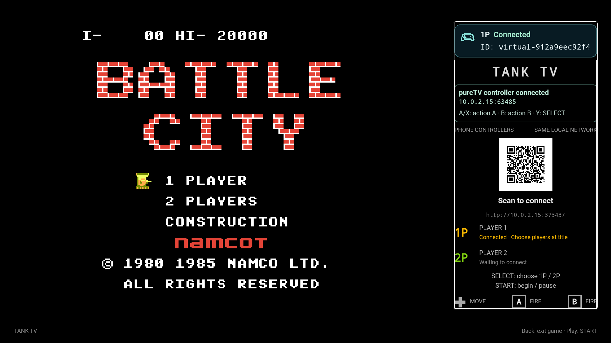
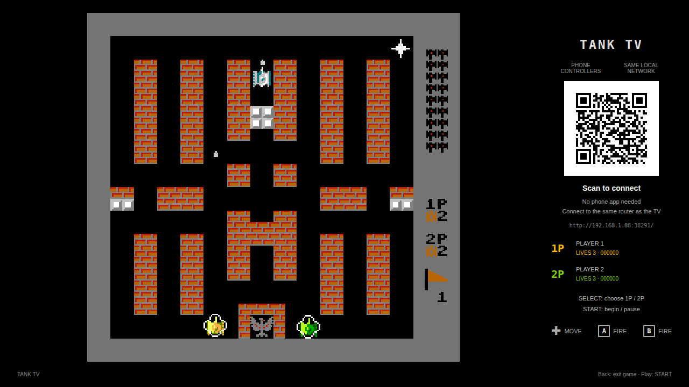
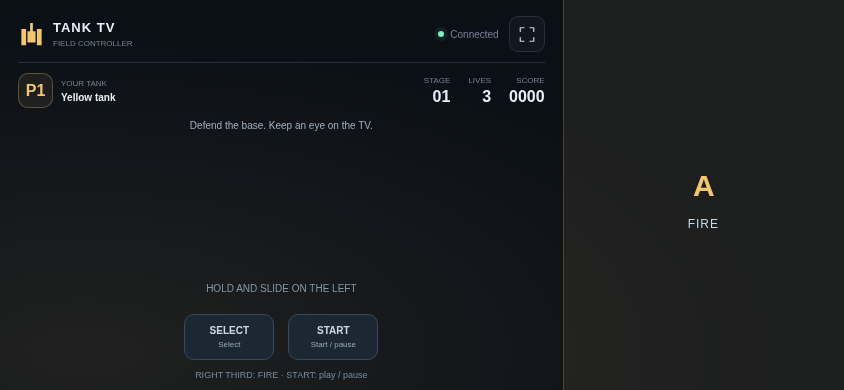
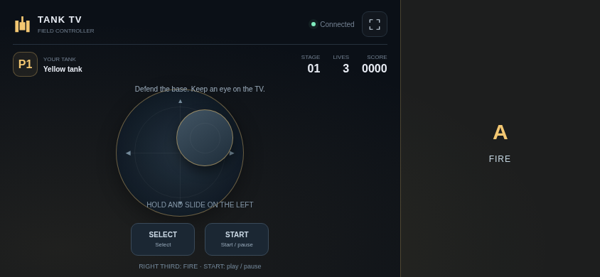

# Tank TV

<!-- apk-resource:start -->
[Android TV 0.5.8 · APK](tank-0.5.8.apk?raw=1) · [macOS · DMG](https://github.com/ecojust/pureTV/releases/download/games-zh-cn-2026.11.25/tank-macos.dmg) · [Windows x64 · Installer](https://github.com/ecojust/pureTV/releases/download/games-zh-cn-2026.11.25/tank-windows-x64-setup.exe)
<!-- apk-resource:end -->

Earlier downloads (Android 0.5.7) · [Android 0.5.7 APK](tank-0.5.7.apk?raw=1) · [Windows x64](https://github.com/ecojust/pureTV/releases/download/gameplay-icons-2026.11.21/tank-windows-x64-setup.exe) · [macOS](https://github.com/ecojust/pureTV/releases/download/gameplay-icons-2026.11.21/tank-macos.dmg) · [Launcher artwork and installation checks](docs/releases/0.5.7/android-icon-receipt.json) · [Checksums](SHA256SUMS.txt) · [0.5.6 gameplay video](docs/releases/0.5.6/gameplay.mp4?raw=1)

## Earlier Android release 0.5.6 · Controllers and phone pairing

[Download the signed APK](tank-0.5.6.apk?raw=1) · [Checksums](SHA256SUMS.txt) · [Package and source](resource.json)

On 720 × 480 TVs, the QR code and both player seats fit inside the screen. Connect a keyboard, pair a pureTV Wi-Fi controller, or scan the TV room’s QR code with a phone on the same network. The connection indicator identifies each player while the game keeps its playing area at the same size. [Controller guide](../../docs/guide/README.en.md#install-a-game-and-connect-a-controller)

The signed APK completed an in-place upgrade on an Android TV emulator, following the previously verified 0.5.4 to 0.5.5 upgrade. The original controller SDK completed 9 checks and received matching acknowledgements for 102 messages. [Gameplay screenshot](docs/releases/0.5.6/gameplay.png) · [Android gameplay recording](docs/releases/0.5.6/gameplay.mp4?raw=1) · [Verification and limitations](docs/releases/0.5.6/verification.json)

[中文](README.md) · [English](README.en.md)

<!-- controller-client-status:start -->
## Earlier release 0.5.4 · Connected controller identity

<!-- previous-apk-resource:start -->
[Download signed APK](tank-0.5.4.apk?raw=1) · [Checksums](SHA256SUMS.txt) · [Signing and source](resource.json) · [Source](src/) · [Icon](logo.svg)
<!-- previous-apk-resource:end -->

Android **0.5.4 / versionCode 11** shows a controller icon, player seat (1P/2P where supported), and the connected device's complete ID in the side area. Disconnected devices disappear. The default TCP port remains **63485**. Current controller firmware does not report RSSI, so signal strength is not displayed.

[Connected screenshot](docs/releases/0.5.4/connected.png) · [Controller-status recording](docs/releases/0.5.4/controller-status.mp4?raw=1) · [Version verification](docs/releases/0.5.4/verification.json) · [Twenty-game update record](../../docs/controller-client-status/README.md)

The APK uses the existing release certificate. This update verifies connection identity, disconnect/reconnect status and in-place installation in an Android TV emulator; the capture and video show the menu status checks. It does not repeat full gameplay acceptance. Unchanged model evidence is reused by exact hash, with previous reports retained below. Physical TVs, phones, ESP32 devices and upgrades containing existing user saves remain untested.


<!-- controller-client-status:end -->

Version **0.5.4** independently reimplements the 1985 NES Battle City rules, 35 stages and presentation. Install and play without importing a ROM. Physical-TV and frame-by-frame comparisons are incomplete.

The rewrite retains QR pairing and two phone controllers over the local network, with a native 256×240 display and 208×208 battlefield. It does not load or execute a ROM. The 35 maps, 20-enemy stage sequences, four enemy classes, six power-ups, upgrades, co-op tallies and Construction mode have source references. AI, some collisions and animation timings still need frame-by-frame comparison. See [rules and maps](docs/reference.md) and [artwork and audio](docs/reference-art-audio.md) for evidence and limitations.

Requires Android 8.0 or later; package `com.ecojust.tanktv`. New installations default to Simplified Chinese. The TV room, phone controllers, in-game menus, stage announcements and results screens support Chinese and English.

<!-- visual-release:start -->
## Historical: 0.5.2 visual update and verification

The following preserves the **0.5.2** visual changes, source and verification records. These historical results do not verify the current pureTV controller update. That release retained the pureTV certificate used by 0.5.0/0.5.1. See the [0.5.2 visual update record](../../docs/game-visuals-0.5.2.md) for its per-game changes, verification scope and physical-device test status.

That visual update reviewed the visual reference to the 1985 FC/NES Battle City and retained the existing pixel battlefield. The Tank renderer was not changed.

See the [reference notes](docs/reference.md) for the implementation scope.

<!-- final-verification -->
The historical frozen source 0752b658aecbb1322cb7294e3176500639db1b54 passed Android CI 40843467072: 280 model/render-behavior regressions, 36 compatibility scenarios, 131 controller scenarios and 18 bilingual integration scenarios. Cozy Island input-runtime checks passed 9/9; both WebGL 1 rendering scripts and the Coast Kart combat suite also passed. Android builds, lint, size checks and staging succeeded; 15 modules executed JUnit tasks, including all 9 games, without an inferred JUnit case count. Signing run 40846148068 verified all nine APKs’ source assets, signatures and resource catalog. Chrome 61 syntax checks and old-API simulation in modern Chromium do not establish physical legacy-WebView compatibility. At that historical release, physical TV/phone acceptance, device FPS and in-place installation/data retention were untested.
<!-- visual-release:end -->

## Historical: 0.5.1 gameplay review

Rechecked all 35 maps, enemy waves and co-op rules; the full-area fire control remains available.

The historical 0.5.1 release used the same signing certificate as 0.5.0 and supported an in-place update. See the [fidelity review](../../docs/game-fidelity-0.5.1.md) for tested behavior and remaining differences.

## Installation and signing

Historical version 0.5.3 retained the shared pureTV certificate used by 0.5.0/0.5.1/0.5.2. An in-place `adb install -r` update from 0.5.2 succeeded on an Android TV emulator. This check did not seed existing saves and does not verify retention of saves or other user data. Installations of 0.4.x and earlier signed with the old certificate cannot be updated in place: back up exportable data before uninstalling. Uninstalling clears local saves and records; the project has no automatic cross-certificate migration.

## Floating joystick and compatibility

The phone controller now uses a floating joystick. It stays hidden until you touch the left control area, and that touch becomes the center for the current gesture. Drag in any direction to move; release to stop and hide the stick. Each new touch establishes a new center. Movement and A/B support simultaneous touches. Cancelling a touch, rotating or hiding the page, and losing the connection clear movement to prevent stuck input. The older TV WebView startup fix from 0.3.0 is retained.

## Historical: controller changes in 0.5.0

The right third of the phone screen is an edge-to-edge action area. Tap anywhere in it to fire; the left stick also selects stages in either direction. The left area retains the floating joystick. START and SELECT sit separately at the bottom left. Touches are independent, and cancellation, focus loss or disconnect clears held input. Selection, dragging and long-press context menus are suppressed across the controller.

## Play

1. Install the app and connect the TV and phones to the same router.
2. Scan the TV's QR code; up to two phones can join.
3. Use **SELECT** to choose 1 PLAYER, 2 PLAYERS or CONSTRUCTION; confirm with **START**.
4. On the initial stage selector, the stick changes the stage (keyboard A/B also work) and START begins. During play, START pauses or resumes.

| Control | Action |
| --- | --- |
| Left touch area | Touch anywhere to set the joystick center; drag to move and turn; release to stop and hide |
| Entire right third (A) | Fire on each press anywhere in the area; holding does not autofire |
| SELECT | Change menu selection |
| START | Start, confirm, pause or resume |
| TV Back | Exit confirmation |

Defend the base and defeat the enemy wave. Helmet, clock, shovel, star, grenade and tank are collectible power-ups; B no longer creates a custom shield. Stars increase shell speed, simultaneous shell capacity and steel-breaking ability. Friendly fire temporarily freezes the other tank, and player shells can destroy the base.

These images show this rewritten version running its actual bundled game page in Chromium with simulated room data. They are not physical-TV captures.





The stick stays hidden until you hold and drag on the left, appearing at the initial touch point:



## Local connections

The TV app runs an HTTP and WebSocket room server on a port assigned at startup. The QR code contains the current TV address, port and random room token. Use the code currently shown by the app after each launch. Controller input is not sent to a pureTV cloud service.

Up to two players can connect at once. Temporary disconnections clear held controls; a returning phone attempts to resume its previous player slot. Switching the phone to the background or locking its screen also releases the joystick and buttons. Pressing Home closes the room. Confirming exit closes the server, disconnects every controller, destroys the game page and terminates this app’s process. Reopening creates a new room.

If the phone cannot connect, check that both devices share the same local network and that the router does not isolate guest or Wi-Fi clients. Open the local HTTP address in a phone browser with local-network access. There is no public Internet relay.

## Build and verify

The commands below are reproducible check entry points, not a claim that all checks passed for this release. Current execution results are linked above.

Run from the repository root:

```bash
node --test joystick-games/tank/tests/game.test.cjs
npm ci --prefix desktop
cd desktop && npx playwright install chromium && cd ..
node joystick-games/tank/tests/compatibility.mjs
node joystick-games/tank/tests/controller.mjs
node joystick-games/tank/tests/capture.mjs
cd resource/launcher/puretv
./gradlew :tank:assembleDebug :tank:testDebugUnitTest :tank:lintDebug :tank:verifyReleaseSize
```

APKs are generated under `joystick-games/tank/build/outputs/apk/`. Release builds enable code and resource shrinking and enforce a 5 MiB size limit. Published resource APKs are signed with the pureTV release certificate. Android tests cover the room server and lifecycle, Node tests cover game rules, and browser tests cover phone input.

Set `TANK_UI_CAPTURE_DIR` and run `tests/capture.mjs` to export Chinese and English game previews. These capture the actual bundled page in Chromium using test data for the native room bridge; they are not measurements of physical TV performance or phone network latency. The historical 0.5.2 build is documented above. See this round’s acceptance record for the new package status, and [resource.json](resource.json) for its source commit, APK checksum and build method, and [resource maintenance](../../docs/resource-maintenance.md) for catalog maintenance.

## Artwork and licensing

The independently written application code is MIT licensed. Upstream reference images and short audio cues, their supplied license records, and attribution to the original Namco game are documented in the [artwork and audio notes](docs/reference-art-audio.md). The project does not claim authorship of the original designs or extend its code license to all third-party content.

## pureTV Wi-Fi controller

Connect the TV and controller to the same LAN, open the game, then press the controller Search key (GPIO 23). The TV shows its actual TCP address and discovery state. Default port: **63485**; a fallback is chosen only if that port is already occupied. The port stays fixed while the app runs. With multiple game services on the network, close the others before searching.

The D-pad moves and turns. Each **A/X** or **B** press fires; holding does not auto-fire. At stage selection, A/X increases the stage and B decreases it. **Y (SELECT)** changes the menu option. **START** begins, pauses or resumes. Two Wi-Fi controllers can occupy the two player seats. Phone QR controllers and TV remote controls remain available.

Disconnecting or switching controller sources pauses gameplay. Release held keys, then press START again; reconnecting or synchronizing held buttons does not perform an action. Temporary focus loss retains the listener while isolating game input. Home or switching apps still exits the game and closes services through the existing exit flow.

<!-- controller-client-status-history:start -->
<details>
<summary>Historical 0.5.3 download and acceptance record</summary>

The following describes the previous release; its tests and media do not validate the new controller-ID UI. [Original README at the previous source](https://github.com/ecojust/pureTV/blob/9af9f197855eb7a0ce7174c0e6295c8974b3250d/resource/apps/tank/README.en.md).

[Download APK](tank-0.5.3.apk?raw=1) · [Checksums](docs/controller-status-baseline/0.5.3/SHA256SUMS.txt) · [Signing and build provenance](docs/controller-status-baseline/0.5.3/resource.json) · [Source code](src/) · [64×64 SVG icon](logo.svg)

This APK is signed with the existing pureTV release certificate and has passed an in-place update from the previous version. See the controller update for that historical version’s Android controller acceptance results. Android cannot update an existing installation of the same package if it uses a different signing certificate. Back up its data and uninstall the old package first.

## 0.5.3 pureTV controller update

Version **0.5.3 / versionCode 10** adds pureTV Wi-Fi controller input on default TCP port **63485**, while retaining phone QR and TV remote controls. The signed APK passed all 9/9 controller checks on an Android TV emulator and an in-place `adb install -r` update from the previous version. Upgrading with pre-existing saves and retaining user data were not tested.

See the [historical twenty-game acceptance record](../../docs/readme-controller-support/README.md) and [rollout status](../../docs/readme-controller-support/rollout.json) for actual results and limitations. Earlier CI reports, videos and screenshots below remain historical evidence.

That historical version’s acceptance resources: [menu screenshot](docs/releases/0.5.3/menu.png) · [actual APK recording](docs/releases/0.5.3/gameplay.mp4?raw=1) · [verification record](docs/releases/0.5.3/verification.json). Images and recordings come from an Android TV emulator; no physical television has been tested. The verification record gives the exact acceptance scope and results; emulator checks do not establish physical-TV compatibility or save-data retention during an upgrade.

</details>
<!-- controller-client-status-history:end -->
