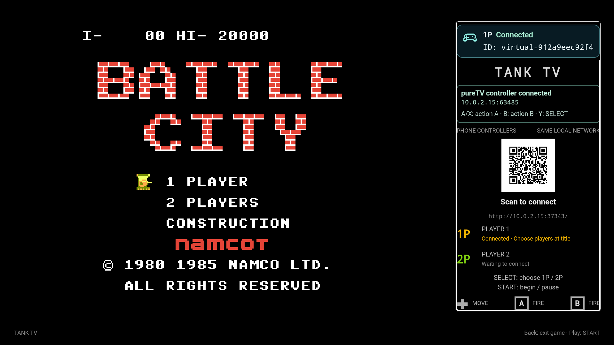
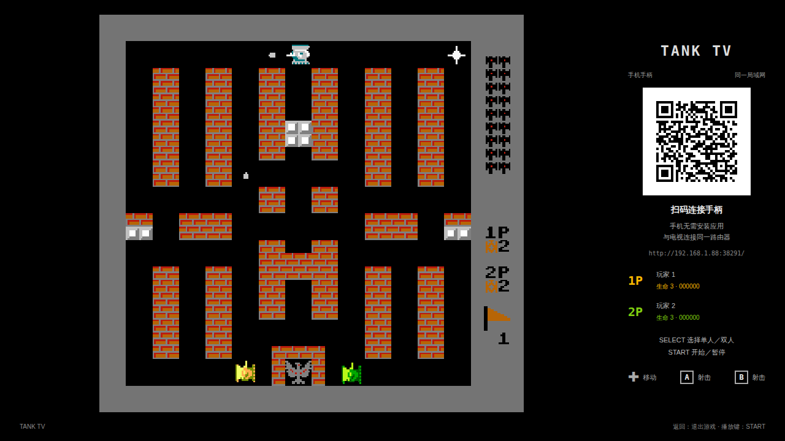
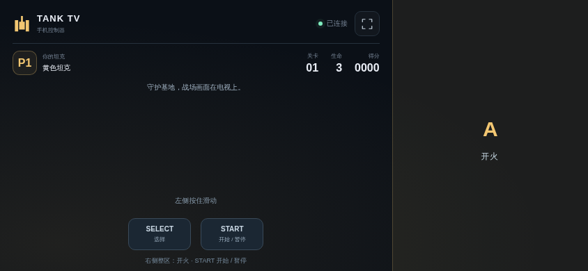
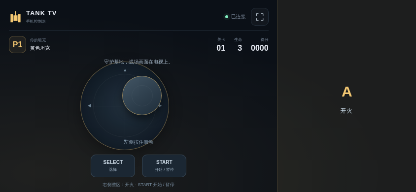

# Tank TV · 经典坦克大战

<!-- apk-resource:start -->
[Android 0.5.7 APK](../../../joystick-games/tank/tank-0.5.7.apk?raw=1) · [Windows x64](https://github.com/ecojust/pureTV/releases/download/gameplay-icons-2026.11.21/tank-windows-x64-setup.exe) · [macOS](https://github.com/ecojust/pureTV/releases/download/gameplay-icons-2026.11.21/tank-macos.dmg) · [图标与安装验证](docs/releases/0.5.7/android-icon-receipt.json) · [文件校验](SHA256SUMS.txt) · [0.5.6 实玩录像](docs/releases/0.5.6/gameplay.mp4?raw=1)
<!-- apk-resource:end -->

## 历史 Android 版本 0.5.6 · 手柄与手机连接

[下载签名 APK](tank-0.5.6.apk?raw=1) · [校验值](SHA256SUMS.txt) · [安装包与源码](resource.json)

在 720 × 480 电视上，二维码和两个玩家席位都能完整显示。可用键盘、pureTV Wi-Fi 手柄，或用同一局域网内的手机扫描电视房间二维码。连接标识区分玩家，连接与断开时保留游戏画布尺寸。[连接手柄指南](../../../docs/guide/README.md#安装游戏与连接手柄)

此签名 APK 已在 Android TV 模拟器完成从 0.5.4 到 0.5.5、再到 0.5.6 的两段同证书覆盖安装。原版手柄 SDK 通过 9 项检查，实际发出的 102 条消息全部收到同序号确认。[游戏截图](docs/releases/0.5.6/gameplay.png) · [Android 玩法录像](docs/releases/0.5.6/gameplay.mp4?raw=1) · [验证记录与测试范围](docs/releases/0.5.6/verification.json)

[中文](README.md) · [English](README.en.md)

<!-- controller-client-status:start -->
## 历史版本 0.5.4 · 手柄连接标识

<!-- previous-apk-resource:start -->
[下载签名 APK](tank-0.5.4.apk?raw=1) · [校验值](SHA256SUMS.txt) · [签名与来源](resource.json) · [源码](src/) · [图标](logo.svg)
<!-- previous-apk-resource:end -->

Android **0.5.4 / versionCode 11**：手柄连接后，侧边显示手柄图标、玩家席位（按游戏人数显示 1P/2P）和设备完整连接 ID；断开后隐藏。默认 TCP 端口仍为 **63485**。当前手柄固件未上报 RSSI，因此不显示信号强弱。

[连接截图](docs/releases/0.5.4/connected.png) · [连接状态专项录像](docs/releases/0.5.4/controller-status.mp4?raw=1) · [版本验证](docs/releases/0.5.4/verification.json) · [20 款更新记录](../../../docs/controller-client-status/README.md)

安装包沿用原发布证书。本轮在 Android TV 模拟器中验证连接身份、断开／重连状态及同证书覆盖安装；截图和录像记录菜单中的连接状态专项，没有重做完整玩法验收。未改规则模型按精确哈希复用历史依据，旧版报告继续保留。尚未验证实体电视、手机、ESP32 或带已有存档的升级与数据保留。


<!-- controller-client-status:end -->

当前版本为 **0.5.7**，独立重写 1985 年红白机《Battle City》的玩法、35 关地图与表现。安装后即可游玩，无须导入 ROM；包名保持不变。尚未完成电视实机和逐帧对照验证。

新版保留电视二维码与手机局域网双人手柄，使用 256×240 原生画面和 208×208 战场。游戏规则独立编写，不加载或运行 ROM。35 关地图、每关 20 辆敌人的顺序、四种敌军、六种道具、星级升级、双人统计与 Construction 均有来源对照；AI、部分碰撞和动画时序仍需进一步逐帧核对。详细依据与局限见[规则和关卡](docs/reference.md)、[图像与声音](docs/reference-art-audio.md)。

适用于 Android 8.0 及以上电视，包名 `com.ecojust.tanktv`。电视房间界面与手机手柄支持中英文，游戏内部保留原作英文菜单。

<!-- visual-release:start -->
## 历史：0.5.2 视觉更新与验证

以下保留 **0.5.2** 发布时的视觉更新、源码和验收记录；这些旧版结果不代表本轮 pureTV 手柄更新已经通过验收。当时沿用 0.5.0／0.5.1 的 pureTV 发布证书。逐款改动、检查范围和实机验证状态见[0.5.2 视觉更新记录](../../../docs/game-visuals-0.5.2.md)。

该次视觉更新只读核对 1985 年 FC/NES《Battle City》的视觉对应关系，保留已有像素战场；没有修改 Tank 渲染器。

具体还原范围见[参考说明](docs/reference.md)。

<!-- final-verification -->
当时冻结源码 0752b658aecbb1322cb7294e3176500639db1b54 已通过 Android CI 40843467072：280 项模型／渲染行为回归、36 个兼容场景、131 个手柄场景及 18 个双语集成场景；Cozy Island 输入运行时 9／9、两款 WebGL 1 渲染脚本及 Coast Kart 道具攻防专项也通过。Android 构建、lint、体积和 staging 成功，15 个模块实际执行 JUnit 任务（含全部 9 款游戏），不推断未输出的 JUnit 用例数。签名运行 40846148068 已核验九款 APK 的源码资源、签名与资源目录。Chrome 61 语法和现代 Chromium 旧 API 模拟不等于真实旧 WebView 验收；该历史版本当时未测试真实电视／手机、设备 FPS、覆盖安装和数据保留。
<!-- visual-release:end -->

## 历史：0.5.1 还原度升级

复核 35 关地图、波次和双人规则，保留整区开火手柄。

沿用 0.5.0 证书，可直接覆盖更新；0.5.1 的核对结果与剩余差距见[还原度复核](../../../docs/game-fidelity-0.5.1.md)。

## 安装与签名

历史 0.5.3 已沿用 0.5.0／0.5.1／0.5.2 的 pureTV 统一发布证书；当时已在 Android TV 模拟器成功从 0.5.2 执行 `adb install -r` 覆盖安装。该检查未预置存档，不代表已验证升级后存档或用户数据保留。使用旧证书的 0.4.x 及更早安装不能直接覆盖，请先备份可导出的数据再卸载；卸载会清除本机存档和记录，本项目没有跨证书自动迁移工具。

## 浮动摇杆与兼容性

手机手柄改为浮动摇杆：默认隐藏，在左侧操作区任意位置按下，该触点就是本次摇杆中心；向上下左右拖动控制坦克，松手立即停止并隐藏。下一次按下会重新确定中心，无须盯着固定圆盘。移动和 A/B 支持多指同时操作；触控取消、旋转屏幕、切到后台或断线时都会清空方向，避免持续移动。保留 0.3.0 对旧版电视 WebView 黑屏与玩家状态的修复。

## 历史：0.5.0 手柄升级

手机右侧三分之一屏幕为无空隙的动作区，任意位置点击均开火；选关时左侧摇杆也可双向增减关卡。左侧保留浮动摇杆，START、SELECT 在左侧底部独立放置。支持多指同时操作，触控取消、失焦或断线均释放输入；整页抑制文字选择、拖拽和长按菜单。

## 开始游玩

1. 安装应用并打开应用，将手机和电视连接到同一路由器。
2. 扫描电视右侧二维码，最多两部手机加入房间。
3. 用 **SELECT** 选择 1 PLAYER、2 PLAYERS 或 CONSTRUCTION，用 **START** 确认。
4. 首次选关画面可用摇杆增减关卡（键盘 A/B 仍可用），按 START 开始；游戏中 START 暂停／继续。

| 控件 | 功能 |
| --- | --- |
| 左侧触控区 | 任意位置按下确定摇杆中心，拖动移动及转向，松手停止并隐藏 |
| 右侧整区（A） | 任意位置按下射击；长按不自动连射 |
| SELECT | 菜单选择 |
| START | 开始、确认、暂停／继续 |
| 电视返回键 | 退出确认 |

保护基地，清除敌军。头盔、时钟、铲子、星星、手雷和坦克是地图中拾取的六种道具；B 不再提供自定义护盾。星级影响弹速、并发炮弹与破坏钢墙的能力。玩家炮弹也会摧毁基地，命中队友会暂时冻结队友。

以下图片保留 0.5.2 重写版本的历史画面，在 Chromium 中运行实际游戏页面，并使用模拟房间数据；不是电视实机截图。





摇杆默认隐藏；左侧按住滑动时，出现在本次触点位置：



## 局域网连接

房间由电视上的应用提供 HTTP 和 WebSocket 服务，监听启动时分配的端口。二维码包含当前电视地址、端口和随机房间令牌；每次启动应用以电视当前显示的二维码为准。手机控制请求不会发送到 pureTV 的云端服务器。

最多同时接入两名玩家。短暂断线会清空操作输入，手机恢复连接后尝试回到原来的玩家位置，避免坦克持续移动或开火。手机切到后台或锁屏时也会释放摇杆和按钮。按 Home 离开应用会关闭房间；确认退出游戏时，会关闭房间服务、断开所有手机连接、销毁游戏页面并结束本应用进程。再次打开会创建新房间。

扫码后无法连接时，先检查手机与电视是否在同一局域网，以及路由器是否启用了访客网络或 AP 隔离。二维码中的本地 HTTP 地址需要由能够访问局域网的手机浏览器打开；应用没有公网中转功能。

## 构建与验证

以下命令是可复现的检查入口，不表示本轮已经全部执行通过；本轮实际执行结果见上方验收记录。

从仓库根目录执行：

```bash
node --test resource/apps/tank/tests/game.test.cjs
npm ci --prefix desktop
cd desktop && npx playwright install chromium && cd ..
node resource/apps/tank/tests/compatibility.mjs
node resource/apps/tank/tests/controller.mjs
node resource/apps/tank/tests/capture.mjs
cd resource/launcher/puretv
./gradlew :tank:assembleDebug :tank:testDebugUnitTest :tank:lintDebug :tank:verifyReleaseSize
```

APK 输出在 `resource/apps/tank/build/outputs/apk/`。Release 开启代码与资源压缩，体积上限为 5 MiB；正式资源 APK 使用 pureTV 发布证书签名。Android 测试验证房间服务及生命周期，Node 测试验证游戏规则，浏览器测试验证手机触控。

设置 `TANK_UI_CAPTURE_DIR` 后运行 `tests/capture.mjs`，可导出中英文游戏页面预览。这些图片由随 APK 打包的真实页面在 Chromium 中渲染，原生桥接使用测试房间数据，不代表电视实机性能或真实手机网络时延。0.5.2 的历史构建记录保留于上文；本轮安装包验收结果见本轮验收记录，源码提交、APK 校验值及构建方式见 [resource.json](resource.json)；资源目录维护见[资源维护说明](../../../docs/resource-maintenance.md)。

## 素材与许可

应用独立实现使用 MIT 许可；参考图像和短音效的上游来源、许可记录与原作 Namco 署名见[图像与声音说明](docs/reference-art-audio.md)。本项目不将原作设计归为自己的创作，也不把应用代码的 MIT 许可扩展到所有第三方内容。

## pureTV Wi-Fi 手柄

电视和手柄加入同一局域网，打开游戏后按手柄搜索键（GPIO 23）。电视界面显示实际 TCP 地址和发现状态，默认端口 **63485**；仅启动时被占用才选择备用端口，一次运行期间保持不变。同网存在多个游戏服务时，请先关闭其他服务再搜索。

方向键移动和转向；**A/X** 或 **B** 每次按下射击，按住不自动连射；选关时 A/X 增加关卡，B 减少关卡。**Y（SELECT）** 切换菜单选项。**START** 开始、暂停／继续。支持两只 Wi-Fi 手柄分别占据两个玩家席位。扫码手机手柄和电视遥控器仍可使用。

断线或切换控制来源会暂停游戏，松开按键后重新按 START 继续；重连同步和原先按住的键不会自动触发动作。临时失焦时隔离输入并保留监听服务；按 Home 或切换应用仍会按原有流程退出游戏并关闭服务。

<!-- controller-client-status-history:start -->
<details>
<summary>历史 0.5.3 安装包与验收记录</summary>

以下为旧版发布记录，其测试与画面不代表本次连接 ID 界面验收。[原提交中的完整说明](https://github.com/ecojust/pureTV/blob/9af9f197855eb7a0ce7174c0e6295c8974b3250d/resource/apps/tank/README.md)。

[下载 APK](tank-0.5.3.apk?raw=1) · [校验值](docs/controller-status-baseline/0.5.3/SHA256SUMS.txt) · [签名及构建来源](docs/controller-status-baseline/0.5.3/resource.json) · [源码](src/) · [64×64 SVG 图标](logo.svg)

该历史版本 APK 已使用原 pureTV 发布证书正式签名，并通过从上一版本覆盖安装的验证；当时 Android 手柄验收结果见下方更新说明。若设备中存在使用旧证书的同包应用，Android 无法直接覆盖安装；需先备份数据并卸载旧包。

## 0.5.3 pureTV 手柄更新

历史版本为 **0.5.3 / versionCode 10**，新增 pureTV Wi-Fi 手柄输入，默认 TCP 端口 **63485**，保留扫码手机手柄和电视遥控器。正式签名 APK 已在 Android TV 模拟器完成 9/9 项手柄验收，并通过从上一版本执行 `adb install -r` 覆盖安装。未做带存档升级或数据保留验证。

实际结果和限制见[当时 20 款游戏验收记录](../../../docs/readme-controller-support/README.md)及[发布进度](../../../docs/readme-controller-support/rollout.json)。下文保留的旧版 CI、录像和截图均为历史依据。

该历史版本验收资源：[菜单截图](docs/releases/0.5.3/menu.png) · [实际 APK 运行录像](docs/releases/0.5.3/gameplay.mp4?raw=1) · [验证记录](docs/releases/0.5.3/verification.json)。截图和录像来自 Android TV 模拟器，未做实体电视测试。验收范围和具体结果见验证记录；模拟器结果不代表实体电视或带存档升级验证。

</details>
<!-- controller-client-status-history:end -->
