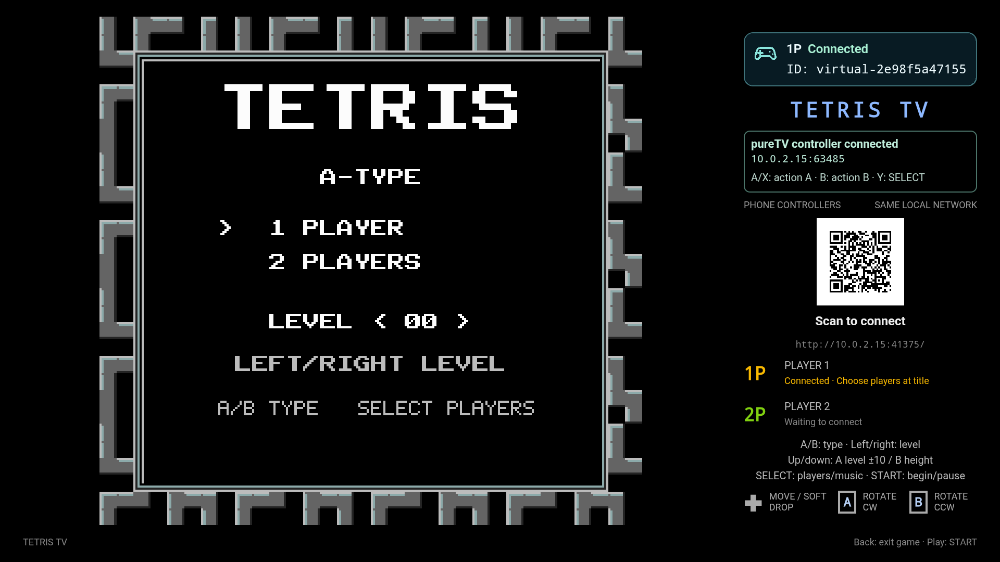
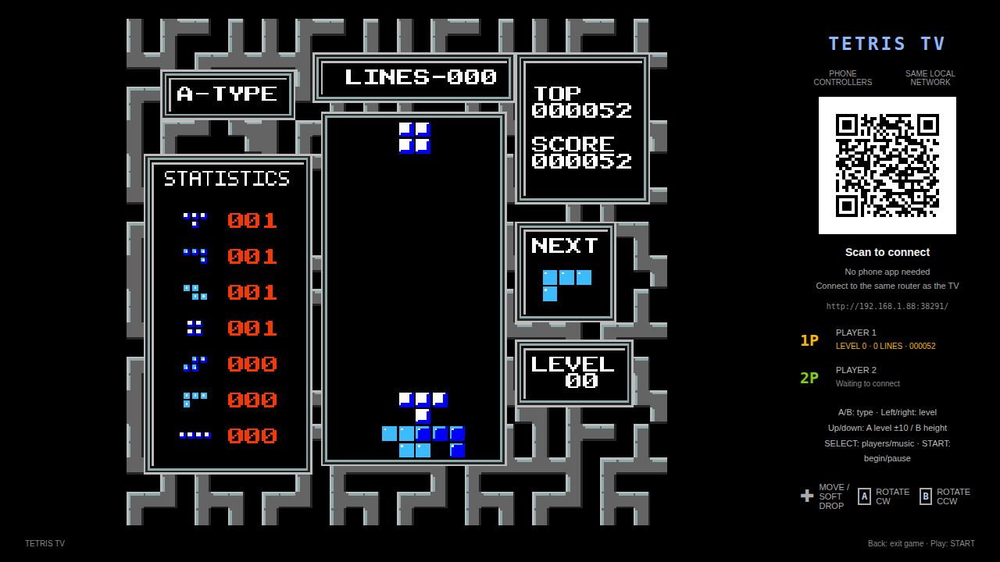
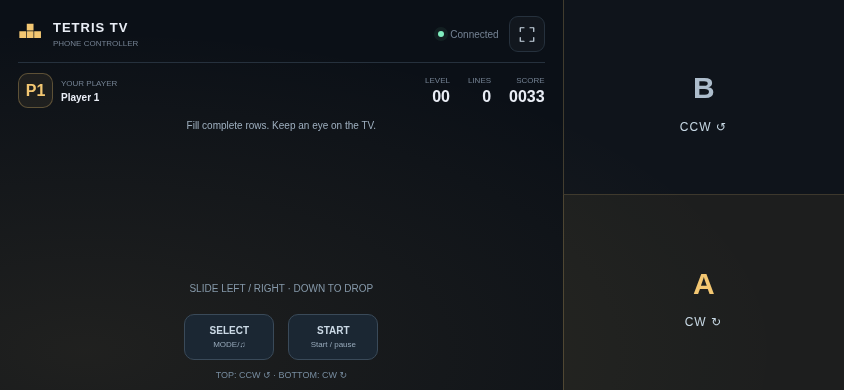
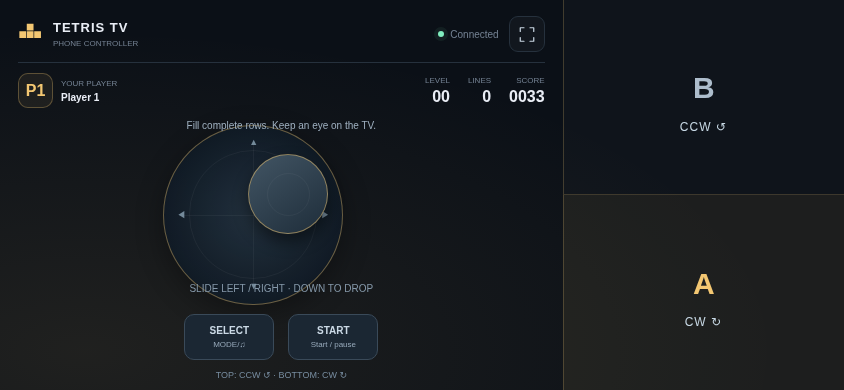

# Tetris TV

<!-- apk-resource:start -->
[Android 0.5.8 APK](tetris-0.5.8.apk?raw=1) · [Windows x64](https://github.com/ecojust/pureTV/releases/download/gameplay-icons-2026.11.21/tetris-windows-x64-setup.exe) · [macOS](https://github.com/ecojust/pureTV/releases/download/gameplay-icons-2026.11.21/tetris-macos.dmg) · [Launcher artwork and installation checks](docs/releases/0.5.8/android-icon-receipt.json) · [Checksums](SHA256SUMS.txt) · [0.5.7 gameplay video](docs/releases/0.5.7/gameplay.mp4?raw=1)
<!-- apk-resource:end -->

## Earlier Android release 0.5.7 · Controllers and phone pairing

[Download the signed APK](tetris-0.5.7.apk?raw=1) · [Checksums](SHA256SUMS.txt) · [Package and source](resource.json)

The phone room stays responsive if the first frame fails to draw. On 720 × 480 TVs, the QR code and both player seats fit inside the screen. Connect a keyboard, pair a pureTV Wi-Fi controller, or scan the TV room’s QR code with a phone on the same network. The connection indicator identifies each player while the game keeps its playing area at the same size. [Controller guide](../../docs/guide/README.en.md#install-a-game-and-connect-a-controller)

The signed APK upgraded 0.5.6 in place on an Android TV emulator. The verification record links each tested upgrade from the published 0.5.4 release. The original controller SDK completed 9 checks and received matching acknowledgements for 109 messages. [Gameplay screenshot](docs/releases/0.5.7/gameplay.png) · [Android gameplay recording](docs/releases/0.5.7/gameplay.mp4?raw=1) · [Verification and limitations](docs/releases/0.5.7/verification.json)

[中文](README.md) · [English](README.en.md)

<!-- controller-client-status:start -->
## Earlier release 0.5.4 · Connected controller identity

<!-- previous-apk-resource:start -->
[Download signed APK](tetris-0.5.4.apk?raw=1) · [Checksums](SHA256SUMS.txt) · [Signing and source](resource.json) · [Source](src/) · [Icon](logo.svg)
<!-- previous-apk-resource:end -->

Android **0.5.4 / versionCode 6** shows a controller icon, player seat (1P/2P where supported), and the connected device's complete ID in the side area. Disconnected devices disappear. The default TCP port remains **63485**. Current controller firmware does not report RSSI, so signal strength is not displayed.

[Connected screenshot](docs/releases/0.5.4/connected.png) · [Controller-status recording](docs/releases/0.5.4/controller-status.mp4?raw=1) · [Version verification](docs/releases/0.5.4/verification.json) · [Twenty-game update record](../../docs/controller-client-status/README.md)

The APK uses the existing release certificate. This update verifies connection identity, disconnect/reconnect status and in-place installation in an Android TV emulator; the capture and video show the menu status checks. It does not repeat full gameplay acceptance. Unchanged model evidence is reused by exact hash, with previous reports retained below. Physical TVs, phones, ESP32 devices and upgrades containing existing user saves remain untested.


<!-- controller-client-status:end -->

An independent recreation of classic NES falling-block play: a 10×20 well, seven tetrominoes, classic rotation, soft drop, line-clear scoring, increasing gravity and a NEXT preview.

Version **0.5.4** supports Android 8.0+ TVs. Package: `com.ecojust.tetristv`. The TV displays the board and room QR code, and phones scan it to become controllers. No ROM import is required.

<!-- visual-release:start -->
## Historical: 0.5.2 visual update and verification

The following preserves the **0.5.2** visual changes, source and verification records. These historical results do not verify the current pureTV controller update. That release retained the pureTV certificate used by 0.5.0/0.5.1. See the [0.5.2 visual update record](../../docs/game-visuals-0.5.2.md) for its per-game changes, verification scope and physical-device test status.

The gray maze background and classic single-player layout were redrawn for Nintendo NES Tetris: statistics on the left, field in the center, and score/NEXT/LEVEL on the right, with corresponding block styles and proportional scaling. The two-player extension retains separate fields; its top metadata no longer touches the frame. This is independent artwork, without a claim of pixel-exact reproduction.

See the [reference notes](docs/reference.md) for the implementation scope.

<!-- final-verification -->
The historical frozen source 0752b658aecbb1322cb7294e3176500639db1b54 passed Android CI 40843467072: 280 model/render-behavior regressions, 36 compatibility scenarios, 131 controller scenarios and 18 bilingual integration scenarios. Cozy Island input-runtime checks passed 9/9; both WebGL 1 rendering scripts and the Coast Kart combat suite also passed. Android builds, lint, size checks and staging succeeded; 15 modules executed JUnit tasks, including all 9 games, without an inferred JUnit case count. Signing run 40846148068 verified all nine APKs’ source assets, signatures and resource catalog. Chrome 61 syntax checks and old-API simulation in modern Chromium do not establish physical legacy-WebView compatibility. At that historical release, physical TV/phone acceptance, device FPS and in-place installation/data retention were untested.
<!-- visual-release:end -->

## Historical: 0.5.1 gameplay review

Corrects soft-drop timing, release/repress between pieces, shift/rotation ordering and line-clear animation cadence.

The historical 0.5.1 release used the same signing certificate as 0.5.0 and supported an in-place update. See the [fidelity review](../../docs/game-fidelity-0.5.1.md) for tested behavior and remaining differences.

## Installation and signing

Historical version 0.5.3 retained the shared pureTV certificate used by 0.5.0/0.5.1/0.5.2. An in-place `adb install -r` update from 0.5.2 succeeded on an Android TV emulator. This check did not seed existing saves and does not verify retention of saves or other user data. Installations of 0.4.x and earlier signed with the old certificate cannot be updated in place: back up exportable data before uninstalling. Uninstalling clears local saves and records; the project has no automatic cross-certificate migration.

## Play

1. Connect the phones and TV to the same local network and open the TV app.
2. Scan its QR code in a phone browser. For two players, each phone joins separately.
3. Press SELECT at the title to choose one or two players, then START. Both players must connect for two-player play.
4. The left joystick stays hidden until touched. Each initial touch sets its center; drag to control and release to stop and hide it. The entire right third of the screen accepts action touches. START/SELECT stay separate at the bottom left. Gameplay areas suppress text selection and long-press menus.

| Control | Action |
| --- | --- |
| Left floating stick | Move left/right; hold down for soft drop. At the title, left/right selects a level; up/down changes A-TYPE level by ten or selects B-TYPE obstacle height |
| Lower-right half A | Rotate clockwise; switch A-TYPE/B-TYPE at the title |
| Upper-right half B | Rotate counterclockwise; switch A-TYPE/B-TYPE at the title |
| SELECT | Choose one/two players at the title; toggle music during play or pause |
| START | Start, pause or resume |
| TV Back | Exit confirmation |

Uses classic rotation without wall kicks and the NES level/gravity curve. There is no modern HOLD, ghost piece or hard drop. A-TYPE starting levels 0–19 are selectable. B-TYPE adds a fixed-speed, 25-line challenge with levels 0–9 and initial obstacle heights 0–5. Both players receive identical obstacles; a completed player waits while the other continues. Two-player mode adds separate wells with the same piece sequence and independent scores, without garbage attacks.

High scores are stored on the TV. Moving from an old-certificate release to 0.5.0 requires uninstalling, which clears those records; there is no automatic migration.

## Historical screenshots (0.5.2)

These are captures of the actual game page rendered in Chromium with a simulated room connection, not physical-TV captures.







## Rooms and exit

Up to two phones connect directly to the local HTTP/WebSocket room. Its QR code includes a port and random room token for this launch, without a cloud relay. Backgrounding, interrupted touches and disconnections release controls. Losing an active player pauses the boards until they reconnect.

Pressing TV Home closes the room. Confirming exit closes ports and server threads, disconnects controllers, destroys the WebView and audio, and terminates the app process. Scan the new QR code after reopening.

## Build and verify

The commands below are reproducible check entry points, not a claim that all checks passed for this release. Current execution results are linked above.

```sh
# Repository root
node --test joystick-games/tetris/tests/*.test.cjs
node joystick-games/tetris/tests/controller.mjs
node joystick-games/tetris/tests/compatibility.mjs
node joystick-games/tetris/tests/capture.mjs

cd resource/launcher/puretv
./gradlew :tetris:assembleRelease :tetris:testDebugUnitTest :tetris:lintDebug :tetris:verifyReleaseSize
```

Browser tests require the desktop npm dependencies and Chromium, optionally selected with `CHROMIUM_PATH`. Gradle emits an unsigned release APK. The APK distributed in this directory is signed with the existing pureTV release certificate; signing and Android acceptance evidence are in the current verification record.

See [reference notes](docs/reference.md) for rule sources and implementation differences. Artwork, icons, effects and 8-bit music are independently created; no original ROM, extracted artwork or soundtrack recording is included. Project-authored code and assets use [MIT](LICENSE). Physical TV/phone and frame-by-frame comparisons remain unverified.

## pureTV Wi-Fi controller

Connect the TV and controller to the same LAN, open the game, then press the controller Search key (GPIO 23). The TV shows its actual TCP address and discovery state. Default port: **63485**; a fallback is chosen only if that port is already occupied. The port stays fixed while the app runs. With multiple game services on the network, close the others before searching.

Left/right moves the piece and Down soft-drops. **A/X** rotates clockwise; **B** rotates counterclockwise. Both switch A-TYPE/B-TYPE at the title. **Y (SELECT)** changes the player count at the title and toggles music during play or pause. **START** begins, pauses or resumes. Two Wi-Fi controllers can occupy the two player seats. Phone QR controllers and TV remote controls remain available.

Disconnecting or switching controller sources pauses gameplay. Release held keys, then press START again; reconnecting or synchronizing held buttons does not perform an action. Temporary focus loss retains the listener while isolating game input. Home or switching apps still exits the game and closes services through the existing exit flow.

<!-- controller-client-status-history:start -->
<details>
<summary>Historical 0.5.3 download and acceptance record</summary>

The following describes the previous release; its tests and media do not validate the new controller-ID UI. [Original README at the previous source](https://github.com/ecojust/pureTV/blob/9af9f197855eb7a0ce7174c0e6295c8974b3250d/resource/apps/tetris/README.en.md).

[Download APK](tetris-0.5.3.apk?raw=1) · [Checksums](docs/controller-status-baseline/0.5.3/SHA256SUMS.txt) · [Signing and build provenance](docs/controller-status-baseline/0.5.3/resource.json) · [Source code](src/) · [64×64 SVG icon](logo.svg)

This APK is signed with the existing pureTV release certificate and has passed an in-place update from the previous version. See the controller update for that historical version’s Android controller acceptance results. Android cannot update an existing installation of the same package if it uses a different signing certificate. Back up its data and uninstall the old package first.

## 0.5.3 pureTV controller update

Version **0.5.3 / versionCode 5** adds pureTV Wi-Fi controller input on default TCP port **63485**, while retaining phone QR and TV remote controls. The signed APK passed all 9/9 controller checks on an Android TV emulator and an in-place `adb install -r` update from the previous version. Upgrading with pre-existing saves and retaining user data were not tested.

See the [historical twenty-game acceptance record](../../docs/readme-controller-support/README.md) and [rollout status](../../docs/readme-controller-support/rollout.json) for actual results and limitations. Earlier CI reports, videos and screenshots below remain historical evidence.

That historical version’s acceptance resources: [menu screenshot](docs/releases/0.5.3/menu.png) · [actual APK recording](docs/releases/0.5.3/gameplay.mp4?raw=1) · [verification record](docs/releases/0.5.3/verification.json). Images and recordings come from an Android TV emulator; no physical television has been tested. The verification record gives the exact acceptance scope and results; emulator checks do not establish physical-TV compatibility or save-data retention during an upgrade.

</details>
<!-- controller-client-status-history:end -->
