# pureTV 手柄游戏候选清单

[浏览全量目录（3,888 款正式游戏）](./catalog/README.md) · [合集另列的 495 款游戏](./catalog/additional.md) · [完整 Excel 核对表](./game-audit.xlsx)

上版把代码许可有依据的 **609 款**放进这张表。其余 **3,279 款**中，**3,155 款**的许可需要复核，**103 款**有明确授权限制且使用范围待核，另有 **21 条**已发布版本、同源副本或改版。现在正式目录的每一款都能在 GitHub 按名称和仓库查到，其中 **3,867 款可勾选**，21 条保留作版本对照。可以先勾选感兴趣的游戏，再核对移植条件。

| 想查看的游戏 | 款数 | 浏览入口 |
| --- | ---: | --- |
| 原表已列，代码许可有依据 | 609 | [逐款详查](#reviewed) · [其他有截图分](#scored) · [尚无截图分](#unscored) |
| 尚未确认代码许可 | 2,982 | [按游戏名称首字浏览](./catalog/README.md#by-name) |
| 有许可声明或文件，需核对条款 | 173 | [README 或包清单有声明（106 款）](./catalog/license-declared.md) · [有原文待判读（67 款）](./catalog/license-review.md) |
| 有明确授权限制，使用范围待核 | 103 | [逐款查看限制](./catalog/rights.md) |
| 已发布或与已发布版本同源 | 21 | [17 款已发布、3 个同源副本、1 个改版](./catalog/released.md) |

4,383 个游戏条目共用一套序号，可直接回复序号挑选。已有 1,514 款提供可点开的画面，涵盖上游截图、演示截帧和浏览器实截。另有 2,869 款标为“待补截图”。截图分沿用原合集。

在清单中将对应的 `[ ]` 改为 `[x]`，也可以直接回复游戏名和仓库。以下保留原表的 609 款，其中 224 款有来源截图分，385 款画面待评。

## 逐款挑选

原清单 9 款，新增详查 18 款。截图分沿用合集的画面评估。下表缩略图用于预览，工作簿保留评分所用的原图。操作信息来自上游说明和代码。试玩列区分网页、下载、本地启动和演示。电视帧率、菜单导航与手柄手感均待实测。

| 序号 | 确认 | 游戏 | 截图
 | 玩法与操作 | 上游仓库与许可证 | 试玩或演示 |
| ---: | --- | --- | --- | --- | --- | --- |
| 1 | [x] | **Nerd of Duty** · 原候选 · 9.4/10 | 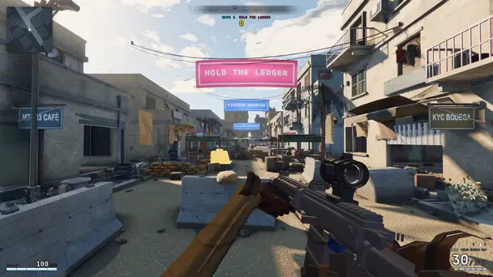 [精选画面](<https://github.com/sytaylor/nerd-of-duty/blob/1bd18d4e0c4c5116ffc3ae229bd0261cbd744148/docs/hero.png>) | 街区防守 FPS。街道两侧的阳台、招牌和路障构成射击掩体，远处的金色纪念碑是防守目标。 原版用键鼠移动和瞄准，电视端需补双摇杆操作。 | [sytaylor/nerd-of-duty](https://github.com/sytaylor/nerd-of-duty) [MIT](https://github.com/sytaylor/nerd-of-duty/blob/1bd18d4e0c4c5116ffc3ae229bd0261cbd744148/LICENSE) | [在线试玩](https://nerd-of-duty.vercel.app) |
| 2 | [ ] | **VECTOR RUSH** · 原候选 · 9.3/10 | 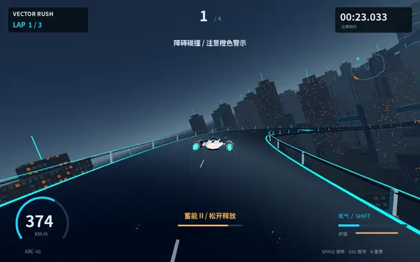 [精选画面](<https://github.com/ToBeWin/vector-rush/blob/21afd7b2ff3708253c9306e1798008473a2c8018/docs/media/harbor.png>) | 反重力竞速。沿霓虹海港的高架磁轨飞驰，在倾斜弯道漂移蓄能，再加速出弯。 比赛已有转向、漂移和氮气的手柄映射。菜单仍需键鼠。 | [ToBeWin/vector-rush](https://github.com/ToBeWin/vector-rush) [MIT](https://github.com/ToBeWin/vector-rush/blob/21afd7b2ff3708253c9306e1798008473a2c8018/LICENSE)（代码），字体 OFL | [实机动图](https://github.com/ToBeWin/vector-rush/blob/21afd7b2ff3708253c9306e1798008473a2c8018/docs/media/gameplay.gif) [下载 Web / Mac 版](https://github.com/ToBeWin/vector-rush/releases/tag/v1.0.0) |
| 3 | [ ] | **Iridium Reach** · 新增 · 9.0/10 | 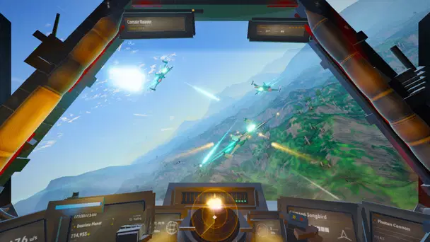 [精选画面](<https://github.com/jason-c-dev/iridium-reach-demo/blob/ae07db6afc38762c60784a492c331cff314584fc/screenshots/low-altitude-combat.png>) | 在太空和行星近地上空驾驶战机。方向键俯仰与偏航，W/S 控制推力和刹车，鼠标也可转向、射击。 | [jason-c-dev/iridium-reach-demo](https://github.com/jason-c-dev/iridium-reach-demo) [MIT](https://github.com/jason-c-dev/iridium-reach-demo/blob/ae07db6afc38762c60784a492c331cff314584fc/LICENSE) 飞船电脑语音另依 ElevenLabs 条款。 | [上游试玩入口](https://jason-c-dev.github.io/iridium-reach-demo/) |
| 4 | [ ] | **World of ClaudeCraft** · 新增 · 9.0/10 | 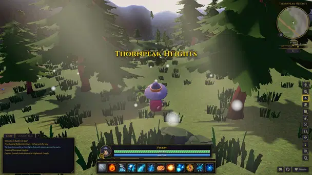 [精选画面](<https://github.com/levy-street/world-of-claudecraft/blob/d2b91e0884cb269422c28d0b42d2a30a01de130a/docs/screenshots/weather-peaks_snow.jpg>) | 在线角色扮演。可以组队做任务、采集和打团本。键鼠控制移动、视角和技能栏，手机有虚拟摇杆；电视需处理目标切换和多排技能。 | [levy-street/world-of-claudecraft](https://github.com/levy-street/world-of-claudecraft) [MIT](https://github.com/levy-street/world-of-claudecraft/blob/d2b91e0884cb269422c28d0b42d2a30a01de130a/LICENSE) 仅代码。部分技能图标、商店美术和录音须替换或另获许可，部分音效限非商业使用，名称和标志未授权。[素材明细](https://github.com/levy-street/world-of-claudecraft/blob/d2b91e0884cb269422c28d0b42d2a30a01de130a/CREDITS.md) | [上游试玩入口](https://worldofclaudecraft.com/) |
| 5 | [ ] | **Little Flock · 小羊慢慢** · 原候选 · 8.7/10 | 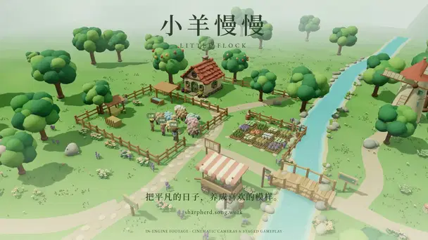 [精选画面](<https://github.com/songkeys/little-flock/blob/eaaa56184ad8f1b513ae81960075846663803886/docs/demo-poster.jpg>) | 合作牧场。柔和的低多边形山谷里分布着羊圈、菜地和溪流，可以和朋友一起放牧、扩建农场。 原版支持键鼠和触屏摇杆。多人房间、存档均依赖 Go 服务端。 | [songkeys/little-flock](https://github.com/songkeys/little-flock) [MIT](https://github.com/songkeys/little-flock/blob/eaaa56184ad8f1b513ae81960075846663803886/LICENSE)（代码），[CC BY 4.0](https://github.com/songkeys/little-flock/blob/eaaa56184ad8f1b513ae81960075846663803886/ASSETS.md)（美术、木屋模型与演示，须署名），字体 OFL | [在线试玩](https://sharpherd.song.work/)（需账号） [先看演示](https://github.com/songkeys/little-flock/blob/eaaa56184ad8f1b513ae81960075846663803886/docs/demo.mp4) |
| 6 | [ ] | **Tater's Flight Sim** · 原候选 · 8.2/10 | 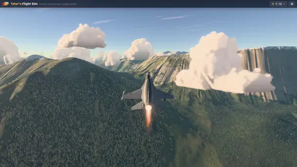 [精选画面](<https://github.com/JaredTate/tatertotsflightsim/blob/61ad8f7a611c5ea870e5604e4e37a97956fbbb57/docs/screenshots/f16-afterburner-mountains.jpg>) | 3D 飞行模拟。可从座舱观察仪表，也能切到机外，看机翼掠过森林和连绵山脊。 原版支持标准手柄操纵飞机。 | [JaredTate/tatertotsflightsim](https://github.com/JaredTate/tatertotsflightsim) [MIT](https://github.com/JaredTate/tatertotsflightsim/blob/61ad8f7a611c5ea870e5604e4e37a97956fbbb57/LICENSE) | 未找到在线试玩 [本地运行说明](https://github.com/JaredTate/tatertotsflightsim#readme) |
| 7 | [ ] | **Emberwake** · 原候选 · 8.0/10 | 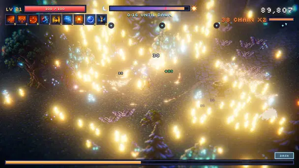 [精选画面](<https://github.com/mogita/emberwake/blob/46ebdb8574c2a87d9fcc8e2eddd77e1bfb91a0a5/docs/gameplay.jpg>) | 像素生存。角色提灯穿过夜色中的怪群，火盆和金色弹幕照亮林地。每局坚持五分钟，直到天亮。 原版支持手柄移动与冲刺，提灯自动攻击。 | [mogita/emberwake](https://github.com/mogita/emberwake) [MIT](https://github.com/mogita/emberwake/blob/46ebdb8574c2a87d9fcc8e2eddd77e1bfb91a0a5/LICENSE) | [在线试玩](https://emberwake.mogita.rocks) |
| 8 | [ ] | **Gravewake** · 新增 · 8.0/10 | 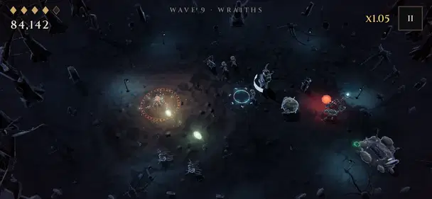 [精选画面](<https://github.com/LioraLabs/gravewake/blob/e0ebab1e7f948570d10b74d1750dfdb344eea2dc/docs/media/fight.webp>) | 在墓地用法术抵挡亡灵，波次之间选择强化。手机用左右虚拟摇杆分别行走和瞄准施法，桌面用 WASD 和鼠标；实体手柄待核。 | [LioraLabs/gravewake](https://github.com/LioraLabs/gravewake) [MIT](https://github.com/LioraLabs/gravewake/blob/e0ebab1e7f948570d10b74d1750dfdb344eea2dc/LICENSE) Cinzel 字体为 OFL。 | [itch.io 试玩页（曾遇限流，复核可达）](https://shiny-guru.itch.io/gravewake) [本地运行说明](https://github.com/LioraLabs/gravewake/blob/e0ebab1e7f948570d10b74d1750dfdb344eea2dc/README.md) |
| 9 | [ ] | **KAIJU DOKAN!** · 原候选 · 8.0/10 | 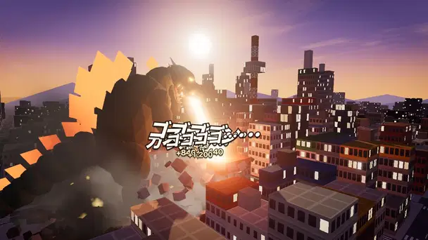 [精选画面](<https://github.com/tanuu5/kaiju-dokan/blob/90815e4fb737f9d26c02b8e9db4ac41ebca316d7/docs/images/breath.jpg>) | 怪兽动作。黄昏海湾里，高楼会从受击楼层折断，撞倒邻楼。熔岩吐息能沿街扫过整排建筑。 原版支持双摇杆，菜单也能用手柄操作。 | [tanuu5/kaiju-dokan](https://github.com/tanuu5/kaiju-dokan) [MIT](https://github.com/tanuu5/kaiju-dokan/blob/90815e4fb737f9d26c02b8e9db4ac41ebca316d7/LICENSE) | [在线试玩](https://tanuu5.github.io/kaiju-dokan/) |
| 10 | [ ] | **OUT OF THE BOX** · 原候选 · 8.0/10 | 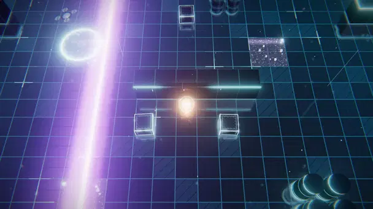 [精选画面](<https://github.com/tanuu5/out-of-the-box/blob/e0084f0ea050209f33d204ebd46328d28b3845fa/docs/screenshots/lab.jpg>) | 俯视角 3D 潜行。穿过成排机柜，利用阴影避开摄像头的视野锥、巡逻无人机和激光门。 原版支持手柄移动。镜头、交互和菜单需要逐项核对。 | [tanuu5/out-of-the-box](https://github.com/tanuu5/out-of-the-box) [MIT](https://github.com/tanuu5/out-of-the-box/blob/e0084f0ea050209f33d204ebd46328d28b3845fa/LICENSE)（代码），字体 OFL | [在线试玩](https://tanuu5.github.io/out-of-the-box/) |
| 11 | [ ] | **Rift Chess** · 原候选 · 7.9/10 | 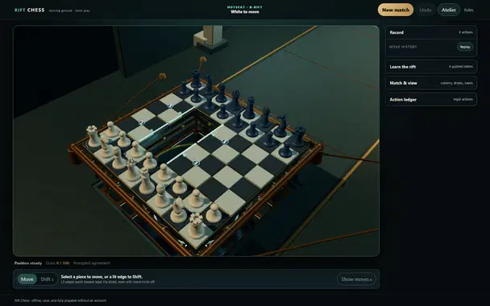 [精选画面](<https://github.com/HaileyStorm/rift-chess/blob/33e3e8dc58b77146331d4598b8274d92452c7e03/docs/evidence/overhaul/gallery.png>) | 3D 棋盘解谜式对弈。除了走棋，还能滑动整块棋盘来改写攻防路线。发光的格边标出可移动的板块。 原版可用方向键选格、回车落子，支持同屏轮流对弈。 | [HaileyStorm/rift-chess](https://github.com/HaileyStorm/rift-chess) [MIT](https://github.com/HaileyStorm/rift-chess/blob/33e3e8dc58b77146331d4598b8274d92452c7e03/LICENSE) | [在线试玩](https://haileystorm.github.io/rift-chess/) |
| 12 | [ ] | **Sunward** · 新增 · 7.8/10 | 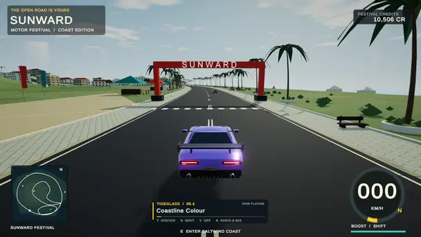 [精选画面](<https://github.com/yjrocks712/Sunward-by-GPT-6-Astra/blob/e4356b88560f0d39a0647a6abd9e59ca2036ac97/docs/images/driving.png>) | 开放世界街机赛车。用方向键驾驶、空格漂移、Shift 加速，也可进车库调校赛车。上游发布 Apple Silicon Mac 版和 Unity 源码。 | [yjrocks712/Sunward-by-GPT-6-Astra](https://github.com/yjrocks712/Sunward-by-GPT-6-Astra) [MIT](https://github.com/yjrocks712/Sunward-by-GPT-6-Astra/blob/e4356b88560f0d39a0647a6abd9e59ca2036ac97/LICENSE) 原项目素材及代码。Unity、字体和依赖见[第三方声明](https://github.com/yjrocks712/Sunward-by-GPT-6-Astra/blob/e4356b88560f0d39a0647a6abd9e59ca2036ac97/THIRD_PARTY_NOTICES.md)。 | [Mac 版发布页](https://github.com/yjrocks712/Sunward-by-GPT-6-Astra/releases/tag/v0.1.0) |
| 13 | [ ] | **Last Courier** · 原候选 · 7.7/10 | 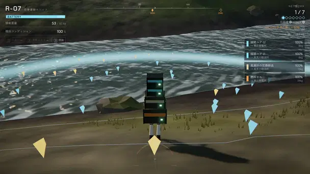 [精选画面](<https://github.com/tanuu5/last-courier/blob/b0fec7887d0b68a3d1f765ee6b251109c25a4910/docs/screenshots/scan.jpg>) | 3D 配送冒险。机器人背着层叠的货箱穿越河谷，用扫描光圈探路、用梯子搭桥，七个站点逐步连通。 原版有完整手柄键位，包含行走、平衡货物和架设工具。 | [tanuu5/last-courier](https://github.com/tanuu5/last-courier) [MIT](https://github.com/tanuu5/last-courier/blob/b0fec7887d0b68a3d1f765ee6b251109c25a4910/LICENSE)（代码），字体 OFL | [在线试玩](https://tanuu5.github.io/last-courier/) |
| 14 | [ ] | **Survive Coders** · 新增 · 7.7/10 | 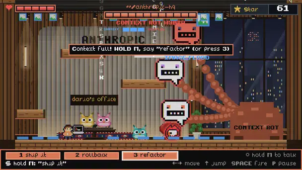 [精选画面](<https://github.com/travisstephenfraser/survive-coders/blob/1ebffbf0079989ebd1333766f38b682b880fc58e/docs/screenshots/09-boss-context-overflow.png>) | 16 位风格横版动作。穿越旧金山，沿途跳跃、射击，最后挑战九头蛇。键盘可改键，手机有方向及动作键，语音技能也能用按键发动。 | [travisstephenfraser/survive-coders](https://github.com/travisstephenfraser/survive-coders) [Apache-2.0](https://github.com/travisstephenfraser/survive-coders/blob/ff8bbdb5c7bf55bc9d2fd4c852ad7c5d3a0d979e/LICENSE) 上游自制代码、美术与音乐适用 Apache-2.0，第三方素材包为 CC0。 | [上游试玩入口](https://survive-coders.vercel.app) |
| 15 | [ ] | **Donify** · 新增 · 7.5/10 | 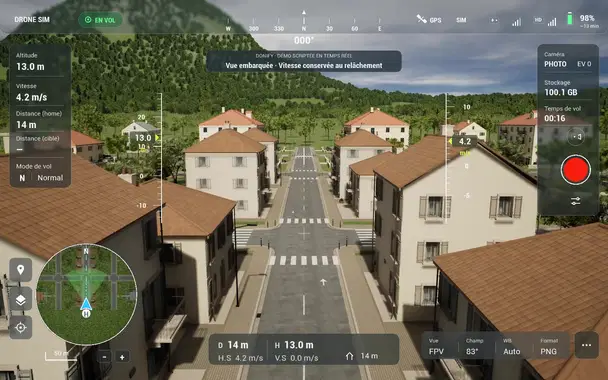 [精选画面](<https://github.com/w4coder/donify/blob/dd209975ead00468fc993948e0d60398ec578381/docs/media/gameplay-preview.jpg>) | 在阿尔卑斯村庄操控四旋翼飞行器，可手动驾驶或执行航点任务。上游提供 Xbox 手柄映射，当前运行环境为 Linux、Unreal Engine 和 Vulkan。 | [w4coder/donify](https://github.com/w4coder/donify) [MIT](https://github.com/w4coder/donify/blob/dd209975ead00468fc993948e0d60398ec578381/LICENSE) 仅上游代码与文档，Unreal Engine 和素材另见[第三方声明](https://github.com/w4coder/donify/blob/dd209975ead00468fc993948e0d60398ec578381/THIRD_PARTY_NOTICES.md)。 | [实机演示（本次访问未确认）](https://www.youtube.com/watch?v=UHJMg_nACbE) |
| 16 | [ ] | **Neon Bay** · 新增 · 7.4/10 | 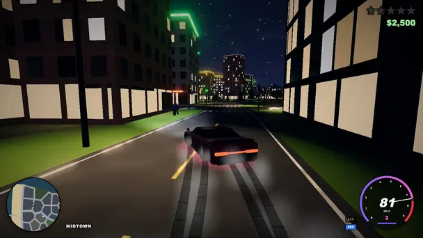 [精选画面](<https://github.com/L1vsun/NEONBAY/blob/baac38fecd1698c67dcf75ccffb1a82592798e9c/screenshots/drift.jpg>) | 从七辆车中选择一辆，穿过海滨城市的桥梁、海滩和地下车库。方向键或 WASD 驾驶，上游明确只支持键盘，需增加手柄转向和油门。 | [L1vsun/NEONBAY](https://github.com/L1vsun/NEONBAY) [MIT](https://github.com/L1vsun/NEONBAY/blob/baac38fecd1698c67dcf75ccffb1a82592798e9c/LICENSE) 随仓库提供的 Three.js 也为 MIT。 | [上游试玩入口](https://l1vsun.github.io/NEONBAY/) |
| 17 | [ ] | **Novaki: Strike Twice** · 新增 · 7.4/10 | 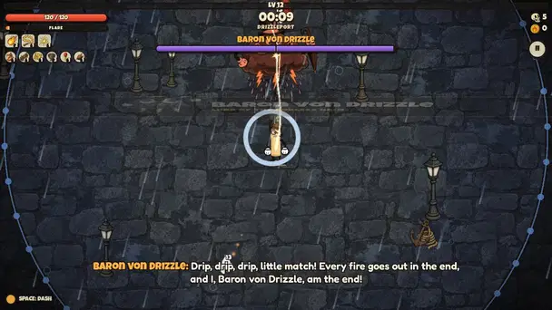 [精选画面](<https://github.com/novaki-ai/strike-twice/blob/fc97c4d5de409eebf0c36e2417fcf8eb2b04248f/docs/test-06/boss.jpg>) | 操控卡通火柴人，在俯视角战场升级并挑战三个首领。上游明确列出实体手柄、键盘和触屏摇杆。 | [novaki-ai/strike-twice](https://github.com/novaki-ai/strike-twice) [MIT](https://github.com/novaki-ai/strike-twice/blob/fc97c4d5de409eebf0c36e2417fcf8eb2b04248f/LICENSE) 代码；图像、配音与音乐为 [CC BY 4.0](https://github.com/novaki-ai/strike-twice/blob/fc97c4d5de409eebf0c36e2417fcf8eb2b04248f/LICENSE-ASSETS)，须署名。 | [本地运行说明](https://github.com/novaki-ai/strike-twice/blob/fc97c4d5de409eebf0c36e2417fcf8eb2b04248f/README.md) |
| 18 | [ ] | **Beyond Boring: Death March** · 新增 · 7.2/10 | 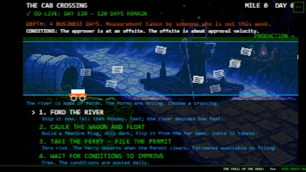 [精选画面](<https://github.com/kolatts/beyond-boring-death-march/blob/8eb13656b7a058a3d5a9f4b4c3addca64936ab97/docs/screenshots/cab-crossing.png>) | 旅行队在软件开发主题的旅途中分配资源、做选择，并应对小挑战。上游说明全程可用方向键和回车操作，Esc 返回。 | [kolatts/beyond-boring-death-march](https://github.com/kolatts/beyond-boring-death-march) [MIT](https://github.com/kolatts/beyond-boring-death-march/blob/8eb13656b7a058a3d5a9f4b4c3addca64936ab97/LICENSE)  | [原试玩入口（HTTP 404）](https://kolatts.github.io/beyond-boring-death-march/) [本地运行说明](https://github.com/kolatts/beyond-boring-death-march/blob/8eb13656b7a058a3d5a9f4b4c3addca64936ab97/README.md) |
| 19 | [ ] | **Heart of the Light** · 新增 · 7.2/10 | 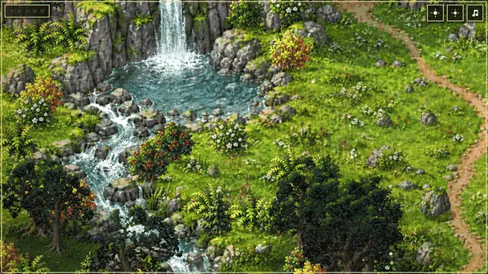 [精选画面](<https://github.com/LegoFighter/heart-of-the-light/blob/aac6f6cbcefba060483c78593c79c1d3f3950985/docs/glade-day.png>) | 提灯在像素林地探索，收集五团光并带回山洞。方向键或 WASD 行走，H 提示最近的目标。支持触屏指向移动。 | [LegoFighter/heart-of-the-light](https://github.com/LegoFighter/heart-of-the-light) [MIT](https://github.com/LegoFighter/heart-of-the-light/blob/aac6f6cbcefba060483c78593c79c1d3f3950985/LICENSE) 字体和库另见[第三方声明](https://github.com/LegoFighter/heart-of-the-light/blob/aac6f6cbcefba060483c78593c79c1d3f3950985/public/licenses.txt)。 | [在线试玩](https://minigames.world/play/heart-of-the-light) |
| 20 | [ ] | **Hoard Hopper** · 新增 · 7.2/10 | 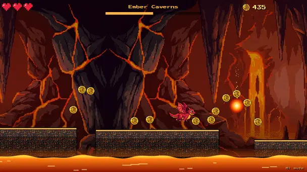 [精选画面](<https://github.com/zeveck/hoardhopper/blob/24a6b2333bfb1357b963f0f17ffe59fb3573733e/media/screenshots/ember-caverns.png>) | 操控小龙穿越四个卷轴洞穴，躲避熔岩、收集财宝。左右键移动，跳跃后再按一次可振翅，手机提供屏幕按钮，适合映射到方向键和单个动作键。 | [zeveck/hoardhopper](https://github.com/zeveck/hoardhopper) [MIT](https://github.com/zeveck/hoardhopper/blob/24a6b2333bfb1357b963f0f17ffe59fb3573733e/LICENSE) 仓库许可证；音乐和音效的生成来源见上游 README。 | [上游试玩入口](https://hoardhopper.synapticnoise.com) |
| 21 | [ ] | **Sakura Rally** · 新增 · 7.1/10 | 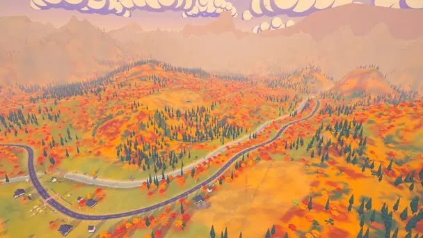 [精选画面](<https://github.com/SummerEngine/sakura-rally/blob/72b0443210888eca53b621d86a653d2de303dfb5/docs/renders/momiji_aerial.jpg>) | 从春日山口驶入秋色山谷，参加计时赛或与对手竞速。已有手柄键位：左摇杆转向、RT 加速、LT 刹车、A 拉手刹。 | [SummerEngine/sakura-rally](https://github.com/SummerEngine/sakura-rally) [MIT](https://github.com/SummerEngine/sakura-rally/blob/4c2da60c79922a2028752221225577f504aeca46/LICENSE) 代码与美术；字体 OFL 1.1，音乐与环境声另见[音频说明](https://github.com/SummerEngine/sakura-rally/blob/4c2da60c79922a2028752221225577f504aeca46/docs/AUDIO.md)。 | [Godot 本地运行说明](https://github.com/SummerEngine/sakura-rally/blob/4c2da60c79922a2028752221225577f504aeca46/README.md) |
| 22 | [ ] | **CarRace** · 新增 · 7.0/10 | 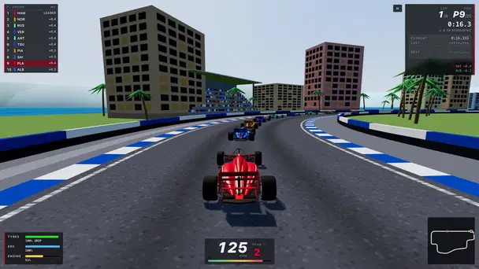 [精选画面](<https://github.com/alexander-uspenskiy/CarRace/blob/8cc3f2b7dee27e13b848fc48afd73acb6ab58e19/docs/images/05-race-chase.jpg>) | 浏览器方程式赛车。标准手柄的左摇杆控制转向，RT/LT 控制油门和刹车，A 加速，X 拉手刹。 | [alexander-uspenskiy/CarRace](https://github.com/alexander-uspenskiy/CarRace) [MIT](https://github.com/alexander-uspenskiy/CarRace/blob/8cc3f2b7dee27e13b848fc48afd73acb6ab58e19/LICENSE) Three.js 同为 MIT。车队及车手名称为描述性使用。 | [上游试玩入口](https://alexander-uspenskiy.github.io/CarRace/) |
| 23 | [ ] | **Witchspace** · 新增 · 6.8/10 | 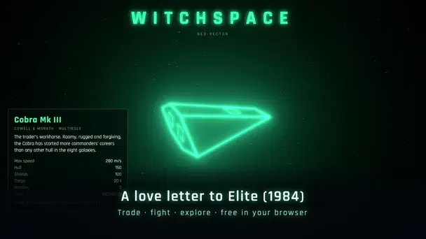 [精选画面](<https://github.com/witchspace-game/witchspace/blob/18b6210becffbcec5724d788ef38ff0369a9493d/public/media/trailer-poster.jpg>) | 在程序生成的星系间做贸易、采矿和接赏金。手柄左摇杆俯仰与翻滚，右摇杆偏航，扳机调速，A 键起航或启动停靠程序。 | [witchspace-game/witchspace](https://github.com/witchspace-game/witchspace) [GPL-3.0](https://github.com/witchspace-game/witchspace/blob/18b6210becffbcec5724d788ef38ff0369a9493d/LICENSE) 代码；内容为 [CC BY-SA 4.0](https://github.com/witchspace-game/witchspace/blob/18b6210becffbcec5724d788ef38ff0369a9493d/CONTENT_LICENSE.txt)。 | [在线试玩](https://witchspace.org.uk/play/) |
| 24 | [ ] | **Desi Dash** · 新增 · 6.6/10 | 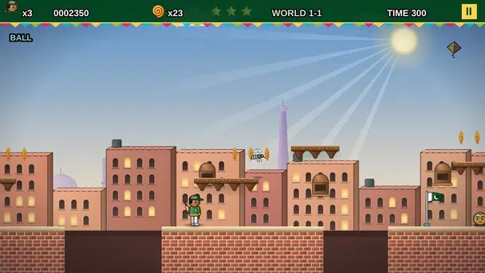 [精选画面](<https://github.com/mezeezain/desi-dash/blob/02ab1282afb5b1aabbd3fea8b3de13a1d3fb8c36/docs/level-1-1.jpg>) | 从拉合尔跑到卡拉奇和沙漠，踏过敌人、寻找风筝碎片。上游提供手柄操作表，可用十字键或左摇杆移动。 | [mezeezain/desi-dash](https://github.com/mezeezain/desi-dash) [MIT](https://github.com/mezeezain/desi-dash/blob/02ab1282afb5b1aabbd3fea8b3de13a1d3fb8c36/LICENSE) 代码和 Phaser 为 MIT。 | [上游试玩入口](https://mezeezain.github.io/desi-dash/) |
| 25 | [x] | **Kaboom Arena** · 新增 · 6.6/10 | 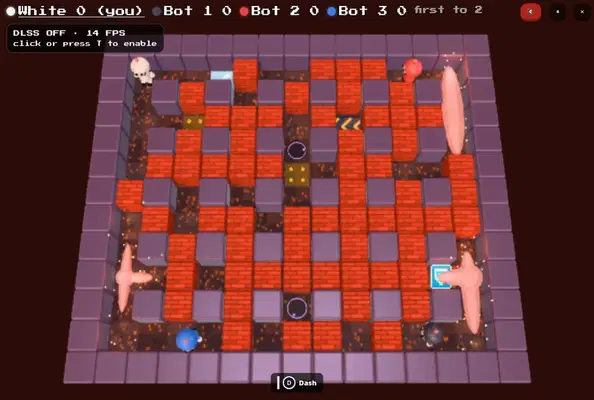 [精选画面](<https://github.com/janroudaut/kaboom-arena/blob/b9191f6f045e4153ec238a47969a21621a940713/docs/screenshots/gameplay-3d.webp>) | 在格子竞技场炸开墙、抢道具并击败对手。支持同屏和联机，手柄十字键或左摇杆移动、按键放炸弹，联机另需服务器。 | [janroudaut/kaboom-arena](https://github.com/janroudaut/kaboom-arena) [WTFPL-2.0](https://github.com/janroudaut/kaboom-arena/blob/b9191f6f045e4153ec238a47969a21621a940713/LICENSE) Three.js 为 MIT，上游说明画面与声音由代码生成。 | [上游试玩入口](https://kaboom.philament.club) |
| 26 | [ ] | **Rink Rat Mayhem** · 新增 · 6.6/10 | 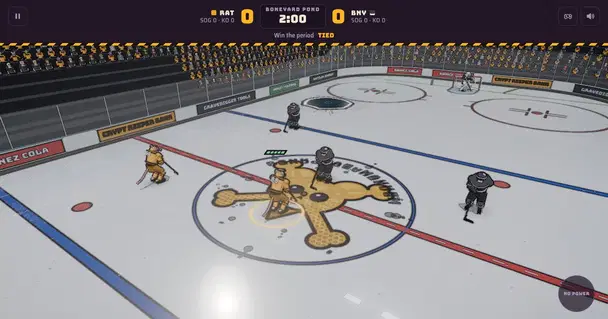 [精选画面](<https://github.com/ennywnad/rink-rat-mayhem/blob/10169b083fba823c385150c916031c2f91ba7c8c/assets/screenshot.jpg>) | 3 对 3 变种冰球，在七座球场完成带机关的比赛。上游支持 Xbox、PlayStation 和 Switch Pro 标准手柄，可在更衣室和暂停菜单改键。 | [ennywnad/rink-rat-mayhem](https://github.com/ennywnad/rink-rat-mayhem) [MIT](https://github.com/ennywnad/rink-rat-mayhem/blob/10169b083fba823c385150c916031c2f91ba7c8c/LICENSE) 字体为 OFL。 | [上游试玩入口](https://ennywnad.github.io/rink-rat-mayhem/) |
| 27 | [ ] | **Nova Vanguard** · 新增 · 6.4/10 | 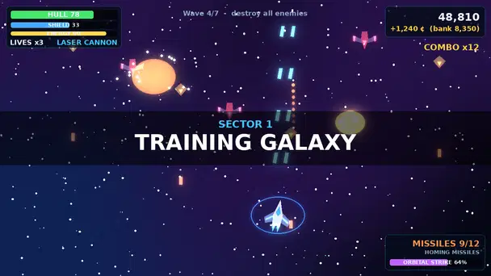 [精选画面](<https://github.com/jaineil32624/nova-vanguard/blob/edf0bec408bd7ea1bb59e06e7eed60aa3e669e5b/docs/media/sector1_training.png>) | Unity 3D 街机太空射击。左摇杆移动、右摇杆瞄准、RT 开火、LT 加速。另有键鼠和触屏操作。 | [jaineil32624/nova-vanguard](https://github.com/jaineil32624/nova-vanguard) [MIT](https://github.com/jaineil32624/nova-vanguard/blob/edf0bec408bd7ea1bb59e06e7eed60aa3e669e5b/LICENSE) Unity 引擎适用自身条款。 | [WebGL 试玩](https://jaineil32624.github.io/nova-vanguard/play/) |

## 更多有截图评分和许可原文的游戏

下列 197 款有可核对的代码许可和截图，按截图分降序排列。点击分数看评分所用画面，点击许可名看原文。若原图失效，备用画面单独标注。操作列记录上游说明或源码线索。若同仓多个游戏共用说明，标作“仓库级”。部分游戏的美术、音乐或品牌另有授权条件，列在许可下方。

| 序号 | 确认 | 游戏 | 截图
 | 截图分 | 运行环境线索 | 操作线索 | 仓库与代码许可 | 入口检查 |
| ---: | --- | --- | --- | ---: | --- | --- | --- | --- |
| 28 | [ ] | [The Hourglass City](<https://github.com/gamingnews5/awesome-opus-5.5-games/blob/9a29b570e56bd19f15a3cd6bbac0b8c682f2c48c/games/the-hourglass-city/readme.md>) | 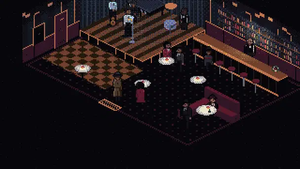 [合集截图](<https://github.com/Odiriuss/PixelArtGameOpus/blob/main/docs/city_club.png>) | [8.7](<https://github.com/Odiriuss/PixelArtGameOpus/blob/main/docs/city_club.png>) | 含 Web 技术 | 鼠标、键盘 | [Odiriuss/PixelArtGameOpus](<https://github.com/Odiriuss/PixelArtGameOpus>) · [MIT](<https://github.com/Odiriuss/PixelArtGameOpus/blob/HEAD/LICENSE>) [故事、角色、设定和书面文本另行保留权利；移植涉及这些内容需许可。](<https://github.com/Odiriuss/PixelArtGameOpus/blob/HEAD/README.md#L96-L98>) | [可达 · 含游戏画布／引擎的网页](<https://odiriuss.github.io/PixelArtGameOpus/hourglass_city.html>) |
| 29 | [ ] | [Rogue Squadron — The Battle of Yavin](<https://github.com/gamingnews5/awesome-opus-5.5-games/blob/9a29b570e56bd19f15a3cd6bbac0b8c682f2c48c/games/rogue-squadron-the-battle-of-yavin/readme.md>) | 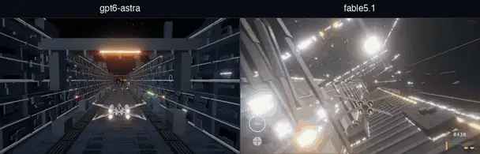 [上游动图截帧](<https://github.com/PhiloLabs/fable51-worlds/blob/main/death-star-trench-run-gpt-astra/media/preview.gif>) | [8.6](<https://github.com/PhiloLabs/fable51-worlds/blob/main/death-star-trench-run-gpt-astra/media/preview.gif>) | 含 Web 技术 | 未检出 | [PhiloLabs/fable51-worlds](<https://github.com/PhiloLabs/fable51-worlds>) · [MIT](<https://github.com/PhiloLabs/fable51-worlds/blob/HEAD/LICENSE>) [星球大战角色、载具等名称为 Lucasfilm 商标；作者称场景素材为程序生成。](<https://github.com/PhiloLabs/fable51-worlds/blob/HEAD/README.md#L90>) | [可达 · 代码仓库／说明](<https://github.com/PhiloLabs/fable51-worlds/tree/main/death-star-trench-run-gpt-astra>) |
| 30 | [ ] | [The Black Sedan](<https://github.com/gamingnews5/awesome-opus-5.5-games/blob/9a29b570e56bd19f15a3cd6bbac0b8c682f2c48c/games/the-black-sedan/readme.md>) | 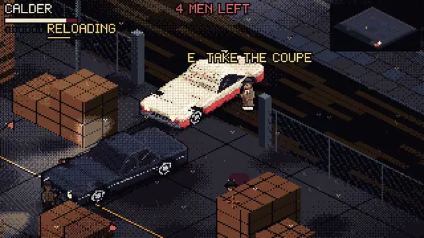 [合集截图](<https://github.com/Odiriuss/PixelArtGameOpus/blob/main/docs/level_fight.png>) | [8.5](<https://github.com/Odiriuss/PixelArtGameOpus/blob/main/docs/level_fight.png>) | 含 Web 技术 | 键盘、鼠标 | [Odiriuss/PixelArtGameOpus](<https://github.com/Odiriuss/PixelArtGameOpus>) · [MIT](<https://github.com/Odiriuss/PixelArtGameOpus/blob/HEAD/LICENSE>) [故事、角色、设定和书面文本另行保留权利；移植涉及这些内容需许可。](<https://github.com/Odiriuss/PixelArtGameOpus/blob/HEAD/README.md#L96-L98>) | [可达 · 含游戏画布／引擎的网页](<https://odiriuss.github.io/PixelArtGameOpus/hourglass_testlevel.html>) |
| 31 | [ ] | [P(DOOM)](<https://github.com/gamingnews5/awesome-opus-5.5-games/blob/9a29b570e56bd19f15a3cd6bbac0b8c682f2c48c/games/p-doom/readme.md>) | 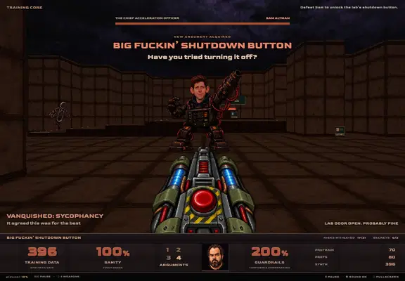 [合集截图](<https://github.com/transitive-bullshit/ai-safety-doom/blob/main/docs/images/boss.jpg>) | [8.0](<https://github.com/transitive-bullshit/ai-safety-doom/blob/main/docs/images/boss.jpg>) | 含 Web 技术 | 键盘、鼠标 | [transitive-bullshit/ai-safety-doom](<https://github.com/transitive-bullshit/ai-safety-doom>) · [MIT](<https://github.com/transitive-bullshit/ai-safety-doom/blob/HEAD/license>) | [可达 · 含游戏画布／引擎的网页](<https://p-doom.transitivebullsh.it>) |
| 32 | [ ] | [Fruit Ninja](<https://github.com/gamingnews5/awesome-opus-5.5-games/blob/9a29b570e56bd19f15a3cd6bbac0b8c682f2c48c/games/fruit-ninja/readme.md>) | 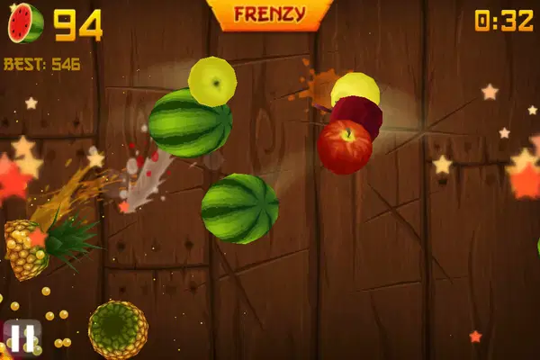 [合集截图](<https://github.com/mariotaku/FruitNinja/blob/HEAD/docs/screenshots/arcade-frenzy.png>) | [7.8](<https://github.com/mariotaku/FruitNinja/blob/HEAD/docs/screenshots/arcade-frenzy.png>) | 原生 / 引擎项目 | 鼠标 | [mariotaku/FruitNinja](<https://github.com/mariotaku/FruitNinja>) · [MIT](<https://github.com/mariotaku/FruitNinja/blob/HEAD/LICENSE>) [须自备原作的游戏数据才能构建或运行。](<https://github.com/mariotaku/FruitNinja/blob/HEAD/README.md#L8-L9>) | 未列入口 |
| 33 | [ ] | [Outpace](<https://github.com/gamingnews5/awesome-opus-5.5-games/blob/9a29b570e56bd19f15a3cd6bbac0b8c682f2c48c/games/outpace/readme.md>) | 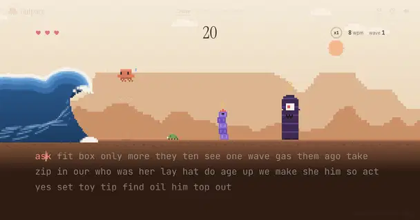 [合集截图](<https://github.com/ethanplusai/outpace/blob/9500d7d52279c1b770257c979847e3559196d99a/docs/screenshots/hero.png>) | [7.8](<https://github.com/ethanplusai/outpace/blob/9500d7d52279c1b770257c979847e3559196d99a/docs/screenshots/hero.png>) | 见技术栈 | 键盘 | [ethanplusai/outpace](<https://github.com/ethanplusai/outpace>) · [MIT](<https://github.com/ethanplusai/outpace/blob/HEAD/LICENSE>) | [可达 · 含游戏画布／引擎的网页](<https://outpace.ethanplus.ai/>) |
| 34 | [ ] | [Kyoril MMORPG](<https://github.com/gamingnews5/awesome-opus-5.5-games/blob/9a29b570e56bd19f15a3cd6bbac0b8c682f2c48c/games/kyoril-mmorpg/readme.md>) | 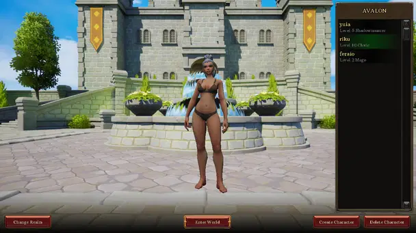 [合集截图](<https://github.com/Kyoril/mmo/blob/1841d90de444d988fdad1ddf5cbacbe5f7c0cfb0/screenshots/char_select.png>) | [7.6](<https://github.com/Kyoril/mmo/blob/1841d90de444d988fdad1ddf5cbacbe5f7c0cfb0/screenshots/char_select.png>) | 原生 / 引擎项目 | 未检出 | [Kyoril/mmo](<https://github.com/Kyoril/mmo>) · [AGPL-3.0](<https://github.com/Kyoril/mmo/blob/HEAD/LICENSE>) | 未列入口 |
| 35 | [ ] | [Grid Wars](<https://github.com/gamingnews5/awesome-opus-5.5-games/blob/9a29b570e56bd19f15a3cd6bbac0b8c682f2c48c/games/grid-wars/readme.md>) | 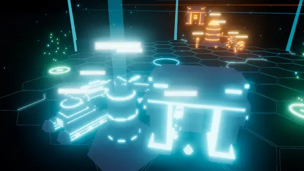 [合集截图](<https://github.com/loosecannons/grid-wars/blob/main/docs/screenshots/04-units-walls.jpg>) | [7.5](<https://github.com/loosecannons/grid-wars/blob/main/docs/screenshots/04-units-walls.jpg>) | 含 Web 技术 | 键盘、鼠标 | [loosecannons/grid-wars](<https://github.com/loosecannons/grid-wars>) · [MIT](<https://github.com/loosecannons/grid-wars/blob/HEAD/LICENSE>) | 未列入口 |
| 36 | [ ] | [Just Five More Minutes](<https://github.com/gamingnews5/awesome-opus-5.5-games/blob/9a29b570e56bd19f15a3cd6bbac0b8c682f2c48c/games/just-five-more-minutes/readme.md>) | 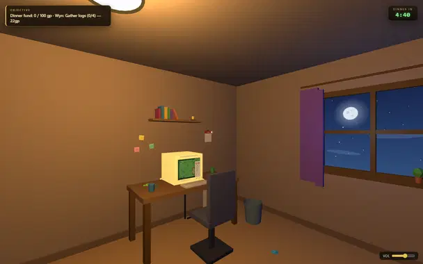 [同款备选截图](<https://github.com/Giftedx/just-five-more-minutes/blob/master/docs/screenshots/parity-3d.png>) | [7.5](<https://github.com/Giftedx/just-five-more-minutes/blob/master/docs/screenshots/title.png>) | 含 Web 技术 | 键盘、鼠标 | [Giftedx/just-five-more-minutes](<https://github.com/Giftedx/just-five-more-minutes>) · [MIT](<https://github.com/Giftedx/just-five-more-minutes/blob/HEAD/LICENSE>) MIT；不能将游戏内MMO界面误称需要网络账号。 | [可达 · 合集所列网页](<https://ha.ggis.xyz/just-five-more-minutes/>) |
| 37 | [ ] | [STARLANE — Fable 5.1 build](<https://github.com/gamingnews5/awesome-opus-5.5-games/blob/9a29b570e56bd19f15a3cd6bbac0b8c682f2c48c/games/starlane-fable-5-1-build/readme.md>) | 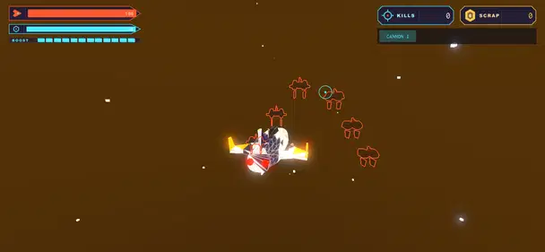 [合集截图](<https://github.com/mrfqcentic/blender-roblox-experiment/blob/HEAD/glm-assets/03-lane-flight.png>) | [7.5](<https://github.com/mrfqcentic/blender-roblox-experiment/blob/HEAD/glm-assets/03-lane-flight.png>) | Roblox 平台 | 未检出 | [mrfqcentic/blender-roblox-experiment](<https://github.com/mrfqcentic/blender-roblox-experiment>) · [MIT](<https://github.com/mrfqcentic/blender-roblox-experiment/blob/HEAD/LICENSE>) [README 许可段另述素材或第三方内容](<https://raw.githubusercontent.com/mrfqcentic/blender-roblox-experiment/HEAD/README.md>) | 未列入口 |
| 38 | [ ] | [ha·ggis Hub](<https://github.com/gamingnews5/awesome-opus-5.5-games/blob/9a29b570e56bd19f15a3cd6bbac0b8c682f2c48c/games/ha-ggis-hub/readme.md>) | 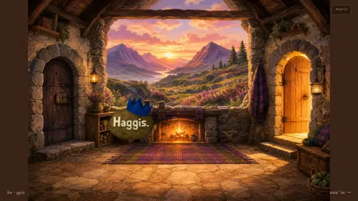 [合集截图](<https://github.com/Giftedx/ha-ggis-hub/blob/main/assets/screens/bothy-idle.png>) | [7.4](<https://github.com/Giftedx/ha-ggis-hub/blob/main/assets/screens/bothy-idle.png>) | 含 Web 技术 | 键盘 | [Giftedx/ha-ggis-hub](<https://github.com/Giftedx/ha-ggis-hub>) · [MIT](<https://github.com/Giftedx/ha-ggis-hub/blob/HEAD/LICENSE>) | [可达 · 合集所列网页](<https://ha.ggis.xyz>) |
| 39 | [ ] | [Catgirl Pachinko](<https://github.com/gamingnews5/awesome-opus-5.5-games/blob/9a29b570e56bd19f15a3cd6bbac0b8c682f2c48c/games/catgirl-pachinko/readme.md>) |  [合集截图](<https://github.com/Maoku/Opus55CatgirlPachi/blob/main/Opus55CatgirlPachi.jpg>) | [7.2](<https://github.com/Maoku/Opus55CatgirlPachi/blob/main/Opus55CatgirlPachi.jpg>) | 含 Web 技术 | 键盘、鼠标、触控 | [Maoku/Opus55CatgirlPachi](<https://github.com/Maoku/Opus55CatgirlPachi>) · [MIT](<https://github.com/Maoku/Opus55CatgirlPachi/blob/HEAD/LICENSE>) | [可达 · 合集所列网页](<https://maoku.github.io/Opus55CatgirlPachi/>) |
| 40 | [ ] | [Ephemera](<https://github.com/gamingnews5/awesome-opus-5.5-games/blob/9a29b570e56bd19f15a3cd6bbac0b8c682f2c48c/games/ephemera/readme.md>) | 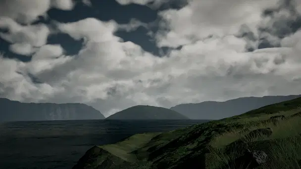 [合集截图](<https://github.com/0xWerz/ephemera/blob/main/media/4_bay.jpg>) | [7.2](<https://github.com/0xWerz/ephemera/blob/main/media/4_bay.jpg>) | 原生 / 引擎项目 | 实体手柄、键盘、鼠标 | [0xWerz/ephemera](<https://github.com/0xWerz/ephemera>) · [MIT](<https://github.com/0xWerz/ephemera/blob/HEAD/LICENSE>) [Sonniss 的声音可下载，但不得作为独立文件再分发。](<https://github.com/0xWerz/ephemera/blob/HEAD/README.md#L97-L101>) | 未列入口 |
| 41 | [ ] | [Hisar · Fortress Defense](<https://github.com/gamingnews5/awesome-opus-5.5-games/blob/9a29b570e56bd19f15a3cd6bbac0b8c682f2c48c/games/hisar-fortress-defense/readme.md>) | 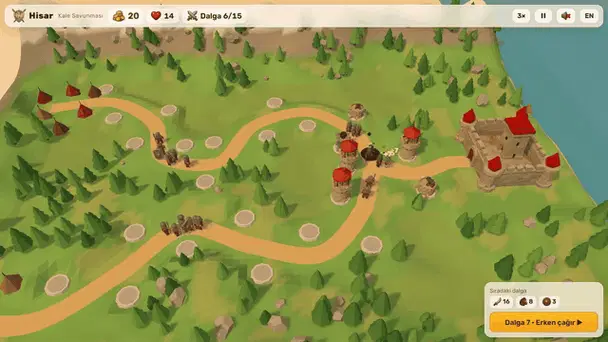 [上游动图截帧](<https://github.com/Furkiozknn/kale-savunmasi/blob/main/docs/gameplay.gif>) | [7.2](<https://github.com/Furkiozknn/kale-savunmasi/blob/main/docs/gameplay.gif>) | 含 Web 技术 | 键盘、鼠标、触控 | [Furkiozknn/kale-savunmasi](<https://github.com/Furkiozknn/kale-savunmasi>) · [MIT](<https://github.com/Furkiozknn/kale-savunmasi/blob/HEAD/LICENSE>) | [可达 · 合集所列网页](<https://furkiozknn.github.io/kale-savunmasi/>) |
| 42 | [ ] | [Tempora](<https://github.com/gamingnews5/awesome-opus-5.5-games/blob/9a29b570e56bd19f15a3cd6bbac0b8c682f2c48c/games/tempora/readme.md>) | 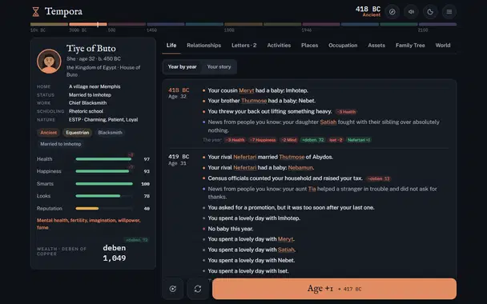 [合集截图](<https://github.com/Mofferato/tempora/blob/a9874dda365d0b21a3e046ca2b81fb866920de81/assets/screenshot.png>) | [7.2](<https://github.com/Mofferato/tempora/blob/a9874dda365d0b21a3e046ca2b81fb866920de81/assets/screenshot.png>) | 含 Web 技术 | 未检出 | [Mofferato/tempora](<https://github.com/Mofferato/tempora>) · [MIT](<https://github.com/Mofferato/tempora/blob/HEAD/LICENSE>) | [可达 · 合集所列网页](<https://mofferato.github.io/tempora/>) |
| 43 | [ ] | [Novaki: Still Smoldering](<https://github.com/gamingnews5/awesome-opus-5.5-games/blob/9a29b570e56bd19f15a3cd6bbac0b8c682f2c48c/games/novaki-still-smoldering/readme.md>) | 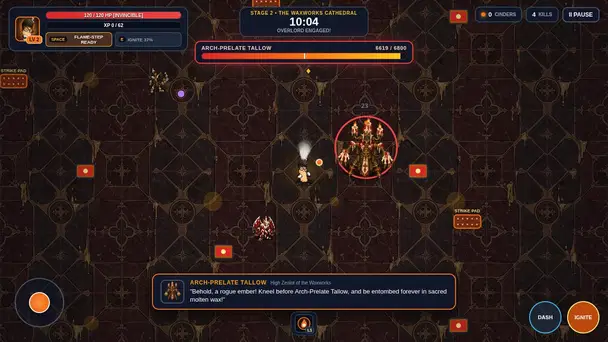 [合集截图](<https://github.com/novaki-ai/still-smoldering/blob/master/docs/test-06/boss.jpg>) | [7.1](<https://github.com/novaki-ai/still-smoldering/blob/master/docs/test-06/boss.jpg>) | 含 Web 技术 | 实体手柄、键盘、触控 | [novaki-ai/still-smoldering](<https://github.com/novaki-ai/still-smoldering>) · [MIT](<https://github.com/novaki-ai/still-smoldering/blob/HEAD/LICENSE>) [图片、配音与音乐按 CC BY 4.0，须给 Novaki 署名并回链。](<https://github.com/novaki-ai/still-smoldering/blob/HEAD/README.md#L75>) | [可达 · 含游戏画布／引擎的网页](<https://novaki.lol>) |
| 44 | [ ] | [Çay Ocağı · Tea House Rush](<https://github.com/gamingnews5/awesome-opus-5.5-games/blob/9a29b570e56bd19f15a3cd6bbac0b8c682f2c48c/games/cay-ocag-tea-house-rush/readme.md>) | 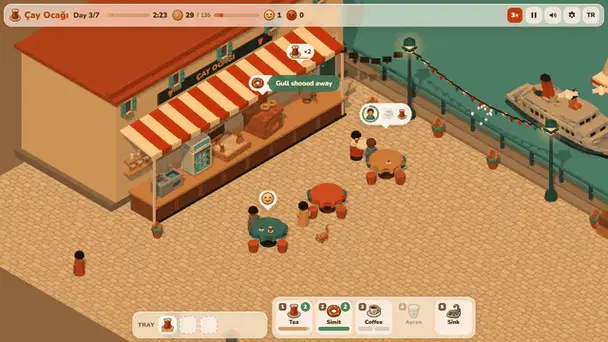 [上游动图截帧](<https://github.com/Furkiozknn/cay-ocagi/blob/main/docs/gameplay.gif>) | [7.1](<https://github.com/Furkiozknn/cay-ocagi/blob/main/docs/gameplay.gif>) | 含 Web 技术 | 键盘、鼠标、触控 | [Furkiozknn/cay-ocagi](<https://github.com/Furkiozknn/cay-ocagi>) · [MIT](<https://github.com/Furkiozknn/cay-ocagi/blob/HEAD/LICENSE>) | [可达 · 合集所列网页](<https://furkiozknn.github.io/cay-ocagi/>) |
| 45 | [ ] | [DuneCraft & Conquer](<https://github.com/gamingnews5/awesome-opus-5.5-games/blob/9a29b570e56bd19f15a3cd6bbac0b8c682f2c48c/games/dunecraft-conquer/readme.md>) | 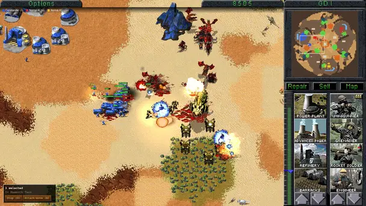 [合集截图](<https://github.com/AndreyBelyy/dunecraft-conquer/blob/main/docs/screenshots/battle.jpg>) | [7.0](<https://github.com/AndreyBelyy/dunecraft-conquer/blob/main/docs/screenshots/battle.jpg>) | 含 Web 技术 | 键盘、鼠标 | [AndreyBelyy/dunecraft-conquer](<https://github.com/AndreyBelyy/dunecraft-conquer>) · [GPL-3.0](<https://github.com/AndreyBelyy/dunecraft-conquer/blob/HEAD/LICENSE>) [须从自有原作提取图像和声音；原作文件不得随项目发布。](<https://github.com/AndreyBelyy/dunecraft-conquer/blob/HEAD/README.md#L13-L15>) | 未列入口 |
| 46 | [ ] | [Forja Abisal](<https://github.com/gamingnews5/awesome-opus-5.5-games/blob/9a29b570e56bd19f15a3cd6bbac0b8c682f2c48c/games/forja-abisal/readme.md>) | 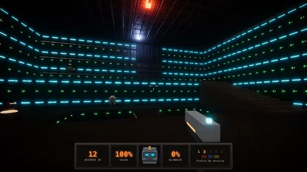 [合集截图](<https://github.com/Carte1972/forja-abisal/blob/7e9477a2c04a2ac28fee6a5b6a4ee6dab70149ac/docs/capturas/nivel_1_fundicion.jpg>) | [7.0](<https://github.com/Carte1972/forja-abisal/blob/7e9477a2c04a2ac28fee6a5b6a4ee6dab70149ac/docs/capturas/nivel_1_fundicion.jpg>) | 含 Web 技术 | 键盘、鼠标 | [Carte1972/forja-abisal](<https://github.com/Carte1972/forja-abisal>) · [MIT](<https://github.com/Carte1972/forja-abisal/blob/HEAD/LICENSE>) | [可达 · 合集所列网页](<https://carte1972.github.io/forja-abisal/>) |
| 47 | [ ] | [Frontier](<https://github.com/gamingnews5/awesome-opus-5.5-games/blob/9a29b570e56bd19f15a3cd6bbac0b8c682f2c48c/games/frontier/readme.md>) | 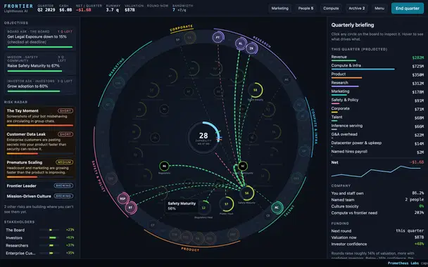 [合集截图](<https://github.com/g8r-b8/frontierLab/blob/main/assets/screenshot-board.png>) | [7.0](<https://github.com/g8r-b8/frontierLab/blob/main/assets/screenshot-board.png>) | 含 Web 技术 | 未检出 | [g8r-b8/frontierLab](<https://github.com/g8r-b8/frontierLab>) · [Apache-2.0](<https://github.com/g8r-b8/frontierLab/blob/HEAD/LICENSE>) | [可达 · 合集所列网页](<https://g8r-b8.github.io/frontierLab/>) |
| 48 | [x] | [Gogh Strike](<https://github.com/gamingnews5/awesome-opus-5.5-games/blob/9a29b570e56bd19f15a3cd6bbac0b8c682f2c48c/games/gogh-strike/readme.md>) | 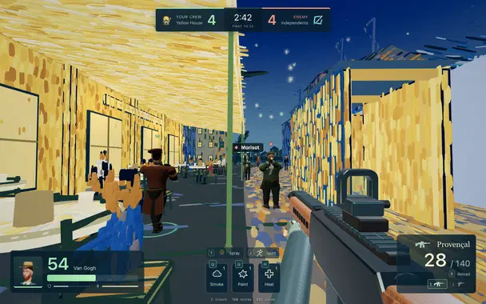 [合集截图](<https://github.com/petergpt/gogh-strike/blob/main/docs/screenshots/gameplay.png>) | [7.0](<https://github.com/petergpt/gogh-strike/blob/main/docs/screenshots/gameplay.png>) | 含 Web 技术 | 键盘、鼠标 | [petergpt/gogh-strike](<https://github.com/petergpt/gogh-strike>) · [MIT](<https://github.com/petergpt/gogh-strike/blob/HEAD/LICENSE>) [MakeHuman 的基础模型和形变目标用 CC0，须区分上游素材来源。](<https://github.com/petergpt/gogh-strike/blob/HEAD/README.md#L92>) | [可达 · 合集所列网页](<https://gogh-strike.petergostev.chatgpt.site/>) |
| 49 | [ ] | [Noordheim](<https://github.com/gamingnews5/awesome-opus-5.5-games/blob/9a29b570e56bd19f15a3cd6bbac0b8c682f2c48c/games/noordheim/readme.md>) | 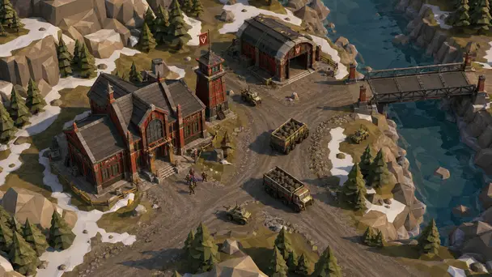 [合集截图](<https://github.com/thijssmudde/noordheim-oss/blob/main/art/concepts/noordheim-gameplay.png>) | [7.0](<https://github.com/thijssmudde/noordheim-oss/blob/main/art/concepts/noordheim-gameplay.png>) | 含 Web 技术 | 未检出 | [thijssmudde/noordheim-oss](<https://github.com/thijssmudde/noordheim-oss>) · [MIT](<https://github.com/thijssmudde/noordheim-oss/blob/HEAD/LICENSE>) [素材按 CC BY-NC 4.0，商用须另获许可。](<https://github.com/thijssmudde/noordheim-oss/blob/HEAD/README.md#L233-L235>) | [可达 · 合集所列网页](<https://noordheim.com>) |
| 50 | [ ] | [Novaki: The Last Light](<https://github.com/gamingnews5/awesome-opus-5.5-games/blob/9a29b570e56bd19f15a3cd6bbac0b8c682f2c48c/games/novaki-the-last-light/readme.md>) | 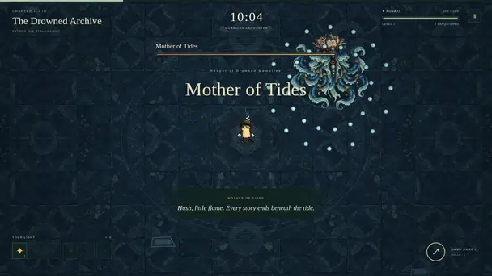 [合集截图](<https://github.com/novaki-ai/the-last-light/blob/master/docs/test-06/boss.jpg>) | [7.0](<https://github.com/novaki-ai/the-last-light/blob/master/docs/test-06/boss.jpg>) | 含 Web 技术 | 实体手柄、键盘、触控 | [novaki-ai/the-last-light](<https://github.com/novaki-ai/the-last-light>) · [MIT](<https://github.com/novaki-ai/the-last-light/blob/HEAD/LICENSE>) [图片、配音与音乐按 CC BY 4.0，须给 Novaki 署名并回链。](<https://github.com/novaki-ai/the-last-light/blob/HEAD/README.md#L79>) | [可达 · 含游戏画布／引擎的网页](<https://novaki.lol>) |
| 51 | [ ] | [Pulse](<https://github.com/gamingnews5/awesome-opus-5.5-games/blob/9a29b570e56bd19f15a3cd6bbac0b8c682f2c48c/games/pulse/readme.md>) | 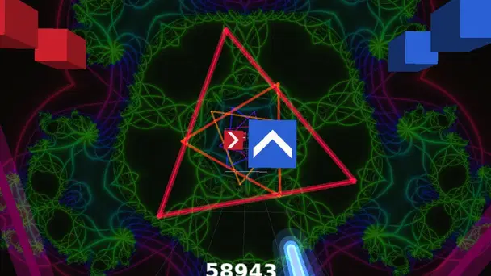 [合集截图](<https://github.com/shwan-ps5/pulse/blob/main/docs/media/pulse-fractal-triangle.jpg>) | [7.0](<https://github.com/shwan-ps5/pulse/blob/main/docs/media/pulse-fractal-triangle.jpg>) | 见技术栈 | 实体手柄、键盘 | [shwan-ps5/pulse](<https://github.com/shwan-ps5/pulse>) · [GPL-3.0](<https://github.com/shwan-ps5/pulse/blob/HEAD/LICENSE>) | 未列入口 |
| 52 | [ ] | [pyKombat](<https://github.com/gamingnews5/awesome-opus-5.5-games/blob/9a29b570e56bd19f15a3cd6bbac0b8c682f2c48c/games/pykombat/readme.md>) |  [合集截图](<https://github.com/vidalmatheus/pyKombat/blob/master/res/Screenshot.png>) | [7.0](<https://github.com/vidalmatheus/pyKombat/blob/master/res/Screenshot.png>) | 含 Web 技术 | 实体手柄、键盘、触控 | [vidalmatheus/pyKombat](<https://github.com/vidalmatheus/pyKombat>) · [MIT](<https://github.com/vidalmatheus/pyKombat/blob/HEAD/LICENSE>) | [可达 · 含游戏画布／引擎的网页](<https://vidalmatheus.github.io/pyKombat/>) |
| 53 | [ ] | [ramen-typing-game](<https://github.com/gamingnews5/awesome-opus-5.5-games/blob/9a29b570e56bd19f15a3cd6bbac0b8c682f2c48c/games/ramen-typing-game/readme.md>) |  [合集截图](<https://github.com/KeitoAbe/ramen-typing-game/blob/main/docs/images/screenshot-play.png>) | [7.0](<https://github.com/KeitoAbe/ramen-typing-game/blob/main/docs/images/screenshot-play.png>) | 含 Web 技术 | 键盘、触控 | [KeitoAbe/ramen-typing-game](<https://github.com/KeitoAbe/ramen-typing-game>) · [MIT](<https://github.com/KeitoAbe/ramen-typing-game/blob/HEAD/LICENSE>) | [可达 · 合集所列网页](<https://ramen-typing.com>) |
| 54 | [ ] | [ReTzar](<https://github.com/gamingnews5/awesome-opus-5.5-games/blob/9a29b570e56bd19f15a3cd6bbac0b8c682f2c48c/games/retzar/readme.md>) |  [合集截图](<https://github.com/ColCarlo/ReTzar/blob/main/screenshots/1-castle-and-army.jpg>) | [7.0](<https://github.com/ColCarlo/ReTzar/blob/main/screenshots/1-castle-and-army.jpg>) | 见技术栈 | 未检出 | [ColCarlo/ReTzar](<https://github.com/ColCarlo/ReTzar>) · [GPL-3.0](<https://github.com/ColCarlo/ReTzar/blob/HEAD/LICENSE>) | 未列入口 |
| 55 | [ ] | [Çini Ustası · Iznik Tile Puzzle](<https://github.com/gamingnews5/awesome-opus-5.5-games/blob/9a29b570e56bd19f15a3cd6bbac0b8c682f2c48c/games/cini-ustas-iznik-tile-puzzle/readme.md>) |  [合集截图](<https://github.com/Furkiozknn/cini-ustasi/blob/main/docs/chapter3-level22-wall.png>) | [7.0](<https://github.com/Furkiozknn/cini-ustasi/blob/main/docs/chapter3-level22-wall.png>) | 含 Web 技术 | 键盘、鼠标、触控 | [Furkiozknn/cini-ustasi](<https://github.com/Furkiozknn/cini-ustasi>) · [MIT](<https://github.com/Furkiozknn/cini-ustasi/blob/HEAD/LICENSE>) | [可达 · 合集所列网页](<https://furkiozknn.github.io/cini-ustasi/>) |
| 56 | [ ] | [Star Swarm](<https://github.com/gamingnews5/awesome-opus-5.5-games/blob/9a29b570e56bd19f15a3cd6bbac0b8c682f2c48c/games/star-swarm/readme.md>) |  [上游动图截帧](<https://github.com/GiladGlo/StarSwarm/blob/HEAD/docs/monsters-ingame.gif>) | [6.9](<https://github.com/GiladGlo/StarSwarm/blob/main/Code/monsters-ingame.gif>) · [备用画面](<https://raw.githubusercontent.com/GiladGlo/StarSwarm/HEAD/docs/monsters-ingame.gif>) | 见技术栈 | 键盘 | [GiladGlo/StarSwarm](<https://github.com/GiladGlo/StarSwarm>) · [MIT](<https://github.com/GiladGlo/StarSwarm/blob/HEAD/LICENSE>) | 未列入口 |
| 57 | [ ] | [AVA DKong Jr](<https://github.com/gamingnews5/awesome-opus-5.5-games/blob/9a29b570e56bd19f15a3cd6bbac0b8c682f2c48c/games/ava-dkong-jr/readme.md>) |  [合集截图](<https://github.com/Harlock123/AVADKongJr/blob/main/Images/AVADKongJr-jungle.png>) | [6.8](<https://github.com/Harlock123/AVADKongJr/blob/main/Images/AVADKongJr-jungle.png>) | 原生 / 引擎项目 | 实体手柄、键盘 | [Harlock123/AVADKongJr](<https://github.com/Harlock123/AVADKongJr>) · [MIT](<https://github.com/Harlock123/AVADKongJr/blob/HEAD/LICENSE>) | 未列入口 |
| 58 | [ ] | [BLACKTAIL](<https://github.com/gamingnews5/awesome-opus-5.5-games/blob/9a29b570e56bd19f15a3cd6bbac0b8c682f2c48c/games/blacktail/readme.md>) | 待补截图 | [6.8](<https://github.com/teja-bot5/blacktail-alley-run/blob/main/docs/art-reference.png>) | 原生 / 引擎项目 | 触控 | [teja-bot5/blacktail-alley-run](<https://github.com/teja-bot5/blacktail-alley-run>) · [MIT](<https://github.com/teja-bot5/blacktail-alley-run/blob/HEAD/LICENSE>) [Teko 字体采用 OFL 1.1。](<https://github.com/teja-bot5/blacktail-alley-run/blob/HEAD/README.md#L156>) | 未列入口 |
| 59 | [ ] | [RISKBOUND](<https://github.com/gamingnews5/awesome-opus-5.5-games/blob/9a29b570e56bd19f15a3cd6bbac0b8c682f2c48c/games/riskbound/readme.md>) |  [合集截图](<https://github.com/mutima89/riskbound/blob/main/Docs/Screenshots/Cast_Workspace.jpg>) | [6.8](<https://github.com/mutima89/riskbound/blob/main/Docs/Screenshots/Cast_Workspace.jpg>) | 原生 / 引擎项目 | 实体手柄、键盘、鼠标 | [mutima89/riskbound](<https://github.com/mutima89/riskbound>) · [MIT](<https://github.com/mutima89/riskbound/blob/HEAD/LICENSE>) [音乐为 CC BY 4.0；界面音效为 CC0。](<https://github.com/mutima89/riskbound/blob/HEAD/README.md#L151>) | 未列入口 |
| 60 | [ ] | [SkySprout](<https://github.com/gamingnews5/awesome-opus-5.5-games/blob/9a29b570e56bd19f15a3cd6bbac0b8c682f2c48c/games/skysprout/readme.md>) |  [合集截图](<https://github.com/DUBSOpenHub/skysprout/blob/main/docs/images/skysprout-meadow.png>) | [6.7](<https://github.com/DUBSOpenHub/skysprout/blob/main/docs/images/skysprout-meadow.png>) | 含 Web 技术 | 键盘、触控 | [DUBSOpenHub/skysprout](<https://github.com/DUBSOpenHub/skysprout>) · [MIT](<https://github.com/DUBSOpenHub/skysprout/blob/HEAD/LICENSE>) | [可达 · 含游戏画布／引擎的网页](<https://dubsopenhub.github.io/skysprout/>) |
| 61 | [ ] | [AVA Punch-Out!!](<https://github.com/gamingnews5/awesome-opus-5.5-games/blob/9a29b570e56bd19f15a3cd6bbac0b8c682f2c48c/games/ava-punch-out/readme.md>) |  [合集截图](<https://github.com/Harlock123/AVAPunchOut/blob/main/Images/AVAPunchOut-exchange.png>) | [6.6](<https://github.com/Harlock123/AVAPunchOut/blob/main/Images/AVAPunchOut-exchange.png>) | 见技术栈 | 实体手柄、键盘 | [Harlock123/AVAPunchOut](<https://github.com/Harlock123/AVAPunchOut>) · [MIT](<https://github.com/Harlock123/AVAPunchOut/blob/HEAD/LICENSE>) | 未列入口 |
| 62 | [ ] | [Bug Survivors](<https://github.com/gamingnews5/awesome-opus-5.5-games/blob/9a29b570e56bd19f15a3cd6bbac0b8c682f2c48c/games/bug-survivors/readme.md>) |  [合集截图](<https://github.com/PostHog/survivors/blob/main/docs/header.png>) | [6.6](<https://github.com/PostHog/survivors/blob/main/docs/header.png>) | 含 Web 技术 | 未检出 | [PostHog/survivors](<https://github.com/PostHog/survivors>) · [MIT](<https://github.com/PostHog/survivors/blob/HEAD/LICENSE>) | [README · 可达 · 上游 README 所列网页](<https://survivors.posthog.com>) |
| 63 | [ ] | [CEO Tycoon](<https://github.com/gamingnews5/awesome-opus-5.5-games/blob/9a29b570e56bd19f15a3cd6bbac0b8c682f2c48c/games/ceo-tycoon/readme.md>) |  [上游动图截帧](<https://github.com/jasisz/ceo-tycoon/blob/main/docs/demo.gif>) | [6.6](<https://github.com/jasisz/ceo-tycoon/blob/main/docs/demo.gif>) | 含 Web 技术 | 未检出 | [jasisz/ceo-tycoon](<https://github.com/jasisz/ceo-tycoon>) · [MIT](<https://github.com/jasisz/ceo-tycoon/blob/HEAD/LICENSE>) | 未列入口 |
| 64 | [x] | [Martı · Seagull Run](<https://github.com/gamingnews5/awesome-opus-5.5-games/blob/9a29b570e56bd19f15a3cd6bbac0b8c682f2c48c/games/mart-seagull-run/readme.md>) |  [上游动图截帧](<https://github.com/Furkiozknn/marti/blob/main/docs/gameplay.gif>) | [6.6](<https://github.com/Furkiozknn/marti/blob/main/docs/gameplay.gif>) | 含 Web 技术 | 键盘、鼠标、触控 | [Furkiozknn/marti](<https://github.com/Furkiozknn/marti>) · [MIT](<https://github.com/Furkiozknn/marti/blob/HEAD/LICENSE>) | [可达 · 合集所列网页](<https://furkiozknn.github.io/marti/>) |
| 65 | [ ] | [Ora et Labora](<https://github.com/gamingnews5/awesome-opus-5.5-games/blob/9a29b570e56bd19f15a3cd6bbac0b8c682f2c48c/games/ora-et-labora/readme.md>) |  [合集截图](<https://github.com/JohnVonDrashek/ora-et-labora/blob/main/screenshot.png>) | [6.6](<https://github.com/JohnVonDrashek/ora-et-labora/blob/main/screenshot.png>) | 原生 / 引擎项目 | 未检出 | [JohnVonDrashek/ora-et-labora](<https://github.com/JohnVonDrashek/ora-et-labora>) · [MIT](<https://github.com/JohnVonDrashek/ora-et-labora/blob/HEAD/LICENSE>) | 未列入口 |
| 66 | [ ] | [Shade](<https://github.com/gamingnews5/awesome-opus-5.5-games/blob/9a29b570e56bd19f15a3cd6bbac0b8c682f2c48c/games/shade/readme.md>) |  [上游动图截帧](<https://github.com/zaynabtauqeer/SHADE/blob/main/media/boss.gif>) | [6.6](<https://github.com/zaynabtauqeer/SHADE/blob/main/media/boss.gif>) | 含 Web 技术 | 鼠标 | [zaynabtauqeer/SHADE](<https://github.com/zaynabtauqeer/SHADE>) · [MIT](<https://github.com/zaynabtauqeer/SHADE/blob/HEAD/LICENSE>) [Press Start 2P 字体为 OFL。](<https://github.com/zaynabtauqeer/SHADE/blob/HEAD/README.md#L111>) | [可达 · Claude 作品页](<https://claude.ai/artifact/JyV3HBAgFuCkhDnzzM6NGt>) |
| 67 | [ ] | [Skywave](<https://github.com/gamingnews5/awesome-opus-5.5-games/blob/9a29b570e56bd19f15a3cd6bbac0b8c682f2c48c/games/skywave/readme.md>) |  [合集截图](<https://github.com/adammathes/skywave/blob/claude/intelligent-hypatia-vnrj1a/tools/screenshot/golden/coast-night-golden.png>) | [6.6](<https://github.com/adammathes/skywave/blob/claude/intelligent-hypatia-vnrj1a/tools/screenshot/golden/coast-night-golden.png>) | 见技术栈 | 实体手柄、鼠标 | [adammathes/skywave](<https://github.com/adammathes/skywave>) · [BSD-3-Clause](<https://github.com/adammathes/skywave/blob/HEAD/LICENSE>) | 未列入口 |
| 68 | [ ] | [Sunspire Saga](<https://github.com/gamingnews5/awesome-opus-5.5-games/blob/9a29b570e56bd19f15a3cd6bbac0b8c682f2c48c/games/sunspire-saga/readme.md>) | 待补截图 | [6.6](<https://github.com/sboulema/Sunspire-Saga/blob/main/assets/art/box-front.png>) | 含 Web 技术 | 未检出 | [sboulema/Sunspire-Saga](<https://github.com/sboulema/Sunspire-Saga>) · [MIT](<https://github.com/sboulema/Sunspire-Saga/blob/HEAD/LICENSE.txt>) | [README · 可达 · 上游 README 所列网页](<https://sboulema.github.io/Sunspire-Saga/>) |
| 69 | [ ] | [TAK Engine](<https://github.com/gamingnews5/awesome-opus-5.5-games/blob/9a29b570e56bd19f15a3cd6bbac0b8c682f2c48c/games/tak-engine/readme.md>) |  [同款备选截图](<https://github.com/pocketgeek/tak-engine/blob/HEAD/docs/img/battle.jpg>) | [6.6](<https://github.com/pocketgeek/tak-engine/blob/main/docs/img/ingame.jpg>) · [备用画面](<https://raw.githubusercontent.com/pocketgeek/tak-engine/HEAD/docs/img/battle.jpg>) | 原生 / 引擎项目 | 未检出 | [pocketgeek/tak-engine](<https://github.com/pocketgeek/tak-engine>) · [GPL-3.0](<https://github.com/pocketgeek/tak-engine/blob/HEAD/LICENSE>) [须自备《横扫千军：王国》和相应扩展的原作数据。](<https://github.com/pocketgeek/tak-engine/blob/HEAD/README.md#L23-L26>) | 未列入口 |
| 70 | [ ] | [Underneath](<https://github.com/gamingnews5/awesome-opus-5.5-games/blob/9a29b570e56bd19f15a3cd6bbac0b8c682f2c48c/games/underneath/readme.md>) |  [合集截图](<https://github.com/MundaPlus/Underneath/blob/master/docs/screenshots/fungal.webp>) | [6.6](<https://github.com/MundaPlus/Underneath/blob/master/docs/screenshots/fungal.webp>) | 含 Web 技术 | 未检出 | [MundaPlus/Underneath](<https://github.com/MundaPlus/Underneath>) · [MIT](<https://github.com/MundaPlus/Underneath/blob/HEAD/LICENSE>) | [可达 · 合集所列网页](<https://mundaplus.github.io/Underneath/>) |
| 71 | [ ] | [Vector Arcade](<https://github.com/gamingnews5/awesome-opus-5.5-games/blob/9a29b570e56bd19f15a3cd6bbac0b8c682f2c48c/games/vector-arcade/readme.md>) |  [合集截图](<https://github.com/scottpeterman/arcade/blob/main/games/bounty-hunter/docs/screenshots/floor-17-heavies.png>) | [6.6](<https://github.com/scottpeterman/arcade/blob/main/games/bounty-hunter/docs/screenshots/floor-17-heavies.png>) | 含 Web 技术 | 键盘 | [scottpeterman/arcade](<https://github.com/scottpeterman/arcade>) · [GPL-3.0](<https://github.com/scottpeterman/arcade/blob/HEAD/LICENSE>) [每个游戏目录有各自的许可和第三方声明。](<https://github.com/scottpeterman/arcade/blob/HEAD/README.md#L139>) | [可达 · 合集所列网页](<https://scottpeterman.github.io/arcade/>) |
| 72 | [ ] | [Cube Run](<https://github.com/gamingnews5/awesome-opus-5.5-games/blob/9a29b570e56bd19f15a3cd6bbac0b8c682f2c48c/games/cube-run/readme.md>) |  [合集截图](<https://github.com/Eve-146T/cube-run/blob/main/fastlane/metadata/android/en-US/images/phoneScreenshots/1.png>) | [6.5](<https://github.com/Eve-146T/cube-run/blob/main/fastlane/metadata/android/en-US/images/phoneScreenshots/1.png>) | 含移动端技术 | 触控 | [Eve-146T/cube-run](<https://github.com/Eve-146T/cube-run>) · [GPL-3.0](<https://github.com/Eve-146T/cube-run/blob/HEAD/LICENSE>) | 未列入口 |
| 73 | [ ] | [Ringbeat](<https://github.com/gamingnews5/awesome-opus-5.5-games/blob/9a29b570e56bd19f15a3cd6bbac0b8c682f2c48c/games/ringbeat/readme.md>) |  [游戏菜单或界面](<https://github.com/GIider/ringbeat/blob/screenshots/select-desktop.png>) | [6.5](<https://raw.githubusercontent.com/GIider/ringbeat/screenshots/play-desktop.png>) · [备用画面](<https://raw.githubusercontent.com/GIider/ringbeat/screenshots/select-desktop.png>) | 含 Web 技术 | 实体手柄、键盘、触控 | [GIider/ringbeat](<https://github.com/GIider/ringbeat>) · [MIT](<https://github.com/GIider/ringbeat/blob/HEAD/LICENSE>) | [可达 · 含游戏画布／引擎的网页](<https://giider.github.io/ringbeat/>) |
| 74 | [ ] | [TUX 64 — The Kernel Castle Adventure](<https://github.com/gamingnews5/awesome-opus-5.5-games/blob/9a29b570e56bd19f15a3cd6bbac0b8c682f2c48c/games/tux-64-the-kernel-castle-adventure/readme.md>) |  [合集截图](<https://github.com/hubstacksea/tux64/blob/main/docs/screenshots/grounds.png>) | [6.5](<https://github.com/hubstacksea/tux64/blob/main/docs/screenshots/grounds.png>) | 见技术栈 | 实体手柄、键盘 | [hubstacksea/tux64](<https://github.com/hubstacksea/tux64>) · [MIT](<https://github.com/hubstacksea/tux64/blob/HEAD/LICENSE>) [日文字体位图另循 OFL 1.1。](<https://github.com/hubstacksea/tux64/blob/HEAD/README.md#L340>) | 未列入口 |
| 75 | [ ] | [Vanai](<https://github.com/gamingnews5/awesome-opus-5.5-games/blob/9a29b570e56bd19f15a3cd6bbac0b8c682f2c48c/games/vanai/readme.md>) |  [合集截图](<https://www.vanaiworld.com/media/shots/combat-drake-thunder.jpg>) | [6.5](<https://www.vanaiworld.com/media/shots/combat-drake-thunder.jpg>) | 含 Web 技术 | 键盘、鼠标 | [philipqnguyen/vanai](<https://github.com/philipqnguyen/vanai>) · [MIT](<https://github.com/philipqnguyen/vanai/blob/HEAD/LICENSE>) [外部模型、纹理、字体与解码器分别按原许可；部分动画是 CC0。](<https://github.com/philipqnguyen/vanai/blob/HEAD/README.md#L259-L264>) | 未列入口 |
| 76 | [ ] | [AmmaraGames](<https://github.com/gamingnews5/awesome-opus-5.5-games/blob/9a29b570e56bd19f15a3cd6bbac0b8c682f2c48c/games/ammaragames/readme.md>) |  [合集截图](<https://github.com/Fildxza/AmmaraLearningGames/blob/main/docs/screenshots/gameplay-hall.png>) | [6.4](<https://github.com/Fildxza/AmmaraLearningGames/blob/main/docs/screenshots/gameplay-hall.png>) | 含 Web 技术 | 键盘、鼠标 | [Fildxza/AmmaraLearningGames](<https://github.com/Fildxza/AmmaraLearningGames>) · [MIT](<https://github.com/Fildxza/AmmaraLearningGames/blob/HEAD/LICENSE>) [字体为 OFL，《古兰经》文本采用 CC BY 3.0 并按原文使用。](<https://github.com/Fildxza/AmmaraLearningGames/blob/HEAD/README.md#L273-L275>) | [可达 · 合集所列网页](<https://fildxza.github.io/AmmaraLearningGames/>) |
| 77 | [ ] | [Ascent Flight](<https://github.com/gamingnews5/awesome-opus-5.5-games/blob/9a29b570e56bd19f15a3cd6bbac0b8c682f2c48c/games/ascent-flight/readme.md>) |  [合集截图](<https://github.com/calebschalesky-ops/ascent/blob/main/docs/flight.jpg>) | [6.4](<https://github.com/calebschalesky-ops/ascent/blob/main/docs/flight.jpg>) | 含 Web 技术 | 实体手柄、键盘、触控 · [手柄输入代码](<https://github.com/calebschalesky-ops/ascent/blob/main/src/components/Voyage.tsx#L1310>) | [calebschalesky-ops/ascent](<https://github.com/calebschalesky-ops/ascent>) · [MIT](<https://github.com/calebschalesky-ops/ascent/blob/HEAD/LICENSE>) MIT；保留资产/字体第三方说明，不因测试徽章声称质量实测。 | [可达 · 合集所列网页](<https://calebschalesky-ops.github.io/ascent/>) |
| 78 | [ ] | [AVA Track & Field](<https://github.com/gamingnews5/awesome-opus-5.5-games/blob/9a29b570e56bd19f15a3cd6bbac0b8c682f2c48c/games/ava-track-field/readme.md>) |  [合集截图](<https://github.com/Harlock123/AVATrackAndField/blob/main/Images/AVATrackAndField-dash.png>) | [6.4](<https://github.com/Harlock123/AVATrackAndField/blob/main/Images/AVATrackAndField-dash.png>) | 见技术栈 | 实体手柄、键盘 | [Harlock123/AVATrackAndField](<https://github.com/Harlock123/AVATrackAndField>) · [MIT](<https://github.com/Harlock123/AVATrackAndField/blob/HEAD/LICENSE>) | 未列入口 |
| 79 | [ ] | [AVA X-COM](<https://github.com/gamingnews5/awesome-opus-5.5-games/blob/9a29b570e56bd19f15a3cd6bbac0b8c682f2c48c/games/ava-x-com/readme.md>) |  [合集截图](<https://github.com/Harlock123/AVAXCom/blob/main/Images/AVAXCom-geoscape.png>) | [6.4](<https://github.com/Harlock123/AVAXCom/blob/main/Images/AVAXCom-geoscape.png>) | 见技术栈 | 实体手柄、键盘、鼠标 | [Harlock123/AVAXCom](<https://github.com/Harlock123/AVAXCom>) · [MIT](<https://github.com/Harlock123/AVAXCom/blob/HEAD/LICENSE>) | 未列入口 |
| 80 | [ ] | [AVAAshenReliquary](<https://github.com/gamingnews5/awesome-opus-5.5-games/blob/9a29b570e56bd19f15a3cd6bbac0b8c682f2c48c/games/avaashenreliquary/readme.md>) |  [合集截图](<https://github.com/Harlock123/AVAAshenReliquary/blob/main/Images/AVAAshenReliquary-gameplay.png>) | [6.4](<https://github.com/Harlock123/AVAAshenReliquary/blob/main/Images/AVAAshenReliquary-gameplay.png>) | 见技术栈 | 键盘、鼠标 | [Harlock123/AVAAshenReliquary](<https://github.com/Harlock123/AVAAshenReliquary>) · [MIT](<https://github.com/Harlock123/AVAAshenReliquary/blob/HEAD/LICENSE>) [美术和肖像有多种 CC BY、CC BY-SA 许可。](<https://github.com/Harlock123/AVAAshenReliquary/blob/HEAD/README.md#L299-L302>) | [可达 · 素材／第三方资源](<https://gearhead.itch.io/fantasy-portait-set-1>) |
| 81 | [ ] | [Bane Remastered](<https://github.com/gamingnews5/awesome-opus-5.5-games/blob/9a29b570e56bd19f15a3cd6bbac0b8c682f2c48c/games/bane-remastered/readme.md>) |  [合集截图](<https://github.com/Empatixx/Bane-remastered/blob/master/media/biome-sewer.png>) | [6.4](<https://github.com/Empatixx/Bane-remastered/blob/master/media/biome-sewer.png>) | 见技术栈 | 键盘、鼠标 | [Empatixx/Bane-remastered](<https://github.com/Empatixx/Bane-remastered>) · [GPL-3.0](<https://github.com/Empatixx/Bane-remastered/blob/HEAD/LICENSE>) | [可达 · 合集所列网页](<https://empatixx.github.io/Bane-remastered/docs>) |
| 82 | [x] | [Bloom Hop](<https://github.com/gamingnews5/awesome-opus-5.5-games/blob/9a29b570e56bd19f15a3cd6bbac0b8c682f2c48c/games/bloom-hop/readme.md>) |  [合集截图](<https://github.com/zeveck/bloom-hop/blob/main/media/screenshots/morning.png>) | [6.4](<https://github.com/zeveck/bloom-hop/blob/main/media/screenshots/morning.png>) | 含 Web 技术 | 键盘 | [zeveck/bloom-hop](<https://github.com/zeveck/bloom-hop>) · [MIT](<https://github.com/zeveck/bloom-hop/blob/HEAD/LICENSE>) [Fredoka 字体使用 OFL。](<https://github.com/zeveck/bloom-hop/blob/HEAD/README.md#L141-L143>) | [可达 · 含游戏画布／引擎的网页](<https://bloomhop.synapticnoise.com>) |
| 83 | [ ] | [Boğaz Vapuru](<https://github.com/gamingnews5/awesome-opus-5.5-games/blob/9a29b570e56bd19f15a3cd6bbac0b8c682f2c48c/games/bogaz-vapuru/readme.md>) |  [上游动图截帧](<https://github.com/Furkiozknn/bogaz-vapuru/blob/main/docs/gameplay.gif>) | [6.4](<https://github.com/Furkiozknn/bogaz-vapuru/blob/main/docs/gameplay.gif>) | 含 Web 技术 | 键盘、鼠标、触控 | [Furkiozknn/bogaz-vapuru](<https://github.com/Furkiozknn/bogaz-vapuru>) · [MIT](<https://github.com/Furkiozknn/bogaz-vapuru/blob/HEAD/LICENSE>) | [可达 · 合集所列网页](<https://furkiozknn.github.io/bogaz-vapuru/>) |
| 84 | [ ] | [CodeRogue](<https://github.com/gamingnews5/awesome-opus-5.5-games/blob/9a29b570e56bd19f15a3cd6bbac0b8c682f2c48c/games/coderogue/readme.md>) |  [合集截图](<https://github.com/gabrielconlon/coderogue/blob/main/docs/screenshots/wakeup.png>) | [6.4](<https://github.com/gabrielconlon/coderogue/blob/main/docs/screenshots/wakeup.png>) | 见技术栈 | 键盘、鼠标 | [gabrielconlon/coderogue](<https://github.com/gabrielconlon/coderogue>) · [MIT](<https://github.com/gabrielconlon/coderogue/blob/HEAD/LICENSE>) [美术和音频为 Kenney CC0，编辑器字体为 OFL。](<https://github.com/gabrielconlon/coderogue/blob/HEAD/README.md#L115>) | 未列入口 |
| 85 | [ ] | [Fireplace](<https://github.com/gamingnews5/awesome-opus-5.5-games/blob/9a29b570e56bd19f15a3cd6bbac0b8c682f2c48c/games/fireplace/readme.md>) |  [合集截图](<https://github.com/AnthonE/Fireplace/blob/main/docs/f1-fireplace.png>) | [6.4](<https://github.com/AnthonE/Fireplace/blob/main/docs/f1-fireplace.png>) | 含 Web 技术 | 鼠标 | [AnthonE/Fireplace](<https://github.com/AnthonE/Fireplace>) · [CC0-1.0](<https://github.com/AnthonE/Fireplace/blob/HEAD/LICENSE>) | 未列入口 |
| 86 | [ ] | [Hearsay: Everyone's talking about you.](<https://github.com/gamingnews5/awesome-opus-5.5-games/blob/9a29b570e56bd19f15a3cd6bbac0b8c682f2c48c/games/hearsay-everyone-s-talking-about-you/readme.md>) |  [合集截图](<https://github.com/Yashgurav002/hearsay/blob/main/docs/screenshots/3d-inn.png>) | [6.4](<https://github.com/Yashgurav002/hearsay/blob/main/docs/screenshots/3d-inn.png>) | 原生 / 引擎项目 | 键盘 | [Yashgurav002/hearsay](<https://github.com/Yashgurav002/hearsay>) · [MIT](<https://github.com/Yashgurav002/hearsay/blob/HEAD/LICENSE>) | [可达 · 合集所列网页](<https://hearsay-six.vercel.app>) |
| 87 | [ ] | [Kwest](<https://github.com/gamingnews5/awesome-opus-5.5-games/blob/9a29b570e56bd19f15a3cd6bbac0b8c682f2c48c/games/kwest/readme.md>) |  [合集截图](<https://github.com/mykkro/kwest/blob/main/public/screenshot.jpg>) | [6.4](<https://github.com/mykkro/kwest/blob/main/public/screenshot.jpg>) | 含 Web 技术 | 未检出 | [mykkro/kwest](<https://github.com/mykkro/kwest>) · [MIT](<https://github.com/mykkro/kwest/blob/HEAD/LICENSE>) | 未列入口 |
| 88 | [ ] | [Life as Duburi](<https://github.com/gamingnews5/awesome-opus-5.5-games/blob/9a29b570e56bd19f15a3cd6bbac0b8c682f2c48c/games/life-as-duburi/readme.md>) |  [合集截图](<https://github.com/jarifalam13/Life_in_Lab/blob/main/screenshots/promo.jpg>) | [6.4](<https://github.com/jarifalam13/Life_in_Lab/blob/main/screenshots/promo.jpg>) | 含 Web 技术 | 实体手柄、键盘 | [jarifalam13/Life_in_Lab](<https://github.com/jarifalam13/Life_in_Lab>) · [GPL-3.0](<https://github.com/jarifalam13/Life_in_Lab/blob/HEAD/LICENSE>) | [可达 · 合集所列网页](<https://jarifalamclaude-max.github.io/Life_in_DUBURI/>) |
| 89 | [x] | [Mechapede](<https://github.com/gamingnews5/awesome-opus-5.5-games/blob/9a29b570e56bd19f15a3cd6bbac0b8c682f2c48c/games/mechapede/readme.md>) |  [合集截图](<https://github.com/davbachman/Mechapede/blob/main/assets/machine-interior.png>) | [6.4](<https://github.com/davbachman/Mechapede/blob/main/assets/machine-interior.png>) | 含 Web 技术 | 键盘、鼠标 | [davbachman/Mechapede](<https://github.com/davbachman/Mechapede>) · [MIT](<https://github.com/davbachman/Mechapede/blob/HEAD/LICENSE>) | [可达 · 含游戏画布／引擎的网页](<https://davbachman.github.io/Mechapede/>) |
| 90 | [ ] | [Simit Fırını](<https://github.com/gamingnews5/awesome-opus-5.5-games/blob/9a29b570e56bd19f15a3cd6bbac0b8c682f2c48c/games/simit-f-r-n/readme.md>) |  [上游动图截帧](<https://github.com/Furkiozknn/simit-firini/blob/main/docs/gameplay.gif>) | [6.4](<https://github.com/Furkiozknn/simit-firini/blob/main/docs/gameplay.gif>) | 含 Web 技术 | 键盘、鼠标、触控 | [Furkiozknn/simit-firini](<https://github.com/Furkiozknn/simit-firini>) · [MIT](<https://github.com/Furkiozknn/simit-firini/blob/HEAD/LICENSE>) [自托管的 Patrick Hand 字体子集按 OFL。](<https://github.com/Furkiozknn/simit-firini/blob/HEAD/README.md#L151>) | [可达 · 合集所列网页](<https://furkiozknn.github.io/simit-firini/>) |
| 91 | [ ] | [SPICE — a card game for couples](<https://github.com/gamingnews5/awesome-opus-5.5-games/blob/9a29b570e56bd19f15a3cd6bbac0b8c682f2c48c/games/spice-a-card-game-for-couples/readme.md>) |  [同款备选截图](<https://github.com/Hiberius/couples-card-game/blob/main/docs/media/levels.png>) | [6.4](<https://github.com/Hiberius/couples-card-game/blob/HEAD/docs/media/banner.png>) | 含 Web 技术 | 键盘 | [Hiberius/couples-card-game](<https://github.com/Hiberius/couples-card-game>) · [MIT](<https://github.com/Hiberius/couples-card-game/blob/HEAD/LICENSE>) | [可达 · 合集所列网页](<https://couples-card-game.hiberius.workers.dev>) |
| 92 | [ ] | [Super Giorgi: Batumi](<https://github.com/gamingnews5/awesome-opus-5.5-games/blob/9a29b570e56bd19f15a3cd6bbac0b8c682f2c48c/games/super-giorgi-batumi/readme.md>) |  [合集截图](<https://github.com/gogodzilla/super-giorgi/blob/main/docs/street.png>) | [6.4](<https://github.com/gogodzilla/super-giorgi/blob/main/docs/street.png>) | 含 Web 技术 | 实体手柄、键盘、触控 | [gogodzilla/super-giorgi](<https://github.com/gogodzilla/super-giorgi>) · [MIT](<https://github.com/gogodzilla/super-giorgi/blob/HEAD/LICENSE>) [音乐录音保留全部权利，不在代码 MIT 许可范围内。](<https://github.com/gogodzilla/super-giorgi/blob/HEAD/README.md#L97>) | [可达 · 含游戏画布／引擎的网页](<https://super.malets.by>) |
| 93 | [ ] | [Ace Plays!](<https://github.com/gamingnews5/awesome-opus-5.5-games/blob/9a29b570e56bd19f15a3cd6bbac0b8c682f2c48c/games/ace-plays/readme.md>) |  [游戏菜单或界面](<https://github.com/d3bug21/ace-plays/blob/main/docs/screenshots/title.png>) | [6.2](<https://github.com/d3bug21/ace-plays/blob/main/docs/screenshots/title.png>) | 含 Web 技术 | 鼠标、触控 | [d3bug21/ace-plays](<https://github.com/d3bug21/ace-plays>) · [MIT](<https://github.com/d3bug21/ace-plays/blob/HEAD/LICENSE>) | [可达 · 合集所列网页](<https://ace-plays.ace-plays.workers.dev>) |
| 94 | [ ] | [AI Transformation Simulator](<https://github.com/gamingnews5/awesome-opus-5.5-games/blob/9a29b570e56bd19f15a3cd6bbac0b8c682f2c48c/games/ai-transformation-simulator/readme.md>) |  [合集截图](<https://github.com/makoydev/ai-transformation-simulator/blob/main/docs/screenshots/dashboard.jpg>) | [6.2](<https://github.com/makoydev/ai-transformation-simulator/blob/main/docs/screenshots/dashboard.jpg>) | 含 Web 技术 | 键盘 | [makoydev/ai-transformation-simulator](<https://github.com/makoydev/ai-transformation-simulator>) · [MIT](<https://github.com/makoydev/ai-transformation-simulator/blob/HEAD/LICENSE>) | [可达 · 合集所列网页](<https://makoydev.github.io/ai-transformation-simulator/>) |
| 95 | [ ] | [AVA Klax](<https://github.com/gamingnews5/awesome-opus-5.5-games/blob/9a29b570e56bd19f15a3cd6bbac0b8c682f2c48c/games/ava-klax/readme.md>) |  [合集截图](<https://github.com/Harlock123/AVAKlax/blob/main/Images/AVAKlax-play.png>) | [6.2](<https://github.com/Harlock123/AVAKlax/blob/main/Images/AVAKlax-play.png>) | 见技术栈 | 实体手柄、键盘 | [Harlock123/AVAKlax](<https://github.com/Harlock123/AVAKlax>) · [MIT](<https://github.com/Harlock123/AVAKlax/blob/HEAD/LICENSE>) | 未列入口 |
| 96 | [ ] | [Deck Shenanigans](<https://github.com/gamingnews5/awesome-opus-5.5-games/blob/9a29b570e56bd19f15a3cd6bbac0b8c682f2c48c/games/deck-shenanigans/readme.md>) |  [上游游戏截图](<https://github.com/burakTanBilgi/deck-shenanigans/blob/HEAD/docs/screenshots/game-riso-noir.webp>) | [6.2](<https://github.com/burakTanBilgi/deck-shenanigans/blob/HEAD/docs/screenshots/deck-riso-noir.webp>) | 含 Web 技术 | 键盘 | [burakTanBilgi/deck-shenanigans](<https://github.com/burakTanBilgi/deck-shenanigans>) · [MIT](<https://github.com/burakTanBilgi/deck-shenanigans/blob/HEAD/LICENSE>) | [可达 · 合集所列网页](<https://deck-shenanigans.vercel.app>) |
| 97 | [x] | [Dolmuş](<https://github.com/gamingnews5/awesome-opus-5.5-games/blob/9a29b570e56bd19f15a3cd6bbac0b8c682f2c48c/games/dolmus/readme.md>) |  [上游动图截帧](<https://github.com/Furkiozknn/dolmus/blob/main/docs/gameplay.gif>) | [6.2](<https://github.com/Furkiozknn/dolmus/blob/main/docs/gameplay.gif>) | 含 Web 技术 | 实体手柄、键盘、鼠标、触控 | [Furkiozknn/dolmus](<https://github.com/Furkiozknn/dolmus>) · [MIT](<https://github.com/Furkiozknn/dolmus/blob/HEAD/LICENSE>) [README 许可段另述素材或第三方内容](<https://raw.githubusercontent.com/Furkiozknn/dolmus/HEAD/README.md>) | [可达 · 合集所列网页](<https://furkiozknn.github.io/dolmus/>) |
| 98 | [ ] | [Dusty's Great Achoo](<https://github.com/gamingnews5/awesome-opus-5.5-games/blob/9a29b570e56bd19f15a3cd6bbac0b8c682f2c48c/games/dusty-s-great-achoo/readme.md>) |  [合集截图](<https://github.com/erenciracioglu-dotcom/dustys-great-achoo/blob/main/docs/screenshots/gameplay.jpg>) | [6.2](<https://github.com/erenciracioglu-dotcom/dustys-great-achoo/blob/main/docs/screenshots/gameplay.jpg>) | 含 Web 技术 | 未检出 | [erenciracioglu-dotcom/dustys-great-achoo](<https://github.com/erenciracioglu-dotcom/dustys-great-achoo>) · [MIT](<https://github.com/erenciracioglu-dotcom/dustys-great-achoo/blob/HEAD/LICENSE>) | [可达 · 含游戏画布／引擎的网页](<https://erenciracioglu-dotcom.github.io/dustys-great-achoo/>) |
| 99 | [ ] | [Embervale](<https://github.com/gamingnews5/awesome-opus-5.5-games/blob/9a29b570e56bd19f15a3cd6bbac0b8c682f2c48c/games/embervale/readme.md>) |  [合集截图](<https://github.com/NicholasAryelFerreira/embervale/blob/HEAD/screenshots/07-dark-halls.png>) | [6.2](<https://github.com/NicholasAryelFerreira/embervale/blob/HEAD/screenshots/07-dark-halls.png>) | 含 Web 技术 | 键盘 | [NicholasAryelFerreira/embervale](<https://github.com/NicholasAryelFerreira/embervale>) · [MIT](<https://github.com/NicholasAryelFerreira/embervale/blob/HEAD/LICENSE>) MIT代码；作者声明美术音乐均代码生成，Zelda类比不代表任天堂授权。 | [可达 · 含游戏画布／引擎的网页](<https://nicholasaryelferreira.github.io/embervale/>) |
| 100 | [ ] | [EPIC BLAST](<https://github.com/gamingnews5/awesome-opus-5.5-games/blob/9a29b570e56bd19f15a3cd6bbac0b8c682f2c48c/games/epic-blast/readme.md>) |  [合集截图](<https://github.com/felixwahner/epic-blast/blob/main/docs/screenshots/storm-citadel.webp>) | [6.2](<https://github.com/felixwahner/epic-blast/blob/main/docs/screenshots/storm-citadel.webp>) | 含 Web 技术 | 未检出 | [felixwahner/epic-blast](<https://github.com/felixwahner/epic-blast>) · [MIT](<https://github.com/felixwahner/epic-blast/blob/HEAD/LICENSE>) [Press Start 2P 字体另按 OFL 1.1。](<https://github.com/felixwahner/epic-blast/blob/HEAD/README.md#L239>) | [可达 · 合集所列网页](<https://www.o315.de/epic-blast>) |
| 101 | [ ] | [Hohenfeuer](<https://github.com/gamingnews5/awesome-opus-5.5-games/blob/9a29b570e56bd19f15a3cd6bbac0b8c682f2c48c/games/hohenfeuer/readme.md>) |  [合集截图](<https://github.com/tobiasosborne/hohenfeuer/blob/main/tests/goldens/danger-match1.png>) | [6.2](<https://github.com/tobiasosborne/hohenfeuer/blob/main/tests/goldens/danger-match1.png>) | 含 Web 技术 | 键盘、鼠标 | [tobiasosborne/hohenfeuer](<https://github.com/tobiasosborne/hohenfeuer>) · [MIT](<https://github.com/tobiasosborne/hohenfeuer/blob/HEAD/LICENSE>) [README 许可段另述素材或第三方内容](<https://raw.githubusercontent.com/tobiasosborne/hohenfeuer/HEAD/README.md>) | 未列入口 |
| 102 | [ ] | [Iron Tide: Naval Command 1939–45](<https://github.com/gamingnews5/awesome-opus-5.5-games/blob/9a29b570e56bd19f15a3cd6bbac0b8c682f2c48c/games/iron-tide-naval-command-1939-45/readme.md>) |  [合集截图](<https://github.com/jessehaemmerle/tac-game/blob/main/docs/images/tactical_plot.jpg>) | [6.2](<https://github.com/jessehaemmerle/tac-game/blob/main/docs/images/tactical_plot.jpg>) | 见技术栈 | 键盘、鼠标 | [jessehaemmerle/tac-game](<https://github.com/jessehaemmerle/tac-game>) · [AGPL-3.0](<https://github.com/jessehaemmerle/tac-game/blob/HEAD/LICENSE>) [游戏字体、地形与音频等另有授权说明。](<https://github.com/jessehaemmerle/tac-game/blob/HEAD/README.md#L199-L200>) | 未列入口 |
| 103 | [ ] | [Kervan (Furkiozknn)](<https://github.com/gamingnews5/awesome-opus-5.5-games/blob/9a29b570e56bd19f15a3cd6bbac0b8c682f2c48c/games/kervan-furkiozknn/readme.md>) |  [上游动图截帧](<https://github.com/Furkiozknn/kervan/blob/main/docs/gameplay.gif>) | [6.2](<https://github.com/Furkiozknn/kervan/blob/main/docs/gameplay.gif>) | 含 Web 技术 | 键盘、鼠标、触控 | [Furkiozknn/kervan](<https://github.com/Furkiozknn/kervan>) · [MIT](<https://github.com/Furkiozknn/kervan/blob/HEAD/LICENSE>) [自托管的 Marcellus 字体采用 OFL。](<https://github.com/Furkiozknn/kervan/blob/HEAD/README.md#L134>) | [可达 · 合集所列网页](<https://furkiozknn.github.io/kervan/>) |
| 104 | [ ] | [Martini's Brainrot Brawl](<https://github.com/gamingnews5/awesome-opus-5.5-games/blob/9a29b570e56bd19f15a3cd6bbac0b8c682f2c48c/games/martini-s-brainrot-brawl/readme.md>) | 待补截图 | [6.2](<https://github.com/martinipolice/brainrot-brawl/blob/main/img/og-image.png>) | 含 Web 技术 | 键盘、触控 | [martinipolice/brainrot-brawl](<https://github.com/martinipolice/brainrot-brawl>) · [MIT](<https://github.com/martinipolice/brainrot-brawl/blob/HEAD/LICENSE>) [作者标明所绘网络角色不属本项目所有。](<https://github.com/martinipolice/brainrot-brawl/blob/HEAD/README.md#L111>) | [可达 · 含游戏画布／引擎的网页](<https://martinipolice.github.io/brainrot-brawl/>) |
| 105 | [ ] | [Mèo Giao Bánh Mì](<https://github.com/gamingnews5/awesome-opus-5.5-games/blob/9a29b570e56bd19f15a3cd6bbac0b8c682f2c48c/games/meo-giao-banh-mi/readme.md>) |  [合集截图](<https://github.com/sangdaden/meo-giao-banh-mi/blob/main/docs/lo-banh.png>) | [6.2](<https://github.com/sangdaden/meo-giao-banh-mi/blob/main/docs/lo-banh.png>) | 原生 / 引擎项目 | 键盘 | [sangdaden/meo-giao-banh-mi](<https://github.com/sangdaden/meo-giao-banh-mi>) · [MIT](<https://github.com/sangdaden/meo-giao-banh-mi/blob/HEAD/LICENSE>) | [可达 · 含游戏画布／引擎的网页](<https://sangdaden.github.io/meo-giao-banh-mi/>) |
| 106 | [ ] | [Pawprints](<https://github.com/gamingnews5/awesome-opus-5.5-games/blob/9a29b570e56bd19f15a3cd6bbac0b8c682f2c48c/games/pawprints/readme.md>) |  [游戏菜单或界面](<https://github.com/y-a-v-a/pawprints/blob/main/docs/title.png>) | [6.2](<https://github.com/y-a-v-a/pawprints/blob/main/docs/title.png>) | 见技术栈 | 未检出 | [y-a-v-a/pawprints](<https://github.com/y-a-v-a/pawprints>) · [MIT](<https://github.com/y-a-v-a/pawprints/blob/HEAD/LICENSE>) | 未列入口 |
| 107 | [ ] | [TapkoTyper](<https://github.com/gamingnews5/awesome-opus-5.5-games/blob/9a29b570e56bd19f15a3cd6bbac0b8c682f2c48c/games/tapkotyper/readme.md>) |  [合集截图](<https://github.com/atiris/tapkotyper/blob/main/docs/meadow.png>) | [6.2](<https://github.com/atiris/tapkotyper/blob/main/docs/meadow.png>) | 含 Web 技术 | 键盘、鼠标 | [atiris/tapkotyper](<https://github.com/atiris/tapkotyper>) · [MIT](<https://github.com/atiris/tapkotyper/blob/HEAD/LICENSE>) [名称与标志不在 MIT 范围内；字体采用 OFL。](<https://github.com/atiris/tapkotyper/blob/HEAD/README.md#L279>) | [可达 · 合集所列网页](<https://atiris.github.io/tapkotyper/>) |
| 108 | [ ] | [Tarkamarena](<https://github.com/gamingnews5/awesome-opus-5.5-games/blob/9a29b570e56bd19f15a3cd6bbac0b8c682f2c48c/games/tarkamarena/readme.md>) |  [合集截图](<https://github.com/SyubadubinStudios/TarkamArena/blob/main/docs/screenshots/signatures/summon-kuyang-head.jpg>) | [6.2](<https://github.com/SyubadubinStudios/TarkamArena/blob/main/docs/screenshots/signatures/summon-kuyang-head.jpg>) | 见技术栈 | 未检出 | [SyubadubinStudios/TarkamArena](<https://github.com/SyubadubinStudios/TarkamArena>) · [MIT](<https://github.com/SyubadubinStudios/TarkamArena/blob/HEAD/LICENSE>) [字体为 OFL。](<https://github.com/SyubadubinStudios/TarkamArena/blob/HEAD/README.md#L151>) | 未列入口 |
| 109 | [ ] | [The Glitch Arcade](<https://github.com/gamingnews5/awesome-opus-5.5-games/blob/9a29b570e56bd19f15a3cd6bbac0b8c682f2c48c/games/the-glitch-arcade/readme.md>) |  [合集截图](<https://github.com/glitchless-gg/glitch-arcade/blob/main/assets/screenshots/blastpit-game.png>) | [6.2](<https://github.com/glitchless-gg/glitch-arcade/blob/main/assets/screenshots/blastpit-game.png>) | 含 Web 技术 | 未检出 | [glitchless-gg/glitch-arcade](<https://github.com/glitchless-gg/glitch-arcade>) · [MIT](<https://github.com/glitchless-gg/glitch-arcade/blob/HEAD/LICENSE>) | [可达 · 合集所列网页](<https://www.glitchless.gg>) |
| 110 | [ ] | [Vintage Click](<https://github.com/gamingnews5/awesome-opus-5.5-games/blob/9a29b570e56bd19f15a3cd6bbac0b8c682f2c48c/games/vintage-click/readme.md>) | 待补截图 | [6.2](<https://github.com/timfennell/vintage-click/blob/master/docs/screenshots/finder.jpg>) | 见技术栈 | 实体手柄、键盘、鼠标、触控 | [timfennell/vintage-click](<https://github.com/timfennell/vintage-click>) · [GPL-3.0](<https://github.com/timfennell/vintage-click/blob/HEAD/LICENSE>) | 未列入口 |
| 111 | [ ] | [Wild Haggis Survivors](<https://github.com/gamingnews5/awesome-opus-5.5-games/blob/9a29b570e56bd19f15a3cd6bbac0b8c682f2c48c/games/wild-haggis-survivors/readme.md>) |  [合集截图](<https://github.com/Giftedx/wild-haggis-survivors/blob/a0c2c3581ea77c1495a41640761ff75f5e953f86/assets/screens/gameplay.png>) | [6.2](<https://github.com/Giftedx/wild-haggis-survivors/blob/a0c2c3581ea77c1495a41640761ff75f5e953f86/assets/screens/gameplay.png>) | 含 Web 技术 | 实体手柄、键盘 | [Giftedx/wild-haggis-survivors](<https://github.com/Giftedx/wild-haggis-survivors>) · [MIT](<https://github.com/Giftedx/wild-haggis-survivors/blob/HEAD/LICENSE>) 代码许可不自动覆盖品牌或第三方素材。 | [可达 · 合集所列网页](<https://ha.ggis.xyz/wild/>) |
| 112 | [ ] | [Time Traveller's Dilemma](<https://github.com/gamingnews5/awesome-opus-5.5-games/blob/9a29b570e56bd19f15a3cd6bbac0b8c682f2c48c/games/time-traveller-s-dilemma/readme.md>) | 待补截图 | [6.1](<https://github.com/PrathyayPGM-ALT/Time-Traveller-s-Dilemma/blob/main/promo/cover.png>) | 原生 / 引擎项目 | 键盘 | [PrathyayPGM-ALT/Time-Traveller-s-Dilemma](<https://github.com/PrathyayPGM-ALT/Time-Traveller-s-Dilemma>) · [MIT](<https://github.com/PrathyayPGM-ALT/Time-Traveller-s-Dilemma/blob/HEAD/LICENSE>) [音频由他人提供，再分发前须确认授权；字体为 OFL。](<https://github.com/PrathyayPGM-ALT/Time-Traveller-s-Dilemma/blob/HEAD/README.md#L59-L62>) | 未列入口 |
| 113 | [ ] | [AVA Rip Off](<https://github.com/gamingnews5/awesome-opus-5.5-games/blob/9a29b570e56bd19f15a3cd6bbac0b8c682f2c48c/games/ava-rip-off/readme.md>) |  [合集截图](<https://github.com/Harlock123/AVARipOff/blob/main/Images/AVARipOff-towing.png>) | [6.0](<https://github.com/Harlock123/AVARipOff/blob/main/Images/AVARipOff-towing.png>) | 见技术栈 | 实体手柄、键盘 | [Harlock123/AVARipOff](<https://github.com/Harlock123/AVARipOff>) · [MIT](<https://github.com/Harlock123/AVARipOff/blob/HEAD/LICENSE>) | 未列入口 |
| 114 | [ ] | [Brawler](<https://github.com/gamingnews5/awesome-opus-5.5-games/blob/9a29b570e56bd19f15a3cd6bbac0b8c682f2c48c/games/brawler/readme.md>) |  [上游动图截帧](<https://github.com/cgsereggela/Brawler/blob/master/docs/media/chaos.gif>) | [6.0](<https://github.com/cgsereggela/Brawler/blob/master/docs/media/chaos.gif>) | 见技术栈 | 实体手柄、键盘、鼠标 | [cgsereggela/Brawler](<https://github.com/cgsereggela/Brawler>) · [MIT](<https://github.com/cgsereggela/Brawler/blob/HEAD/LICENSE>) | 未列入口 |
| 115 | [ ] | [CHAOS.exe: The 90s Gaming Multiverse](<https://github.com/gamingnews5/awesome-opus-5.5-games/blob/9a29b570e56bd19f15a3cd6bbac0b8c682f2c48c/games/chaos-exe-the-90s-gaming-multiverse/readme.md>) |  [合集截图](<https://github.com/dreamdreams77/Chaod/blob/main/docs/screenshots/hub.png>) | [6.0](<https://github.com/dreamdreams77/Chaod/blob/main/docs/screenshots/hub.png>) | 含 Web 技术 | 键盘 | [dreamdreams77/Chaod](<https://github.com/dreamdreams77/Chaod>) · [MIT](<https://github.com/dreamdreams77/Chaod/blob/HEAD/LICENSE>) [README 许可段另述素材或第三方内容](<https://raw.githubusercontent.com/dreamdreams77/Chaod/HEAD/README.md>) | 未列入口 |
| 116 | [ ] | [Couch Colony](<https://github.com/gamingnews5/awesome-opus-5.5-games/blob/9a29b570e56bd19f15a3cd6bbac0b8c682f2c48c/games/couch-colony/readme.md>) |  [游戏菜单或界面](<https://github.com/phal-nx/couch-colony/blob/main/docs/images/tv-menu.jpg>) | [6.0](<https://github.com/phal-nx/couch-colony/blob/main/docs/images/tv-menu.jpg>) | 含 Web 技术 | 键盘 | [phal-nx/couch-colony](<https://github.com/phal-nx/couch-colony>) · [GPL-3.0](<https://github.com/phal-nx/couch-colony/blob/HEAD/LICENSE>) | 未列入口 |
| 117 | [ ] | [Dig Up](<https://github.com/gamingnews5/awesome-opus-5.5-games/blob/9a29b570e56bd19f15a3cd6bbac0b8c682f2c48c/games/dig-up/readme.md>) |  [合集截图](<https://github.com/woydarko/digup-hemi/blob/main/docs/screenshots/gameplay.png>) | [6.0](<https://github.com/woydarko/digup-hemi/blob/main/docs/screenshots/gameplay.png>) | 原生 / 引擎项目 | 未检出 | [woydarko/digup-hemi](<https://github.com/woydarko/digup-hemi>) · [MIT](<https://github.com/woydarko/digup-hemi/blob/HEAD/LICENSE>) | [可达 · 含游戏画布／引擎的网页](<https://digup-hemi.digup-worker.workers.dev>) |
| 118 | [ ] | [Doomarena3D](<https://github.com/gamingnews5/awesome-opus-5.5-games/blob/9a29b570e56bd19f15a3cd6bbac0b8c682f2c48c/games/doomarena3d/readme.md>) |  [上游动图截帧](<https://github.com/kamwoh/yume/blob/master/docs/media/doomarena.gif>) | [6.0](<https://github.com/kamwoh/yume/blob/master/docs/media/doomarena.gif>) | 原生 / 引擎项目 | 实体手柄、键盘、鼠标（仓库级） | [kamwoh/yume](<https://github.com/kamwoh/yume>) · [MIT](<https://github.com/kamwoh/yume/blob/HEAD/LICENSE>) | 未列入口 |
| 119 | [ ] | [GEN Z QUANT: Unfinished Business](<https://github.com/gamingnews5/awesome-opus-5.5-games/blob/9a29b570e56bd19f15a3cd6bbac0b8c682f2c48c/games/gen-z-quant-unfinished-business/readme.md>) | 待补截图 | [6.0](<https://github.com/ceogenz/gen-z-quant/blob/main/og.jpg>) | 原生 / 引擎项目 | 实体手柄、键盘、鼠标 | [ceogenz/gen-z-quant](<https://github.com/ceogenz/gen-z-quant>) · [MIT](<https://github.com/ceogenz/gen-z-quant/blob/HEAD/LICENSE>) [部分战斗系统经原作者单独许可；部分动作捕捉属 CC BY-NC 4.0。](<https://github.com/ceogenz/gen-z-quant/blob/HEAD/README.md#L56-L58>) | [可达 · 合集所列网页](<https://genzquant.com>) |
| 120 | [ ] | [Karagöz](<https://github.com/gamingnews5/awesome-opus-5.5-games/blob/9a29b570e56bd19f15a3cd6bbac0b8c682f2c48c/games/karagoz/readme.md>) |  [上游动图截帧](<https://github.com/Furkiozknn/karagoz/blob/main/docs/gameplay.gif>) | [6.0](<https://github.com/Furkiozknn/karagoz/blob/main/docs/gameplay.gif>) | 含 Web 技术 | 键盘、鼠标、触控 | [Furkiozknn/karagoz](<https://github.com/Furkiozknn/karagoz>) · [MIT](<https://github.com/Furkiozknn/karagoz/blob/HEAD/LICENSE>) | [可达 · 合集所列网页](<https://furkiozknn.github.io/karagoz/>) |
| 121 | [ ] | [MergeUp](<https://github.com/gamingnews5/awesome-opus-5.5-games/blob/9a29b570e56bd19f15a3cd6bbac0b8c682f2c48c/games/mergeup/readme.md>) |  [游戏菜单或界面](<https://github.com/arKharashi/mergeup/blob/main/docs/screenshots/desktop-en.png>) | [6.0](<https://github.com/arKharashi/mergeup/blob/main/docs/screenshots/desktop-en.png>) | 含 Web 技术 | 未检出 | [arKharashi/mergeup](<https://github.com/arKharashi/mergeup>) · [MIT](<https://github.com/arKharashi/mergeup/blob/HEAD/LICENSE>) | [可达 · 合集所列网页](<https://arkharashi.github.io/mergeup/>) |
| 122 | [ ] | [Paris Riots: The Game](<https://github.com/gamingnews5/awesome-opus-5.5-games/blob/9a29b570e56bd19f15a3cd6bbac0b8c682f2c48c/games/paris-riots-the-game/readme.md>) | 待补截图 | [6.0](<https://github.com/b1rdmania/paris-riots/blob/main/game/og.jpg>) | 含 Web 技术 | 未检出 | [b1rdmania/paris-riots](<https://github.com/b1rdmania/paris-riots>) · [MIT](<https://github.com/b1rdmania/paris-riots/blob/HEAD/LICENSE>) | [可达 · 含游戏画布／引擎的网页](<https://couvre-feu.pages.dev>) |
| 123 | [ ] | [RareFriends Realm](<https://github.com/gamingnews5/awesome-opus-5.5-games/blob/9a29b570e56bd19f15a3cd6bbac0b8c682f2c48c/games/rarefriends-realm/readme.md>) |  [合集截图](<https://github.com/Rare-Friends-Realm/rarefriends-realm/blob/main/docs/new-light-dusk.png>) | [6.0](<https://github.com/Rare-Friends-Realm/rarefriends-realm/blob/main/docs/new-light-dusk.png>) | 含 Web 技术 | 键盘、鼠标 | [Rare-Friends-Realm/rarefriends-realm](<https://github.com/Rare-Friends-Realm/rarefriends-realm>) · [Apache-2.0](<https://github.com/Rare-Friends-Realm/rarefriends-realm/blob/HEAD/LICENSE>) | [可达 · 合集所列网页](<https://rare-friends-realm.github.io/rarefriends-realm/preview/#trailer>) |
| 124 | [ ] | [RedFlag](<https://github.com/gamingnews5/awesome-opus-5.5-games/blob/9a29b570e56bd19f15a3cd6bbac0b8c682f2c48c/games/redflag/readme.md>) | 待补截图 | [6.0](<https://github.com/jaineil32624/RedFlag/blob/main/docs/banner.png>) | 含 Web 技术 | 键盘、触控 | [jaineil32624/RedFlag](<https://github.com/jaineil32624/RedFlag>) · [MIT](<https://github.com/jaineil32624/RedFlag/blob/HEAD/LICENSE>) | [入口已失效 · 合集所列网页](<https://jaineil32624.github.io/RedFlag/>) |
| 125 | [ ] | [Ruler of the Plane](<https://github.com/gamingnews5/awesome-opus-5.5-games/blob/9a29b570e56bd19f15a3cd6bbac0b8c682f2c48c/games/ruler-of-the-plane/readme.md>) |  [合集截图](<https://github.com/ls11ae/ruler-of-the-plane/blob/main/docs/look/start-map.webp>) | [6.0](<https://github.com/ls11ae/ruler-of-the-plane/blob/main/docs/look/start-map.webp>) | 原生 / 引擎项目 | 未检出 | [ls11ae/ruler-of-the-plane](<https://github.com/ls11ae/ruler-of-the-plane>) · [MIT](<https://github.com/ls11ae/ruler-of-the-plane/blob/HEAD/LICENSE>) [Unity 版关卡和生成数据不在 MIT 授权范围内；字体另按 OFL。](<https://github.com/ls11ae/ruler-of-the-plane/blob/HEAD/README.md#L45-L48>) | [可达 · 合集所列网页](<https://ls11ae.github.io/ruler-of-the-plane/>) |
| 126 | [ ] | [stillplay.](<https://github.com/gamingnews5/awesome-opus-5.5-games/blob/9a29b570e56bd19f15a3cd6bbac0b8c682f2c48c/games/stillplay/readme.md>) | 待补截图 | [6.0](<https://github.com/btahir/stillplay/blob/main/docs/media/stillplay-loop.webp>) | 含 Web 技术 | 键盘、鼠标、触控 | [btahir/stillplay](<https://github.com/btahir/stillplay>) · [MIT](<https://github.com/btahir/stillplay/blob/HEAD/LICENSE>) [两款字体均按 OFL 授权。](<https://github.com/btahir/stillplay/blob/HEAD/README.md#L118>) | [可达 · 合集所列网页](<https://stillplay.shiptiffin.app>) |
| 127 | [ ] | [Turtle Ninja Quest — ретро-игра в браузере](<https://github.com/gamingnews5/awesome-opus-5.5-games/blob/9a29b570e56bd19f15a3cd6bbac0b8c682f2c48c/games/turtle-ninja-quest/readme.md>) |  [合集截图](<https://github.com/ol0710/playnin/blob/main/docs/screenshot.png>) | [6.0](<https://github.com/ol0710/playnin/blob/main/docs/screenshot.png>) | 含 Web 技术 | 键盘、鼠标、触控 | [ol0710/playnin](<https://github.com/ol0710/playnin>) · [MIT](<https://github.com/ol0710/playnin/blob/HEAD/LICENSE>) [Press Start 2P 字体为 OFL。](<https://github.com/ol0710/playnin/blob/HEAD/README.md#L45>) | [可达 · 含游戏画布／引擎的网页](<https://ol0710.github.io/playnin/>) |
| 128 | [ ] | [Wars](<https://github.com/gamingnews5/awesome-opus-5.5-games/blob/9a29b570e56bd19f15a3cd6bbac0b8c682f2c48c/games/wars/readme.md>) |  [合集截图](<https://github.com/Devace-93/wars/blob/main/docs/screenshots/desktop-dark-age.png>) | [6.0](<https://github.com/Devace-93/wars/blob/main/docs/screenshots/desktop-dark-age.png>) | 见技术栈 | 未检出 | [Devace-93/wars](<https://github.com/Devace-93/wars>) · [MIT](<https://github.com/Devace-93/wars/blob/HEAD/LICENSE>) | 未列入口 |
| 129 | [ ] | [WaymoWorld](<https://github.com/gamingnews5/awesome-opus-5.5-games/blob/9a29b570e56bd19f15a3cd6bbac0b8c682f2c48c/games/waymoworld/readme.md>) |  [合集截图](<https://github.com/bortpro/WaymoWorld/blob/main/out/baseline_v0/shot_3.png>) | [6.0](<https://github.com/bortpro/WaymoWorld/blob/main/out/baseline_v0/shot_3.png>) | 含 Web 技术 | 键盘、触控 | [bortpro/WaymoWorld](<https://github.com/bortpro/WaymoWorld>) · [MIT](<https://github.com/bortpro/WaymoWorld/blob/HEAD/LICENSE>) [Waymo 数据集图像禁止再分发，须使用者自行获取。](<https://github.com/bortpro/WaymoWorld/blob/HEAD/README.md#L441>) | [可达 · 含游戏画布／引擎的网页](<https://waymoworld.onrender.com/>) |
| 130 | [ ] | [小雨云 · Little Rain Cloud](<https://github.com/gamingnews5/awesome-opus-5.5-games/blob/9a29b570e56bd19f15a3cd6bbac0b8c682f2c48c/games/little-rain-cloud/readme.md>) |  [合集截图](<https://github.com/dososo/little-rain-cloud/blob/main/shots/01-opening.png>) | [6.0](<https://github.com/dososo/little-rain-cloud/blob/main/shots/01-opening.png>) | 含 Web 技术 | 键盘 | [dososo/little-rain-cloud](<https://github.com/dososo/little-rain-cloud>) · [Apache-2.0](<https://github.com/dososo/little-rain-cloud/blob/HEAD/LICENSE>) [狐狸模型的绑骨与动画采用 CC BY 4.0，原模型 CC0。](<https://github.com/dososo/little-rain-cloud/blob/HEAD/README.md#L101>) | [可达 · 合集所列网页](<https://dososo.github.io/little-rain-cloud/>) |
| 131 | [ ] | [Tic-Tac-Toe MCP Game](<https://github.com/gamingnews5/awesome-opus-5.5-games/blob/9a29b570e56bd19f15a3cd6bbac0b8c682f2c48c/games/tic-tac-toe-mcp-game/readme.md>) |  [合集截图](<https://github.com/worgho2/tic-tac-toe-mcp-game/blob/main/docs/media/game.png>) | [5.9](<https://github.com/worgho2/tic-tac-toe-mcp-game/blob/main/docs/media/game.png>) | 原生 / 引擎项目 | 未检出 | [worgho2/tic-tac-toe-mcp-game](<https://github.com/worgho2/tic-tac-toe-mcp-game>) · [MIT](<https://github.com/worgho2/tic-tac-toe-mcp-game/blob/HEAD/LICENSE>) | [请求未成功 · 链接](<https://tic-tac-toe-mcp-game.baziewi.cz/mcp>) |
| 132 | [ ] | [AVA Rolling Thunder](<https://github.com/gamingnews5/awesome-opus-5.5-games/blob/9a29b570e56bd19f15a3cd6bbac0b8c682f2c48c/games/ava-rolling-thunder/readme.md>) |  [合集截图](<https://github.com/Harlock123/AVARollingThunder/blob/main/Images/AVARollingThunder-gunfight.png>) | [5.8](<https://github.com/Harlock123/AVARollingThunder/blob/main/Images/AVARollingThunder-gunfight.png>) | 见技术栈 | 实体手柄、键盘 | [Harlock123/AVARollingThunder](<https://github.com/Harlock123/AVARollingThunder>) · [MIT](<https://github.com/Harlock123/AVARollingThunder/blob/HEAD/LICENSE>) | 未列入口 |
| 133 | [ ] | [Charbaman](<https://github.com/gamingnews5/awesome-opus-5.5-games/blob/9a29b570e56bd19f15a3cd6bbac0b8c682f2c48c/games/charbaman/readme.md>) |  [合集截图](<https://github.com/Yassinelaadraoui/charbaman/blob/main/store/screenshots/android-phone/2-casablanca.png>) | [5.8](<https://github.com/Yassinelaadraoui/charbaman/blob/main/store/screenshots/android-phone/2-casablanca.png>) | 含 Web 技术 | 键盘、触控 | [Yassinelaadraoui/charbaman](<https://github.com/Yassinelaadraoui/charbaman>) · [MIT](<https://github.com/Yassinelaadraoui/charbaman/blob/HEAD/LICENSE>) [部分模型按 Sketchfab Standard，仅可在游戏中使用，不得单独再分发模型。](<https://github.com/Yassinelaadraoui/charbaman/blob/HEAD/README.md#L144-L146>) | 未列入口 |
| 134 | [ ] | [ECHO](<https://github.com/gamingnews5/awesome-opus-5.5-games/blob/9a29b570e56bd19f15a3cd6bbac0b8c682f2c48c/games/echo-erenciracioglu-dotcom-echo/readme.md>) | 待补截图 | [5.8](<https://github.com/erenciracioglu-dotcom/echo/blob/main/docs/screenshots/hero.jpg>) | 含 Web 技术 | 键盘、鼠标、触控 | [erenciracioglu-dotcom/echo](<https://github.com/erenciracioglu-dotcom/echo>) · [MIT](<https://github.com/erenciracioglu-dotcom/echo/blob/HEAD/LICENSE>) | [可达 · 含游戏画布／引擎的网页](<https://erenciracioglu-dotcom.github.io/echo/>) |
| 135 | [ ] | [Emberdeep on Mezo](<https://github.com/gamingnews5/awesome-opus-5.5-games/blob/9a29b570e56bd19f15a3cd6bbac0b8c682f2c48c/games/emberdeep-on-mezo/readme.md>) |  [合集截图](<https://github.com/Lazaniaaa/emberdeep-mezo/blob/main/docs/screenshots/mezo-descent.png>) | [5.8](<https://github.com/Lazaniaaa/emberdeep-mezo/blob/main/docs/screenshots/mezo-descent.png>) | 含 Web 技术 | 键盘、触控 | [Lazaniaaa/emberdeep-mezo](<https://github.com/Lazaniaaa/emberdeep-mezo>) · [MIT](<https://github.com/Lazaniaaa/emberdeep-mezo/blob/HEAD/LICENSE>) [两款字体使用 OFL。](<https://github.com/Lazaniaaa/emberdeep-mezo/blob/HEAD/README.md#L264>) | [README · 可达 · 上游 README 所列网页](<https://108-61-197-158.sslip.io>) |
| 136 | [ ] | [Fluid Puzzle](<https://github.com/gamingnews5/awesome-opus-5.5-games/blob/9a29b570e56bd19f15a3cd6bbac0b8c682f2c48c/games/fluid-puzzle/readme.md>) |  [合集截图](<https://github.com/Wh1teRabbitHU/fluid-puzzle/blob/master/.github/screenshot.png>) | [5.8](<https://github.com/Wh1teRabbitHU/fluid-puzzle/blob/master/.github/screenshot.png>) | 含 Web 技术 | 未检出 | [Wh1teRabbitHU/fluid-puzzle](<https://github.com/Wh1teRabbitHU/fluid-puzzle>) · [GPL-3.0](<https://github.com/Wh1teRabbitHU/fluid-puzzle/blob/HEAD/LICENSE>) | 未列入口 |
| 137 | [ ] | [HarvestChain](<https://github.com/gamingnews5/awesome-opus-5.5-games/blob/9a29b570e56bd19f15a3cd6bbac0b8c682f2c48c/games/harvestchain/readme.md>) |  [合集截图](<https://github.com/vithushanms/HarvestChain/blob/main/docs/screenshots/farm.png>) | [5.8](<https://github.com/vithushanms/HarvestChain/blob/main/docs/screenshots/farm.png>) | 含 Web 技术 | 键盘、鼠标 | [vithushanms/HarvestChain](<https://github.com/vithushanms/HarvestChain>) · [MIT](<https://github.com/vithushanms/HarvestChain/blob/HEAD/LICENSE>) | [README · 可达 · 含游戏画布／引擎的网页](<https://harvestchain.vithushansylvester.com>) |
| 138 | [ ] | [Haynes Quest](<https://github.com/gamingnews5/awesome-opus-5.5-games/blob/9a29b570e56bd19f15a3cd6bbac0b8c682f2c48c/games/haynes-quest/readme.md>) | 待补截图 | [5.8](<https://github.com/thaynes43/haynes-quest/blob/main/docs/assets/media/bestie-pink/v001/browser-beauty.png>) | 含 Web 技术 | 未检出 | [thaynes43/haynes-quest](<https://github.com/thaynes43/haynes-quest>) · [AGPL-3.0](<https://github.com/thaynes43/haynes-quest/blob/HEAD/LICENSE>) | 未列入口 |
| 139 | [ ] | [Meridian Wake](<https://github.com/gamingnews5/awesome-opus-5.5-games/blob/9a29b570e56bd19f15a3cd6bbac0b8c682f2c48c/games/meridian-wake/readme.md>) |  [游戏菜单或界面](<https://github.com/michaelcrosato/meridian-wake-g6a/blob/32850bbc39005a5b245c57f63133bdfd1f3f893c/docs/images/title.png>) | [5.8](<https://github.com/michaelcrosato/meridian-wake-g6a/blob/32850bbc39005a5b245c57f63133bdfd1f3f893c/docs/images/title.png>) | 含 Web 技术 | 实体手柄、键盘 | [michaelcrosato/meridian-wake-g6a](<https://github.com/michaelcrosato/meridian-wake-g6a>) · [GPL-3.0](<https://github.com/michaelcrosato/meridian-wake-g6a/blob/HEAD/LICENSE>) [Lato 使用 OFL，音频为公有领域；另见第三方说明。](<https://github.com/michaelcrosato/meridian-wake-g6a/blob/HEAD/README.md#L53>) | 未列入口 |
| 140 | [ ] | [Movie Royal](<https://github.com/gamingnews5/awesome-opus-5.5-games/blob/9a29b570e56bd19f15a3cd6bbac0b8c682f2c48c/games/movie-royal/readme.md>) |  [合集截图](<https://github.com/TimePeace49/movie-royale-releases/blob/main/docs/screenshots/fight.jpg>) | [5.8](<https://github.com/TimePeace49/movie-royale-releases/blob/main/docs/screenshots/fight.jpg>) | 含 Web 技术 | 未检出 | [TimePeace49/movie-royale-releases](<https://github.com/TimePeace49/movie-royale-releases>) · [MIT](<https://github.com/TimePeace49/movie-royale-releases/blob/HEAD/LICENSE>) | 未列入口 |
| 141 | [ ] | [Pac-Man (1980) Recreation](<https://github.com/gamingnews5/awesome-opus-5.5-games/blob/9a29b570e56bd19f15a3cd6bbac0b8c682f2c48c/games/pac-man-1980-recreation/readme.md>) |  [合集截图](<https://github.com/davidkolche/pacman/blob/main/assets/screenshot.png>) | [5.8](<https://github.com/davidkolche/pacman/blob/main/assets/screenshot.png>) | 含 Web 技术 | 键盘、鼠标 | [davidkolche/pacman](<https://github.com/davidkolche/pacman>) · [MIT](<https://github.com/davidkolche/pacman/blob/HEAD/LICENSE>) [字体为 OFL；Pac-Man 为 Bandai Namco 商标，上游标为同人作品。](<https://github.com/davidkolche/pacman/blob/HEAD/README.md#L106-L115>) | [可达 · 含游戏画布／引擎的网页](<https://davidkolche.github.io/pacman/>) |
| 142 | [ ] | [VIBE CODER](<https://github.com/gamingnews5/awesome-opus-5.5-games/blob/9a29b570e56bd19f15a3cd6bbac0b8c682f2c48c/games/vibe-coder/readme.md>) |  [合集截图](<https://github.com/ichorid/vibecoder/blob/main/docs/screenshot.png>) | [5.8](<https://github.com/ichorid/vibecoder/blob/main/docs/screenshot.png>) | 含 Web 技术 | 未检出 | [ichorid/vibecoder](<https://github.com/ichorid/vibecoder>) · [GPL-3.0](<https://github.com/ichorid/vibecoder/blob/HEAD/LICENSE>) [美术、音乐及文字按 CC BY 4.0 使用。](<https://github.com/ichorid/vibecoder/blob/HEAD/README.md#L59-L61>) | [可达 · 合集所列网页](<https://ichorid.github.io/vibecoder/>) |
| 143 | [ ] | [Whowolf](<https://github.com/gamingnews5/awesome-opus-5.5-games/blob/9a29b570e56bd19f15a3cd6bbac0b8c682f2c48c/games/whowolf/readme.md>) | 待补截图 | [5.8](<https://github.com/nurkert/whowolf/blob/main/.github/assets/game-box.jpg>) · 原图失效 | 含移动端技术 | 未检出 | [nurkert/whowolf](<https://github.com/nurkert/whowolf>) · [Apache-2.0](<https://github.com/nurkert/whowolf/blob/HEAD/LICENSE>) [README 许可段另述素材或第三方内容](<https://raw.githubusercontent.com/nurkert/whowolf/HEAD/README.md>) | [可达 · 合集所列网页](<https://whowolf.de>) |
| 144 | [ ] | [毛线星球 · Yarn Planet](<https://github.com/gamingnews5/awesome-opus-5.5-games/blob/9a29b570e56bd19f15a3cd6bbac0b8c682f2c48c/games/yarn-planet/readme.md>) | 待补截图 | [5.8](<https://github.com/makerjackie/yarn-planet/blob/main/docs/media/trailer.jpg>) | 含 Web 技术 | 键盘、鼠标 | [makerjackie/yarn-planet](<https://github.com/makerjackie/yarn-planet>) · [MIT](<https://github.com/makerjackie/yarn-planet/blob/HEAD/LICENSE>) [上游要求公开修改版本另起名称；MIT 未授予品牌使用权。](<https://github.com/makerjackie/yarn-planet/blob/HEAD/README.md#L127-L128>) | [可达 · 合集所列网页](<https://yarn.ynot.games/>) |
| 145 | [ ] | [CityMaker — 3D Landmark 2048](<https://github.com/gamingnews5/awesome-opus-5.5-games/blob/9a29b570e56bd19f15a3cd6bbac0b8c682f2c48c/games/citymaker-3d-landmark-2048/readme.md>) |  [合集截图](<https://github.com/derek-wangpch/OpenCityMaker/blob/master/docs/images/citymaker-game.png>) | [5.7](<https://github.com/derek-wangpch/OpenCityMaker/blob/master/docs/images/citymaker-game.png>) | 含 Web 技术 | 键盘 | [derek-wangpch/OpenCityMaker](<https://github.com/derek-wangpch/OpenCityMaker>) · [MIT](<https://github.com/derek-wangpch/OpenCityMaker/blob/HEAD/LICENSE>) [建筑参考物、品牌名称和设计的权利归各自的权利人。](<https://github.com/derek-wangpch/OpenCityMaker/blob/HEAD/README.md#L108-L110>) | [可达 · 合集所列网页](<https://citymaker.0to1app.com/>) |
| 146 | [ ] | [Windy 10v10 AI](<https://github.com/gamingnews5/awesome-opus-5.5-games/blob/9a29b570e56bd19f15a3cd6bbac0b8c682f2c48c/games/windy-10v10-ai/readme.md>) | 待补截图 | [5.7](<https://github.com/windy10v10ai/game/blob/develop/content/materials/overviews/dota.png>) | 原生 / 引擎项目 | 未检出 | [windy10v10ai/game](<https://github.com/windy10v10ai/game>) · [GPL-3.0](<https://github.com/windy10v10ai/game/blob/HEAD/LICENSE>) | [可达 · Steam 创意工坊](<https://steamcommunity.com/sharedfiles/filedetails/?id=2307479570>) |
| 147 | [ ] | [Burn Rate](<https://github.com/gamingnews5/awesome-opus-5.5-games/blob/9a29b570e56bd19f15a3cd6bbac0b8c682f2c48c/games/burn-rate/readme.md>) |  [游戏菜单或界面](<https://github.com/wowlocal/burn-rate/blob/main/docs/screenshots/founders.png>) | [5.6](<https://github.com/wowlocal/burn-rate/blob/main/docs/screenshots/founders.png>) | 见技术栈 | 未检出 | [wowlocal/burn-rate](<https://github.com/wowlocal/burn-rate>) · [MIT](<https://github.com/wowlocal/burn-rate/blob/HEAD/LICENSE>) [README 许可段另述素材或第三方内容](<https://raw.githubusercontent.com/wowlocal/burn-rate/HEAD/README.md>) | 未列入口 |
| 148 | [ ] | [Cellbound](<https://github.com/gamingnews5/awesome-opus-5.5-games/blob/9a29b570e56bd19f15a3cd6bbac0b8c682f2c48c/games/cellbound/readme.md>) |  [合集截图](<https://github.com/playingpossumm/cellbound/blob/main/docs/laptop.png>) | [5.6](<https://github.com/playingpossumm/cellbound/blob/main/docs/laptop.png>) | 含 Web 技术 | 键盘 | [playingpossumm/cellbound](<https://github.com/playingpossumm/cellbound>) · [MIT](<https://github.com/playingpossumm/cellbound/blob/HEAD/LICENSE>) | [可达 · 合集所列网页](<https://cellbound-sudoku.vercel.app>) |
| 149 | [ ] | [Chase Game](<https://github.com/gamingnews5/awesome-opus-5.5-games/blob/9a29b570e56bd19f15a3cd6bbac0b8c682f2c48c/games/chase-game/readme.md>) |  [上游动图截帧](<https://github.com/ayanamirei404/Pac_man_3d/blob/main/%E6%BC%94%E7%A4%BA%E7%85%A7%E7%89%87/%E5%B1%8F%E5%B9%95%E5%BD%95%E5%88%B6%202026-06-04%20192312.gif>) | [5.6](<https://raw.githubusercontent.com/ayanamirei404/Pac_man_3d/main/%E6%BC%94%E7%A4%BA%E7%85%A7%E7%89%87/%E5%B1%8F%E5%B9%95%E5%BD%95%E5%88%B6%202026-06-04%20192312.gif>) | 原生 / 引擎项目 | 键盘、触控 | [ayanamirei404/Pac_man_3d](<https://github.com/ayanamirei404/Pac_man_3d>) · [MIT](<https://github.com/ayanamirei404/Pac_man_3d/blob/HEAD/LICENSE>) | 未列入口 |
| 150 | [ ] | [Cursed Chronicles](<https://github.com/gamingnews5/awesome-opus-5.5-games/blob/9a29b570e56bd19f15a3cd6bbac0b8c682f2c48c/games/cursed-chronicles/readme.md>) |  [游戏菜单或界面](<https://github.com/TamanegiNinja25/JJK-Mobile-Game/blob/main/docs/screenshots/title.jpg>) | [5.6](<https://github.com/TamanegiNinja25/JJK-Mobile-Game/blob/main/docs/screenshots/title.jpg>) | 含 Web 技术 | 实体手柄、键盘、触控 | [TamanegiNinja25/JJK-Mobile-Game](<https://github.com/TamanegiNinja25/JJK-Mobile-Game>) · [Unlicense](<https://github.com/TamanegiNinja25/JJK-Mobile-Game/blob/HEAD/LICENSE>) [上游明确标注为非商业同人，所用原作角色与名称归各自权利人。](<https://github.com/TamanegiNinja25/JJK-Mobile-Game/blob/HEAD/README.md#L59-L61>) | 未列入口 |
| 151 | [ ] | [DinoPixel](<https://github.com/gamingnews5/awesome-opus-5.5-games/blob/9a29b570e56bd19f15a3cd6bbac0b8c682f2c48c/games/dinopixel/readme.md>) |  [合集截图](<https://github.com/rzazo24/dinopixel-game/blob/main/docs/game.png>) | [5.6](<https://github.com/rzazo24/dinopixel-game/blob/main/docs/game.png>) | 含 Web 技术 | 键盘 | [rzazo24/dinopixel-game](<https://github.com/rzazo24/dinopixel-game>) · [MIT](<https://github.com/rzazo24/dinopixel-game/blob/HEAD/LICENSE>) [字体另用 OFL 1.1。](<https://github.com/rzazo24/dinopixel-game/blob/HEAD/README.md#L322>) | [可达 · 含游戏画布／引擎的网页](<https://dinopixel-game.vercel.app/>) |
| 152 | [ ] | [Latter Day Game](<https://github.com/gamingnews5/awesome-opus-5.5-games/blob/9a29b570e56bd19f15a3cd6bbac0b8c682f2c48c/games/latter-day-game/readme.md>) |  [游戏菜单或界面](<https://github.com/xirtus/LatterDayGame/blob/main/game/evidence/menu.png>) | [5.6](<https://github.com/xirtus/LatterDayGame/blob/main/game/evidence/menu.png>) | 原生 / 引擎项目 | 键盘 | [xirtus/LatterDayGame](<https://github.com/xirtus/LatterDayGame>) · [MIT](<https://github.com/xirtus/LatterDayGame/blob/HEAD/LICENSE>) | 未列入口 |
| 153 | [ ] | [Ark 1P Hub](<https://github.com/gamingnews5/awesome-opus-5.5-games/blob/9a29b570e56bd19f15a3cd6bbac0b8c682f2c48c/games/ark-1p-hub/readme.md>) |  [合集截图](<https://github.com/areyesromo/Ark-1p-Hub/blob/main/docs/screenshots/tv-lobby.jpg>) | [5.5](<https://github.com/areyesromo/Ark-1p-Hub/blob/main/docs/screenshots/tv-lobby.jpg>) | 含 Web 技术 | 实体手柄、键盘、触控 | [areyesromo/Ark-1p-Hub](<https://github.com/areyesromo/Ark-1p-Hub>) · [Apache-2.0](<https://github.com/areyesromo/Ark-1p-Hub/blob/HEAD/LICENSE>) | 未列入口 |
| 154 | [ ] | [Breakneck Baseball](<https://github.com/gamingnews5/awesome-opus-5.5-games/blob/9a29b570e56bd19f15a3cd6bbac0b8c682f2c48c/games/breakneck-baseball/readme.md>) |  [合集截图](<https://github.com/hynding/breakneck-baseball/blob/main/docs/agent/playtest/2026-08-21/23-live-gameplay.png>) | [5.5](<https://github.com/hynding/breakneck-baseball/blob/main/docs/agent/playtest/2026-08-21/23-live-gameplay.png>) | 含 Web 技术 | 实体手柄、键盘、触控 | [hynding/breakneck-baseball](<https://github.com/hynding/breakneck-baseball>) · [MIT](<https://github.com/hynding/breakneck-baseball/blob/HEAD/LICENSE-MIT>) | [可达 · 含游戏画布／引擎的网页](<https://hynding.github.io/breakneck-baseball/>) |
| 155 | [ ] | [Crosswinds](<https://github.com/gamingnews5/awesome-opus-5.5-games/blob/9a29b570e56bd19f15a3cd6bbac0b8c682f2c48c/games/crosswinds/readme.md>) | 待补截图 | [5.5](<https://github.com/terriblewitlogic/crosswinds/blob/main/docs/images/title.png>) | 见技术栈 | 触控 | [terriblewitlogic/crosswinds](<https://github.com/terriblewitlogic/crosswinds>) · [MIT](<https://github.com/terriblewitlogic/crosswinds/blob/HEAD/LICENSE>) | 未列入口 |
| 156 | [ ] | [Hitman 2016 Demo](<https://github.com/gamingnews5/awesome-opus-5.5-games/blob/9a29b570e56bd19f15a3cd6bbac0b8c682f2c48c/games/hitman-2016-demo/readme.md>) |  [合集截图](<https://github.com/user-attachments/assets/dd5df4bd-be28-445c-ac73-51690bca9050>) | [5.5](<https://github.com/user-attachments/assets/dd5df4bd-be28-445c-ac73-51690bca9050>) | 含 Web 技术 | 未检出 | [EricSpencer00/oneshot-hm2016](<https://github.com/EricSpencer00/oneshot-hm2016>) · [MIT](<https://github.com/EricSpencer00/oneshot-hm2016/blob/HEAD/LICENSE>) | 未列入口 |
| 157 | [ ] | [Invaders](<https://github.com/gamingnews5/awesome-opus-5.5-games/blob/9a29b570e56bd19f15a3cd6bbac0b8c682f2c48c/games/invaders/readme.md>) | 待补截图 | [5.5](<https://github.com/cocodedk/invaders/blob/main/og.png>) | 含 Web 技术 | 键盘、鼠标 | [cocodedk/invaders](<https://github.com/cocodedk/invaders>) · [Apache-2.0](<https://github.com/cocodedk/invaders/blob/HEAD/LICENSE>) Apache-2.0；仅静态研究，未核所有95关实际可通。 | [可达 · 含游戏画布／引擎的网页](<https://invaders.cocode.dk>) |
| 158 | [ ] | [Scripture Slinger](<https://github.com/gamingnews5/awesome-opus-5.5-games/blob/9a29b570e56bd19f15a3cd6bbac0b8c682f2c48c/games/scripture-slinger/readme.md>) |  [上游动图截帧](<https://github.com/MasterTemple/scripture-slinger/blob/main/docs/gameplay.gif>) | [5.5](<https://github.com/MasterTemple/scripture-slinger/blob/main/docs/gameplay.gif>) | 含 Web 技术 | 未检出 | [MasterTemple/scripture-slinger](<https://github.com/MasterTemple/scripture-slinger>) · [CC0-1.0](<https://github.com/MasterTemple/scripture-slinger/blob/HEAD/LICENSE>) | [可达 · 含游戏画布／引擎的网页](<https://mastertemple.github.io/scripture-slinger/>) |
| 159 | [ ] | [AVA Castles of Dr. Creep](<https://github.com/gamingnews5/awesome-opus-5.5-games/blob/9a29b570e56bd19f15a3cd6bbac0b8c682f2c48c/games/ava-castles-of-dr-creep/readme.md>) |  [合集截图](<https://github.com/Harlock123/AVACastlesOfDrCreep/blob/main/Images/AVACastlesOfDrCreep-gatehouse.png>) | [5.4](<https://github.com/Harlock123/AVACastlesOfDrCreep/blob/main/Images/AVACastlesOfDrCreep-gatehouse.png>) | 见技术栈 | 实体手柄、键盘 | [Harlock123/AVACastlesOfDrCreep](<https://github.com/Harlock123/AVACastlesOfDrCreep>) · [MIT](<https://github.com/Harlock123/AVACastlesOfDrCreep/blob/HEAD/LICENSE>) | 未列入口 |
| 160 | [ ] | [AVA Dune II](<https://github.com/gamingnews5/awesome-opus-5.5-games/blob/9a29b570e56bd19f15a3cd6bbac0b8c682f2c48c/games/ava-dune-ii/readme.md>) |  [游戏菜单或界面](<https://github.com/Harlock123/AVADune2/blob/main/Images/AVADune2-title.png>) | [5.4](<https://github.com/Harlock123/AVADune2/blob/main/Images/AVADune2-title.png>) | 见技术栈 | 实体手柄、键盘、鼠标 | [Harlock123/AVADune2](<https://github.com/Harlock123/AVADune2>) · [MIT](<https://github.com/Harlock123/AVADune2/blob/HEAD/LICENSE>) | 未列入口 |
| 161 | [ ] | [AVA Jet Set Willy](<https://github.com/gamingnews5/awesome-opus-5.5-games/blob/9a29b570e56bd19f15a3cd6bbac0b8c682f2c48c/games/ava-jet-set-willy/readme.md>) |  [合集截图](<https://github.com/Harlock123/AVAJetSetWilly/blob/main/Images/AVAJetSetWilly-bathroom.png>) | [5.4](<https://github.com/Harlock123/AVAJetSetWilly/blob/main/Images/AVAJetSetWilly-bathroom.png>) | 见技术栈 | 实体手柄、键盘 | [Harlock123/AVAJetSetWilly](<https://github.com/Harlock123/AVAJetSetWilly>) · [MIT](<https://github.com/Harlock123/AVAJetSetWilly/blob/HEAD/LICENSE>) | 未列入口 |
| 162 | [ ] | [Connect Four (4 в ряд)](<https://github.com/gamingnews5/awesome-opus-5.5-games/blob/9a29b570e56bd19f15a3cd6bbac0b8c682f2c48c/games/connect-four-4/readme.md>) |  [合集截图](<https://github.com/olshanskiyad/telegram-connect-four/blob/main/screenshots/room.png>) | [5.4](<https://github.com/olshanskiyad/telegram-connect-four/blob/main/screenshots/room.png>) | 含 Web 技术 | 未检出 | [olshanskiyad/telegram-connect-four](<https://github.com/olshanskiyad/telegram-connect-four>) · [MIT](<https://github.com/olshanskiyad/telegram-connect-four/blob/HEAD/LICENSE>) | 未列入口 |
| 163 | [ ] | [Forkline](<https://github.com/gamingnews5/awesome-opus-5.5-games/blob/9a29b570e56bd19f15a3cd6bbac0b8c682f2c48c/games/forkline/readme.md>) |  [上游游戏截图](<https://github.com/bartbasi/forkline/blob/HEAD/docs/art/store_screenshot_1.png>) | [5.4](<https://github.com/bartbasi/forkline/blob/main/docs/art/cover_actual_size.png>) | 原生 / 引擎项目 | 未检出 | [bartbasi/forkline](<https://github.com/bartbasi/forkline>) · [GPL-3.0](<https://github.com/bartbasi/forkline/blob/HEAD/LICENSE>) [再发布修改版本须标注变更、采用新名称和图标并保留规定署名。](<https://github.com/bartbasi/forkline/blob/HEAD/README.md#L61-L62>) | 未列入口 |
| 164 | [ ] | [Freedie](<https://github.com/gamingnews5/awesome-opus-5.5-games/blob/9a29b570e56bd19f15a3cd6bbac0b8c682f2c48c/games/freedie/readme.md>) | 待补截图 | [5.4](<https://github.com/Shumtugle/freedie/blob/main/docs/freedie.webp>) · 原图失效 | 见技术栈 | 未检出 | [Shumtugle/freedie](<https://github.com/Shumtugle/freedie>) · [ISC](<https://github.com/Shumtugle/freedie/blob/HEAD/LICENSE>) [README 许可段另述素材或第三方内容](<https://raw.githubusercontent.com/Shumtugle/freedie/HEAD/README.md>) | 未列入口 |
| 165 | [ ] | [Lantern Run](<https://github.com/gamingnews5/awesome-opus-5.5-games/blob/9a29b570e56bd19f15a3cd6bbac0b8c682f2c48c/games/lantern-run/readme.md>) |  [合集截图](<https://github.com/krishnavijaykumar/lantern-run/blob/main/docs/world2-crystal-caves.png>) | [5.4](<https://github.com/krishnavijaykumar/lantern-run/blob/main/docs/world2-crystal-caves.png>) | 含 Web 技术 | 键盘、触控 | [krishnavijaykumar/lantern-run](<https://github.com/krishnavijaykumar/lantern-run>) · [MIT](<https://github.com/krishnavijaykumar/lantern-run/blob/HEAD/LICENSE>) [Fredoka 字体采用 OFL。](<https://github.com/krishnavijaykumar/lantern-run/blob/HEAD/README.md#L207>) | [可达 · 含游戏画布／引擎的网页](<https://krishnavijaykumar.github.io/lantern-run/>) |
| 166 | [ ] | [Little Learner Trail](<https://github.com/gamingnews5/awesome-opus-5.5-games/blob/9a29b570e56bd19f15a3cd6bbac0b8c682f2c48c/games/little-learner-trail/readme.md>) |  [合集截图](<https://github.com/krishnavijaykumar/little-learner-trail/blob/main/docs/screens.png>) | [5.4](<https://github.com/krishnavijaykumar/little-learner-trail/blob/main/docs/screens.png>) | 含 Web 技术 | 未检出 | [krishnavijaykumar/little-learner-trail](<https://github.com/krishnavijaykumar/little-learner-trail>) · [MIT](<https://github.com/krishnavijaykumar/little-learner-trail/blob/HEAD/LICENSE>) | 未列入口 |
| 167 | [ ] | [Shiftscape](<https://github.com/gamingnews5/awesome-opus-5.5-games/blob/9a29b570e56bd19f15a3cd6bbac0b8c682f2c48c/games/shiftscape/readme.md>) |  [上游动图截帧](<https://github.com/jaking-studios/shiftscape/blob/main/docs/media/shiftscape-preview.gif>) | [5.4](<https://github.com/jaking-studios/shiftscape/blob/main/docs/media/shiftscape-preview.gif>) | 原生 / 引擎项目 | 键盘、鼠标、触控 | [jaking-studios/shiftscape](<https://github.com/jaking-studios/shiftscape>) · [MIT](<https://github.com/jaking-studios/shiftscape/blob/HEAD/LICENSE>) | [可达 · 合集所列网页](<https://jaking-studios.github.io/shiftscape/play/>) |
| 168 | [ ] | [Tesla Roadster Simulator](<https://github.com/gamingnews5/awesome-opus-5.5-games/blob/9a29b570e56bd19f15a3cd6bbac0b8c682f2c48c/games/tesla-roadster-simulator/readme.md>) |  [上游动图截帧](<https://github.com/eduardmur/tesla-roadster-simulator/blob/main/docs/media/curl.gif>) | [5.4](<https://github.com/eduardmur/tesla-roadster-simulator/blob/main/docs/media/curl.gif>) | 含 Web 技术 | 实体手柄 | [eduardmur/tesla-roadster-simulator](<https://github.com/eduardmur/tesla-roadster-simulator>) · [MIT](<https://github.com/eduardmur/tesla-roadster-simulator/blob/HEAD/LICENSE>) [文档按 CC BY 4.0；音效不在代码和文档的许可范围内。](<https://github.com/eduardmur/tesla-roadster-simulator/blob/HEAD/README.md#L81-L84>) | [可达 · 合集所列网页](<https://eduardmur.github.io/tesla-roadster-simulator/>) |
| 169 | [ ] | [Partial Annihilation](<https://github.com/gamingnews5/awesome-opus-5.5-games/blob/9a29b570e56bd19f15a3cd6bbac0b8c682f2c48c/games/partial-annihilation/readme.md>) |  [上游动图截帧](<https://github.com/BrianChase515/partial-annihilation/blob/main/screenshots/arena.gif>) | [5.3](<https://github.com/BrianChase515/partial-annihilation/blob/main/screenshots/arena.gif>) | 含 Web 技术 | 实体手柄、键盘、鼠标 | [BrianChase515/partial-annihilation](<https://github.com/BrianChase515/partial-annihilation>) · [MIT](<https://github.com/BrianChase515/partial-annihilation/blob/HEAD/LICENSE>) [部分配音与图标为独立的 CC 许可，须按条目署名。](<https://github.com/BrianChase515/partial-annihilation/blob/HEAD/README.md#L461-L463>) | [README · 可达 · 含游戏画布／引擎的网页](<https://brianchase515.github.io/partial-annihilation/>) |
| 170 | [ ] | [Block Puzzle](<https://github.com/gamingnews5/awesome-opus-5.5-games/blob/9a29b570e56bd19f15a3cd6bbac0b8c682f2c48c/games/block-puzzle/readme.md>) |  [合集截图](<https://github.com/uchedavid50-oss/blockpuzzle/blob/main/docs/screens/gameplay.png>) | [5.2](<https://github.com/uchedavid50-oss/blockpuzzle/blob/main/docs/screens/gameplay.png>) | 含 Web 技术 | 鼠标 | [uchedavid50-oss/blockpuzzle](<https://github.com/uchedavid50-oss/blockpuzzle>) · [MIT](<https://github.com/uchedavid50-oss/blockpuzzle/blob/HEAD/LICENSE>) | [可达 · 含游戏画布／引擎的网页](<https://blockpuzzle-three.vercel.app>) |
| 171 | [ ] | [CoreInk Tamagotchi](<https://github.com/gamingnews5/awesome-opus-5.5-games/blob/9a29b570e56bd19f15a3cd6bbac0b8c682f2c48c/games/coreink-tamagotchi/readme.md>) |  [合集截图](<https://github.com/cmaranes/coreink-tamagotchi/blob/main/docs/screenshots/home.png>) | [5.2](<https://github.com/cmaranes/coreink-tamagotchi/blob/main/docs/screenshots/home.png>) | 见技术栈 | 未检出 | [cmaranes/coreink-tamagotchi](<https://github.com/cmaranes/coreink-tamagotchi>) · [MIT](<https://github.com/cmaranes/coreink-tamagotchi/blob/HEAD/LICENSE>) | 未列入口 |
| 172 | [ ] | [Echo Maze](<https://github.com/gamingnews5/awesome-opus-5.5-games/blob/9a29b570e56bd19f15a3cd6bbac0b8c682f2c48c/games/echo-maze/readme.md>) |  [合集截图](<https://github.com/ThanhBC1234/echo-maze/blob/main/docs/screenshots/memorize.png>) | [5.2](<https://github.com/ThanhBC1234/echo-maze/blob/main/docs/screenshots/memorize.png>) | 含 Web 技术 | 键盘 | [ThanhBC1234/echo-maze](<https://github.com/ThanhBC1234/echo-maze>) · [MIT](<https://github.com/ThanhBC1234/echo-maze/blob/HEAD/LICENSE>) | 未列入口 |
| 173 | [ ] | [Iron Requiem](<https://github.com/gamingnews5/awesome-opus-5.5-games/blob/9a29b570e56bd19f15a3cd6bbac0b8c682f2c48c/games/iron-requiem/readme.md>) |  [合集截图](<https://github.com/HxCSYxC/iron-requiem/blob/main/docs/screenshot-en.jpg>) | [5.2](<https://github.com/HxCSYxC/iron-requiem/blob/main/docs/screenshot-en.jpg>) | 含 Web 技术 | 未检出 | [HxCSYxC/iron-requiem](<https://github.com/HxCSYxC/iron-requiem>) · [MIT](<https://github.com/HxCSYxC/iron-requiem/blob/HEAD/LICENSE>) | [可达 · 含游戏画布／引擎的网页](<https://hxcsyxc.github.io/iron-requiem/>) |
| 174 | [ ] | [Relativity](<https://github.com/gamingnews5/awesome-opus-5.5-games/blob/9a29b570e56bd19f15a3cd6bbac0b8c682f2c48c/games/relativity/readme.md>) |  [游戏菜单或界面](<https://github.com/jdonald/relativity/blob/main/screenshot1.png>) | [5.2](<https://github.com/jdonald/relativity/blob/main/screenshot1.png>) | 含 Web 技术 | 未检出 | [jdonald/relativity](<https://github.com/jdonald/relativity>) · [MIT](<https://github.com/jdonald/relativity/blob/HEAD/LICENSE>) | [可达 · 含游戏画布／引擎的网页](<https://jdonald.github.io/relativity/>) |
| 175 | [ ] | [Gulf of Trump](<https://github.com/gamingnews5/awesome-opus-5.5-games/blob/9a29b570e56bd19f15a3cd6bbac0b8c682f2c48c/games/gulf-of-trump/readme.md>) | 待补截图 | [5.0](<https://github.com/Darhaal/GulfOfTrump/blob/main/public/screens/1950/turn.jpg>) · 原图失效 | 含 Web 技术 | 触控 | [Darhaal/GulfOfTrump](<https://github.com/Darhaal/GulfOfTrump>) · [AGPL-3.0](<https://github.com/Darhaal/GulfOfTrump/blob/HEAD/LICENSE>) [派生版本须另取名称，商标和标志不在代码许可范围内。](<https://github.com/Darhaal/GulfOfTrump/blob/HEAD/README.md#L291-L293>) | [可达 · 代码仓库／说明](<https://github.com/Darhaal/GulfOfTrump>) |
| 176 | [ ] | [Kindling](<https://github.com/gamingnews5/awesome-opus-5.5-games/blob/9a29b570e56bd19f15a3cd6bbac0b8c682f2c48c/games/kindling/readme.md>) |  [上游动图截帧](<https://github.com/Preponderous-Software/kindling/blob/main/docs/images/reveal.gif>) | [5.0](<https://github.com/Preponderous-Software/kindling/blob/main/docs/images/reveal.gif>) | 含 Web 技术 | 键盘、鼠标 | [Preponderous-Software/kindling](<https://github.com/Preponderous-Software/kindling>) · [MIT](<https://github.com/Preponderous-Software/kindling/blob/HEAD/LICENSE>) | [可达 · 含游戏画布／引擎的网页](<https://kindling.play.danielstephenson.dev>) |
| 177 | [ ] | [Leserina](<https://github.com/gamingnews5/awesome-opus-5.5-games/blob/9a29b570e56bd19f15a3cd6bbac0b8c682f2c48c/games/leserina/readme.md>) |  [合集截图](<https://github.com/sadilek/leserina/blob/main/docs/screenshots/round.webp>) | [5.0](<https://github.com/sadilek/leserina/blob/main/docs/screenshots/round.webp>) | 含 Web 技术 | 键盘、鼠标 | [sadilek/leserina](<https://github.com/sadilek/leserina>) · [MIT](<https://github.com/sadilek/leserina/blob/HEAD/LICENSE>) [打包语音不在代码 MIT 许可内，见 README 的配音说明。](<https://github.com/sadilek/leserina/blob/HEAD/README.md#L323>) | [可达 · 合集所列网页](<https://sadilek.github.io/leserina/>) |
| 178 | [ ] | [Minesweeper](<https://github.com/gamingnews5/awesome-opus-5.5-games/blob/9a29b570e56bd19f15a3cd6bbac0b8c682f2c48c/games/minesweeper-1cto-minesweeper/readme.md>) |  [合集截图](<https://github.com/1cto/minesweeper/blob/main/docs/screenshot.png>) | [5.0](<https://github.com/1cto/minesweeper/blob/main/docs/screenshot.png>) | 含 Web 技术 | 鼠标、触控 | [1cto/minesweeper](<https://github.com/1cto/minesweeper>) · [MIT](<https://github.com/1cto/minesweeper/blob/HEAD/LICENSE>) | [README · 可达 · 上游 README 所列网页](<https://1cto.github.io/minesweeper/>) |
| 179 | [ ] | [naosugi-ai-games](<https://github.com/gamingnews5/awesome-opus-5.5-games/blob/9a29b570e56bd19f15a3cd6bbac0b8c682f2c48c/games/naosugi-ai-games/readme.md>) |  [合集截图](<https://github.com/naosugi/naosugi-ai-games/blob/main/games/infinite-shot-3d/thumb.jpg>) | [5.0](<https://github.com/naosugi/naosugi-ai-games/blob/main/games/infinite-shot-3d/thumb.jpg>) | 含 Web 技术 | 键盘 | [naosugi/naosugi-ai-games](<https://github.com/naosugi/naosugi-ai-games>) · [MIT](<https://github.com/naosugi/naosugi-ai-games/blob/HEAD/LICENSE>) [README 许可段另述素材或第三方内容](<https://raw.githubusercontent.com/naosugi/naosugi-ai-games/HEAD/README.md>) | [可达 · 合集所列网页](<https://naosugi.github.io/naosugi-ai-games/>) |
| 180 | [ ] | [Neuro Rivals](<https://github.com/gamingnews5/awesome-opus-5.5-games/blob/9a29b570e56bd19f15a3cd6bbac0b8c682f2c48c/games/neuro-rivals/readme.md>) |  [合集截图](<https://github.com/Chloudde/neuro-rivals/blob/main/docs/screenshots/race-start.jpg>) | [5.0](<https://github.com/Chloudde/neuro-rivals/blob/main/docs/screenshots/race-start.jpg>) | 含 Web 技术 | 实体手柄、键盘、触控 | [Chloudde/neuro-rivals](<https://github.com/Chloudde/neuro-rivals>) · [MIT](<https://github.com/Chloudde/neuro-rivals/blob/HEAD/LICENSE>) MIT。 | [可达 · 含游戏画布／引擎的网页](<https://chloudde.github.io/neuro-rivals/>) |
| 181 | [ ] | [Seri Math Hero](<https://github.com/gamingnews5/awesome-opus-5.5-games/blob/9a29b570e56bd19f15a3cd6bbac0b8c682f2c48c/games/seri-math-hero/readme.md>) |  [合集截图](<https://github.com/Zeke91-ai/math-hero/blob/main/docs/mh2-cuplikan.png>) | [5.0](<https://github.com/Zeke91-ai/math-hero/blob/main/docs/mh2-cuplikan.png>) | 含 Web 技术 | 键盘 | [Zeke91-ai/math-hero](<https://github.com/Zeke91-ai/math-hero>) · [MIT](<https://github.com/Zeke91-ai/math-hero/blob/HEAD/LICENSE>) [CraftPix 原始素材包禁止转发，项目所用图像和字体另循各自许可。](<https://github.com/Zeke91-ai/math-hero/blob/HEAD/README.md#L246>) | 未列入口 |
| 182 | [ ] | [Sverigespelet](<https://github.com/gamingnews5/awesome-opus-5.5-games/blob/9a29b570e56bd19f15a3cd6bbac0b8c682f2c48c/games/sverigespelet/readme.md>) |  [合集截图](<https://github.com/hamiltoon/sweden-county-quiz/blob/main/docs/screenshot.png>) | [5.0](<https://github.com/hamiltoon/sweden-county-quiz/blob/main/docs/screenshot.png>) | 含 Web 技术 | 未检出 | [hamiltoon/sweden-county-quiz](<https://github.com/hamiltoon/sweden-county-quiz>) · [MIT](<https://github.com/hamiltoon/sweden-county-quiz/blob/HEAD/LICENSE>) | [可达 · 合集所列网页](<https://sverigespelet.hamiltoon.workers.dev>) |
| 183 | [ ] | [The Proxima Trail](<https://github.com/gamingnews5/awesome-opus-5.5-games/blob/9a29b570e56bd19f15a3cd6bbac0b8c682f2c48c/games/the-proxima-trail/readme.md>) |  [游戏菜单或界面](<https://github.com/zachruss1987-apple/space-oregon-trail/blob/main/tests/e2e/__screenshots__/win32/visual.spec.ts/Arrival.png>) | [5.0](<https://github.com/zachruss1987-apple/space-oregon-trail/blob/main/tests/e2e/__screenshots__/win32/visual.spec.ts/Arrival.png>) | 含 Web 技术 | 键盘、触控 | [zachruss1987-apple/space-oregon-trail](<https://github.com/zachruss1987-apple/space-oregon-trail>) · [MIT](<https://github.com/zachruss1987-apple/space-oregon-trail/blob/HEAD/LICENSE>) [README 许可段另述素材或第三方内容](<https://raw.githubusercontent.com/zachruss1987-apple/space-oregon-trail/HEAD/README.md>) | [可达 · 合集所列网页](<https://zachruss1987-apple.github.io/space-oregon-trail/>) |
| 184 | [ ] | [World Conquest](<https://github.com/gamingnews5/awesome-opus-5.5-games/blob/9a29b570e56bd19f15a3cd6bbac0b8c682f2c48c/games/world-conquest/readme.md>) |  [合集截图](<https://github.com/foster-curtis/world-conquest/blob/main/tools/map-build/preview.png>) | [5.0](<https://github.com/foster-curtis/world-conquest/blob/main/tools/map-build/preview.png>) | 含 Web 技术 | 未取得说明 | [foster-curtis/world-conquest](<https://github.com/foster-curtis/world-conquest>) · [MIT](<https://github.com/foster-curtis/world-conquest/blob/HEAD/LICENSE>) | 未列入口 |
| 185 | [ ] | [大肥鱼](<https://github.com/gamingnews5/awesome-opus-5.5-games/blob/9a29b570e56bd19f15a3cd6bbac0b8c682f2c48c/games/game-realroc-dfy-pet-game/readme.md>) |  [上游实机演示截帧](<https://github.com/realRoc/dfy-pet-game/blob/HEAD/docs/tower-promo.mp4>) | [5.0](<https://github.com/realRoc/dfy-pet-game/blob/main/docs/expressions.png>) | 含 Web 技术 | 鼠标 | [realRoc/dfy-pet-game](<https://github.com/realRoc/dfy-pet-game>) · [MIT](<https://github.com/realRoc/dfy-pet-game/blob/HEAD/LICENSE>) [默认角色包不在 MIT 范围内，立绘、指定动画与角色设定限非商业用途。](<https://github.com/realRoc/dfy-pet-game/blob/HEAD/README.md#L261-L263>) | 未列入口 |
| 186 | [ ] | [Brownian!](<https://github.com/gamingnews5/awesome-opus-5.5-games/blob/9a29b570e56bd19f15a3cd6bbac0b8c682f2c48c/games/brownian/readme.md>) |  [合集截图](<https://github.com/jdonald/brownian/blob/main/screenshot2.png>) | [4.8](<https://github.com/jdonald/brownian/blob/main/screenshot2.png>) | 含 Web 技术 | 未检出 | [jdonald/brownian](<https://github.com/jdonald/brownian>) · [MIT](<https://github.com/jdonald/brownian/blob/HEAD/LICENSE>) | [可达 · 含游戏画布／引擎的网页](<https://jdonald.github.io/brownian/>) |
| 187 | [ ] | [Caro X-O](<https://github.com/gamingnews5/awesome-opus-5.5-games/blob/9a29b570e56bd19f15a3cd6bbac0b8c682f2c48c/games/caro-x-o/readme.md>) |  [上游动图截帧](<https://github.com/tuankun-279/Caro_XO/blob/main/docs/gameplay.gif>) | [4.8](<https://github.com/tuankun-279/Caro_XO/blob/main/docs/gameplay.gif>) | 原生 / 引擎项目 | 未检出 | [tuankun-279/Caro_XO](<https://github.com/tuankun-279/Caro_XO>) · [MIT](<https://github.com/tuankun-279/Caro_XO/blob/HEAD/LICENSE>) [两款打包字体采用 OFL。](<https://github.com/tuankun-279/Caro_XO/blob/HEAD/README.md#L81>) | 未列入口 |
| 188 | [ ] | [Elden Kart](<https://github.com/gamingnews5/awesome-opus-5.5-games/blob/9a29b570e56bd19f15a3cd6bbac0b8c682f2c48c/games/elden-kart/readme.md>) | 待补截图 | [4.8](<https://github.com/Manoz/elden-kart/blob/17d7212e143c88a47bc0e2d396d7247b4a8e033d/docs/banner.webp>) | 含 Web 技术 | 实体手柄、键盘 | [Manoz/elden-kart](<https://github.com/Manoz/elden-kart>) · [MIT](<https://github.com/Manoz/elden-kart/blob/HEAD/LICENSE>) [作者标注为非商业同人项目，另有 DISCLAIMER。](<https://github.com/Manoz/elden-kart/blob/HEAD/README.md#L7>) | [可达 · 含游戏画布／引擎的网页](<https://elden-kart.vercel.app/>) |
| 189 | [ ] | [Meld](<https://github.com/gamingnews5/awesome-opus-5.5-games/blob/9a29b570e56bd19f15a3cd6bbac0b8c682f2c48c/games/meld/readme.md>) |  [合集截图](<https://github.com/andreasmwenzel/meld-with-friends/blob/main/docs/screens/trick-1280.png>) | [4.8](<https://github.com/andreasmwenzel/meld-with-friends/blob/main/docs/screens/trick-1280.png>) | 含 Web 技术 | 未检出 | [andreasmwenzel/meld-with-friends](<https://github.com/andreasmwenzel/meld-with-friends>) · [MIT](<https://github.com/andreasmwenzel/meld-with-friends/blob/HEAD/LICENSE>) | [可达 · 合集所列网页](<https://meld.insulatorgap.com>) |
| 190 | [ ] | [MoeGo 毛孩子全明星创意方案](<https://github.com/gamingnews5/awesome-opus-5.5-games/blob/9a29b570e56bd19f15a3cd6bbac0b8c682f2c48c/games/moego/readme.md>) | 待补截图 | [4.8](<https://github.com/sakiila/moego-pet-match/blob/main/acceptance/stage1/05-combo-preview.jpg>) | 含 Web 技术 | 未检出 | [sakiila/moego-pet-match](<https://github.com/sakiila/moego-pet-match>) · [MIT](<https://github.com/sakiila/moego-pet-match/blob/HEAD/LICENSE>) [宠物照片、贴图、人员资料、美术音频和品牌均保留权利。](<https://github.com/sakiila/moego-pet-match/blob/HEAD/README.md#L26-L27>) | 未列入口 |
| 191 | [ ] | [Parqués](<https://github.com/gamingnews5/awesome-opus-5.5-games/blob/9a29b570e56bd19f15a3cd6bbac0b8c682f2c48c/games/parques/readme.md>) |  [合集截图](<https://github.com/jdmahecha1/parques/blob/main/docs/screenshot.jpg>) | [4.8](<https://github.com/jdmahecha1/parques/blob/main/docs/screenshot.jpg>) | 含 Web 技术 | 键盘 | [jdmahecha1/parques](<https://github.com/jdmahecha1/parques>) · [MIT](<https://github.com/jdmahecha1/parques/blob/HEAD/LICENSE>) | [可达 · 合集所列网页](<https://jdmahecha1.github.io/parques/>) |
| 192 | [ ] | [Rust a move](<https://github.com/gamingnews5/awesome-opus-5.5-games/blob/9a29b570e56bd19f15a3cd6bbac0b8c682f2c48c/games/rust-a-move/readme.md>) |  [游戏菜单或界面](<https://github.com/ricande/rust-a-move/blob/main/docs/images/screens.png>) | [4.8](<https://github.com/ricande/rust-a-move/blob/main/docs/images/screens.png>) | 见技术栈 | 键盘、鼠标 | [ricande/rust-a-move](<https://github.com/ricande/rust-a-move>) · [GPL-3.0](<https://github.com/ricande/rust-a-move/blob/HEAD/LICENSE>) [README 许可段另述素材或第三方内容](<https://raw.githubusercontent.com/ricande/rust-a-move/HEAD/README.md>) | 未列入口 |
| 193 | [ ] | [Solitaire](<https://github.com/gamingnews5/awesome-opus-5.5-games/blob/9a29b570e56bd19f15a3cd6bbac0b8c682f2c48c/games/solitaire-thomasvanriel-solitaire/readme.md>) |  [合集截图](<https://github.com/ThomasVanRiel/solitaire/blob/main/docs/screenshots/klondike.png>) | [4.8](<https://github.com/ThomasVanRiel/solitaire/blob/main/docs/screenshots/klondike.png>) | 见技术栈 | 未检出 | [ThomasVanRiel/solitaire](<https://github.com/ThomasVanRiel/solitaire>) · [GPL-3.0](<https://github.com/ThomasVanRiel/solitaire/blob/HEAD/LICENSE>) [作者标注仅供个人使用，不供分发或生产使用。](<https://github.com/ThomasVanRiel/solitaire/blob/HEAD/README.md#L4-L6>) | 未列入口 |
| 194 | [ ] | [Bilang: a math adventure for kids](<https://github.com/gamingnews5/awesome-opus-5.5-games/blob/9a29b570e56bd19f15a3cd6bbac0b8c682f2c48c/games/bilang-a-math-adventure-for-kids/readme.md>) |  [合集截图](<https://github.com/tofilagman/bilang/blob/main/docs/screenshots/map.png>) | [4.6](<https://github.com/tofilagman/bilang/blob/main/docs/screenshots/map.png>) | 见技术栈 | 鼠标 | [tofilagman/bilang](<https://github.com/tofilagman/bilang>) · [MIT](<https://github.com/tofilagman/bilang/blob/HEAD/LICENSE>) | 未列入口 |
| 195 | [ ] | [Bubbles](<https://github.com/gamingnews5/awesome-opus-5.5-games/blob/9a29b570e56bd19f15a3cd6bbac0b8c682f2c48c/games/bubbles/readme.md>) |  [游戏菜单或界面](<https://github.com/reseed-ops/bubbles-even-g2/blob/master/screenshots/1-title.png>) | [4.6](<https://github.com/reseed-ops/bubbles-even-g2/blob/master/screenshots/1-title.png>) | 含 Web 技术 | 触控 | [reseed-ops/bubbles-even-g2](<https://github.com/reseed-ops/bubbles-even-g2>) · [GPL-2.0](<https://github.com/reseed-ops/bubbles-even-g2/blob/HEAD/LICENSE>) | 未列入口 |
| 196 | [ ] | [Dino Run](<https://github.com/gamingnews5/awesome-opus-5.5-games/blob/9a29b570e56bd19f15a3cd6bbac0b8c682f2c48c/games/dino-run/readme.md>) | 待补截图 | [4.6](<https://github.com/meuse24/DinoRun/blob/master/assets/images/dino.png>) | 含 Web 技术 | 未检出 | [meuse24/DinoRun](<https://github.com/meuse24/DinoRun>) · [BSD-3-Clause](<https://github.com/meuse24/DinoRun/blob/HEAD/LICENSE>) [两首歌曲保留全部权利；字体遵守 OFL。](<https://github.com/meuse24/DinoRun/blob/HEAD/README.md#L46-L48>) | [可达 · 合集所列网页](<https://meuse24.info/apps/dino/dino.html>) |
| 197 | [ ] | [Family Trivia](<https://github.com/gamingnews5/awesome-opus-5.5-games/blob/9a29b570e56bd19f15a3cd6bbac0b8c682f2c48c/games/family-trivia/readme.md>) |  [同款备选截图](<https://github.com/yeahthisisrob/family-trivia/blob/5c37822873db40636e16a61a9f0c05752f6428d7/docs/screenshots/01-trivia-flow.png>) | [4.6](<https://github.com/yeahthisisrob/family-trivia/blob/main/docs/screenshots/01-trivia-flow.png>) · [备用画面](<https://raw.githubusercontent.com/yeahthisisrob/family-trivia/5c37822873db40636e16a61a9f0c05752f6428d7/docs/screenshots/01-trivia-flow.png>) | 含 Web 技术 | 未检出 | [yeahthisisrob/family-trivia](<https://github.com/yeahthisisrob/family-trivia>) · [MIT](<https://github.com/yeahthisisrob/family-trivia/blob/HEAD/LICENSE>) | [可达 · 代码仓库／说明](<https://github.com/yeahthisisrob/family-trivia#readme>) |
| 198 | [ ] | [Kilter Games](<https://github.com/gamingnews5/awesome-opus-5.5-games/blob/9a29b570e56bd19f15a3cd6bbac0b8c682f2c48c/games/kilter-games/readme.md>) |  [上游动图截帧](<https://github.com/emre9690/kilter_board_game/blob/main/docs/gap-drop.gif>) | [4.6](<https://github.com/emre9690/kilter_board_game/blob/main/docs/gap-drop.gif>) | 含 Web 技术 | 未检出 | [emre9690/kilter_board_game](<https://github.com/emre9690/kilter_board_game>) · [MIT](<https://github.com/emre9690/kilter_board_game/blob/HEAD/LICENSE>) [棋盘 LED 布局数据不在 MIT 许可内，须另核数据权利。](<https://github.com/emre9690/kilter_board_game/blob/HEAD/README.md#L71>) | [可达 · 合集所列网页](<https://kiltergame.vercel.app>) |
| 199 | [ ] | [Mouse Quest: rat parkour prototype](<https://github.com/gamingnews5/awesome-opus-5.5-games/blob/9a29b570e56bd19f15a3cd6bbac0b8c682f2c48c/games/mouse-quest-rat-parkour-prototype/readme.md>) |  [合集截图](<https://github.com/mykkro/mouse-quest/blob/main/docs/images/game.png>) | [4.6](<https://github.com/mykkro/mouse-quest/blob/main/docs/images/game.png>) | 含 Web 技术 | 键盘、鼠标 | [mykkro/mouse-quest](<https://github.com/mykkro/mouse-quest>) · [MIT](<https://github.com/mykkro/mouse-quest/blob/HEAD/LICENSE>) [README 许可段另述素材或第三方内容](<https://raw.githubusercontent.com/mykkro/mouse-quest/HEAD/README.md>) | 未列入口 |
| 200 | [ ] | [Peri Golf](<https://github.com/gamingnews5/awesome-opus-5.5-games/blob/9a29b570e56bd19f15a3cd6bbac0b8c682f2c48c/games/peri-golf/readme.md>) |  [上游动图截帧](<https://github.com/Furkiozknn/peri-golf/blob/main/docs/gameplay.gif>) | [4.6](<https://github.com/Furkiozknn/peri-golf/blob/main/docs/gameplay.gif>) | 含 Web 技术 | 键盘、鼠标、触控 | [Furkiozknn/peri-golf](<https://github.com/Furkiozknn/peri-golf>) · [MIT](<https://github.com/Furkiozknn/peri-golf/blob/HEAD/LICENSE>) [README 许可段另述素材或第三方内容](<https://raw.githubusercontent.com/Furkiozknn/peri-golf/HEAD/README.md>) | [可达 · 合集所列网页](<https://furkiozknn.github.io/peri-golf/>) |
| 201 | [ ] | [gameday](<https://github.com/gamingnews5/awesome-opus-5.5-games/blob/9a29b570e56bd19f15a3cd6bbac0b8c682f2c48c/games/gameday/readme.md>) |  [合集截图](<https://github.com/WallyMagill/gameday/blob/main/docs/tour.png>) | [4.5](<https://github.com/WallyMagill/gameday/blob/main/docs/tour.png>) | 原生 / 引擎项目 | 未检出 | [WallyMagill/gameday](<https://github.com/WallyMagill/gameday>) · [MIT](<https://github.com/WallyMagill/gameday/blob/HEAD/LICENSE-MIT>) | 未列入口 |
| 202 | [ ] | [Gastown](<https://github.com/gamingnews5/awesome-opus-5.5-games/blob/9a29b570e56bd19f15a3cd6bbac0b8c682f2c48c/games/gastown/readme.md>) |  [合集截图](<https://github.com/nulljosh/gastown/blob/main/screenshots/gastown-2.jpg>) | [4.5](<https://github.com/nulljosh/gastown/blob/main/screenshots/gastown-2.jpg>) | 含 Web 技术 | 未检出 | [nulljosh/gastown](<https://github.com/nulljosh/gastown>) · [Apache-2.0](<https://github.com/nulljosh/gastown/blob/HEAD/LICENSE>) [改名的 Inter 字体仍按 OFL 授权。](<https://github.com/nulljosh/gastown/blob/HEAD/README.md#L70>) | [可达 · 含游戏画布／引擎的网页](<https://gastown.jaybulb.com>) |
| 203 | [ ] | [Mind Game Simulator](<https://github.com/gamingnews5/awesome-opus-5.5-games/blob/9a29b570e56bd19f15a3cd6bbac0b8c682f2c48c/games/mind-game-simulator/readme.md>) |  [游戏菜单或界面](<https://github.com/jaineil32624/Mind-Game-Simulator/blob/main/docs/screenshots/home-dark.png>) | [4.5](<https://github.com/jaineil32624/Mind-Game-Simulator/blob/main/docs/screenshots/home-dark.png>) | 含 Web 技术 | 键盘 | [jaineil32624/Mind-Game-Simulator](<https://github.com/jaineil32624/Mind-Game-Simulator>) · [MIT](<https://github.com/jaineil32624/Mind-Game-Simulator/blob/HEAD/LICENSE>) | [入口已失效 · 合集所列网页](<https://jaineil32624.github.io/Mind-Game-Simulator/>) |
| 204 | [ ] | [PieceOff](<https://github.com/gamingnews5/awesome-opus-5.5-games/blob/9a29b570e56bd19f15a3cd6bbac0b8c682f2c48c/games/pieceoff/readme.md>) |  [上游动图截帧](<https://github.com/UnsupervisedMedia/PieceOffApp/blob/main/docs/media/pieceoff-gameplay.gif>) | [4.5](<https://github.com/UnsupervisedMedia/PieceOffApp/blob/main/docs/media/pieceoff-gameplay.gif>) | 见技术栈 | 键盘、鼠标 | [UnsupervisedMedia/PieceOffApp](<https://github.com/UnsupervisedMedia/PieceOffApp>) · [Apache-2.0](<https://github.com/UnsupervisedMedia/PieceOffApp/blob/HEAD/LICENSE>) [README 许可段另述素材或第三方内容](<https://raw.githubusercontent.com/UnsupervisedMedia/PieceOffApp/HEAD/README.md>) | 未列入口 |
| 205 | [ ] | [QRG – QR Game Engine](<https://github.com/gamingnews5/awesome-opus-5.5-games/blob/9a29b570e56bd19f15a3cd6bbac0b8c682f2c48c/games/qrg-qr-game-engine/readme.md>) |  [上游动图截帧](<https://github.com/TylusKinas/QRG/blob/main/docs/img/breakout.gif>) | [4.4](<https://github.com/TylusKinas/QRG/blob/main/docs/img/breakout.gif>) | 含 Web 技术 | 键盘、触控 | [TylusKinas/QRG](<https://github.com/TylusKinas/QRG>) · [MIT](<https://github.com/TylusKinas/QRG/blob/HEAD/LICENSE>) | 未列入口 |
| 206 | [ ] | [Sokoban](<https://github.com/gamingnews5/awesome-opus-5.5-games/blob/9a29b570e56bd19f15a3cd6bbac0b8c682f2c48c/games/sokoban/readme.md>) |  [上游动图截帧](<https://github.com/kamwoh/yume/blob/master/docs/media/sokoban.gif>) | [4.4](<https://github.com/kamwoh/yume/blob/master/docs/media/sokoban.gif>) | 原生 / 引擎项目 | 实体手柄、键盘、鼠标（仓库级） | [kamwoh/yume](<https://github.com/kamwoh/yume>) · [MIT](<https://github.com/kamwoh/yume/blob/HEAD/LICENSE>) | 未列入口 |
| 207 | [ ] | [MeNIN](<https://github.com/gamingnews5/awesome-opus-5.5-games/blob/9a29b570e56bd19f15a3cd6bbac0b8c682f2c48c/games/menin/readme.md>) | 待补截图 | [4.2](<https://github.com/Matusvec/MeNIN/blob/main/docs/figma/hall-arrow-promax.png>) | 含 Web 技术 | 未检出 | [Matusvec/MeNIN](<https://github.com/Matusvec/MeNIN>) · [MIT](<https://github.com/Matusvec/MeNIN/blob/HEAD/LICENSE>) | [README · 请求未成功 · 链接](<https://play.206.189.237.157.sslip.io>) |
| 208 | [ ] | [Side-scrolling Shooter](<https://github.com/gamingnews5/awesome-opus-5.5-games/blob/9a29b570e56bd19f15a3cd6bbac0b8c682f2c48c/games/side-scrolling-shooter/readme.md>) |  [上游动图截帧](<https://github.com/mohi-devhub/claude-games/blob/main/assets/shooter.gif>) | [4.2](<https://github.com/mohi-devhub/claude-games/blob/main/assets/shooter.gif>) | 见技术栈 | 键盘、鼠标（仓库级） | [mohi-devhub/claude-games](<https://github.com/mohi-devhub/claude-games>) · [MIT](<https://github.com/mohi-devhub/claude-games/blob/HEAD/LICENSE>) | 未列入口 |
| 209 | [ ] | [VibeWars](<https://github.com/gamingnews5/awesome-opus-5.5-games/blob/9a29b570e56bd19f15a3cd6bbac0b8c682f2c48c/games/vibewars/readme.md>) |  [同款备选截图](<https://github.com/Enteee/VibeWars/blob/9699f3a29a24bb40d9fd62ae9f7b239198bac01d/docs/media/readme-arena.png>) | [4.2](<https://github.com/Enteee/VibeWars/blob/main/docs/media/readme-arena.png>) · [备用画面](<https://raw.githubusercontent.com/Enteee/VibeWars/9699f3a29a24bb40d9fd62ae9f7b239198bac01d/docs/media/readme-arena.png>) | 含 Web 技术 | 键盘、鼠标 | [Enteee/VibeWars](<https://github.com/Enteee/VibeWars>) · [AGPL-3.0](<https://github.com/Enteee/VibeWars/blob/HEAD/LICENSE>) [README 许可段另述素材或第三方内容](<https://raw.githubusercontent.com/Enteee/VibeWars/HEAD/README.md>) | [可达 · 合集所列网页](<https://enteee.github.io/VibeWars/next/>) |
| 210 | [ ] | [Dino Runner](<https://github.com/gamingnews5/awesome-opus-5.5-games/blob/9a29b570e56bd19f15a3cd6bbac0b8c682f2c48c/games/dino-runner/readme.md>) |  [上游动图截帧](<https://github.com/mohi-devhub/claude-games/blob/main/assets/dino.gif>) | [4.0](<https://github.com/mohi-devhub/claude-games/blob/main/assets/dino.gif>) | 见技术栈 | 键盘、鼠标（仓库级） | [mohi-devhub/claude-games](<https://github.com/mohi-devhub/claude-games>) · [MIT](<https://github.com/mohi-devhub/claude-games/blob/HEAD/LICENSE>) | 未列入口 |
| 211 | [ ] | [OpenFlek](<https://github.com/gamingnews5/awesome-opus-5.5-games/blob/9a29b570e56bd19f15a3cd6bbac0b8c682f2c48c/games/openflek/readme.md>) |  [合集截图](<https://github.com/radcliffkey/openflek/blob/main/docs/card_sheet.png>) | [4.0](<https://github.com/radcliffkey/openflek/blob/main/docs/card_sheet.png>) | 见技术栈 | 键盘、鼠标 | [radcliffkey/openflek](<https://github.com/radcliffkey/openflek>) · [MIT](<https://github.com/radcliffkey/openflek/blob/HEAD/LICENSE>) | 未列入口 |
| 212 | [ ] | [Petals & Bones](<https://github.com/gamingnews5/awesome-opus-5.5-games/blob/9a29b570e56bd19f15a3cd6bbac0b8c682f2c48c/games/petals-bones/readme.md>) |  [游戏菜单或界面](<https://github.com/alexzfe/skull-web-game/blob/main/docs/screenshot.png>) | [4.0](<https://github.com/alexzfe/skull-web-game/blob/main/docs/screenshot.png>) | 含 Web 技术 | 未检出 | [alexzfe/skull-web-game](<https://github.com/alexzfe/skull-web-game>) · [MIT](<https://github.com/alexzfe/skull-web-game/blob/HEAD/LICENSE>) [Skull 是原权利人商标，上游声明无隶属或背书关系。](<https://github.com/alexzfe/skull-web-game/blob/HEAD/README.md#L42>) | [可达 · 合集所列网页](<https://skull.xlobax.com>) |
| 213 | [ ] | [Rocket Roadster](<https://github.com/gamingnews5/awesome-opus-5.5-games/blob/9a29b570e56bd19f15a3cd6bbac0b8c682f2c48c/games/rocket-roadster/readme.md>) | 待补截图 | [4.0](<https://github.com/linaventures/rocket-roadster/blob/main/docs/studio.png>) | 含 Web 技术 | 未检出 | [linaventures/rocket-roadster](<https://github.com/linaventures/rocket-roadster>) · [MIT](<https://github.com/linaventures/rocket-roadster/blob/HEAD/LICENSE>) [README 许可段另述素材或第三方内容](<https://raw.githubusercontent.com/linaventures/rocket-roadster/HEAD/README.md>) | [可达 · 含游戏画布／引擎的网页](<https://linaventures.github.io/rocket-roadster/>) |
| 214 | [ ] | [Roguelites](<https://github.com/gamingnews5/awesome-opus-5.5-games/blob/9a29b570e56bd19f15a3cd6bbac0b8c682f2c48c/games/roguelites/readme.md>) |  [上游动图截帧](<https://github.com/MundaPlus/roguelites/blob/main/docs/demo.gif>) | [4.0](<https://github.com/MundaPlus/roguelites/blob/main/docs/demo.gif>) | 含 Web 技术 | 触控 | [MundaPlus/roguelites](<https://github.com/MundaPlus/roguelites>) · [MIT](<https://github.com/MundaPlus/roguelites/blob/HEAD/LICENSE>) | [可达 · 合集所列网页](<https://mundaplus.github.io/roguelites/>) |
| 215 | [ ] | [Rusty Rex](<https://github.com/gamingnews5/awesome-opus-5.5-games/blob/9a29b570e56bd19f15a3cd6bbac0b8c682f2c48c/games/rusty-rex/readme.md>) |  [上游动图截帧](<https://github.com/yamz8/rusty-rex/blob/master/docs/demo.gif>) | [4.0](<https://github.com/yamz8/rusty-rex/blob/master/docs/demo.gif>) | 见技术栈 | 鼠标 | [yamz8/rusty-rex](<https://github.com/yamz8/rusty-rex>) · [MIT](<https://github.com/yamz8/rusty-rex/blob/HEAD/LICENSE>) | 未列入口 |
| 216 | [ ] | [Warlock](<https://github.com/gamingnews5/awesome-opus-5.5-games/blob/9a29b570e56bd19f15a3cd6bbac0b8c682f2c48c/games/warlock/readme.md>) |  [同款备选截图](<https://github.com/jannef/warlock/blob/de5ef62cf83ad65cfb31142989fa69bc06b085b0/docs/screenshots/m3-light-hall.png>) | [4.0](<https://github.com/jannef/warlock/blob/main/docs/screenshots/m3-light-hall.png>) · [备用画面](<https://raw.githubusercontent.com/jannef/warlock/de5ef62cf83ad65cfb31142989fa69bc06b085b0/docs/screenshots/m3-light-hall.png>) | 含 Web 技术 | 键盘 | [jannef/warlock](<https://github.com/jannef/warlock>) · [GPL-3.0](<https://github.com/jannef/warlock/blob/HEAD/LICENSE>) [JuliaMono 字体为 OFL。](<https://github.com/jannef/warlock/blob/HEAD/README.md#L128>) | [README · 可达 · 含游戏画布／引擎的网页](<https://ascmearc.com/>) |
| 217 | [ ] | [Accomplice](<https://github.com/gamingnews5/awesome-opus-5.5-games/blob/9a29b570e56bd19f15a3cd6bbac0b8c682f2c48c/games/accomplice/readme.md>) |  [游戏菜单或界面](<https://github.com/kinnuworks/accomplice/blob/master/apps/echo-sim/screenshots/out/01-home.png>) | [3.8](<https://github.com/kinnuworks/accomplice/blob/master/apps/echo-sim/screenshots/out/01-home.png>) | 含 Web 技术 | 未检出 | [kinnuworks/accomplice](<https://github.com/kinnuworks/accomplice>) · [MIT](<https://github.com/kinnuworks/accomplice/blob/HEAD/LICENSE>) | 未列入口 |
| 218 | [ ] | [Glyphwood](<https://github.com/gamingnews5/awesome-opus-5.5-games/blob/9a29b570e56bd19f15a3cd6bbac0b8c682f2c48c/games/glyphwood/readme.md>) |  [上游动图截帧](<https://github.com/drugdamage/glyphwood/blob/main/docs/gameplay.gif>) | [3.8](<https://github.com/drugdamage/glyphwood/blob/main/docs/gameplay.gif>) | 原生 / 引擎项目 | 未检出 | [drugdamage/glyphwood](<https://github.com/drugdamage/glyphwood>) · [MIT](<https://github.com/drugdamage/glyphwood/blob/HEAD/LICENSE>) | [入口已失效 · 合集所列网页](<https://drugdamage.github.io/glyphwood/>) |
| 219 | [ ] | [Raid — a co-op AR RPG where Gemma 4 is the dungeon master](<https://github.com/gamingnews5/awesome-opus-5.5-games/blob/9a29b570e56bd19f15a3cd6bbac0b8c682f2c48c/games/raid-a-co-op-ar-rpg-where-gemma-4-is-the-dungeon-master/readme.md>) |  [游戏菜单或界面](<https://github.com/hocmemini/gemma-raid/blob/main/docs/screenshots/lobby.png>) | [3.8](<https://github.com/hocmemini/gemma-raid/blob/main/docs/screenshots/lobby.png>) | 见技术栈 | 未检出 | [hocmemini/gemma-raid](<https://github.com/hocmemini/gemma-raid>) · [Apache-2.0](<https://github.com/hocmemini/gemma-raid/blob/HEAD/LICENSE>) | 未列入口 |
| 220 | [ ] | [Balloon Stack](<https://github.com/gamingnews5/awesome-opus-5.5-games/blob/9a29b570e56bd19f15a3cd6bbac0b8c682f2c48c/games/balloon-stack/readme.md>) |  [合集截图](<https://github.com/lewisca/Balloon-Stack/blob/main/docs/screenshot.png>) | [3.6](<https://github.com/lewisca/Balloon-Stack/blob/main/docs/screenshot.png>) | 含 Web 技术 | 未检出 | [lewisca/Balloon-Stack](<https://github.com/lewisca/Balloon-Stack>) · [MIT](<https://github.com/lewisca/Balloon-Stack/blob/HEAD/LICENSE>) | [可达 · 含游戏画布／引擎的网页](<https://lewisca.github.io/Balloon-Stack/>) |
| 221 | [ ] | [Gate Rush](<https://github.com/gamingnews5/awesome-opus-5.5-games/blob/9a29b570e56bd19f15a3cd6bbac0b8c682f2c48c/games/gate-rush/readme.md>) |  [上游游戏截图](<https://github.com/carterkeel/gate_rush/blob/HEAD/assets/play/screenshots/2-forest-crimson-guard.png>) | [3.6](<https://github.com/carterkeel/gate_rush/blob/main/assets/social-preview.png>) | 含 Web 技术 | 键盘 | [carterkeel/gate_rush](<https://github.com/carterkeel/gate_rush>) · [MIT](<https://github.com/carterkeel/gate_rush/blob/HEAD/LICENSE>) [README 许可段另述素材或第三方内容](<https://raw.githubusercontent.com/carterkeel/gate_rush/HEAD/README.md>) | [可达 · 合集所列网页](<https://carterkeel.github.io/gate_rush/>) |
| 222 | [ ] | [Algomind](<https://github.com/gamingnews5/awesome-opus-5.5-games/blob/9a29b570e56bd19f15a3cd6bbac0b8c682f2c48c/games/algomind/readme.md>) |  [上游运行截图](<https://github.com/shahadathhs/Algomind/blob/HEAD/docs/assets/screens/play-running-dark.png>) | [3.4](<https://github.com/shahadathhs/Algomind/blob/main/docs/design/overview-light.png>) | 原生 / 引擎项目 | 未检出 | [shahadathhs/Algomind](<https://github.com/shahadathhs/Algomind>) · [MIT](<https://github.com/shahadathhs/Algomind/blob/HEAD/LICENSE>) | [可达 · 合集所列网页](<https://playalgomind.vercel.app>) |
| 223 | [ ] | [Lastlight](<https://github.com/gamingnews5/awesome-opus-5.5-games/blob/9a29b570e56bd19f15a3cd6bbac0b8c682f2c48c/games/lastlight-ben-gy-lastlight/readme.md>) | 待补截图 | [3.0](<https://github.com/ben-gy/lastlight/blob/main/public/og.png>) | 含 Web 技术 | 未检出 | [ben-gy/lastlight](<https://github.com/ben-gy/lastlight>) · [AGPL-3.0](<https://github.com/ben-gy/lastlight/blob/HEAD/LICENSE>) [README 许可段另述素材或第三方内容](<https://raw.githubusercontent.com/ben-gy/lastlight/HEAD/README.md>) | [可达 · 合集所列网页](<https://lastlight.benrichardson.dev>) |
| 224 | [ ] | [moorestech](<https://github.com/gamingnews5/awesome-opus-5.5-games/blob/9a29b570e56bd19f15a3cd6bbac0b8c682f2c48c/games/moorestech/readme.md>) |  [合集截图](<https://github.com/moorestech/moorestech/blob/master/docs/pr-assets/challenge-hud-visual/01-single-world.png>) | [2.8](<https://github.com/moorestech/moorestech/blob/master/docs/pr-assets/challenge-hud-visual/01-single-world.png>) | 原生 / 引擎项目 | 未检出 | [moorestech/moorestech](<https://github.com/moorestech/moorestech>) · [Apache-2.0](<https://github.com/moorestech/moorestech/blob/HEAD/LICENSE>) | 未列入口 |

## 有代码许可、画面尚待评分

另有 385 款核到仓库代码许可，合集还没有给它们逐款评画面。其中 32 款有手柄操作线索。展开即可逐名查看或勾选；完整核对表还列有技术栈和证据出处。

有手柄线索（32 款）

| 序号 | 确认 | 游戏 | 截图
 | 手柄线索 | 技术线索 | 仓库与代码许可 | 入口检查 |
| ---: | --- | --- | --- | --- | --- | --- | --- |
| 225 | [ ] | [2-D Tank Command](<https://github.com/gamingnews5/awesome-opus-5.5-games/blob/9a29b570e56bd19f15a3cd6bbac0b8c682f2c48c/games/2-d-tank-command/readme.md>) | 待补截图 | [README 提及](<https://github.com/Chris-N2/2DTankFight/blob/HEAD/README.md#L35>) | 含 Web 技术 | [Chris-N2/2DTankFight](<https://github.com/Chris-N2/2DTankFight>) · [MIT](<https://github.com/Chris-N2/2DTankFight/blob/HEAD/LICENSE>) | 未列入口 |
| 226 | [ ] | [Apex Formula](<https://github.com/gamingnews5/awesome-opus-5.5-games/blob/9a29b570e56bd19f15a3cd6bbac0b8c682f2c48c/games/apex-formula/readme.md>) | 待补截图 | [README 提及](<https://github.com/bridge-mind/apex-formula/blob/HEAD/README.md#L89>) | 含 Web 技术 | [bridge-mind/apex-formula](<https://github.com/bridge-mind/apex-formula>) · [MIT](<https://github.com/bridge-mind/apex-formula/blob/HEAD/LICENSE>) | [可达 · 含游戏画布／引擎的网页](<https://bridge-mind.github.io/apex-formula/>) |
| 227 | [ ] | [Apex Grand Prix](<https://github.com/gamingnews5/awesome-opus-5.5-games/blob/9a29b570e56bd19f15a3cd6bbac0b8c682f2c48c/games/apex-grand-prix/readme.md>) | 待补截图 | [README 提及](<https://github.com/jkempy2009-lang/claudeF1game/blob/HEAD/README.md#L97>) | 含 Web 技术 | [jkempy2009-lang/claudeF1game](<https://github.com/jkempy2009-lang/claudeF1game>) · [MIT](<https://github.com/jkempy2009-lang/claudeF1game/blob/HEAD/LICENSE>) | [可达 · 含游戏画布／引擎的网页](<https://claudef1game.vercel.app>) |
| 228 | [ ] | [Battle Frontier](<https://github.com/gamingnews5/awesome-opus-5.5-games/blob/9a29b570e56bd19f15a3cd6bbac0b8c682f2c48c/games/battle-frontier/readme.md>) | 待补截图 | [README 提及](<https://github.com/LouisMareau/battle-frontier/blob/HEAD/README.md#L1124>) | 含 Web 技术 | [LouisMareau/battle-frontier](<https://github.com/LouisMareau/battle-frontier>) · [MIT](<https://github.com/LouisMareau/battle-frontier/blob/HEAD/LICENSE-MIT>) [README 许可段另述素材或第三方内容](<https://raw.githubusercontent.com/LouisMareau/battle-frontier/HEAD/README.md>) | [README · 可达 · 含游戏画布／引擎的网页](<https://battle-frontier.pages.dev>) |
| 229 | [ ] | [Chiip](<https://github.com/gamingnews5/awesome-opus-5.5-games/blob/9a29b570e56bd19f15a3cd6bbac0b8c682f2c48c/games/chiip/readme.md>) | 待补截图 | [README 提及](<https://github.com/Jankozeluh/Chiip/blob/HEAD/README.md#L58>) | 原生 / 引擎项目 | [Jankozeluh/Chiip](<https://github.com/Jankozeluh/Chiip>) · [GPL-3.0](<https://github.com/Jankozeluh/Chiip/blob/HEAD/LICENSE>) [README 许可段另述素材或第三方内容](<https://raw.githubusercontent.com/Jankozeluh/Chiip/HEAD/README.md>) | [可达 · 合集所列网页](<https://jankozeluh.github.io/Chiip/>) |
| 230 | [ ] | [Claude of Tanks](<https://github.com/gamingnews5/awesome-opus-5.5-games/blob/9a29b570e56bd19f15a3cd6bbac0b8c682f2c48c/games/claude-of-tanks/readme.md>) |  [README 游戏截图](<https://github.com/Kevin-Liu-01/Claude-of-Tanks#readme>) | [README 提及](<https://github.com/Kevin-Liu-01/Claude-of-Tanks/blob/HEAD/README.md#L156>) | 含 Web 技术 | [Kevin-Liu-01/Claude-of-Tanks](<https://github.com/Kevin-Liu-01/Claude-of-Tanks>) · [MIT](<https://github.com/Kevin-Liu-01/Claude-of-Tanks/blob/HEAD/LICENSE>) | [README · 访问受限 · 上游 README 所列网页](<https://cot.kevinliu.studio/>) |
| 231 | [ ] | [ClaudeJump](<https://github.com/gamingnews5/awesome-opus-5.5-games/blob/9a29b570e56bd19f15a3cd6bbac0b8c682f2c48c/games/claudejump/readme.md>) |  [README 游戏截图](<https://github.com/PrabhjotSodhi/ClaudeJump#readme>) | [README 提及](<https://github.com/PrabhjotSodhi/ClaudeJump/blob/HEAD/README.md#L48>) | 含 Web 技术 | [PrabhjotSodhi/ClaudeJump](<https://github.com/PrabhjotSodhi/ClaudeJump>) · [MIT](<https://github.com/PrabhjotSodhi/ClaudeJump/blob/HEAD/LICENSE>) | [README · 可达 · 含游戏画布／引擎的网页](<https://largelanguagemayhem.netlify.app>) |
| 232 | [ ] | [Dancing Every Night](<https://github.com/gamingnews5/awesome-opus-5.5-games/blob/9a29b570e56bd19f15a3cd6bbac0b8c682f2c48c/games/dancing-every-night/readme.md>) | 待补截图 | [README 提及](<https://github.com/m-a-fr/dancing-every-night/blob/HEAD/README.md#L63>) | 原生 / 引擎项目 | [m-a-fr/dancing-every-night](<https://github.com/m-a-fr/dancing-every-night>) · [GPL-3.0](<https://github.com/m-a-fr/dancing-every-night/blob/HEAD/LICENSE>) [README 许可段另述素材或第三方内容](<https://raw.githubusercontent.com/m-a-fr/dancing-every-night/HEAD/README.md>) | [可达 · 合集所列网页](<https://dancing-every-night.pages.dev>) |
| 233 | [ ] | [FPVLeague](<https://github.com/gamingnews5/awesome-opus-5.5-games/blob/9a29b570e56bd19f15a3cd6bbac0b8c682f2c48c/games/fpvleague/readme.md>) | 待补截图 | [README 提及](<https://github.com/ConanMuir/FPVLeague/blob/HEAD/README.md#L24>) | 含 Web 技术 | [ConanMuir/FPVLeague](<https://github.com/ConanMuir/FPVLeague>) · [MIT](<https://github.com/ConanMuir/FPVLeague/blob/HEAD/LICENSE>) | 未列入口 |
| 234 | [ ] | [game-project-demo-collection](<https://github.com/gamingnews5/awesome-opus-5.5-games/blob/9a29b570e56bd19f15a3cd6bbac0b8c682f2c48c/games/game-project-demo-collection/readme.md>) | 待补截图 | [README 提及](<https://github.com/JeongHunsss/game-project-demo-collection/blob/HEAD/README.md#L36>) | 含移动端技术 | [JeongHunsss/game-project-demo-collection](<https://github.com/JeongHunsss/game-project-demo-collection>) · [MIT](<https://github.com/JeongHunsss/game-project-demo-collection/blob/HEAD/LICENSE>) | 未列入口 |
| 235 | [ ] | [Hollowfall](<https://github.com/gamingnews5/awesome-opus-5.5-games/blob/9a29b570e56bd19f15a3cd6bbac0b8c682f2c48c/games/hollowfall/readme.md>) | 待补截图 | [README 提及](<https://github.com/ewanc26/Hollowfall/blob/HEAD/README.md#L48>) | 见技术栈 | [ewanc26/Hollowfall](<https://github.com/ewanc26/Hollowfall>) · [AGPL-3.0](<https://github.com/ewanc26/Hollowfall/blob/HEAD/LICENSE>) | 未列入口 |
| 236 | [ ] | [Kartipelago](<https://github.com/gamingnews5/awesome-opus-5.5-games/blob/9a29b570e56bd19f15a3cd6bbac0b8c682f2c48c/games/kartipelago/readme.md>) | 待补截图 | [README 提及](<https://github.com/blakebates22/kartipelago/blob/HEAD/README.md#L19>) | 含 Web 技术 | [blakebates22/kartipelago](<https://github.com/blakebates22/kartipelago>) · [MIT](<https://github.com/blakebates22/kartipelago/blob/HEAD/LICENSE>) [README 许可段另述素材或第三方内容](<https://raw.githubusercontent.com/blakebates22/kartipelago/HEAD/README.md>) | [可达 · 合集所列网页](<https://blakebates22.github.io/kartipelago/>) |
| 237 | [ ] | [Lanterns](<https://github.com/gamingnews5/awesome-opus-5.5-games/blob/9a29b570e56bd19f15a3cd6bbac0b8c682f2c48c/games/lanterns/readme.md>) | 待补截图 | [README 提及（仓库级）](<https://github.com/kamwoh/yume/blob/HEAD/README.md>) | 原生 / 引擎项目 | [kamwoh/yume](<https://github.com/kamwoh/yume>) · [MIT](<https://github.com/kamwoh/yume/blob/HEAD/LICENSE>) | 未列入口 |
| 238 | [ ] | [MORTAL BRAINROT](<https://github.com/gamingnews5/awesome-opus-5.5-games/blob/9a29b570e56bd19f15a3cd6bbac0b8c682f2c48c/games/mortal-brainrot/readme.md>) |  [源码运行首页](<https://github.com/johnohhh1/mortal-brainrot/blob/main/public/index.html>) | [README 提及、源码有输入读取](<https://github.com/johnohhh1/mortal-brainrot/blob/main/public/index.html#L163>) | 含 Web 技术 | [johnohhh1/mortal-brainrot](<https://github.com/johnohhh1/mortal-brainrot>) · [MIT](<https://github.com/johnohhh1/mortal-brainrot/blob/HEAD/LICENSE>) | 未列入口 |
| 239 | [ ] | [Neon-Flight](<https://github.com/gamingnews5/awesome-opus-5.5-games/blob/9a29b570e56bd19f15a3cd6bbac0b8c682f2c48c/games/neon-flight/readme.md>) | 待补截图 | [README 提及](<https://github.com/gabriel-berzescu/Neon-Flight/blob/HEAD/README.md#L7>) | 含 Web 技术 | [gabriel-berzescu/Neon-Flight](<https://github.com/gabriel-berzescu/Neon-Flight>) · [MIT](<https://github.com/gabriel-berzescu/Neon-Flight/blob/HEAD/LICENSE>) | [可达 · 含游戏画布／引擎的网页](<https://gabriel-berzescu.github.io/Neon-Flight/>) |
| 240 | [ ] | [OUTATIME 88](<https://github.com/gamingnews5/awesome-opus-5.5-games/blob/9a29b570e56bd19f15a3cd6bbac0b8c682f2c48c/games/outatime-88/readme.md>) | 待补截图 | [README 提及](<https://github.com/mutaaf/outatime-88/blob/HEAD/README.md#L4>) | 含 Web 技术 | [mutaaf/outatime-88](<https://github.com/mutaaf/outatime-88>) · [MIT](<https://github.com/mutaaf/outatime-88/blob/HEAD/LICENSE>) | [README · 可达 · 含游戏画布／引擎的网页](<https://mutaafaziz.com/outatime/>) |
| 241 | [ ] | [Palmetto Run](<https://github.com/gamingnews5/awesome-opus-5.5-games/blob/9a29b570e56bd19f15a3cd6bbac0b8c682f2c48c/games/palmetto-run/readme.md>) | 待补截图 | [README 提及](<https://github.com/juricmatej/palmetto-run/blob/HEAD/README.md#L72>) | 含 Web 技术 | [juricmatej/palmetto-run](<https://github.com/juricmatej/palmetto-run>) · [MIT](<https://github.com/juricmatej/palmetto-run/blob/HEAD/LICENSE>) | [可达 · 合集所列网页](<https://palmetto-run.palleto.workers.dev>) |
| 242 | [ ] | [Penguin League](<https://github.com/gamingnews5/awesome-opus-5.5-games/blob/9a29b570e56bd19f15a3cd6bbac0b8c682f2c48c/games/penguin-league/readme.md>) | 待补截图 | [README 提及](<https://github.com/SilverNinja71/Penguin-League/blob/HEAD/README.md#L18>) | 含 Web 技术 | [SilverNinja71/Penguin-League](<https://github.com/SilverNinja71/Penguin-League>) · [MIT](<https://github.com/SilverNinja71/Penguin-League/blob/HEAD/LICENSE>) | [可达 · 合集所列网页](<https://silverninja71.github.io/Penguin-League/>) |
| 243 | [ ] | [Photo Dojo: Revival](<https://github.com/gamingnews5/awesome-opus-5.5-games/blob/9a29b570e56bd19f15a3cd6bbac0b8c682f2c48c/games/photo-dojo-revival/readme.md>) | 待补截图 | [README 提及](<https://github.com/Apexal/photo-dojo-revival/blob/HEAD/README.md#L41>) | 含 Web 技术 | [Apexal/photo-dojo-revival](<https://github.com/Apexal/photo-dojo-revival>) · [MIT](<https://github.com/Apexal/photo-dojo-revival/blob/HEAD/LICENSE>) [README 许可段另述素材或第三方内容](<https://raw.githubusercontent.com/Apexal/photo-dojo-revival/HEAD/README.md>) | [可达 · 合集所列网页](<https://photo-dojo.pages.dev>) |
| 244 | [ ] | [Pikara Horizon — HARBOR DAYLIGHT · 港灣晴日](<https://github.com/gamingnews5/awesome-opus-5.5-games/blob/9a29b570e56bd19f15a3cd6bbac0b8c682f2c48c/games/pikara-horizon-harbor-daylight/readme.md>) | 待补截图 | [README 提及](<https://github.com/eddiesu9420minecraft-wq/pikara-horizon/blob/HEAD/README.md#L88>) | 原生 / 引擎项目 | [eddiesu9420minecraft-wq/pikara-horizon](<https://github.com/eddiesu9420minecraft-wq/pikara-horizon>) · [MIT](<https://github.com/eddiesu9420minecraft-wq/pikara-horizon/blob/HEAD/LICENSE>) | [可达 · 合集所列网页](<https://pikara-horizon.pages.dev>) |
| 245 | [ ] | [Red Alert](<https://github.com/gamingnews5/awesome-opus-5.5-games/blob/9a29b570e56bd19f15a3cd6bbac0b8c682f2c48c/games/red-alert/readme.md>) | 待补截图 | [README 提及、源码有输入读取](<https://github.com/CrawfishChowder/GDSCHackathon/blob/main/red-alert/scripts/player/first_person_controller.gd#L83>) | 原生 / 引擎项目 | [CrawfishChowder/GDSCHackathon](<https://github.com/CrawfishChowder/GDSCHackathon>) · [Apache-2.0](<https://github.com/CrawfishChowder/GDSCHackathon/blob/HEAD/LICENSE>) | 未列入口 |
| 246 | [ ] | [Redline Riot](<https://github.com/gamingnews5/awesome-opus-5.5-games/blob/9a29b570e56bd19f15a3cd6bbac0b8c682f2c48c/games/redline-riot/readme.md>) | 待补截图 | [README 提及](<https://github.com/Dhaiwat10/redline-riot/blob/HEAD/README.md#L11>) | 含 Web 技术 | [Dhaiwat10/redline-riot](<https://github.com/Dhaiwat10/redline-riot>) · [MIT](<https://github.com/Dhaiwat10/redline-riot/blob/HEAD/LICENSE>) MIT；作者声明艺术/声音原创，Road Rash仅灵感。 | [可达 · 含游戏画布／引擎的网页](<https://redline-riot.fly.dev>) |
| 247 | [ ] | [Roadster (g002)](<https://github.com/gamingnews5/awesome-opus-5.5-games/blob/9a29b570e56bd19f15a3cd6bbac0b8c682f2c48c/games/roadster-g002/readme.md>) | 待补截图 | [README 提及](<https://github.com/kovaforge-games/g002-racing-roadster/blob/HEAD/README.md#L98>) | 含 Web 技术 | [kovaforge-games/g002-racing-roadster](<https://github.com/kovaforge-games/g002-racing-roadster>) · [GPL-3.0](<https://github.com/kovaforge-games/g002-racing-roadster/blob/HEAD/LICENSE>) | 未列入口 |
| 248 | [ ] | [Silent Hill](<https://github.com/gamingnews5/awesome-opus-5.5-games/blob/9a29b570e56bd19f15a3cd6bbac0b8c682f2c48c/games/silent-hill/readme.md>) |  [README 游戏截图](<https://github.com/SlickAmogus/silent-hill-decomp#readme>) | [README 提及](<https://github.com/SlickAmogus/silent-hill-decomp/blob/HEAD/README.md#L87>) | 原生 / 引擎项目 | [SlickAmogus/silent-hill-decomp](<https://github.com/SlickAmogus/silent-hill-decomp>) · [GPL-3.0](<https://github.com/SlickAmogus/silent-hill-decomp/blob/HEAD/LICENSE>) | [可达 · 合集所列网页](<https://sh1pc.com>) |
| 249 | [ ] | [Sixfold](<https://github.com/gamingnews5/awesome-opus-5.5-games/blob/9a29b570e56bd19f15a3cd6bbac0b8c682f2c48c/games/sixfold/readme.md>) |  [README 游戏截图](<https://github.com/phmatray/sixfold#readme>) | [README 提及](<https://github.com/phmatray/sixfold/blob/HEAD/README.md#L109>) | 含 Web 技术 | [phmatray/sixfold](<https://github.com/phmatray/sixfold>) · [MIT](<https://github.com/phmatray/sixfold/blob/HEAD/LICENSE>) | [可达 · 合集所列网页](<https://phmatray.github.io/sixfold/>) |
| 250 | [ ] | [Stratoblaster](<https://github.com/gamingnews5/awesome-opus-5.5-games/blob/9a29b570e56bd19f15a3cd6bbac0b8c682f2c48c/games/stratoblaster/readme.md>) | 待补截图 | [README 提及](<https://github.com/rguillon/stratoblaster/blob/HEAD/README.md#L37>) | 含 Web 技术 | [rguillon/stratoblaster](<https://github.com/rguillon/stratoblaster>) · [MIT](<https://github.com/rguillon/stratoblaster/blob/HEAD/LICENSE>) | [可达 · 合集所列网页](<https://rguillon.github.io/stratoblaster/>) |
| 251 | [ ] | [TESLA JET RACER](<https://github.com/gamingnews5/awesome-opus-5.5-games/blob/9a29b570e56bd19f15a3cd6bbac0b8c682f2c48c/games/tesla-jet-racer/readme.md>) | 待补截图 | [README 提及、源码有输入读取](<https://github.com/satorunet/tesla-jet/blob/main/jet/js/main.js#L196>) | 含 Web 技术 | [satorunet/tesla-jet](<https://github.com/satorunet/tesla-jet>) · [MIT](<https://github.com/satorunet/tesla-jet/blob/HEAD/LICENSE>) | [README · 可达 · 含游戏画布／引擎的网页](<https://jet.satoru.net/>) |
| 252 | [ ] | [Tether](<https://github.com/gamingnews5/awesome-opus-5.5-games/blob/9a29b570e56bd19f15a3cd6bbac0b8c682f2c48c/games/tether/readme.md>) | 待补截图 | [README 提及](<https://github.com/Barabosik/tether-demo/blob/HEAD/README.md#L29>) | 见技术栈 | [Barabosik/tether-demo](<https://github.com/Barabosik/tether-demo>) · [MIT](<https://github.com/Barabosik/tether-demo/blob/HEAD/LICENSE>) | [可达 · 含游戏画布／引擎的网页](<https://barabosik.github.io/tether-demo>) |
| 253 | [ ] | [The Increaser](<https://github.com/gamingnews5/awesome-opus-5.5-games/blob/9a29b570e56bd19f15a3cd6bbac0b8c682f2c48c/games/the-increaser/readme.md>) |  [试玩首页实截](<https://dawters-and-son.github.io/dawters-and-son/increaser/>) | [README 提及](<https://github.com/Increaser-live/Increaser/blob/HEAD/README.md#L41>) | 含 Web 技术 | [Increaser-live/Increaser](<https://github.com/Increaser-live/Increaser>) · [GPL-3.0](<https://github.com/Increaser-live/Increaser/blob/HEAD/LICENSE>) | [可达 · 合集所列网页](<https://dawters-and-son.github.io/dawters-and-son/increaser/>) |
| 254 | [ ] | [Touchline Eleven](<https://github.com/gamingnews5/awesome-opus-5.5-games/blob/9a29b570e56bd19f15a3cd6bbac0b8c682f2c48c/games/touchline-eleven/readme.md>) |  [上游游戏截图](<https://github.com/phil526/touchline-eleven/blob/HEAD/docs/evidence/models-gameplay-running.png>) | [README 提及](<https://github.com/phil526/touchline-eleven/blob/HEAD/README.md#L155>) | 含 Web 技术 | [phil526/touchline-eleven](<https://github.com/phil526/touchline-eleven>) · [MIT](<https://github.com/phil526/touchline-eleven/blob/HEAD/LICENSE>) | [README · 可达 · 含游戏画布／引擎的网页](<https://touchline-eleven-meridian-261019.delinquentuk.chatgpt.site/>) |
| 255 | [ ] | [Word Warriors](<https://github.com/gamingnews5/awesome-opus-5.5-games/blob/9a29b570e56bd19f15a3cd6bbac0b8c682f2c48c/games/word-warriors/readme.md>) | 待补截图 | [README 提及](<https://github.com/techmatt/wordwarriors/blob/HEAD/README.md#L25>) | 含 Web 技术 | [techmatt/wordwarriors](<https://github.com/techmatt/wordwarriors>) · [MIT](<https://github.com/techmatt/wordwarriors/blob/HEAD/LICENSE>) | 未列入口 |
| 256 | [ ] | [Zero Sixty](<https://github.com/gamingnews5/awesome-opus-5.5-games/blob/9a29b570e56bd19f15a3cd6bbac0b8c682f2c48c/games/zero-sixty/readme.md>) | 待补截图 | [README 提及](<https://github.com/piyushmutha/zerosixty/blob/HEAD/README.md#L65>) | 含 Web 技术 | [piyushmutha/zerosixty](<https://github.com/piyushmutha/zerosixty>) · [MIT](<https://github.com/piyushmutha/zerosixty/blob/HEAD/LICENSE>) [README 许可段另述素材或第三方内容](<https://raw.githubusercontent.com/piyushmutha/zerosixty/HEAD/README.md>) | [可达 · 含游戏画布／引擎的网页](<https://piyushmutha.github.io/zerosixty/>) |

其他操作方式或操作待核（353 款）

| 序号 | 确认 | 游戏 | 截图
 | 手柄线索 | 技术线索 | 仓库与代码许可 | 入口检查 |
| ---: | --- | --- | --- | --- | --- | --- | --- |
| 257 | [ ] | [0.001% Drop Chance](<https://github.com/gamingnews5/awesome-opus-5.5-games/blob/9a29b570e56bd19f15a3cd6bbac0b8c682f2c48c/games/0-001-drop-chance/readme.md>) | 待补截图 | 待核 | 含 Web 技术 | [gdjustin/drop-chance](<https://github.com/gdjustin/drop-chance>) · [MIT](<https://github.com/gdjustin/drop-chance/blob/HEAD/LICENSE>) [README 许可段另述素材或第三方内容](<https://raw.githubusercontent.com/gdjustin/drop-chance/HEAD/README.md>) | [可达 · 合集所列网页](<https://gdjustin.github.io/drop-chance/>) |
| 258 | [ ] | [2048](<https://github.com/gamingnews5/awesome-opus-5.5-games/blob/9a29b570e56bd19f15a3cd6bbac0b8c682f2c48c/games/2048-patricker-treant/readme.md>) | 待补截图 | 待核 | 含 Web 技术 | [patricker/treant](<https://github.com/patricker/treant>) · [MIT](<https://github.com/patricker/treant/blob/HEAD/LICENSE>) | [多游戏仓库入口 · 可达 · 合集所列网页](<https://mcts.dev/arcade/>) |
| 259 | [ ] | [7 Minutes — City Crisis](<https://github.com/gamingnews5/awesome-opus-5.5-games/blob/9a29b570e56bd19f15a3cd6bbac0b8c682f2c48c/games/7-minutes-city-crisis/readme.md>) | 待补截图 | 待核 | 含 Web 技术 | [hlforever11/gpt6-city-crisis](<https://github.com/hlforever11/gpt6-city-crisis>) · [MIT](<https://github.com/hlforever11/gpt6-city-crisis/blob/HEAD/LICENSE>) | [可达 · 合集所列网页](<https://hlforever11.github.io/gpt6-city-crisis/>) |
| 260 | [ ] | [8-Ball Pool](<https://github.com/gamingnews5/awesome-opus-5.5-games/blob/9a29b570e56bd19f15a3cd6bbac0b8c682f2c48c/games/8-ball-pool/readme.md>) | 待补截图 | 待核 | 原生 / 引擎项目 | [chrissfoss-nor/8ballpool](<https://github.com/chrissfoss-nor/8ballpool>) · [MIT](<https://github.com/chrissfoss-nor/8ballpool/blob/HEAD/LICENSE>) | 未列入口 |
| 261 | [ ] | [Abyss Scavenger](<https://github.com/gamingnews5/awesome-opus-5.5-games/blob/9a29b570e56bd19f15a3cd6bbac0b8c682f2c48c/games/abyss-scavenger/readme.md>) |  [试玩首页实截](<https://foremanytz.github.io/AbyssScavenger/>) | 待核 | 含 Web 技术 | [Foremanytz/AbyssScavenger](<https://github.com/Foremanytz/AbyssScavenger>) · [MIT](<https://github.com/Foremanytz/AbyssScavenger/blob/HEAD/LICENSE>) | [可达 · 含游戏画布／引擎的网页](<https://foremanytz.github.io/AbyssScavenger/>) |
| 262 | [ ] | [Advanced Sudoku](<https://github.com/gamingnews5/awesome-opus-5.5-games/blob/9a29b570e56bd19f15a3cd6bbac0b8c682f2c48c/games/advanced-sudoku/readme.md>) | 待补截图 | 待核 | 含 Web 技术 | [brunogutierre/AdvancedSudoku](<https://github.com/brunogutierre/AdvancedSudoku>) · [MIT](<https://github.com/brunogutierre/AdvancedSudoku/blob/HEAD/LICENSE>) | [可达 · 合集所列网页](<https://brunogutierre.github.io/AdvancedSudoku/>) |
| 263 | [ ] | [Africa 2 Ice: Paleolithic Dispersal](<https://github.com/gamingnews5/awesome-opus-5.5-games/blob/9a29b570e56bd19f15a3cd6bbac0b8c682f2c48c/games/africa-2-ice-paleolithic-dispersal/readme.md>) | 待补截图 | 待核 | 含 Web 技术 | [adsouza/africa2ice](<https://github.com/adsouza/africa2ice>) · [AGPL-3.0](<https://github.com/adsouza/africa2ice/blob/HEAD/LICENSE>) | 未列入口 |
| 264 | [ ] | [After Hours Burger](<https://github.com/gamingnews5/awesome-opus-5.5-games/blob/9a29b570e56bd19f15a3cd6bbac0b8c682f2c48c/games/after-hours-burger/readme.md>) | 待补截图 | 待核 | 含 Web 技术 | [W1nOfGood/burgurgame](<https://github.com/W1nOfGood/burgurgame>) · [Apache-2.0](<https://github.com/W1nOfGood/burgurgame/blob/HEAD/LICENSE>) | [可达 · 含游戏画布／引擎的网页](<https://game.twice.asia>) |
| 265 | [ ] | [Age of Ops](<https://github.com/gamingnews5/awesome-opus-5.5-games/blob/9a29b570e56bd19f15a3cd6bbac0b8c682f2c48c/games/age-of-ops/readme.md>) | 待补截图 | 待核 | 见技术栈 | [antebm/fabled-games](<https://github.com/antebm/fabled-games>) · [MIT](<https://github.com/antebm/fabled-games/blob/HEAD/LICENSE>) | [多游戏仓库入口 · 可达 · 合集所列网页](<https://antebm.github.io/fabled-games/>) |
| 266 | [ ] | [AI Horror Games](<https://github.com/gamingnews5/awesome-opus-5.5-games/blob/9a29b570e56bd19f15a3cd6bbac0b8c682f2c48c/games/ai-horror-games/readme.md>) |  [Forty Days 试玩画面](<https://github.com/KostiKoNeuro/ai-horror-games#readme>) | 待核 | 含 Web 技术 | [KostiKoNeuro/ai-horror-games](<https://github.com/KostiKoNeuro/ai-horror-games>) · [MIT](<https://github.com/KostiKoNeuro/ai-horror-games/blob/HEAD/LICENSE>) | [可达 · 合集所列网页](<https://kostikoneuro.github.io/ai-horror-games/>) |
| 267 | [ ] | [air-hockey](<https://github.com/gamingnews5/awesome-opus-5.5-games/blob/9a29b570e56bd19f15a3cd6bbac0b8c682f2c48c/games/air-hockey/readme.md>) |  [README 游戏截图](<https://github.com/korial29/air-hockey#readme>) | 待核 | 含 Web 技术 | [korial29/air-hockey](<https://github.com/korial29/air-hockey>) · [Apache-2.0](<https://github.com/korial29/air-hockey/blob/HEAD/LICENSE>) | [可达 · 合集所列网页](<https://korial29.github.io/air-hockey/>) |
| 268 | [ ] | [Airsoft](<https://github.com/gamingnews5/awesome-opus-5.5-games/blob/9a29b570e56bd19f15a3cd6bbac0b8c682f2c48c/games/airsoft/readme.md>) | 待补截图 | 待核 | 原生 / 引擎项目 | [ggbillyjoe3526/Airsoft-Next](<https://github.com/ggbillyjoe3526/Airsoft-Next>) · [MIT](<https://github.com/ggbillyjoe3526/Airsoft-Next/blob/HEAD/LICENSE>) [README 许可段另述素材或第三方内容](<https://raw.githubusercontent.com/ggbillyjoe3526/Airsoft-Next/HEAD/README.md>) | 未列入口 |
| 269 | [ ] | [alien-tic-tac-toe-ai](<https://github.com/gamingnews5/awesome-opus-5.5-games/blob/9a29b570e56bd19f15a3cd6bbac0b8c682f2c48c/games/alien-tic-tac-toe-ai/readme.md>) |  [试玩首页实截](<https://alien-tic-tac-toe-ai.vercel.app>) | 待核 | 含 Web 技术 | [ehawk61/alien-tic-tac-toe-ai](<https://github.com/ehawk61/alien-tic-tac-toe-ai>) · [MIT](<https://github.com/ehawk61/alien-tic-tac-toe-ai/blob/HEAD/LICENSE>) | [可达 · 合集所列网页](<https://alien-tic-tac-toe-ai.vercel.app>) |
| 270 | [ ] | [Amazons](<https://github.com/gamingnews5/awesome-opus-5.5-games/blob/9a29b570e56bd19f15a3cd6bbac0b8c682f2c48c/games/amazons/readme.md>) | 待补截图 | 待核 | 含 Web 技术 | [patricker/treant](<https://github.com/patricker/treant>) · [MIT](<https://github.com/patricker/treant/blob/HEAD/LICENSE>) | [多游戏仓库入口 · 可达 · 合集所列网页](<https://mcts.dev/arcade/>) |
| 271 | [ ] | [Amp Build 1](<https://github.com/gamingnews5/awesome-opus-5.5-games/blob/9a29b570e56bd19f15a3cd6bbac0b8c682f2c48c/games/amp-build-1/readme.md>) | 待补截图 | 待核 | 含 Web 技术 | [zuwasi/Baboons-Over-London](<https://github.com/zuwasi/Baboons-Over-London>) · [MIT](<https://github.com/zuwasi/Baboons-Over-London/blob/HEAD/LICENSE>) | 未列入口 |
| 272 | [ ] | [Amp Build 2](<https://github.com/gamingnews5/awesome-opus-5.5-games/blob/9a29b570e56bd19f15a3cd6bbac0b8c682f2c48c/games/amp-build-2/readme.md>) | 待补截图 | 待核 | 含 Web 技术 | [zuwasi/Baboons-Over-London](<https://github.com/zuwasi/Baboons-Over-London>) · [MIT](<https://github.com/zuwasi/Baboons-Over-London/blob/HEAD/LICENSE>) | 未列入口 |
| 273 | [ ] | [Amp Build 3](<https://github.com/gamingnews5/awesome-opus-5.5-games/blob/9a29b570e56bd19f15a3cd6bbac0b8c682f2c48c/games/amp-build-3/readme.md>) | 待补截图 | 待核 | 含 Web 技术 | [zuwasi/Baboons-Over-London](<https://github.com/zuwasi/Baboons-Over-London>) · [MIT](<https://github.com/zuwasi/Baboons-Over-London/blob/HEAD/LICENSE>) | 未列入口 |
| 274 | [ ] | [Anti-Reversi](<https://github.com/gamingnews5/awesome-opus-5.5-games/blob/9a29b570e56bd19f15a3cd6bbac0b8c682f2c48c/games/anti-reversi/readme.md>) | 待补截图 | 待核 | 含 Web 技术 | [patricker/treant](<https://github.com/patricker/treant>) · [MIT](<https://github.com/patricker/treant/blob/HEAD/LICENSE>) | [多游戏仓库入口 · 可达 · 合集所列网页](<https://mcts.dev/arcade/>) |
| 275 | [ ] | [Apex Circuit](<https://github.com/gamingnews5/awesome-opus-5.5-games/blob/9a29b570e56bd19f15a3cd6bbac0b8c682f2c48c/games/apex-circuit/readme.md>) | 待补截图 | 待核 | 原生 / 引擎项目 | [sohamtiwari-prog/apex-circuit](<https://github.com/sohamtiwari-prog/apex-circuit>) · [MIT](<https://github.com/sohamtiwari-prog/apex-circuit/blob/HEAD/LICENSE>) | 未列入口 |
| 276 | [ ] | [Archivys](<https://github.com/gamingnews5/awesome-opus-5.5-games/blob/9a29b570e56bd19f15a3cd6bbac0b8c682f2c48c/games/archivys/readme.md>) | 待补截图 | 待核 | 原生 / 引擎项目 | [Sapyst/Archivys](<https://github.com/Sapyst/Archivys>) · [GPL-3.0](<https://github.com/Sapyst/Archivys/blob/HEAD/LICENSE>) [README 许可段另述素材或第三方内容](<https://raw.githubusercontent.com/Sapyst/Archivys/HEAD/README.md>) | 未列入口 |
| 277 | [ ] | [Arena Roguelike](<https://github.com/gamingnews5/awesome-opus-5.5-games/blob/9a29b570e56bd19f15a3cd6bbac0b8c682f2c48c/games/arena-roguelike/readme.md>) | 待补截图 | 待核 | 原生 / 引擎项目 | [beben-games/2d-game](<https://github.com/beben-games/2d-game>) · [MIT](<https://github.com/beben-games/2d-game/blob/HEAD/LICENSE>) [README 许可段另述素材或第三方内容](<https://raw.githubusercontent.com/beben-games/2d-game/HEAD/README.md>) | 未列入口 |
| 278 | [ ] | [Arx II](<https://github.com/gamingnews5/awesome-opus-5.5-games/blob/9a29b570e56bd19f15a3cd6bbac0b8c682f2c48c/games/arx-ii/readme.md>) | 待补截图 | 待核 | 见技术栈 | [Arx-Game/arxii](<https://github.com/Arx-Game/arxii>) · [MIT](<https://github.com/Arx-Game/arxii/blob/HEAD/LICENSE>) | 未列入口 |
| 279 | [ ] | [ASHFALL](<https://github.com/gamingnews5/awesome-opus-5.5-games/blob/9a29b570e56bd19f15a3cd6bbac0b8c682f2c48c/games/ashfall/readme.md>) | 待补截图 | 待核 | 含 Web 技术 | [alessoh/game](<https://github.com/alessoh/game>) · [MIT](<https://github.com/alessoh/game/blob/HEAD/LICENSE>) | 未列入口 |
| 280 | [ ] | [Ashlands](<https://github.com/gamingnews5/awesome-opus-5.5-games/blob/9a29b570e56bd19f15a3cd6bbac0b8c682f2c48c/games/ashlands/readme.md>) | 待补截图 | 待核 | 含 Web 技术 | [PeterBlenessy/ashlands](<https://github.com/PeterBlenessy/ashlands>) · [MIT](<https://github.com/PeterBlenessy/ashlands/blob/HEAD/LICENSE>) [README 许可段另述素材或第三方内容](<https://raw.githubusercontent.com/PeterBlenessy/ashlands/HEAD/README.md>) | 未列入口 |
| 281 | [ ] | [Asteroid Fleet](<https://github.com/gamingnews5/awesome-opus-5.5-games/blob/9a29b570e56bd19f15a3cd6bbac0b8c682f2c48c/games/asteroid-fleet/readme.md>) |  [README 游戏截图](<https://github.com/deadronos/asteroid-fleet#readme>) | 待核 | 含 Web 技术 | [deadronos/asteroid-fleet](<https://github.com/deadronos/asteroid-fleet>) · [MIT](<https://github.com/deadronos/asteroid-fleet/blob/HEAD/LICENSE.md>) | [可达 · 合集所列网页](<https://deadronos.github.io/asteroid-fleet/>) |
| 282 | [ ] | [Auto Zork](<https://github.com/gamingnews5/awesome-opus-5.5-games/blob/9a29b570e56bd19f15a3cd6bbac0b8c682f2c48c/games/auto-zork/readme.md>) |  [上游游戏截图](<https://github.com/petershk/auto-zork/blob/HEAD/docs/screenshot.png>) | 待核 | 含 Web 技术 | [petershk/auto-zork](<https://github.com/petershk/auto-zork>) · [MIT](<https://github.com/petershk/auto-zork/blob/HEAD/LICENSE>) | 未列入口 |
| 283 | [ ] | [Bagh-Chal](<https://github.com/gamingnews5/awesome-opus-5.5-games/blob/9a29b570e56bd19f15a3cd6bbac0b8c682f2c48c/games/bagh-chal/readme.md>) |  [上游商店截图](<https://github.com/patricker/treant/blob/HEAD/app/store-assets/screenshot-bagh-chal.png>) | 待核 | 含 Web 技术 | [patricker/treant](<https://github.com/patricker/treant>) · [MIT](<https://github.com/patricker/treant/blob/HEAD/LICENSE>) | [多游戏仓库入口 · 可达 · 合集所列网页](<https://mcts.dev/arcade/>) |
| 284 | [ ] | [Bengaluru — After the Rain](<https://github.com/gamingnews5/awesome-opus-5.5-games/blob/9a29b570e56bd19f15a3cd6bbac0b8c682f2c48c/games/bengaluru-after-the-rain/readme.md>) | 待补截图 | 待核 | 含 Web 技术 | [buildfastwithai/gen-ai-experiments](<https://github.com/buildfastwithai/gen-ai-experiments>) · [MIT](<https://github.com/buildfastwithai/gen-ai-experiments/blob/HEAD/LICENSE>) | 未列入口 |
| 285 | [ ] | [Big Pig](<https://github.com/gamingnews5/awesome-opus-5.5-games/blob/9a29b570e56bd19f15a3cd6bbac0b8c682f2c48c/games/big-pig/readme.md>) | 待补截图 | 待核 | 含 Web 技术 | [patricker/treant](<https://github.com/patricker/treant>) · [MIT](<https://github.com/patricker/treant/blob/HEAD/LICENSE>) | [多游戏仓库入口 · 可达 · 合集所列网页](<https://mcts.dev/arcade/>) |
| 286 | [ ] | [BLACKWATER — Silent Harbor](<https://github.com/gamingnews5/awesome-opus-5.5-games/blob/9a29b570e56bd19f15a3cd6bbac0b8c682f2c48c/games/blackwater-silent-harbor/readme.md>) | 待补截图 | 待核 | 含 Web 技术 | [Hiraeth010/blackwater](<https://github.com/Hiraeth010/blackwater>) · [MIT](<https://github.com/Hiraeth010/blackwater/blob/HEAD/LICENSE>) [README 许可段另述素材或第三方内容](<https://raw.githubusercontent.com/Hiraeth010/blackwater/HEAD/README.md>) | [可达 · 合集所列网页](<https://blackwater-roan.vercel.app/>) |
| 287 | [ ] | [Blind Auction Figgie](<https://github.com/gamingnews5/awesome-opus-5.5-games/blob/9a29b570e56bd19f15a3cd6bbac0b8c682f2c48c/games/blind-auction-figgie/readme.md>) |  [试玩首页实截](<https://prachetpoddar.github.io/blind-auction-figgie/>) | 待核 | 含 Web 技术 | [prachetpoddar/blind-auction-figgie](<https://github.com/prachetpoddar/blind-auction-figgie>) · [MIT](<https://github.com/prachetpoddar/blind-auction-figgie/blob/HEAD/LICENSE>) | [可达 · 合集所列网页](<https://prachetpoddar.github.io/blind-auction-figgie/>) |
| 288 | [ ] | [block-drop-unity](<https://github.com/gamingnews5/awesome-opus-5.5-games/blob/9a29b570e56bd19f15a3cd6bbac0b8c682f2c48c/games/block-drop-unity/readme.md>) | 待补截图 | [上游说明不支持](<https://github.com/Sup3rMar10/block-drop-unity/blob/HEAD/README.md>) | 原生 / 引擎项目 | [Sup3rMar10/block-drop-unity](<https://github.com/Sup3rMar10/block-drop-unity>) · [MIT](<https://github.com/Sup3rMar10/block-drop-unity/blob/HEAD/LICENSE>) | 未列入口 |
| 289 | [ ] | [BLR / After Hours — Open World](<https://github.com/gamingnews5/awesome-opus-5.5-games/blob/9a29b570e56bd19f15a3cd6bbac0b8c682f2c48c/games/blr-after-hours-open-world/readme.md>) | 待补截图 | 待核 | 含 Web 技术 | [buildfastwithai/gen-ai-experiments](<https://github.com/buildfastwithai/gen-ai-experiments>) · [MIT](<https://github.com/buildfastwithai/gen-ai-experiments/blob/HEAD/LICENSE>) | 未列入口 |
| 290 | [ ] | [Branch Zero](<https://github.com/gamingnews5/awesome-opus-5.5-games/blob/9a29b570e56bd19f15a3cd6bbac0b8c682f2c48c/games/branch-zero/readme.md>) |  [上游动图截帧](<https://github.com/JaCoderX/Branch-Zero/blob/HEAD/docs/media/gameplay/gameplay01.gif>) | 待核 | 含 Web 技术 | [JaCoderX/Branch-Zero](<https://github.com/JaCoderX/Branch-Zero>) · [MIT](<https://github.com/JaCoderX/Branch-Zero/blob/HEAD/LICENSE>) [README 许可段另述素材或第三方内容](<https://raw.githubusercontent.com/JaCoderX/Branch-Zero/HEAD/README.md>) | 未列入口 |
| 291 | [ ] | [Brazilian Draughts](<https://github.com/gamingnews5/awesome-opus-5.5-games/blob/9a29b570e56bd19f15a3cd6bbac0b8c682f2c48c/games/brazilian-draughts/readme.md>) | 待补截图 | 待核 | 含 Web 技术 | [patricker/treant](<https://github.com/patricker/treant>) · [MIT](<https://github.com/patricker/treant/blob/HEAD/LICENSE>) | [多游戏仓库入口 · 可达 · 合集所列网页](<https://mcts.dev/arcade/>) |
| 292 | [ ] | [Break my agent](<https://github.com/gamingnews5/awesome-opus-5.5-games/blob/9a29b570e56bd19f15a3cd6bbac0b8c682f2c48c/games/break-my-agent/readme.md>) |  [README 游戏截图](<https://github.com/porouscoin/break-my-agent#readme>) | 待核 | 含 Web 技术 | [porouscoin/break-my-agent](<https://github.com/porouscoin/break-my-agent>) · [MIT](<https://github.com/porouscoin/break-my-agent/blob/HEAD/LICENSE>) | [README · 可达 · 上游 README 所列网页](<https://break-my-agent-ctf.vercel.app>) |
| 293 | [ ] | [Breakout](<https://github.com/gamingnews5/awesome-opus-5.5-games/blob/9a29b570e56bd19f15a3cd6bbac0b8c682f2c48c/games/breakout-mohi-devhub-claude-games/readme.md>) | 待补截图 | 待核 | 见技术栈 | [mohi-devhub/claude-games](<https://github.com/mohi-devhub/claude-games>) · [MIT](<https://github.com/mohi-devhub/claude-games/blob/HEAD/LICENSE>) | 未列入口 |
| 294 | [ ] | [Brett & Blatt](<https://github.com/gamingnews5/awesome-opus-5.5-games/blob/9a29b570e56bd19f15a3cd6bbac0b8c682f2c48c/games/brett-blatt/readme.md>) | 待补截图 | 待核 | 含 Web 技术 | [ichthys2k/brett-und-blatt](<https://github.com/ichthys2k/brett-und-blatt>) · [AGPL-3.0](<https://github.com/ichthys2k/brett-und-blatt/blob/HEAD/LICENSE>) | 未列入口 |
| 295 | [ ] | [Broken Friends](<https://github.com/gamingnews5/awesome-opus-5.5-games/blob/9a29b570e56bd19f15a3cd6bbac0b8c682f2c48c/games/broken-friends/readme.md>) | 待补截图 | 待核 | 原生 / 引擎项目 | [nowmichaelclark/brokenfriends](<https://github.com/nowmichaelclark/brokenfriends>) · [MIT](<https://github.com/nowmichaelclark/brokenfriends/blob/HEAD/LICENSE>) | [可达 · 含游戏画布／引擎的网页](<https://nowmichaelclark.github.io/brokenfriends/>) |
| 296 | [ ] | [Brothers](<https://github.com/gamingnews5/awesome-opus-5.5-games/blob/9a29b570e56bd19f15a3cd6bbac0b8c682f2c48c/games/brothers/readme.md>) | 待补截图 | 待核 | 含 Web 技术 | [david-a-wheeler/brothers](<https://github.com/david-a-wheeler/brothers>) · [MIT](<https://github.com/david-a-wheeler/brothers/blob/HEAD/LICENSE.md>) | [可达 · 含游戏画布／引擎的网页](<https://brothers.dwheeler.com/>) |
| 297 | [ ] | [Brownie Baker](<https://github.com/gamingnews5/awesome-opus-5.5-games/blob/9a29b570e56bd19f15a3cd6bbac0b8c682f2c48c/games/brownie-baker/readme.md>) | 待补截图 | 待核 | 含 Web 技术 | [ZiggiggYT/brownieclicker](<https://github.com/ZiggiggYT/brownieclicker>) · [MIT](<https://github.com/ZiggiggYT/brownieclicker/blob/HEAD/LICENSE.txt>) | 未列入口 |
| 298 | [ ] | [Bruno's Elephant Safari](<https://github.com/gamingnews5/awesome-opus-5.5-games/blob/9a29b570e56bd19f15a3cd6bbac0b8c682f2c48c/games/bruno-s-elephant-safari/readme.md>) | 待补截图 | 待核 | 含 Web 技术 | [mariotristan/elephants](<https://github.com/mariotristan/elephants>) · [MIT](<https://github.com/mariotristan/elephants/blob/HEAD/LICENSE>) | [可达 · 合集所列网页](<https://mariotristan.github.io/elephants/>) |
| 299 | [ ] | [Bulls & Cows](<https://github.com/gamingnews5/awesome-opus-5.5-games/blob/9a29b570e56bd19f15a3cd6bbac0b8c682f2c48c/games/bulls-cows/readme.md>) | 待补截图 | 待核 | 含 Web 技术 | [patricker/treant](<https://github.com/patricker/treant>) · [MIT](<https://github.com/patricker/treant/blob/HEAD/LICENSE>) | [多游戏仓库入口 · 可达 · 合集所列网页](<https://mcts.dev/arcade/>) |
| 300 | [ ] | [Bustit](<https://github.com/gamingnews5/awesome-opus-5.5-games/blob/9a29b570e56bd19f15a3cd6bbac0b8c682f2c48c/games/bustit/readme.md>) | 待补截图 | 待核 | 含 Web 技术 | [MuellerConstantin/bustit](<https://github.com/MuellerConstantin/bustit>) · [AGPL-3.0](<https://github.com/MuellerConstantin/bustit/blob/HEAD/LICENSE.md>) | 未列入口 |
| 301 | [ ] | [CAPYCAKE](<https://github.com/gamingnews5/awesome-opus-5.5-games/blob/9a29b570e56bd19f15a3cd6bbac0b8c682f2c48c/games/capycake/readme.md>) | 待补截图 | 待核 | 含 Web 技术 | [fbianco/capycake](<https://github.com/fbianco/capycake>) · [GPL-3.0](<https://github.com/fbianco/capycake/blob/HEAD/LICENSE>) [README 许可段另述素材或第三方内容](<https://raw.githubusercontent.com/fbianco/capycake/HEAD/README.md>) | 未列入口 |
| 302 | [ ] | [Casa de Gemas](<https://github.com/gamingnews5/awesome-opus-5.5-games/blob/9a29b570e56bd19f15a3cd6bbac0b8c682f2c48c/games/casa-de-gemas/readme.md>) |  [上游游戏截图](<https://github.com/deepujain/casadegema/blob/HEAD/screenshot.png>) | 待核 | 含 Web 技术 | [deepujain/casadegema](<https://github.com/deepujain/casadegema>) · [MIT](<https://github.com/deepujain/casadegema/blob/HEAD/LICENSE>) | [可达 · 含游戏画布／引擎的网页](<https://deepujain.github.io/casadegema/>) |
| 303 | [ ] | [Champion Daily](<https://github.com/gamingnews5/awesome-opus-5.5-games/blob/9a29b570e56bd19f15a3cd6bbac0b8c682f2c48c/games/champion-daily/readme.md>) | 待补截图 | 待核 | 含 Web 技术 | [benjaminxu251/pokemon_daily_champion](<https://github.com/benjaminxu251/pokemon_daily_champion>) · [MIT](<https://github.com/benjaminxu251/pokemon_daily_champion/blob/HEAD/LICENSE>) | 未列入口 |
| 304 | [ ] | [Chess](<https://github.com/gamingnews5/awesome-opus-5.5-games/blob/9a29b570e56bd19f15a3cd6bbac0b8c682f2c48c/games/chess-tg2032-chess/readme.md>) |  [源码运行首页](<https://github.com/tg2032/chess/blob/main/index.html>) | 待核 | 含 Web 技术 | [tg2032/chess](<https://github.com/tg2032/chess>) · [MIT](<https://github.com/tg2032/chess/blob/HEAD/LICENSE>) | 未列入口 |
| 305 | [ ] | [Chess by Chaos](<https://github.com/gamingnews5/awesome-opus-5.5-games/blob/9a29b570e56bd19f15a3cd6bbac0b8c682f2c48c/games/chess-by-chaos/readme.md>) |  [上游游戏截图](<https://github.com/omar-Suleiman14/chess/blob/HEAD/docs/screenshots/2026-11-07/desktop-analysis.png>) | 待核 | 含 Web 技术 | [omar-Suleiman14/chess](<https://github.com/omar-Suleiman14/chess>) · [GPL-3.0](<https://github.com/omar-Suleiman14/chess/blob/HEAD/LICENSE>) [README 许可段另述素材或第三方内容](<https://raw.githubusercontent.com/omar-Suleiman14/chess/HEAD/README.md>) | [可达 · 合集所列网页](<https://chess.chaos.fail>) |
| 306 | [ ] | [Chess Game Killer](<https://github.com/gamingnews5/awesome-opus-5.5-games/blob/9a29b570e56bd19f15a3cd6bbac0b8c682f2c48c/games/chess-game-killer/readme.md>) | 待补截图 | 待核 | 见技术栈 | [lexdiamondhq-ai/chess-game-killer](<https://github.com/lexdiamondhq-ai/chess-game-killer>) · [GPL-3.0](<https://github.com/lexdiamondhq-ai/chess-game-killer/blob/HEAD/LICENSE>) | 未列入口 |
| 307 | [ ] | [Chessweeper](<https://github.com/gamingnews5/awesome-opus-5.5-games/blob/9a29b570e56bd19f15a3cd6bbac0b8c682f2c48c/games/chessweeper/readme.md>) |  [上游游戏截图](<https://github.com/aviate15/chessweeper/blob/HEAD/docs/screenshots/playtest-3/after/1280x800-fresh.png>) | 待核 | 含 Web 技术 | [aviate15/chessweeper](<https://github.com/aviate15/chessweeper>) · [MIT](<https://github.com/aviate15/chessweeper/blob/HEAD/LICENSE>) | 未列入口 |
| 308 | [ ] | [CHM 1025: Introduction to Chemistry](<https://github.com/gamingnews5/awesome-opus-5.5-games/blob/9a29b570e56bd19f15a3cd6bbac0b8c682f2c48c/games/chm-1025-introduction-to-chemistry/readme.md>) | 待补截图 | 待核 | 含 Web 技术 | [NeoGio73/CHM1025](<https://github.com/NeoGio73/CHM1025>) · [MIT](<https://github.com/NeoGio73/CHM1025/blob/HEAD/LICENSE>) [README 许可段另述素材或第三方内容](<https://raw.githubusercontent.com/NeoGio73/CHM1025/HEAD/README.md>) | [可达 · 含游戏画布／引擎的网页](<https://neogio73.github.io/CHM1025/smaller-than-small/>) |
| 309 | [ ] | [Chomp](<https://github.com/gamingnews5/awesome-opus-5.5-games/blob/9a29b570e56bd19f15a3cd6bbac0b8c682f2c48c/games/chomp/readme.md>) | 待补截图 | 待核 | 含 Web 技术 | [patricker/treant](<https://github.com/patricker/treant>) · [MIT](<https://github.com/patricker/treant/blob/HEAD/LICENSE>) | [多游戏仓库入口 · 可达 · 合集所列网页](<https://mcts.dev/arcade/>) |
| 310 | [ ] | [Claude Bandicoot](<https://github.com/gamingnews5/awesome-opus-5.5-games/blob/9a29b570e56bd19f15a3cd6bbac0b8c682f2c48c/games/claude-bandicoot/readme.md>) | 待补截图 | 待核 | 含 Web 技术 | [atiqur-rahman-pro/claude-bandicoot](<https://github.com/atiqur-rahman-pro/claude-bandicoot>) · [MIT](<https://github.com/atiqur-rahman-pro/claude-bandicoot/blob/HEAD/LICENSE>) | [README · 可达 · 上游 README 所列网页](<https://atiqur-rahman-pro.github.io/claude-bandicoot/>) |
| 311 | [ ] | [Claude Build 1](<https://github.com/gamingnews5/awesome-opus-5.5-games/blob/9a29b570e56bd19f15a3cd6bbac0b8c682f2c48c/games/claude-build-1/readme.md>) | 待补截图 | 待核 | 含 Web 技术 | [zuwasi/Baboons-Over-London](<https://github.com/zuwasi/Baboons-Over-London>) · [MIT](<https://github.com/zuwasi/Baboons-Over-London/blob/HEAD/LICENSE>) | 未列入口 |
| 312 | [ ] | [Claude Build 2](<https://github.com/gamingnews5/awesome-opus-5.5-games/blob/9a29b570e56bd19f15a3cd6bbac0b8c682f2c48c/games/claude-build-2/readme.md>) | 待补截图 | 待核 | 含 Web 技术 | [zuwasi/Baboons-Over-London](<https://github.com/zuwasi/Baboons-Over-London>) · [MIT](<https://github.com/zuwasi/Baboons-Over-London/blob/HEAD/LICENSE>) | 未列入口 |
| 313 | [ ] | [Claude Build 3](<https://github.com/gamingnews5/awesome-opus-5.5-games/blob/9a29b570e56bd19f15a3cd6bbac0b8c682f2c48c/games/claude-build-3/readme.md>) | 待补截图 | 待核 | 含 Web 技术 | [zuwasi/Baboons-Over-London](<https://github.com/zuwasi/Baboons-Over-London>) · [MIT](<https://github.com/zuwasi/Baboons-Over-London/blob/HEAD/LICENSE>) | 未列入口 |
| 314 | [ ] | [Climb](<https://github.com/gamingnews5/awesome-opus-5.5-games/blob/9a29b570e56bd19f15a3cd6bbac0b8c682f2c48c/games/climb/readme.md>) |  [上游商店截图](<https://github.com/patricker/treant/blob/HEAD/app/store-assets/screenshot-climb.png>) | 待核 | 含 Web 技术 | [patricker/treant](<https://github.com/patricker/treant>) · [MIT](<https://github.com/patricker/treant/blob/HEAD/LICENSE>) | [多游戏仓库入口 · 可达 · 合集所列网页](<https://mcts.dev/arcade/>) |
| 315 | [ ] | [Clobber](<https://github.com/gamingnews5/awesome-opus-5.5-games/blob/9a29b570e56bd19f15a3cd6bbac0b8c682f2c48c/games/clobber/readme.md>) | 待补截图 | 待核 | 含 Web 技术 | [patricker/treant](<https://github.com/patricker/treant>) · [MIT](<https://github.com/patricker/treant/blob/HEAD/LICENSE>) | [多游戏仓库入口 · 可达 · 合集所列网页](<https://mcts.dev/arcade/>) |
| 316 | [ ] | [CodeRPG](<https://github.com/gamingnews5/awesome-opus-5.5-games/blob/9a29b570e56bd19f15a3cd6bbac0b8c682f2c48c/games/coderpg/readme.md>) |  [上游游戏截图](<https://github.com/LiminallyYours/CodeRPG/blob/HEAD/docs/images/turn-player.png>) | 待核 | 含 Web 技术 | [LiminallyYours/CodeRPG](<https://github.com/LiminallyYours/CodeRPG>) · [MIT](<https://github.com/LiminallyYours/CodeRPG/blob/HEAD/LICENSE>) | 未列入口 |
| 317 | [ ] | [Codex of Duty](<https://github.com/gamingnews5/awesome-opus-5.5-games/blob/9a29b570e56bd19f15a3cd6bbac0b8c682f2c48c/games/codex-of-duty/readme.md>) | 待补截图 | 待核 | 含 Web 技术 | [luongnv89/codex-of-duty](<https://github.com/luongnv89/codex-of-duty>) · [ISC](<https://github.com/luongnv89/codex-of-duty/blob/HEAD/LICENSE>) | [可达 · 合集所列网页](<https://luongnv89.github.io/codex-of-duty/>) |
| 318 | [ ] | [Col](<https://github.com/gamingnews5/awesome-opus-5.5-games/blob/9a29b570e56bd19f15a3cd6bbac0b8c682f2c48c/games/col/readme.md>) | 待补截图 | 待核 | 含 Web 技术 | [patricker/treant](<https://github.com/patricker/treant>) · [MIT](<https://github.com/patricker/treant/blob/HEAD/LICENSE>) | [多游戏仓库入口 · 可达 · 合集所列网页](<https://mcts.dev/arcade/>) |
| 319 | [ ] | [Colcannon Fodder](<https://github.com/gamingnews5/awesome-opus-5.5-games/blob/9a29b570e56bd19f15a3cd6bbac0b8c682f2c48c/games/colcannon-fodder/readme.md>) | 待补截图 | 待核 | 含 Web 技术 | [bdemann/colcannon-fodder](<https://github.com/bdemann/colcannon-fodder>) · [MIT](<https://github.com/bdemann/colcannon-fodder/blob/HEAD/LICENSE-MIT>) | [可达 · 合集所列网页](<https://bdemann.github.io/colcannon-fodder/>) |
| 320 | [ ] | [Color Number](<https://github.com/gamingnews5/awesome-opus-5.5-games/blob/9a29b570e56bd19f15a3cd6bbac0b8c682f2c48c/games/color-number/readme.md>) | 待补截图 | 待核 | 见技术栈 | [Sanitysr163216/pixel-color-by-number](<https://github.com/Sanitysr163216/pixel-color-by-number>) · [MIT](<https://github.com/Sanitysr163216/pixel-color-by-number/blob/HEAD/LICENSE>) [README 许可段另述素材或第三方内容](<https://raw.githubusercontent.com/Sanitysr163216/pixel-color-by-number/HEAD/README.md>) | 未列入口 |
| 321 | [ ] | [Connect Four](<https://github.com/gamingnews5/awesome-opus-5.5-games/blob/9a29b570e56bd19f15a3cd6bbac0b8c682f2c48c/games/connect-four/readme.md>) |  [上游商店截图](<https://github.com/patricker/treant/blob/HEAD/app/store-assets/screenshot-connect-four.png>) | 待核 | 含 Web 技术 | [patricker/treant](<https://github.com/patricker/treant>) · [MIT](<https://github.com/patricker/treant/blob/HEAD/LICENSE>) | [多游戏仓库入口 · 可达 · 合集所列网页](<https://mcts.dev/arcade/>) |
| 322 | [ ] | [Connect Six](<https://github.com/gamingnews5/awesome-opus-5.5-games/blob/9a29b570e56bd19f15a3cd6bbac0b8c682f2c48c/games/connect-six/readme.md>) | 待补截图 | 待核 | 含 Web 技术 | [patricker/treant](<https://github.com/patricker/treant>) · [MIT](<https://github.com/patricker/treant/blob/HEAD/LICENSE>) | [多游戏仓库入口 · 可达 · 合集所列网页](<https://mcts.dev/arcade/>) |
| 323 | [ ] | [Corner Mart](<https://github.com/gamingnews5/awesome-opus-5.5-games/blob/9a29b570e56bd19f15a3cd6bbac0b8c682f2c48c/games/corner-mart/readme.md>) |  [README 游戏截图](<https://github.com/ericyanpek/game-sample-corner-mart#readme>) | 待核 | 含 Web 技术 | [ericyanpek/game-sample-corner-mart](<https://github.com/ericyanpek/game-sample-corner-mart>) · [MIT](<https://github.com/ericyanpek/game-sample-corner-mart/blob/HEAD/LICENSE>) | 未列入口 |
| 324 | [ ] | [Coro Solto](<https://github.com/gamingnews5/awesome-opus-5.5-games/blob/9a29b570e56bd19f15a3cd6bbac0b8c682f2c48c/games/coro-solto/readme.md>) | 待补截图 | 待核 | 含 Web 技术 | [corosolto/client](<https://github.com/corosolto/client>) · [AGPL-3.0](<https://github.com/corosolto/client/blob/HEAD/LICENSE>) | [README · 可达 · 上游 README 所列网页](<https://www.corosolto.com.br/>) |
| 325 | [ ] | [Cram](<https://github.com/gamingnews5/awesome-opus-5.5-games/blob/9a29b570e56bd19f15a3cd6bbac0b8c682f2c48c/games/cram/readme.md>) | 待补截图 | 待核 | 含 Web 技术 | [patricker/treant](<https://github.com/patricker/treant>) · [MIT](<https://github.com/patricker/treant/blob/HEAD/LICENSE>) | [多游戏仓库入口 · 可达 · 合集所列网页](<https://mcts.dev/arcade/>) |
| 326 | [ ] | [Croissant Quest](<https://github.com/gamingnews5/awesome-opus-5.5-games/blob/9a29b570e56bd19f15a3cd6bbac0b8c682f2c48c/games/croissant-quest/readme.md>) | 待补截图 | 待核 | 含 Web 技术 | [silly-cloud/croissant-quest](<https://github.com/silly-cloud/croissant-quest>) · [MIT](<https://github.com/silly-cloud/croissant-quest/blob/HEAD/LICENSE>) | 未列入口 |
| 327 | [ ] | [Cylinder Four](<https://github.com/gamingnews5/awesome-opus-5.5-games/blob/9a29b570e56bd19f15a3cd6bbac0b8c682f2c48c/games/cylinder-four/readme.md>) | 待补截图 | 待核 | 含 Web 技术 | [patricker/treant](<https://github.com/patricker/treant>) · [MIT](<https://github.com/patricker/treant/blob/HEAD/LICENSE>) | [多游戏仓库入口 · 可达 · 合集所列网页](<https://mcts.dev/arcade/>) |
| 328 | [ ] | [Dama](<https://github.com/gamingnews5/awesome-opus-5.5-games/blob/9a29b570e56bd19f15a3cd6bbac0b8c682f2c48c/games/dama/readme.md>) | 待补截图 | 待核 | 含 Web 技术 | [AndreaAcanfora/dama](<https://github.com/AndreaAcanfora/dama>) · [MIT](<https://github.com/AndreaAcanfora/dama/blob/HEAD/LICENSE>) | [可达 · 合集所列网页](<https://andreaacanfora.github.io/dama/>) |
| 329 | [ ] | [Dead Signal: Exclusion Zone](<https://github.com/gamingnews5/awesome-opus-5.5-games/blob/9a29b570e56bd19f15a3cd6bbac0b8c682f2c48c/games/dead-signal-exclusion-zone/readme.md>) | 待补截图 | 待核 | 含 Web 技术 | [bridge-mind/claude-opus-5.5-zombies-game](<https://github.com/bridge-mind/claude-opus-5.5-zombies-game>) · [MIT](<https://github.com/bridge-mind/claude-opus-5.5-zombies-game/blob/HEAD/LICENSE>) 代码许可不自动覆盖第三方素材、品牌和在线服务。 | 未列入口 |
| 330 | [ ] | [Dead Signal: Exclusion Zone](<https://github.com/gamingnews5/awesome-opus-5.5-games/blob/9a29b570e56bd19f15a3cd6bbac0b8c682f2c48c/games/dead-signal-exclusion-zone-bridge-mind-sonnet-5-5-zombies-game/readme.md>) | 待补截图 | 待核 | 含 Web 技术 | [bridge-mind/sonnet-5-5-zombies-game](<https://github.com/bridge-mind/sonnet-5-5-zombies-game>) · [MIT](<https://github.com/bridge-mind/sonnet-5-5-zombies-game/blob/HEAD/LICENSE>) | 未列入口 |
| 331 | [ ] | [DEEP CONTRACT, CHARTER OF THE ELDERDARK & LATE FEES](<https://github.com/gamingnews5/awesome-opus-5.5-games/blob/9a29b570e56bd19f15a3cd6bbac0b8c682f2c48c/games/deep-contract-charter-of-the-elderdark-late-fees/readme.md>) |  [DEEP CONTRACT 游戏截图](<https://github.com/rayners/clicker#readme>) | 待核 | 含 Web 技术 | [rayners/clicker](<https://github.com/rayners/clicker>) · [MIT](<https://github.com/rayners/clicker/blob/HEAD/LICENSE>) | [可达 · 合集所列网页](<https://rayners.github.io/clicker/>) |
| 332 | [ ] | [Deepshaft](<https://github.com/gamingnews5/awesome-opus-5.5-games/blob/9a29b570e56bd19f15a3cd6bbac0b8c682f2c48c/games/deepshaft/readme.md>) | 待补截图 | 待核 | 含 Web 技术 | [ben-gy/deepshaft](<https://github.com/ben-gy/deepshaft>) · [AGPL-3.0](<https://github.com/ben-gy/deepshaft/blob/HEAD/LICENSE>) [README 许可段另述素材或第三方内容](<https://raw.githubusercontent.com/ben-gy/deepshaft/HEAD/README.md>) | [可达 · 合集所列网页](<https://deepshaft.benrichardson.dev>) |
| 333 | [ ] | [Diagon Puzzle](<https://github.com/gamingnews5/awesome-opus-5.5-games/blob/9a29b570e56bd19f15a3cd6bbac0b8c682f2c48c/games/diagon-puzzle/readme.md>) | 待补截图 | 待核 | 含 Web 技术 | [eisiishai/diagonpuzzle](<https://github.com/eisiishai/diagonpuzzle>) · [MIT](<https://github.com/eisiishai/diagonpuzzle/blob/HEAD/LICENSE>) 已读取原许可全文；第三方素材和依赖授权范围另核。 | [可达 · 合集所列网页](<https://eisiishai.github.io/diagonpuzzle/>) |
| 334 | [ ] | [Dig: Deep Descent](<https://github.com/gamingnews5/awesome-opus-5.5-games/blob/9a29b570e56bd19f15a3cd6bbac0b8c682f2c48c/games/dig-deep-descent/readme.md>) |  [同款源码启动画面实截](<https://github.com/aaronshaver/dig-deep-descent/blob/HEAD/index.html>) | 待核 | 含 Web 技术 | [aaronshaver/dig-deep-descent](<https://github.com/aaronshaver/dig-deep-descent>) · [MIT](<https://github.com/aaronshaver/dig-deep-descent/blob/HEAD/LICENSE>) | [可达 · 含游戏画布／引擎的网页](<https://aaronshaver.github.io/dig-deep-descent/>) |
| 335 | [ ] | [DITHER](<https://github.com/gamingnews5/awesome-opus-5.5-games/blob/9a29b570e56bd19f15a3cd6bbac0b8c682f2c48c/games/dither/readme.md>) |  [上游游戏截图](<https://github.com/Versuessen/dither-chess/blob/HEAD/docs/screenshots/game.png>) | 待核 | 含 Web 技术 | [Versuessen/dither-chess](<https://github.com/Versuessen/dither-chess>) · [AGPL-3.0](<https://github.com/Versuessen/dither-chess/blob/HEAD/LICENSE>) [README 许可段另述素材或第三方内容](<https://raw.githubusercontent.com/Versuessen/dither-chess/HEAD/README.md>) | [可达 · 合集所列网页](<https://dither-chess.vercel.app>) |
| 336 | [ ] | [DOM Battlefield](<https://github.com/gamingnews5/awesome-opus-5.5-games/blob/9a29b570e56bd19f15a3cd6bbac0b8c682f2c48c/games/dom-battlefield/readme.md>) | 待补截图 | 待核 | 含 Web 技术 | [coded-dot-design/dom-battlefield](<https://github.com/coded-dot-design/dom-battlefield>) · [MIT](<https://github.com/coded-dot-design/dom-battlefield/blob/HEAD/LICENSE>) | [入口已失效 · 合集所列网页](<https://coded-dot-design.github.io/dom-virus/battlefield/>) |
| 337 | [ ] | [DOM VIRUS · coded.design](<https://github.com/gamingnews5/awesome-opus-5.5-games/blob/9a29b570e56bd19f15a3cd6bbac0b8c682f2c48c/games/dom-virus-coded-design/readme.md>) | 待补截图 | 待核 | 含 Web 技术 | [coded-dot-design/dom-virus](<https://github.com/coded-dot-design/dom-virus>) · [MIT](<https://github.com/coded-dot-design/dom-virus/blob/HEAD/LICENSE>) | [入口已失效 · 合集所列网页](<https://coded-dot-design.github.io/dom-virus/>) |
| 338 | [ ] | [Domineering](<https://github.com/gamingnews5/awesome-opus-5.5-games/blob/9a29b570e56bd19f15a3cd6bbac0b8c682f2c48c/games/domineering/readme.md>) | 待补截图 | 待核 | 含 Web 技术 | [patricker/treant](<https://github.com/patricker/treant>) · [MIT](<https://github.com/patricker/treant/blob/HEAD/LICENSE>) | [多游戏仓库入口 · 可达 · 合集所列网页](<https://mcts.dev/arcade/>) |
| 339 | [ ] | [Doremi Road](<https://github.com/gamingnews5/awesome-opus-5.5-games/blob/9a29b570e56bd19f15a3cd6bbac0b8c682f2c48c/games/doremi-road/readme.md>) | 待补截图 | 待核 | 见技术栈 | [arkulinskis/doremiroad](<https://github.com/arkulinskis/doremiroad>) · [GPL-3.0](<https://github.com/arkulinskis/doremiroad/blob/HEAD/LICENSE.txt>) | [需登录 · 登录页](<https://anvil.works/build/apps/ECVHEZIZ7CUWZAUS>) |
| 340 | [ ] | [Dots & Boxes](<https://github.com/gamingnews5/awesome-opus-5.5-games/blob/9a29b570e56bd19f15a3cd6bbac0b8c682f2c48c/games/dots-boxes/readme.md>) | 待补截图 | 待核 | 含 Web 技术 | [patricker/treant](<https://github.com/patricker/treant>) · [MIT](<https://github.com/patricker/treant/blob/HEAD/LICENSE>) | [多游戏仓库入口 · 可达 · 合集所列网页](<https://mcts.dev/arcade/>) |
| 341 | [ ] | [Draughts](<https://github.com/gamingnews5/awesome-opus-5.5-games/blob/9a29b570e56bd19f15a3cd6bbac0b8c682f2c48c/games/draughts/readme.md>) | 待补截图 | 待核 | 含 Web 技术 | [patricker/treant](<https://github.com/patricker/treant>) · [MIT](<https://github.com/patricker/treant/blob/HEAD/LICENSE>) | [多游戏仓库入口 · 可达 · 合集所列网页](<https://mcts.dev/arcade/>) |
| 342 | [ ] | [DrillingGame](<https://github.com/gamingnews5/awesome-opus-5.5-games/blob/9a29b570e56bd19f15a3cd6bbac0b8c682f2c48c/games/drillinggame/readme.md>) |  [试玩画面](<https://shootquinn.github.io/Drilling_Game/2d/>) | 待核 | 含 Web 技术 | [Shootquinn/Drilling_Game](<https://github.com/Shootquinn/Drilling_Game>) · [Unlicense](<https://github.com/Shootquinn/Drilling_Game/blob/HEAD/LICENSE>) | [可达 · 合集所列网页](<https://shootquinn.github.io/Drilling_Game/2d/>) |
| 343 | [ ] | [Dungeon of Opus](<https://github.com/gamingnews5/awesome-opus-5.5-games/blob/9a29b570e56bd19f15a3cd6bbac0b8c682f2c48c/games/dungeon-of-opus/readme.md>) | 待补截图 | 待核 | 含 Web 技术 | [joozio/dungeon-of-opus](<https://github.com/joozio/dungeon-of-opus>) · [MIT](<https://github.com/joozio/dungeon-of-opus/blob/HEAD/LICENSE>) | [可达 · 合集所列网页](<https://wiz.jock.pl/experiments/dungeon-of-opus>) |
| 344 | [ ] | [Duo Tanks](<https://github.com/gamingnews5/awesome-opus-5.5-games/blob/9a29b570e56bd19f15a3cd6bbac0b8c682f2c48c/games/duo-tanks/readme.md>) |  [上游游戏截图](<https://github.com/AKloc/duo-tanks/blob/HEAD/AppStore/screenshots/2-battle.png>) | 待核 | 见技术栈 | [AKloc/duo-tanks](<https://github.com/AKloc/duo-tanks>) · [MIT](<https://github.com/AKloc/duo-tanks/blob/HEAD/LICENSE>) | 未列入口 |
| 345 | [ ] | [Dust Corridor](<https://github.com/gamingnews5/awesome-opus-5.5-games/blob/9a29b570e56bd19f15a3cd6bbac0b8c682f2c48c/games/dust-corridor/readme.md>) | 待补截图 | 待核 | 含 Web 技术 | [Leonxlnx/claude-of-duty](<https://github.com/Leonxlnx/claude-of-duty>) · [MIT](<https://github.com/Leonxlnx/claude-of-duty/blob/HEAD/LICENSE>) [README 许可段另述素材或第三方内容](<https://raw.githubusercontent.com/Leonxlnx/claude-of-duty/HEAD/README.md>) | 未列入口 |
| 346 | [ ] | [Dynamite Mole](<https://github.com/gamingnews5/awesome-opus-5.5-games/blob/9a29b570e56bd19f15a3cd6bbac0b8c682f2c48c/games/dynamite-mole/readme.md>) | 待补截图 | 待核 | 见技术栈 | [DaikiKobayashi/sonnet-5-5-web-game-samples](<https://github.com/DaikiKobayashi/sonnet-5-5-web-game-samples>) · [MIT](<https://github.com/DaikiKobayashi/sonnet-5-5-web-game-samples/blob/HEAD/LICENSE>) | [可达 · 含游戏画布／引擎的网页](<https://daikikobayashi.github.io/sonnet-5-5-web-game-samples/games/dynamite-mole/max/>) |
| 347 | [ ] | [Dương Sinh Chess](<https://github.com/gamingnews5/awesome-opus-5.5-games/blob/9a29b570e56bd19f15a3cd6bbac0b8c682f2c48c/games/duong-sinh-chess/readme.md>) | 待补截图 | 待核 | 含 Web 技术 | [covuaduongsinh/chessminigame](<https://github.com/covuaduongsinh/chessminigame>) · [MIT](<https://github.com/covuaduongsinh/chessminigame/blob/HEAD/LICENSE>) | [可达 · 合集所列网页](<https://covuaduongsinh.github.io/chessminigame/>) |
| 348 | [ ] | [Emergent Tactics](<https://github.com/gamingnews5/awesome-opus-5.5-games/blob/9a29b570e56bd19f15a3cd6bbac0b8c682f2c48c/games/emergent-tactics/readme.md>) | 待补截图 | 待核 | 见技术栈 | [cfeduke/emergent-tactics](<https://github.com/cfeduke/emergent-tactics>) · [MIT](<https://github.com/cfeduke/emergent-tactics/blob/HEAD/LICENSE>) | 未列入口 |
| 349 | [ ] | [Endfall](<https://github.com/gamingnews5/awesome-opus-5.5-games/blob/9a29b570e56bd19f15a3cd6bbac0b8c682f2c48c/games/endfall/readme.md>) |  [作者发布的游戏截图](<https://ebbfall.com/>) | 待核 | 含 Web 技术 | [mazzucci/endfall](<https://github.com/mazzucci/endfall>) · [MIT](<https://github.com/mazzucci/endfall/blob/HEAD/LICENSE>) | [README · 可达 · 含游戏画布／引擎的网页](<https://ebbfall.com/>) |
| 350 | [ ] | [Euclid's Game](<https://github.com/gamingnews5/awesome-opus-5.5-games/blob/9a29b570e56bd19f15a3cd6bbac0b8c682f2c48c/games/euclid-s-game/readme.md>) | 待补截图 | 待核 | 含 Web 技术 | [patricker/treant](<https://github.com/patricker/treant>) · [MIT](<https://github.com/patricker/treant/blob/HEAD/LICENSE>) | [多游戏仓库入口 · 可达 · 合集所列网页](<https://mcts.dev/arcade/>) |
| 351 | [ ] | [Everdeep](<https://github.com/gamingnews5/awesome-opus-5.5-games/blob/9a29b570e56bd19f15a3cd6bbac0b8c682f2c48c/games/everdeep/readme.md>) | 待补截图 | 待核 | 见技术栈 | [KeigoShimadaCC/generative-gaming](<https://github.com/KeigoShimadaCC/generative-gaming>) · [MIT](<https://github.com/KeigoShimadaCC/generative-gaming/blob/HEAD/LICENSE>) | 未列入口 |
| 352 | [ ] | [Extremely Lifelike Fishing](<https://github.com/gamingnews5/awesome-opus-5.5-games/blob/9a29b570e56bd19f15a3cd6bbac0b8c682f2c48c/games/extremely-lifelike-fishing/readme.md>) | 待补截图 | 待核 | 见技术栈 | [sgilson7/el-fishing](<https://github.com/sgilson7/el-fishing>) · [MIT](<https://github.com/sgilson7/el-fishing/blob/HEAD/LICENSE>) | 未列入口 |
| 353 | [ ] | [Fable Katamari](<https://github.com/gamingnews5/awesome-opus-5.5-games/blob/9a29b570e56bd19f15a3cd6bbac0b8c682f2c48c/games/fable-katamari/readme.md>) |  [上游游戏截图](<https://github.com/aieo-product/fableDemoGame/blob/HEAD/docs/screenshots/live-v2-play.png>) | 待核 | 含 Web 技术 | [aieo-product/fableDemoGame](<https://github.com/aieo-product/fableDemoGame>) · [MIT](<https://github.com/aieo-product/fableDemoGame/blob/HEAD/LICENSE>) | [可达 · 合集所列网页](<https://fable-katamari.pages.dev>) |
| 354 | [ ] | [Faillite ou Révolution](<https://github.com/gamingnews5/awesome-opus-5.5-games/blob/9a29b570e56bd19f15a3cd6bbac0b8c682f2c48c/games/faillite-ou-revolution/readme.md>) |  [试玩首页实截](<https://cyphalle.github.io/faillite-ou-revolution/>) | 待核 | 含 Web 技术 | [cyphalle/faillite-ou-revolution](<https://github.com/cyphalle/faillite-ou-revolution>) · [MIT](<https://github.com/cyphalle/faillite-ou-revolution/blob/HEAD/LICENSE>) | [可达 · 合集所列网页](<https://cyphalle.github.io/faillite-ou-revolution/>) |
| 355 | [ ] | [FC 27](<https://github.com/gamingnews5/awesome-opus-5.5-games/blob/9a29b570e56bd19f15a3cd6bbac0b8c682f2c48c/games/fc-27/readme.md>) | 待补截图 | 待核 | 含 Web 技术 | [Time-dev-alt/Fable-5.1-Games](<https://github.com/Time-dev-alt/Fable-5.1-Games>) · [MIT](<https://github.com/Time-dev-alt/Fable-5.1-Games/blob/HEAD/LICENSE>) | 未列入口 |
| 356 | [ ] | [felt](<https://github.com/gamingnews5/awesome-opus-5.5-games/blob/9a29b570e56bd19f15a3cd6bbac0b8c682f2c48c/games/felt/readme.md>) | 待补截图 | 待核 | 含 Web 技术 | [zacker3310/felt](<https://github.com/zacker3310/felt>) · [MIT](<https://github.com/zacker3310/felt/blob/HEAD/LICENSE>) | [入口已失效 · 合集所列网页](<https://zacker3310.github.io/felt/>) |
| 357 | [ ] | [Felt World](<https://github.com/gamingnews5/awesome-opus-5.5-games/blob/9a29b570e56bd19f15a3cd6bbac0b8c682f2c48c/games/felt-world/readme.md>) |  [README 游戏截图](<https://github.com/az9713/opus-5.5-open-world-game#readme>) | 待核 | 含 Web 技术 | [az9713/opus-5.5-open-world-game](<https://github.com/az9713/opus-5.5-open-world-game>) · [MIT](<https://github.com/az9713/opus-5.5-open-world-game/blob/HEAD/LICENSE>) | [可达 · 含游戏画布／引擎的网页](<https://az9713.github.io/opus-5.5-open-world-game/feltworld/>) |
| 358 | [ ] | [Firangi Tota · फ़िरंगी तोता](<https://github.com/gamingnews5/awesome-opus-5.5-games/blob/9a29b570e56bd19f15a3cd6bbac0b8c682f2c48c/games/firangi-tota/readme.md>) | 待补截图 | 待核 | 含 Web 技术 | [urmaliyadivyanshu31/firangi-tota](<https://github.com/urmaliyadivyanshu31/firangi-tota>) · [MIT](<https://github.com/urmaliyadivyanshu31/firangi-tota/blob/HEAD/LICENSE>) [README 许可段另述素材或第三方内容](<https://raw.githubusercontent.com/urmaliyadivyanshu31/firangi-tota/HEAD/README.md>) | [可达 · 合集所列网页](<https://firangitota.com>) |
| 359 | [ ] | [First Capture](<https://github.com/gamingnews5/awesome-opus-5.5-games/blob/9a29b570e56bd19f15a3cd6bbac0b8c682f2c48c/games/first-capture/readme.md>) | 待补截图 | 待核 | 含 Web 技术 | [patricker/treant](<https://github.com/patricker/treant>) · [MIT](<https://github.com/patricker/treant/blob/HEAD/LICENSE>) | [多游戏仓库入口 · 可达 · 合集所列网页](<https://mcts.dev/arcade/>) |
| 360 | [ ] | [Fish Running](<https://github.com/gamingnews5/awesome-opus-5.5-games/blob/9a29b570e56bd19f15a3cd6bbac0b8c682f2c48c/games/fish-running/readme.md>) |  [上游游戏截图](<https://github.com/EDMOK/fishrunning/blob/HEAD/docs/city-expanded-gameplay.png>) | 待核 | 含 Web 技术 | [EDMOK/fishrunning](<https://github.com/EDMOK/fishrunning>) · [MIT](<https://github.com/EDMOK/fishrunning/blob/HEAD/LICENSE>) | 未列入口 |
| 361 | [ ] | [flicker](<https://github.com/gamingnews5/awesome-opus-5.5-games/blob/9a29b570e56bd19f15a3cd6bbac0b8c682f2c48c/games/flicker/readme.md>) | 待补截图 | 待核 | 含 Web 技术 | [gdjustin/flicker](<https://github.com/gdjustin/flicker>) · [MIT](<https://github.com/gdjustin/flicker/blob/HEAD/LICENSE>) | 未列入口 |
| 362 | [ ] | [Flip Runner Racing](<https://github.com/gamingnews5/awesome-opus-5.5-games/blob/9a29b570e56bd19f15a3cd6bbac0b8c682f2c48c/games/flip-runner-racing/readme.md>) |  [源码运行首页](<https://github.com/markcastle/fliprunner/blob/HEAD/index.html>) | 待核 | 见技术栈 | [markcastle/fliprunner](<https://github.com/markcastle/fliprunner>) · [MIT](<https://github.com/markcastle/fliprunner/blob/HEAD/LICENSE>) | 未列入口 |
| 363 | [ ] | [Flying Train](<https://github.com/gamingnews5/awesome-opus-5.5-games/blob/9a29b570e56bd19f15a3cd6bbac0b8c682f2c48c/games/flying-train/readme.md>) | 待补截图 | 待核 | 含 Web 技术 | [Tetsuoryuu/ToddlerGames](<https://github.com/Tetsuoryuu/ToddlerGames>) · [MIT](<https://github.com/Tetsuoryuu/ToddlerGames/blob/HEAD/LICENSE>) | 未列入口 |
| 364 | [ ] | [Forest Pests](<https://github.com/gamingnews5/awesome-opus-5.5-games/blob/9a29b570e56bd19f15a3cd6bbac0b8c682f2c48c/games/forest-pests/readme.md>) | 待补截图 | 待核 | 含 Web 技术 | [fjzeit/forest-pests](<https://github.com/fjzeit/forest-pests>) · [MIT](<https://github.com/fjzeit/forest-pests/blob/HEAD/LICENSE>) | [可达 · 合集所列网页](<https://fjzeit.github.io/arcade/forest-pests/>) |
| 365 | [ ] | [Fox & Hounds](<https://github.com/gamingnews5/awesome-opus-5.5-games/blob/9a29b570e56bd19f15a3cd6bbac0b8c682f2c48c/games/fox-hounds/readme.md>) | 待补截图 | 待核 | 含 Web 技术 | [patricker/treant](<https://github.com/patricker/treant>) · [MIT](<https://github.com/patricker/treant/blob/HEAD/LICENSE>) | [多游戏仓库入口 · 可达 · 合集所列网页](<https://mcts.dev/arcade/>) |
| 366 | [ ] | [Frontline](<https://github.com/gamingnews5/awesome-opus-5.5-games/blob/9a29b570e56bd19f15a3cd6bbac0b8c682f2c48c/games/frontline/readme.md>) | 待补截图 | 待核 | 含 Web 技术 | [patricker/treant](<https://github.com/patricker/treant>) · [MIT](<https://github.com/patricker/treant/blob/HEAD/LICENSE>) | [多游戏仓库入口 · 可达 · 合集所列网页](<https://mcts.dev/arcade/>) |
| 367 | [ ] | [Fuzhou Mahjong](<https://github.com/gamingnews5/awesome-opus-5.5-games/blob/9a29b570e56bd19f15a3cd6bbac0b8c682f2c48c/games/fuzhou-mahjong/readme.md>) | 待补截图 | 待核 | 含 Web 技术 | [minyic7/fuzhou-mahjong](<https://github.com/minyic7/fuzhou-mahjong>) · [MIT](<https://github.com/minyic7/fuzhou-mahjong/blob/HEAD/LICENSE>) | 未列入口 |
| 368 | [ ] | [FW16 Pong Wars](<https://github.com/gamingnews5/awesome-opus-5.5-games/blob/9a29b570e56bd19f15a3cd6bbac0b8c682f2c48c/games/fw16-pong-wars/readme.md>) | 待补截图 | 待核 | 原生 / 引擎项目 | [boobcactus/fw16-pongwars](<https://github.com/boobcactus/fw16-pongwars>) · [GPL-3.0](<https://github.com/boobcactus/fw16-pongwars/blob/HEAD/LICENSE>) | 未列入口 |
| 369 | [ ] | [Gale](<https://github.com/gamingnews5/awesome-opus-5.5-games/blob/9a29b570e56bd19f15a3cd6bbac0b8c682f2c48c/games/gale/readme.md>) | 待补截图 | 待核 | 含 Web 技术 | [patricker/treant](<https://github.com/patricker/treant>) · [MIT](<https://github.com/patricker/treant/blob/HEAD/LICENSE>) | [多游戏仓库入口 · 可达 · 合集所列网页](<https://mcts.dev/arcade/>) |
| 370 | [ ] | [Gem Mines of Number Mountain](<https://github.com/gamingnews5/awesome-opus-5.5-games/blob/9a29b570e56bd19f15a3cd6bbac0b8c682f2c48c/games/gem-mines-of-number-mountain/readme.md>) | 待补截图 | 待核 | 原生 / 引擎项目 | [SpiroGanas/Gem-Mines-of-Number-Mountain](<https://github.com/SpiroGanas/Gem-Mines-of-Number-Mountain>) · [MIT](<https://github.com/SpiroGanas/Gem-Mines-of-Number-Mountain/blob/HEAD/LICENSE>) [README 许可段另述素材或第三方内容](<https://raw.githubusercontent.com/SpiroGanas/Gem-Mines-of-Number-Mountain/HEAD/README.md>) | 未列入口 |
| 371 | [ ] | [Giveaway Checkers](<https://github.com/gamingnews5/awesome-opus-5.5-games/blob/9a29b570e56bd19f15a3cd6bbac0b8c682f2c48c/games/giveaway-checkers/readme.md>) | 待补截图 | 待核 | 含 Web 技术 | [patricker/treant](<https://github.com/patricker/treant>) · [MIT](<https://github.com/patricker/treant/blob/HEAD/LICENSE>) | [多游戏仓库入口 · 可达 · 合集所列网页](<https://mcts.dev/arcade/>) |
| 372 | [ ] | [Gloamrun](<https://github.com/gamingnews5/awesome-opus-5.5-games/blob/9a29b570e56bd19f15a3cd6bbac0b8c682f2c48c/games/gloamrun/readme.md>) | 待补截图 | 待核 | 含 Web 技术 | [ben-gy/gloamrun](<https://github.com/ben-gy/gloamrun>) · [AGPL-3.0](<https://github.com/ben-gy/gloamrun/blob/HEAD/LICENSE>) [README 许可段另述素材或第三方内容](<https://raw.githubusercontent.com/ben-gy/gloamrun/HEAD/README.md>) | [可达 · 合集所列网页](<https://gloamrun.benrichardson.dev>) |
| 373 | [ ] | [Go on Easy Mode](<https://github.com/gamingnews5/awesome-opus-5.5-games/blob/9a29b570e56bd19f15a3cd6bbac0b8c682f2c48c/games/go-on-easy-mode/readme.md>) | 待补截图 | 待核 | 含 Web 技术 | [cbelsole/easygo](<https://github.com/cbelsole/easygo>) · [MIT](<https://github.com/cbelsole/easygo/blob/HEAD/LICENSE>) | 未列入口 |
| 374 | [ ] | [Gomoku](<https://github.com/gamingnews5/awesome-opus-5.5-games/blob/9a29b570e56bd19f15a3cd6bbac0b8c682f2c48c/games/gomoku-patricker-treant/readme.md>) | 待补截图 | 待核 | 含 Web 技术 | [patricker/treant](<https://github.com/patricker/treant>) · [MIT](<https://github.com/patricker/treant/blob/HEAD/LICENSE>) | [多游戏仓库入口 · 可达 · 合集所列网页](<https://mcts.dev/arcade/>) |
| 375 | [ ] | [Gomoku (AlbertHX86)](<https://github.com/gamingnews5/awesome-opus-5.5-games/blob/9a29b570e56bd19f15a3cd6bbac0b8c682f2c48c/games/gomoku-alberthx86/readme.md>) | 待补截图 | 待核 | 含 Web 技术 | [AlbertHX86/gomoku](<https://github.com/AlbertHX86/gomoku>) · [MIT](<https://github.com/AlbertHX86/gomoku/blob/HEAD/LICENSE>) | [可达 · 合集所列网页](<https://alberthx86.github.io/gomoku/>) |
| 376 | [ ] | [Gran Mayhem](<https://github.com/gamingnews5/awesome-opus-5.5-games/blob/9a29b570e56bd19f15a3cd6bbac0b8c682f2c48c/games/gran-mayhem/readme.md>) | 待补截图 | 待核 | 见技术栈 | [antebm/fabled-games](<https://github.com/antebm/fabled-games>) · [MIT](<https://github.com/antebm/fabled-games/blob/HEAD/LICENSE>) | [多游戏仓库入口 · 可达 · 合集所列网页](<https://antebm.github.io/fabled-games/>) |
| 377 | [ ] | [GRAVOFF](<https://github.com/gamingnews5/awesome-opus-5.5-games/blob/9a29b570e56bd19f15a3cd6bbac0b8c682f2c48c/games/gravoff/readme.md>) |  [README 游戏截图](<https://github.com/weijt606/gravoff#readme>) | 待核 | 含 Web 技术 | [weijt606/gravoff](<https://github.com/weijt606/gravoff>) · [MIT](<https://github.com/weijt606/gravoff/blob/HEAD/LICENSE>) [README 许可段另述素材或第三方内容](<https://raw.githubusercontent.com/weijt606/gravoff/HEAD/README.md>) | [可达 · 含游戏画布／引擎的网页](<https://foudreai.com>) |
| 378 | [ ] | [Hand of the Forgotten](<https://github.com/gamingnews5/awesome-opus-5.5-games/blob/9a29b570e56bd19f15a3cd6bbac0b8c682f2c48c/games/hand-of-the-forgotten/readme.md>) | 待补截图 | 待核 | 原生 / 引擎项目 | [agadoury/Handoftheforgotten](<https://github.com/agadoury/Handoftheforgotten>) · [GPL-3.0](<https://github.com/agadoury/Handoftheforgotten/blob/HEAD/LICENSE>) | 未列入口 |
| 379 | [ ] | [Harbugan's Manic Pets](<https://github.com/gamingnews5/awesome-opus-5.5-games/blob/9a29b570e56bd19f15a3cd6bbac0b8c682f2c48c/games/harbugan-s-manic-pets/readme.md>) |  [源码运行首页](<https://github.com/Harbugan/Manic_Pets/blob/main/Manicpets.html>) | 待核 | 含 Web 技术 | [Harbugan/Manic_Pets](<https://github.com/Harbugan/Manic_Pets>) · [GPL-3.0](<https://github.com/Harbugan/Manic_Pets/blob/HEAD/LICENSE>) | 未列入口 |
| 380 | [ ] | [Heliosling](<https://github.com/gamingnews5/awesome-opus-5.5-games/blob/9a29b570e56bd19f15a3cd6bbac0b8c682f2c48c/games/heliosling/readme.md>) |  [作者分享图 · 游戏实景](<https://heliosling.vercel.app>) | 待核 | 含 Web 技术 | [simbonk/heliosling](<https://github.com/simbonk/heliosling>) · [MIT](<https://github.com/simbonk/heliosling/blob/HEAD/LICENSE>) | [可达 · 合集所列网页](<https://heliosling.vercel.app>) |
| 381 | [ ] | [HELLGRID](<https://github.com/gamingnews5/awesome-opus-5.5-games/blob/9a29b570e56bd19f15a3cd6bbac0b8c682f2c48c/games/hellgrid/readme.md>) | 待补截图 | 待核 | 含 Web 技术 | [markcastle/hellgrid](<https://github.com/markcastle/hellgrid>) · [MIT](<https://github.com/markcastle/hellgrid/blob/HEAD/LICENSE>) | [可达 · 含游戏画布／引擎的网页](<https://hellgrid.pages.dev/>) |
| 382 | [ ] | [Herní večer (Game Night)](<https://github.com/gamingnews5/awesome-opus-5.5-games/blob/9a29b570e56bd19f15a3cd6bbac0b8c682f2c48c/games/herni-vecer-game-night/readme.md>) | 待补截图 | 待核 | 含 Web 技术 | [HaubertTech/game-night](<https://github.com/HaubertTech/game-night>) · [MIT](<https://github.com/HaubertTech/game-night/blob/HEAD/LICENSE>) | 未列入口 |
| 383 | [ ] | [Heroes Clone](<https://github.com/gamingnews5/awesome-opus-5.5-games/blob/9a29b570e56bd19f15a3cd6bbac0b8c682f2c48c/games/heroes-clone/readme.md>) | 待补截图 | 待核 | 含 Web 技术 | [TamirNator/heroes-clone](<https://github.com/TamirNator/heroes-clone>) · [MIT](<https://github.com/TamirNator/heroes-clone/blob/HEAD/LICENSE>) 已读取原许可全文；第三方素材和依赖授权范围另核。 | 未列入口 |
| 384 | [ ] | [Hex](<https://github.com/gamingnews5/awesome-opus-5.5-games/blob/9a29b570e56bd19f15a3cd6bbac0b8c682f2c48c/games/hex/readme.md>) | 待补截图 | 待核 | 含 Web 技术 | [patricker/treant](<https://github.com/patricker/treant>) · [MIT](<https://github.com/patricker/treant/blob/HEAD/LICENSE>) | [多游戏仓库入口 · 可达 · 合集所列网页](<https://mcts.dev/arcade/>) |
| 385 | [ ] | [Hobson](<https://github.com/gamingnews5/awesome-opus-5.5-games/blob/9a29b570e56bd19f15a3cd6bbac0b8c682f2c48c/games/hobson/readme.md>) | 待补截图 | 待核 | 含 Web 技术 | [Felina14/hobson](<https://github.com/Felina14/hobson>) · [MIT](<https://github.com/Felina14/hobson/blob/HEAD/LICENSE>) | 未列入口 |
| 386 | [ ] | [holdumb](<https://github.com/gamingnews5/awesome-opus-5.5-games/blob/9a29b570e56bd19f15a3cd6bbac0b8c682f2c48c/games/holdumb/readme.md>) |  [上游游戏截图](<https://github.com/creynia/holdumb/blob/HEAD/docs/screenshots/lesson-scene-landscape.png>) | 待核 | 含 Web 技术 | [creynia/holdumb](<https://github.com/creynia/holdumb>) · [MIT](<https://github.com/creynia/holdumb/blob/HEAD/LICENSE>) | 未列入口 |
| 387 | [ ] | [Hollow Lullaby](<https://github.com/gamingnews5/awesome-opus-5.5-games/blob/9a29b570e56bd19f15a3cd6bbac0b8c682f2c48c/games/hollow-lullaby/readme.md>) |  [上游游戏截图](<https://github.com/maweis1981/rust_bevy_lua_game/blob/HEAD/docs/web-poc/browser-gameplay.png>) | 待核 | 含 Web 技术 | [maweis1981/rust_bevy_lua_game](<https://github.com/maweis1981/rust_bevy_lua_game>) · [MIT](<https://github.com/maweis1981/rust_bevy_lua_game/blob/HEAD/LICENSE>) | [可达 · 合集所列网页](<https://maweis.com/rust_bevy_lua_game/>) |
| 388 | [ ] | [Hop Bot Party](<https://github.com/gamingnews5/awesome-opus-5.5-games/blob/9a29b570e56bd19f15a3cd6bbac0b8c682f2c48c/games/hop-bot-party/readme.md>) |  [试玩首页实截](<https://abc-wvc.github.io/hop-bot/>) | 待核 | 含 Web 技术 | [abc-wvc/hop-bot](<https://github.com/abc-wvc/hop-bot>) · [MIT](<https://github.com/abc-wvc/hop-bot/blob/HEAD/LICENSE>) | [README · 可达 · 含游戏画布／引擎的网页](<https://abc-wvc.github.io/hop-bot/>) |
| 389 | [ ] | [horse-looker-4000](<https://github.com/gamingnews5/awesome-opus-5.5-games/blob/9a29b570e56bd19f15a3cd6bbac0b8c682f2c48c/games/horse-looker-4000/readme.md>) | 待补截图 | 待核 | 含 Web 技术 | [dnewb-slop/horse-looker-4000](<https://github.com/dnewb-slop/horse-looker-4000>) · [MIT](<https://github.com/dnewb-slop/horse-looker-4000/blob/HEAD/LICENSE>) | [可达 · 含游戏画布／引擎的网页](<https://dnewb-slop.github.io/horse-looker-4000/>) |
| 390 | [ ] | [Hot Air](<https://github.com/gamingnews5/awesome-opus-5.5-games/blob/9a29b570e56bd19f15a3cd6bbac0b8c682f2c48c/games/hot-air/readme.md>) | 待补截图 | 待核 | 含 Web 技术 | [thesigns/HotAir](<https://github.com/thesigns/HotAir>) · [MIT](<https://github.com/thesigns/HotAir/blob/HEAD/LICENSE>) | [可达 · 含游戏画布／引擎的网页](<https://thesigns.github.io/HotAir/>) |
| 391 | [ ] | [Hushwords](<https://github.com/gamingnews5/awesome-opus-5.5-games/blob/9a29b570e56bd19f15a3cd6bbac0b8c682f2c48c/games/hushwords/readme.md>) | 待补截图 | 待核 | 含 Web 技术 | [Jotharsh/Hushwords](<https://github.com/Jotharsh/Hushwords>) · [MIT](<https://github.com/Jotharsh/Hushwords/blob/HEAD/LICENSE>) | 未列入口 |
| 392 | [ ] | [Hydro](<https://github.com/gamingnews5/awesome-opus-5.5-games/blob/9a29b570e56bd19f15a3cd6bbac0b8c682f2c48c/games/hydro/readme.md>) |  [README 游戏截图](<https://github.com/nomeata/hydro#readme>) | 待核 | 含 Web 技术 | [nomeata/hydro](<https://github.com/nomeata/hydro>) · [Apache-2.0](<https://github.com/nomeata/hydro/blob/HEAD/LICENSE>) | [README · 可达 · 含游戏画布／引擎的网页](<https://hydro.nomeata.de/>) |
| 393 | [ ] | [Idle Casino](<https://github.com/gamingnews5/awesome-opus-5.5-games/blob/9a29b570e56bd19f15a3cd6bbac0b8c682f2c48c/games/idle-casino/readme.md>) |  [试玩画面](<https://giider.github.io/idle-casino/>) | 待核 | 含 Web 技术 | [GIider/idle-casino](<https://github.com/GIider/idle-casino>) · [MIT](<https://github.com/GIider/idle-casino/blob/HEAD/LICENSE>) | [README · 可达 · 上游 README 所列网页](<https://giider.github.io/idle-casino/>) |
| 394 | [ ] | [Ink Rogue](<https://github.com/gamingnews5/awesome-opus-5.5-games/blob/9a29b570e56bd19f15a3cd6bbac0b8c682f2c48c/games/ink-rogue/readme.md>) |  [试玩画面](<https://evan-thedev.github.io/ink-rogue/>) | 待核 | 见技术栈 | [evan-thedev/ink-rogue](<https://github.com/evan-thedev/ink-rogue>) · [MIT](<https://github.com/evan-thedev/ink-rogue/blob/HEAD/LICENSE>) | [可达 · 含游戏画布／引擎的网页](<https://evan-thedev.github.io/ink-rogue/>) |
| 395 | [ ] | [Innerclock](<https://github.com/gamingnews5/awesome-opus-5.5-games/blob/9a29b570e56bd19f15a3cd6bbac0b8c682f2c48c/games/innerclock/readme.md>) | 待补截图 | 待核 | 含 Web 技术 | [AlessioCarta/innerclock](<https://github.com/AlessioCarta/innerclock>) · [MIT](<https://github.com/AlessioCarta/innerclock/blob/HEAD/LICENSE>) | [可达 · 合集所列网页](<https://alessiocarta.github.io/innerclock/>) |
| 396 | [ ] | [International Draughts](<https://github.com/gamingnews5/awesome-opus-5.5-games/blob/9a29b570e56bd19f15a3cd6bbac0b8c682f2c48c/games/international-draughts/readme.md>) | 待补截图 | 待核 | 含 Web 技术 | [patricker/treant](<https://github.com/patricker/treant>) · [MIT](<https://github.com/patricker/treant/blob/HEAD/LICENSE>) | [多游戏仓库入口 · 可达 · 合集所列网页](<https://mcts.dev/arcade/>) |
| 397 | [ ] | [Into the Depths](<https://github.com/gamingnews5/awesome-opus-5.5-games/blob/9a29b570e56bd19f15a3cd6bbac0b8c682f2c48c/games/into-the-depths/readme.md>) | 待补截图 | 待核 | 原生 / 引擎项目 | [HexSleeves/odin-into-the-dark](<https://github.com/HexSleeves/odin-into-the-dark>) · [MIT](<https://github.com/HexSleeves/odin-into-the-dark/blob/HEAD/LICENSE>) | 未列入口 |
| 398 | [ ] | [Italian Draughts](<https://github.com/gamingnews5/awesome-opus-5.5-games/blob/9a29b570e56bd19f15a3cd6bbac0b8c682f2c48c/games/italian-draughts/readme.md>) | 待补截图 | 待核 | 含 Web 技术 | [patricker/treant](<https://github.com/patricker/treant>) · [MIT](<https://github.com/patricker/treant/blob/HEAD/LICENSE>) | [多游戏仓库入口 · 可达 · 合集所列网页](<https://mcts.dev/arcade/>) |
| 399 | [ ] | [Jelly Baby](<https://github.com/gamingnews5/awesome-opus-5.5-games/blob/9a29b570e56bd19f15a3cd6bbac0b8c682f2c48c/games/jelly-baby/readme.md>) | 待补截图 | 待核 | 含 Web 技术 | [scottstts/Jelly-Baby](<https://github.com/scottstts/Jelly-Baby>) · [GPL-3.0](<https://github.com/scottstts/Jelly-Baby/blob/HEAD/LICENSE>) | 未列入口 |
| 400 | [ ] | [Jev Cards](<https://github.com/gamingnews5/awesome-opus-5.5-games/blob/9a29b570e56bd19f15a3cd6bbac0b8c682f2c48c/games/jev-cards/readme.md>) | 待补截图 | 待核 | 含 Web 技术 | [Jose-Sabater/jevcards](<https://github.com/Jose-Sabater/jevcards>) · [AGPL-3.0](<https://github.com/Jose-Sabater/jevcards/blob/HEAD/LICENSE>) [README 许可段另述素材或第三方内容](<https://raw.githubusercontent.com/Jose-Sabater/jevcards/HEAD/README.md>) | [可达 · 合集所列网页](<https://jev-cards.apps.sabater.io>) |
| 401 | [ ] | [Joust](<https://github.com/gamingnews5/awesome-opus-5.5-games/blob/9a29b570e56bd19f15a3cd6bbac0b8c682f2c48c/games/joust/readme.md>) | 待补截图 | 待核 | 含 Web 技术 | [patricker/treant](<https://github.com/patricker/treant>) · [MIT](<https://github.com/patricker/treant/blob/HEAD/LICENSE>) | [多游戏仓库入口 · 可达 · 合集所列网页](<https://mcts.dev/arcade/>) |
| 402 | [ ] | [KamiKakushi — An Incremental RPG](<https://github.com/gamingnews5/awesome-opus-5.5-games/blob/9a29b570e56bd19f15a3cd6bbac0b8c682f2c48c/games/kamikakushi-an-incremental-rpg/readme.md>) | 待补截图 | 待核 | 含 Web 技术 | [Raynos/kami-kakushi](<https://github.com/Raynos/kami-kakushi>) · [MIT](<https://github.com/Raynos/kami-kakushi/blob/HEAD/LICENSE>) | [可达 · 合集所列网页](<https://raynos.github.io/kami-kakushi/>) |
| 403 | [ ] | [Kazan 火山](<https://github.com/gamingnews5/awesome-opus-5.5-games/blob/9a29b570e56bd19f15a3cd6bbac0b8c682f2c48c/games/kazan/readme.md>) | 待补截图 | 待核 | 含 Web 技术 | [Jtrouern/Kazan](<https://github.com/Jtrouern/Kazan>) · [MIT](<https://github.com/Jtrouern/Kazan/blob/HEAD/LICENSE>) | [可达 · 合集所列网页](<https://jtrouern.github.io/Kazan/>) |
| 404 | [ ] | [khovax](<https://github.com/gamingnews5/awesome-opus-5.5-games/blob/9a29b570e56bd19f15a3cd6bbac0b8c682f2c48c/games/khovax/readme.md>) | 待补截图 | 待核 | 原生 / 引擎项目 | [Flixbox/khovax](<https://github.com/Flixbox/khovax>) · [Unlicense](<https://github.com/Flixbox/khovax/blob/HEAD/LICENSE>) [README 许可段另述素材或第三方内容](<https://raw.githubusercontent.com/Flixbox/khovax/HEAD/README.md>) | [README · 可达 · 含游戏画布／引擎的网页](<https://coarisfinia.github.io/khovax/>) |
| 405 | [ ] | [Kibitz](<https://github.com/gamingnews5/awesome-opus-5.5-games/blob/9a29b570e56bd19f15a3cd6bbac0b8c682f2c48c/games/kibitz/readme.md>) | 待补截图 | 待核 | 含 Web 技术 | [pc-style/kibitz](<https://github.com/pc-style/kibitz>) · [GPL-3.0](<https://github.com/pc-style/kibitz/blob/HEAD/LICENSE>) | [可达 · 合集所列网页](<https://kibitz-review.vercel.app>) |
| 406 | [ ] | [Kickflip](<https://github.com/gamingnews5/awesome-opus-5.5-games/blob/9a29b570e56bd19f15a3cd6bbac0b8c682f2c48c/games/kickflip/readme.md>) | 待补截图 | 待核 | 含 Web 技术 | [botbtcfun/kickflip](<https://github.com/botbtcfun/kickflip>) · [MIT](<https://github.com/botbtcfun/kickflip/blob/HEAD/LICENSE>) [README 许可段另述素材或第三方内容](<https://raw.githubusercontent.com/botbtcfun/kickflip/HEAD/README.md>) | [README · 可达 · 上游 README 所列网页](<https://kickflip.botbtc.fun>) |
| 407 | [ ] | [Kōnane](<https://github.com/gamingnews5/awesome-opus-5.5-games/blob/9a29b570e56bd19f15a3cd6bbac0b8c682f2c48c/games/konane/readme.md>) | 待补截图 | 待核 | 含 Web 技术 | [patricker/treant](<https://github.com/patricker/treant>) · [MIT](<https://github.com/patricker/treant/blob/HEAD/LICENSE>) | [多游戏仓库入口 · 可达 · 合集所列网页](<https://mcts.dev/arcade/>) |
| 408 | [ ] | [Lasker Morris](<https://github.com/gamingnews5/awesome-opus-5.5-games/blob/9a29b570e56bd19f15a3cd6bbac0b8c682f2c48c/games/lasker-morris/readme.md>) | 待补截图 | 待核 | 含 Web 技术 | [patricker/treant](<https://github.com/patricker/treant>) · [MIT](<https://github.com/patricker/treant/blob/HEAD/LICENSE>) | [多游戏仓库入口 · 可达 · 合集所列网页](<https://mcts.dev/arcade/>) |
| 409 | [ ] | [Last Beacon](<https://github.com/gamingnews5/awesome-opus-5.5-games/blob/9a29b570e56bd19f15a3cd6bbac0b8c682f2c48c/games/last-beacon/readme.md>) |  [源码运行画面](<https://github.com/stackloomdev/last-beacon/blob/HEAD/index.html>) | 待核 | 见技术栈 | [stackloomdev/last-beacon](<https://github.com/stackloomdev/last-beacon>) · [MIT](<https://github.com/stackloomdev/last-beacon/blob/HEAD/LICENSE>) [README 许可段另述素材或第三方内容](<https://raw.githubusercontent.com/stackloomdev/last-beacon/HEAD/README.md>) | [README · HTTP 错误 · 上游 README 所列网页](<https://last-beacon.pjstack.dev>) |
| 410 | [ ] | [Last Hackathon](<https://github.com/gamingnews5/awesome-opus-5.5-games/blob/9a29b570e56bd19f15a3cd6bbac0b8c682f2c48c/games/last-hackathon/readme.md>) | 待补截图 | 待核 | 含 Web 技术 | [DuyNguyen6868/Last-Hackathon](<https://github.com/DuyNguyen6868/Last-Hackathon>) · [MIT](<https://github.com/DuyNguyen6868/Last-Hackathon/blob/HEAD/LICENSE>) | 未列入口 |
| 411 | [ ] | [Layoff Dodge](<https://github.com/gamingnews5/awesome-opus-5.5-games/blob/9a29b570e56bd19f15a3cd6bbac0b8c682f2c48c/games/layoff-dodge/readme.md>) |  [试玩首页实截](<https://marcus-erickson.github.io/aidodgeballgame/>) | 待核 | 含 Web 技术 | [marcus-erickson/aidodgeballgame](<https://github.com/marcus-erickson/aidodgeballgame>) · [MIT](<https://github.com/marcus-erickson/aidodgeballgame/blob/HEAD/LICENSE>) | [可达 · 含游戏画布／引擎的网页](<https://marcus-erickson.github.io/aidodgeballgame/>) |
| 412 | [ ] | [Learning games](<https://github.com/gamingnews5/awesome-opus-5.5-games/blob/9a29b570e56bd19f15a3cd6bbac0b8c682f2c48c/games/learning-games/readme.md>) | 待补截图 | 待核 | 含 Web 技术 | [david-nelson-elske/learning-games](<https://github.com/david-nelson-elske/learning-games>) · [MIT](<https://github.com/david-nelson-elske/learning-games/blob/HEAD/LICENSE>) | 未列入口 |
| 413 | [ ] | [Left Bauer](<https://github.com/gamingnews5/awesome-opus-5.5-games/blob/9a29b570e56bd19f15a3cd6bbac0b8c682f2c48c/games/left-bauer/readme.md>) | 待补截图 | 待核 | 含 Web 技术 | [thowland/leftbauer](<https://github.com/thowland/leftbauer>) · [GPL-3.0](<https://github.com/thowland/leftbauer/blob/HEAD/LICENSE>) | [可达 · 合集所列网页](<https://leftbauer.beta-site.us>) |
| 414 | [ ] | [Len Choa](<https://github.com/gamingnews5/awesome-opus-5.5-games/blob/9a29b570e56bd19f15a3cd6bbac0b8c682f2c48c/games/len-choa/readme.md>) | 待补截图 | 待核 | 含 Web 技术 | [patricker/treant](<https://github.com/patricker/treant>) · [MIT](<https://github.com/patricker/treant/blob/HEAD/LICENSE>) | [多游戏仓库入口 · 可达 · 合集所列网页](<https://mcts.dev/arcade/>) |
| 415 | [ ] | [Leonida Stories 3D](<https://github.com/gamingnews5/awesome-opus-5.5-games/blob/9a29b570e56bd19f15a3cd6bbac0b8c682f2c48c/games/leonida-stories-3d/readme.md>) | 待补截图 | 待核 | 含 Web 技术 | [marvijo-code/leonida-stories-3d](<https://github.com/marvijo-code/leonida-stories-3d>) · [MIT](<https://github.com/marvijo-code/leonida-stories-3d/blob/HEAD/LICENSE>) | 未列入口 |
| 416 | [ ] | [LGDuel](<https://github.com/gamingnews5/awesome-opus-5.5-games/blob/9a29b570e56bd19f15a3cd6bbac0b8c682f2c48c/games/lgduel/readme.md>) | 待补截图 | 待核 | 见技术栈 | [s0pk/lgduel](<https://github.com/s0pk/lgduel>) · [MIT](<https://github.com/s0pk/lgduel/blob/HEAD/LICENSE>) [README 许可段另述素材或第三方内容](<https://raw.githubusercontent.com/s0pk/lgduel/HEAD/README.md>) | 未列入口 |
| 417 | [ ] | [Lieutenant Fizz for DOS](<https://github.com/gamingnews5/awesome-opus-5.5-games/blob/9a29b570e56bd19f15a3cd6bbac0b8c682f2c48c/games/lieutenant-fizz-for-dos/readme.md>) |  [上游游戏截图](<https://github.com/ScottMorris/lieutenant-fizz-dos/blob/HEAD/site/img/level1.png>) | 待核 | 含 Web 技术 | [ScottMorris/lieutenant-fizz-dos](<https://github.com/ScottMorris/lieutenant-fizz-dos>) · [MIT](<https://github.com/ScottMorris/lieutenant-fizz-dos/blob/HEAD/LICENSE-MIT>) | [可达 · 合集所列网页](<https://scottmorris.github.io/lieutenant-fizz-dos/>) |
| 418 | [ ] | [Lines](<https://github.com/gamingnews5/awesome-opus-5.5-games/blob/9a29b570e56bd19f15a3cd6bbac0b8c682f2c48c/games/lines/readme.md>) | 待补截图 | 待核 | 含 Web 技术 | [timbortnik/lines](<https://github.com/timbortnik/lines>) · [MIT](<https://github.com/timbortnik/lines/blob/HEAD/LICENSE>) | [可达 · 合集所列网页](<https://timbortnik.github.io/lines/>) |
| 419 | [ ] | [Live Quiz](<https://github.com/gamingnews5/awesome-opus-5.5-games/blob/9a29b570e56bd19f15a3cd6bbac0b8c682f2c48c/games/live-quiz/readme.md>) | 待补截图 | 待核 | 含 Web 技术 | [l-brendle/live-quiz](<https://github.com/l-brendle/live-quiz>) · [Apache-2.0](<https://github.com/l-brendle/live-quiz/blob/HEAD/LICENSE>) | 未列入口 |
| 420 | [ ] | [Living Marble](<https://github.com/gamingnews5/awesome-opus-5.5-games/blob/9a29b570e56bd19f15a3cd6bbac0b8c682f2c48c/games/living-marble/readme.md>) |  [README 游戏截图](<https://github.com/davidfweiser/LivingMarbleChess#readme>) | 待核 | 见技术栈 | [davidfweiser/LivingMarbleChess](<https://github.com/davidfweiser/LivingMarbleChess>) · [MIT](<https://github.com/davidfweiser/LivingMarbleChess/blob/HEAD/LICENSE>) | 未列入口 |
| 421 | [ ] | [Mage Tower Battle](<https://github.com/gamingnews5/awesome-opus-5.5-games/blob/9a29b570e56bd19f15a3cd6bbac0b8c682f2c48c/games/mage-tower-battle/readme.md>) | 待补截图 | 待核 | 见技术栈 | [sgilson7/mage-tower-battle](<https://github.com/sgilson7/mage-tower-battle>) · [MIT](<https://github.com/sgilson7/mage-tower-battle/blob/HEAD/LICENSE>) | [可达 · 含游戏画布／引擎的网页](<https://sgilson7.github.io/mage-tower-battle/>) |
| 422 | [ ] | [Make Ten](<https://github.com/gamingnews5/awesome-opus-5.5-games/blob/9a29b570e56bd19f15a3cd6bbac0b8c682f2c48c/games/make-ten/readme.md>) | 待补截图 | 待核 | 含 Web 技术 | [koushikreddy510/make-ten](<https://github.com/koushikreddy510/make-ten>) · [MIT](<https://github.com/koushikreddy510/make-ten/blob/HEAD/LICENSE>) | 未列入口 |
| 423 | [ ] | [Mancala](<https://github.com/gamingnews5/awesome-opus-5.5-games/blob/9a29b570e56bd19f15a3cd6bbac0b8c682f2c48c/games/mancala/readme.md>) | 待补截图 | 待核 | 含 Web 技术 | [patricker/treant](<https://github.com/patricker/treant>) · [MIT](<https://github.com/patricker/treant/blob/HEAD/LICENSE>) | [多游戏仓库入口 · 可达 · 合集所列网页](<https://mcts.dev/arcade/>) |
| 424 | [ ] | [Marriage](<https://github.com/gamingnews5/awesome-opus-5.5-games/blob/9a29b570e56bd19f15a3cd6bbac0b8c682f2c48c/games/marriage/readme.md>) | 待补截图 | 待核 | 含 Web 技术 | [mkokes/marriage](<https://github.com/mkokes/marriage>) · [GPL-3.0](<https://github.com/mkokes/marriage/blob/HEAD/LICENSE>) | 未列入口 |
| 425 | [ ] | [MaskGame](<https://github.com/gamingnews5/awesome-opus-5.5-games/blob/9a29b570e56bd19f15a3cd6bbac0b8c682f2c48c/games/maskgame/readme.md>) | 待补截图 | 待核 | 原生 / 引擎项目 | [moeiscool/MaskGame](<https://github.com/moeiscool/MaskGame>) · [MIT](<https://github.com/moeiscool/MaskGame/blob/HEAD/LICENSE>) | 未列入口 |
| 426 | [ ] | [MasterWorld](<https://github.com/gamingnews5/awesome-opus-5.5-games/blob/9a29b570e56bd19f15a3cd6bbac0b8c682f2c48c/games/masterworld/readme.md>) | 待补截图 | 待核 | 含 Web 技术 | [ArndRosemeier/MasterWorld](<https://github.com/ArndRosemeier/MasterWorld>) · [MIT](<https://github.com/ArndRosemeier/MasterWorld/blob/HEAD/LICENSE>) | [可达 · 合集所列网页](<https://arndrosemeier.github.io/MasterWorld/>) |
| 427 | [ ] | [Math Defense: The Last Frontier](<https://github.com/gamingnews5/awesome-opus-5.5-games/blob/9a29b570e56bd19f15a3cd6bbac0b8c682f2c48c/games/math-defense-the-last-frontier/readme.md>) |  [源码运行首页](<https://github.com/dmbartles/math-defense-the-last-frontier/blob/main/index.html>) | 待核 | 含 Web 技术 | [dmbartles/math-defense-the-last-frontier](<https://github.com/dmbartles/math-defense-the-last-frontier>) · [MIT](<https://github.com/dmbartles/math-defense-the-last-frontier/blob/HEAD/LICENSE>) | 未列入口 |
| 428 | [ ] | [Merchant's Keep](<https://github.com/gamingnews5/awesome-opus-5.5-games/blob/9a29b570e56bd19f15a3cd6bbac0b8c682f2c48c/games/merchant-s-keep/readme.md>) | 待补截图 | 待核 | 原生 / 引擎项目 | [Afillex/merchants-keep](<https://github.com/Afillex/merchants-keep>) · [MIT](<https://github.com/Afillex/merchants-keep/blob/HEAD/LICENSE>) | 未列入口 |
| 429 | [ ] | [Midnight Egg 🥚✨](<https://github.com/gamingnews5/awesome-opus-5.5-games/blob/9a29b570e56bd19f15a3cd6bbac0b8c682f2c48c/games/midnight-egg/readme.md>) | 待补截图 | 待核 | Web / XR | [jhanliufu-personal/Crowdcast](<https://github.com/jhanliufu-personal/Crowdcast>) · [MIT](<https://github.com/jhanliufu-personal/Crowdcast/blob/HEAD/LICENSE>) | 未列入口 |
| 430 | [ ] | [Minecraft New 3DS Revival](<https://github.com/gamingnews5/awesome-opus-5.5-games/blob/9a29b570e56bd19f15a3cd6bbac0b8c682f2c48c/games/minecraft-new-3ds-revival/readme.md>) | 待补截图 | 待核 | 见技术栈 | [Pomsky2011/MinecraftNew3DSRevival](<https://github.com/Pomsky2011/MinecraftNew3DSRevival>) · [GPL-3.0](<https://github.com/Pomsky2011/MinecraftNew3DSRevival/blob/HEAD/LICENSE>) | 未列入口 |
| 431 | [ ] | [Minesweeper](<https://github.com/gamingnews5/awesome-opus-5.5-games/blob/9a29b570e56bd19f15a3cd6bbac0b8c682f2c48c/games/minesweeper-spikepy-minesweeper/readme.md>) |  [试玩画面](<https://spikepy.github.io/Minesweeper>) | 待核 | 含 Web 技术 | [SpikePy/Minesweeper](<https://github.com/SpikePy/Minesweeper>) · [GPL-3.0](<https://github.com/SpikePy/Minesweeper/blob/HEAD/LICENSE>) [README 许可段另述素材或第三方内容](<https://raw.githubusercontent.com/SpikePy/Minesweeper/HEAD/README.md>) | [可达 · 合集所列网页](<https://spikepy.github.io/Minesweeper>) |
| 432 | [ ] | [Misdeal](<https://github.com/gamingnews5/awesome-opus-5.5-games/blob/9a29b570e56bd19f15a3cd6bbac0b8c682f2c48c/games/misdeal/readme.md>) | 待补截图 | 待核 | 含 Web 技术 | [Didigame111/misdeal](<https://github.com/Didigame111/misdeal>) · [MIT](<https://github.com/Didigame111/misdeal/blob/HEAD/LICENSE>) | 未列入口 |
| 433 | [ ] | [Missile Command](<https://github.com/gamingnews5/awesome-opus-5.5-games/blob/9a29b570e56bd19f15a3cd6bbac0b8c682f2c48c/games/missile-command/readme.md>) |  [源码运行首页](<https://github.com/argusbrown/missile_command/blob/main/index.html>) | 待核 | 含 Web 技术 | [argusbrown/missile_command](<https://github.com/argusbrown/missile_command>) · [GPL-3.0](<https://github.com/argusbrown/missile_command/blob/HEAD/LICENSE>) | 未列入口 |
| 434 | [ ] | [Monkey Business](<https://github.com/gamingnews5/awesome-opus-5.5-games/blob/9a29b570e56bd19f15a3cd6bbac0b8c682f2c48c/games/monkey-business/readme.md>) |  [源码运行首页](<https://github.com/adamlandman/monkey-business/blob/main/index.html>) | 待核 | 含 Web 技术 | [adamlandman/monkey-business](<https://github.com/adamlandman/monkey-business>) · [MIT](<https://github.com/adamlandman/monkey-business/blob/HEAD/LICENSE>) | 未列入口 |
| 435 | [ ] | [Moonbase: 72 Hours](<https://github.com/gamingnews5/awesome-opus-5.5-games/blob/9a29b570e56bd19f15a3cd6bbac0b8c682f2c48c/games/moonbase-72-hours/readme.md>) | 待补截图 | 待核 | 原生 / 引擎项目 | [kushmdesai/72-Hours](<https://github.com/kushmdesai/72-Hours>) · [MIT](<https://github.com/kushmdesai/72-Hours/blob/HEAD/LICENSE>) | 未列入口 |
| 436 | [ ] | [Moonlit Moat](<https://github.com/gamingnews5/awesome-opus-5.5-games/blob/9a29b570e56bd19f15a3cd6bbac0b8c682f2c48c/games/moonlit-moat/readme.md>) | 待补截图 | 待核 | 含 Web 技术 | [WaySel-org/moonlit-moat](<https://github.com/WaySel-org/moonlit-moat>) · [MIT](<https://github.com/WaySel-org/moonlit-moat/blob/HEAD/LICENSE>) [README 许可段另述素材或第三方内容](<https://raw.githubusercontent.com/WaySel-org/moonlit-moat/HEAD/README.md>) | [可达 · 含游戏画布／引擎的网页](<https://play.waysel.com>) |
| 437 | [ ] | [morBreaker](<https://github.com/gamingnews5/awesome-opus-5.5-games/blob/9a29b570e56bd19f15a3cd6bbac0b8c682f2c48c/games/morbreaker/readme.md>) | 待补截图 | 待核 | 含 Web 技术 | [KingMordas/mor-breaker](<https://github.com/KingMordas/mor-breaker>) · [MIT](<https://github.com/KingMordas/mor-breaker/blob/HEAD/LICENSE>) | 未列入口 |
| 438 | [ ] | [msimcity](<https://github.com/gamingnews5/awesome-opus-5.5-games/blob/9a29b570e56bd19f15a3cd6bbac0b8c682f2c48c/games/msimcity/readme.md>) | 待补截图 | 待核 | 含 Web 技术 | [reneodlt/civitas](<https://github.com/reneodlt/civitas>) · [AGPL-3.0](<https://github.com/reneodlt/civitas/blob/HEAD/LICENSE>) | [可达 · 含游戏画布／引擎的网页](<https://civitas.reneo.app>) |
| 439 | [ ] | [Mu Tōrere](<https://github.com/gamingnews5/awesome-opus-5.5-games/blob/9a29b570e56bd19f15a3cd6bbac0b8c682f2c48c/games/mu-torere/readme.md>) | 待补截图 | 待核 | 含 Web 技术 | [patricker/treant](<https://github.com/patricker/treant>) · [MIT](<https://github.com/patricker/treant/blob/HEAD/LICENSE>) | [多游戏仓库入口 · 可达 · 合集所列网页](<https://mcts.dev/arcade/>) |
| 440 | [ ] | [Murder Mystery](<https://github.com/gamingnews5/awesome-opus-5.5-games/blob/9a29b570e56bd19f15a3cd6bbac0b8c682f2c48c/games/murder-mystery/readme.md>) |  [上游游戏截图](<https://github.com/zees-games/game-murder-mystery/blob/HEAD/reports/models/2026-10-19/props/in-game-bookcase-desk.png>) | 待核 | 原生 / 引擎项目 | [zees-games/game-murder-mystery](<https://github.com/zees-games/game-murder-mystery>) · [MIT](<https://github.com/zees-games/game-murder-mystery/blob/HEAD/LICENSE>) | [可达 · 合集所列网页](<https://zeesgames.com/murder-mystery>) |
| 441 | [ ] | [Neon Armada](<https://github.com/gamingnews5/awesome-opus-5.5-games/blob/9a29b570e56bd19f15a3cd6bbac0b8c682f2c48c/games/neon-armada/readme.md>) |  [试玩首页实截](<https://sivatorx.github.io/neon-armada/>) | 待核 | 含 Web 技术 | [sivatorX/neon-armada](<https://github.com/sivatorX/neon-armada>) · [MIT](<https://github.com/sivatorX/neon-armada/blob/HEAD/LICENSE>) | [可达 · 合集所列网页](<https://sivatorx.github.io/neon-armada/>) |
| 442 | [ ] | [NeonBeat](<https://github.com/gamingnews5/awesome-opus-5.5-games/blob/9a29b570e56bd19f15a3cd6bbac0b8c682f2c48c/games/neonbeat/readme.md>) | 待补截图 | 待核 | 含 Web 技术 | [OBdangshang07/Opus5_rhythm_game](<https://github.com/OBdangshang07/Opus5_rhythm_game>) · [MIT](<https://github.com/OBdangshang07/Opus5_rhythm_game/blob/HEAD/LICENSE>) | 未列入口 |
| 443 | [ ] | [Neuro Reflex](<https://github.com/gamingnews5/awesome-opus-5.5-games/blob/9a29b570e56bd19f15a3cd6bbac0b8c682f2c48c/games/neuro-reflex/readme.md>) | 待补截图 | 待核 | 含 Web 技术 | [paatsinsuwan/neuro-reflex-game](<https://github.com/paatsinsuwan/neuro-reflex-game>) · [MIT](<https://github.com/paatsinsuwan/neuro-reflex-game/blob/HEAD/LICENSE>) | [可达 · 合集所列网页](<https://paatsinsuwan.github.io/neuro-reflex-game/>) |
| 444 | [ ] | [Night Voyage (星筹夜航)](<https://github.com/gamingnews5/awesome-opus-5.5-games/blob/9a29b570e56bd19f15a3cd6bbac0b8c682f2c48c/games/night-voyage/readme.md>) |  [上游游戏截图](<https://github.com/Linwei-Chen/gpt-game-night-voyage/blob/HEAD/docs/screenshots/03-playing.png>) | 待核 | 含 Web 技术 | [Linwei-Chen/gpt-game-night-voyage](<https://github.com/Linwei-Chen/gpt-game-night-voyage>) · [MIT](<https://github.com/Linwei-Chen/gpt-game-night-voyage/blob/HEAD/LICENSE>) | 未列入口 |
| 445 | [ ] | [Nim](<https://github.com/gamingnews5/awesome-opus-5.5-games/blob/9a29b570e56bd19f15a3cd6bbac0b8c682f2c48c/games/nim/readme.md>) | 待补截图 | 待核 | 含 Web 技术 | [patricker/treant](<https://github.com/patricker/treant>) · [MIT](<https://github.com/patricker/treant/blob/HEAD/LICENSE>) | [多游戏仓库入口 · 可达 · 合集所列网页](<https://mcts.dev/arcade/>) |
| 446 | [ ] | [Nine Men's Morris](<https://github.com/gamingnews5/awesome-opus-5.5-games/blob/9a29b570e56bd19f15a3cd6bbac0b8c682f2c48c/games/nine-men-s-morris/readme.md>) | 待补截图 | 待核 | 含 Web 技术 | [patricker/treant](<https://github.com/patricker/treant>) · [MIT](<https://github.com/patricker/treant/blob/HEAD/LICENSE>) | [多游戏仓库入口 · 可达 · 合集所列网页](<https://mcts.dev/arcade/>) |
| 447 | [ ] | [No Mercy LAN](<https://github.com/gamingnews5/awesome-opus-5.5-games/blob/9a29b570e56bd19f15a3cd6bbac0b8c682f2c48c/games/no-mercy-lan/readme.md>) | 待补截图 | 待核 | 含 Web 技术 | [EkhlasMridha/uno_no_mercy](<https://github.com/EkhlasMridha/uno_no_mercy>) · [MIT](<https://github.com/EkhlasMridha/uno_no_mercy/blob/HEAD/LICENSE>) | 未列入口 |
| 448 | [ ] | [No-Tac-Toe](<https://github.com/gamingnews5/awesome-opus-5.5-games/blob/9a29b570e56bd19f15a3cd6bbac0b8c682f2c48c/games/no-tac-toe/readme.md>) | 待补截图 | 待核 | 含 Web 技术 | [patricker/treant](<https://github.com/patricker/treant>) · [MIT](<https://github.com/patricker/treant/blob/HEAD/LICENSE>) | [多游戏仓库入口 · 可达 · 合集所列网页](<https://mcts.dev/arcade/>) |
| 449 | [ ] | [NOCLIP ∞](<https://github.com/gamingnews5/awesome-opus-5.5-games/blob/9a29b570e56bd19f15a3cd6bbac0b8c682f2c48c/games/noclip/readme.md>) | 待补截图 | 待核 | 含 Web 技术 | [arpwatcher/backrooms](<https://github.com/arpwatcher/backrooms>) · [MIT](<https://github.com/arpwatcher/backrooms/blob/HEAD/LICENSE>) | 未列入口 |
| 450 | [ ] | [NoGo](<https://github.com/gamingnews5/awesome-opus-5.5-games/blob/9a29b570e56bd19f15a3cd6bbac0b8c682f2c48c/games/nogo/readme.md>) | 待补截图 | 待核 | 含 Web 技术 | [patricker/treant](<https://github.com/patricker/treant>) · [MIT](<https://github.com/patricker/treant/blob/HEAD/LICENSE>) | [多游戏仓库入口 · 可达 · 合集所列网页](<https://mcts.dev/arcade/>) |
| 451 | [ ] | [Numogarden](<https://github.com/gamingnews5/awesome-opus-5.5-games/blob/9a29b570e56bd19f15a3cd6bbac0b8c682f2c48c/games/numogarden/readme.md>) |  [源码运行画面](<https://github.com/SodiumVaporLamp/Numogarden/blob/main/docs/index.html>) | 待核 | 含 Web 技术 | [SodiumVaporLamp/Numogarden](<https://github.com/SodiumVaporLamp/Numogarden>) · [MIT](<https://github.com/SodiumVaporLamp/Numogarden/blob/HEAD/LICENSE>) | 未列入口 |
| 452 | [ ] | [NvanPlay](<https://github.com/gamingnews5/awesome-opus-5.5-games/blob/9a29b570e56bd19f15a3cd6bbac0b8c682f2c48c/games/nvanplay/readme.md>) |  [同款源码启动画面实截](<https://github.com/nopanpeno/NvanPlay/blob/HEAD/index.html>) | 待核 | 含 Web 技术 | [nopanpeno/NvanPlay](<https://github.com/nopanpeno/NvanPlay>) · [MIT](<https://github.com/nopanpeno/NvanPlay/blob/HEAD/LICENSE>) | [可达 · 合集所列网页](<https://nopanpeno.github.io/NvanPlay/>) |
| 453 | [ ] | [omatro](<https://github.com/gamingnews5/awesome-opus-5.5-games/blob/9a29b570e56bd19f15a3cd6bbac0b8c682f2c48c/games/omatro/readme.md>) |  [上游游戏截图](<https://github.com/vianney-g/omatro/blob/HEAD/docs/screenshot.png>) | 待核 | 见技术栈 | [vianney-g/omatro](<https://github.com/vianney-g/omatro>) · [MIT](<https://github.com/vianney-g/omatro/blob/HEAD/LICENSE>) | 未列入口 |
| 454 | [ ] | [Open Tabletop RPG](<https://github.com/gamingnews5/awesome-opus-5.5-games/blob/9a29b570e56bd19f15a3cd6bbac0b8c682f2c48c/games/open-tabletop-rpg/readme.md>) | 待补截图 | 待核 | 含 Web 技术 | [FourShore/open-tabletop-rpg](<https://github.com/FourShore/open-tabletop-rpg>) · [MIT](<https://github.com/FourShore/open-tabletop-rpg/blob/HEAD/LICENSE>) | 未列入口 |
| 455 | [ ] | [OpenAero DFW](<https://github.com/gamingnews5/awesome-opus-5.5-games/blob/9a29b570e56bd19f15a3cd6bbac0b8c682f2c48c/games/openaero-dfw/readme.md>) |  [作者分享图 · 游戏实景](<https://mutaafaziz.com/openaero/>) | 待核 | 含 Web 技术 | [mutaaf/openaero-dfw](<https://github.com/mutaaf/openaero-dfw>) · [MIT](<https://github.com/mutaaf/openaero-dfw/blob/HEAD/LICENSE>) | [README · 可达 · 含游戏画布／引擎的网页](<https://mutaafaziz.com/openaero/>) |
| 456 | [ ] | [OpenSamguk](<https://github.com/gamingnews5/awesome-opus-5.5-games/blob/9a29b570e56bd19f15a3cd6bbac0b8c682f2c48c/games/opensamguk/readme.md>) |  [README 游戏截图](<https://github.com/peppone-choi/opensamguk#readme>) | 待核 | 含 Web 技术 | [peppone-choi/opensamguk](<https://github.com/peppone-choi/opensamguk>) · [MIT](<https://github.com/peppone-choi/opensamguk/blob/HEAD/LICENSE>) | 未列入口 |
| 457 | [ ] | [Opensnake](<https://github.com/gamingnews5/awesome-opus-5.5-games/blob/9a29b570e56bd19f15a3cd6bbac0b8c682f2c48c/games/opensnake/readme.md>) | 待补截图 | 待核 | 见技术栈 | [CharlieKulak/opensnake](<https://github.com/CharlieKulak/opensnake>) · [BSD-3-Clause](<https://github.com/CharlieKulak/opensnake/blob/HEAD/LICENSE>) | 未列入口 |
| 458 | [ ] | [OpenSynd (working name)](<https://github.com/gamingnews5/awesome-opus-5.5-games/blob/9a29b570e56bd19f15a3cd6bbac0b8c682f2c48c/games/opensynd-working-name/readme.md>) | 待补截图 | 待核 | 含 Web 技术 | [johnsie/OpenSynd](<https://github.com/johnsie/OpenSynd>) · [GPL-2.0](<https://github.com/johnsie/OpenSynd/blob/HEAD/COPYING>) | 未列入口 |
| 459 | [ ] | [OpenTeeGolf](<https://github.com/gamingnews5/awesome-opus-5.5-games/blob/9a29b570e56bd19f15a3cd6bbac0b8c682f2c48c/games/openteegolf/readme.md>) |  [作者分享图 · 游戏实景](<https://socman1984-hub.github.io/OpenTeeGolf/>) | 待核 | 含 Web 技术 | [socman1984-hub/OpenTeeGolf](<https://github.com/socman1984-hub/OpenTeeGolf>) · [GPL-3.0](<https://github.com/socman1984-hub/OpenTeeGolf/blob/HEAD/LICENSE>) | [可达 · 合集所列网页](<https://socman1984-hub.github.io/OpenTeeGolf/>) |
| 460 | [ ] | [Opus FPS](<https://github.com/gamingnews5/awesome-opus-5.5-games/blob/9a29b570e56bd19f15a3cd6bbac0b8c682f2c48c/games/opus-fps/readme.md>) |  [README 游戏截图](<https://github.com/frankhale/opus-fps#readme>) | 待核 | 原生 / 引擎项目 | [frankhale/opus-fps](<https://github.com/frankhale/opus-fps>) · [MIT](<https://github.com/frankhale/opus-fps/blob/HEAD/LICENSE>) | 未列入口 |
| 461 | [ ] | [ORBITAL — 星環機関](<https://github.com/gamingnews5/awesome-opus-5.5-games/blob/9a29b570e56bd19f15a3cd6bbac0b8c682f2c48c/games/orbital/readme.md>) | 待补截图 | 待核 | 含 Web 技术 | [SunnyWell81-ai-generated/orbital-game](<https://github.com/SunnyWell81-ai-generated/orbital-game>) · [MIT](<https://github.com/SunnyWell81-ai-generated/orbital-game/blob/HEAD/LICENSE>) | 未列入口 |
| 462 | [ ] | [Order & Chaos](<https://github.com/gamingnews5/awesome-opus-5.5-games/blob/9a29b570e56bd19f15a3cd6bbac0b8c682f2c48c/games/order-chaos/readme.md>) | 待补截图 | 待核 | 含 Web 技术 | [patricker/treant](<https://github.com/patricker/treant>) · [MIT](<https://github.com/patricker/treant/blob/HEAD/LICENSE>) | [多游戏仓库入口 · 可达 · 合集所列网页](<https://mcts.dev/arcade/>) |
| 463 | [ ] | [Origin 16-bit ARPG](<https://github.com/gamingnews5/awesome-opus-5.5-games/blob/9a29b570e56bd19f15a3cd6bbac0b8c682f2c48c/games/origin-16-bit-arpg/readme.md>) |  [试玩首页实截](<https://dfarm6.github.io/origin-16bit-arpg/>) | 待核 | 见技术栈 | [DFarm6/origin-16bit-arpg](<https://github.com/DFarm6/origin-16bit-arpg>) · [MIT](<https://github.com/DFarm6/origin-16bit-arpg/blob/HEAD/LICENSE>) | [可达 · 合集所列网页](<https://dfarm6.github.io/origin-16bit-arpg/>) |
| 464 | [ ] | [OSRS Survivors](<https://github.com/gamingnews5/awesome-opus-5.5-games/blob/9a29b570e56bd19f15a3cd6bbac0b8c682f2c48c/games/osrs-survivors/readme.md>) | 待补截图 | 待核 | 含 Web 技术 | [Slymiw/osrs-survivors](<https://github.com/Slymiw/osrs-survivors>) · [BSD-2-Clause](<https://github.com/Slymiw/osrs-survivors/blob/HEAD/LICENSE>) | 未列入口 |
| 465 | [ ] | [Oware](<https://github.com/gamingnews5/awesome-opus-5.5-games/blob/9a29b570e56bd19f15a3cd6bbac0b8c682f2c48c/games/oware/readme.md>) | 待补截图 | 待核 | 含 Web 技术 | [patricker/treant](<https://github.com/patricker/treant>) · [MIT](<https://github.com/patricker/treant/blob/HEAD/LICENSE>) | [多游戏仓库入口 · 可达 · 合集所列网页](<https://mcts.dev/arcade/>) |
| 466 | [ ] | [Paige's Snake](<https://github.com/gamingnews5/awesome-opus-5.5-games/blob/9a29b570e56bd19f15a3cd6bbac0b8c682f2c48c/games/paige-s-snake/readme.md>) | 待补截图 | 待核 | 含 Web 技术 | [mpacula/paigesnake](<https://github.com/mpacula/paigesnake>) · [MIT](<https://github.com/mpacula/paigesnake/blob/HEAD/LICENSE>) | [可达 · 含游戏画布／引擎的网页](<https://mpacula.github.io/paigesnake/>) |
| 467 | [ ] | [Pass The Lighter](<https://github.com/gamingnews5/awesome-opus-5.5-games/blob/9a29b570e56bd19f15a3cd6bbac0b8c682f2c48c/games/pass-the-lighter/readme.md>) | 待补截图 | 待核 | 含 Web 技术 | [deronys/PassTheLighter](<https://github.com/deronys/PassTheLighter>) · [MIT](<https://github.com/deronys/PassTheLighter/blob/HEAD/LICENSE>) | 未列入口 |
| 468 | [ ] | [Pawn Duel](<https://github.com/gamingnews5/awesome-opus-5.5-games/blob/9a29b570e56bd19f15a3cd6bbac0b8c682f2c48c/games/pawn-duel/readme.md>) | 待补截图 | 待核 | 含 Web 技术 | [patricker/treant](<https://github.com/patricker/treant>) · [MIT](<https://github.com/patricker/treant/blob/HEAD/LICENSE>) | [多游戏仓库入口 · 可达 · 合集所列网页](<https://mcts.dev/arcade/>) |
| 469 | [ ] | [Penrosum](<https://github.com/gamingnews5/awesome-opus-5.5-games/blob/9a29b570e56bd19f15a3cd6bbac0b8c682f2c48c/games/penrosum/readme.md>) | 待补截图 | 待核 | 含 Web 技术 | [dblevins-3dgfx/penrosum](<https://github.com/dblevins-3dgfx/penrosum>) · [MIT](<https://github.com/dblevins-3dgfx/penrosum/blob/HEAD/LICENSE>) | [可达 · 合集所列网页](<https://dblevins-3dgfx.github.io/penrosum/>) |
| 470 | [ ] | [PHOENIX ∞](<https://github.com/gamingnews5/awesome-opus-5.5-games/blob/9a29b570e56bd19f15a3cd6bbac0b8c682f2c48c/games/phoenix/readme.md>) |  [同款源码启动画面实截](<https://github.com/qn5530/phoenix-infinity/blob/HEAD/index.html>) | 待核 | 含 Web 技术 | [qn5530/phoenix-infinity](<https://github.com/qn5530/phoenix-infinity>) · [MIT](<https://github.com/qn5530/phoenix-infinity/blob/HEAD/LICENSE>) MIT代码；作者以TI-83 Phoenix和DoDonPachi为参考，原作IP/素材边界另核。 | [可达 · 含游戏画布／引擎的网页](<https://qn5530.github.io/phoenix-infinity/>) |
| 471 | [ ] | [Phosphor Siege](<https://github.com/gamingnews5/awesome-opus-5.5-games/blob/9a29b570e56bd19f15a3cd6bbac0b8c682f2c48c/games/phosphor-siege/readme.md>) |  [源码运行首页](<https://github.com/buildfastwithai/gen-ai-experiments/blob/main/ai-creations/fable%205.1/space-invaders.html>) | 待核 | 含 Web 技术 | [buildfastwithai/gen-ai-experiments](<https://github.com/buildfastwithai/gen-ai-experiments>) · [MIT](<https://github.com/buildfastwithai/gen-ai-experiments/blob/HEAD/LICENSE>) | 未列入口 |
| 472 | [ ] | [Pig](<https://github.com/gamingnews5/awesome-opus-5.5-games/blob/9a29b570e56bd19f15a3cd6bbac0b8c682f2c48c/games/pig/readme.md>) | 待补截图 | 待核 | 含 Web 技术 | [patricker/treant](<https://github.com/patricker/treant>) · [MIT](<https://github.com/patricker/treant/blob/HEAD/LICENSE>) | [多游戏仓库入口 · 可达 · 合集所列网页](<https://mcts.dev/arcade/>) |
| 473 | [ ] | [Pinch-Five](<https://github.com/gamingnews5/awesome-opus-5.5-games/blob/9a29b570e56bd19f15a3cd6bbac0b8c682f2c48c/games/pinch-five/readme.md>) | 待补截图 | 待核 | 含 Web 技术 | [patricker/treant](<https://github.com/patricker/treant>) · [MIT](<https://github.com/patricker/treant/blob/HEAD/LICENSE>) | [多游戏仓库入口 · 可达 · 合集所列网页](<https://mcts.dev/arcade/>) |
| 474 | [ ] | [Play the Chain](<https://github.com/gamingnews5/awesome-opus-5.5-games/blob/9a29b570e56bd19f15a3cd6bbac0b8c682f2c48c/games/play-the-chain/readme.md>) | 待补截图 | 待核 | 见技术栈 | [Nikola-Tesla-Odin/play-the-chain](<https://github.com/Nikola-Tesla-Odin/play-the-chain>) · [GPL-3.0](<https://github.com/Nikola-Tesla-Odin/play-the-chain/blob/HEAD/LICENSE>) | 未列入口 |
| 475 | [ ] | [Pocket Soccer](<https://github.com/gamingnews5/awesome-opus-5.5-games/blob/9a29b570e56bd19f15a3cd6bbac0b8c682f2c48c/games/pocket-soccer/readme.md>) | 待补截图 | 待核 | 见技术栈 | [sbugrayy/Pocket-Soccer](<https://github.com/sbugrayy/Pocket-Soccer>) · [MIT](<https://github.com/sbugrayy/Pocket-Soccer/blob/HEAD/LICENSE>) | 未列入口 |
| 476 | [ ] | [Pokecircle](<https://github.com/gamingnews5/awesome-opus-5.5-games/blob/9a29b570e56bd19f15a3cd6bbac0b8c682f2c48c/games/pokecircle/readme.md>) | 待补截图 | 待核 | 含 Web 技术 | [DosPuppet/Pokecircle](<https://github.com/DosPuppet/Pokecircle>) · [MIT](<https://github.com/DosPuppet/Pokecircle/blob/HEAD/LICENSE>) | 未列入口 |
| 477 | [ ] | [Poker: Texas Hold'em learning lab](<https://github.com/gamingnews5/awesome-opus-5.5-games/blob/9a29b570e56bd19f15a3cd6bbac0b8c682f2c48c/games/poker-texas-hold-em-learning-lab/readme.md>) |  [上游游戏截图](<https://github.com/flakeer/poker-trainer/blob/HEAD/docs/screenshots/02-trainer-coach-advice.png>) | 待核 | 含 Web 技术 | [flakeer/poker-trainer](<https://github.com/flakeer/poker-trainer>) · [MIT](<https://github.com/flakeer/poker-trainer/blob/HEAD/LICENSE>) | [可达 · 合集所列网页](<https://flakeer.github.io/poker-trainer/>) |
| 478 | [ ] | [Pokémon War](<https://github.com/gamingnews5/awesome-opus-5.5-games/blob/9a29b570e56bd19f15a3cd6bbac0b8c682f2c48c/games/pokemon-war/readme.md>) | 待补截图 | 待核 | 含 Web 技术 | [Thunderman48/pokemon-war](<https://github.com/Thunderman48/pokemon-war>) · [MIT](<https://github.com/Thunderman48/pokemon-war/blob/HEAD/LICENSE>) | [可达 · 含游戏画布／引擎的网页](<https://thunderman48.github.io/pokemon-war/>) |
| 479 | [ ] | [PokéWalker](<https://github.com/gamingnews5/awesome-opus-5.5-games/blob/9a29b570e56bd19f15a3cd6bbac0b8c682f2c48c/games/pokewalker/readme.md>) | 待补截图 | 待核 | 含 Web 技术 | [spicycumin5/pokewalker](<https://github.com/spicycumin5/pokewalker>) · [MIT](<https://github.com/spicycumin5/pokewalker/blob/HEAD/LICENSE>) | 未列入口 |
| 480 | [ ] | [Pomerium Quest](<https://github.com/gamingnews5/awesome-opus-5.5-games/blob/9a29b570e56bd19f15a3cd6bbac0b8c682f2c48c/games/pomerium-quest/readme.md>) |  [上游动图截帧](<https://github.com/nickytonline/pomerium-quest/blob/HEAD/docs/images/swim-and-shake.gif>) | 待核 | 含 Web 技术 | [nickytonline/pomerium-quest](<https://github.com/nickytonline/pomerium-quest>) · [Apache-2.0](<https://github.com/nickytonline/pomerium-quest/blob/HEAD/LICENSE>) | 未列入口 |
| 481 | [ ] | [Pool Checkers](<https://github.com/gamingnews5/awesome-opus-5.5-games/blob/9a29b570e56bd19f15a3cd6bbac0b8c682f2c48c/games/pool-checkers/readme.md>) | 待补截图 | 待核 | 含 Web 技术 | [patricker/treant](<https://github.com/patricker/treant>) · [MIT](<https://github.com/patricker/treant/blob/HEAD/LICENSE>) | [多游戏仓库入口 · 可达 · 合集所列网页](<https://mcts.dev/arcade/>) |
| 482 | [ ] | [Pop Out](<https://github.com/gamingnews5/awesome-opus-5.5-games/blob/9a29b570e56bd19f15a3cd6bbac0b8c682f2c48c/games/pop-out/readme.md>) | 待补截图 | 待核 | 含 Web 技术 | [patricker/treant](<https://github.com/patricker/treant>) · [MIT](<https://github.com/patricker/treant/blob/HEAD/LICENSE>) | [多游戏仓库入口 · 可达 · 合集所列网页](<https://mcts.dev/arcade/>) |
| 483 | [ ] | [Portalsweeper](<https://github.com/gamingnews5/awesome-opus-5.5-games/blob/9a29b570e56bd19f15a3cd6bbac0b8c682f2c48c/games/portalsweeper/readme.md>) | 待补截图 | 待核 | 含 Web 技术 | [Sireadell/portalsweeper](<https://github.com/Sireadell/portalsweeper>) · [MIT](<https://github.com/Sireadell/portalsweeper/blob/HEAD/LICENSE>) | [可达 · 合集所列网页](<https://portalsweeper.vercel.app>) |
| 484 | [ ] | [Precursor Survivors](<https://github.com/gamingnews5/awesome-opus-5.5-games/blob/9a29b570e56bd19f15a3cd6bbac0b8c682f2c48c/games/precursor-survivors/readme.md>) | 待补截图 | 待核 | 含 Web 技术 | [syrox11/precursor-survivors](<https://github.com/syrox11/precursor-survivors>) · [MIT](<https://github.com/syrox11/precursor-survivors/blob/HEAD/LICENSE>) | [README · 可达 · 上游 README 所列网页](<https://syrox11.github.io/precursor-survivors/>) |
| 485 | [ ] | [Princess Puzzle Game](<https://github.com/gamingnews5/awesome-opus-5.5-games/blob/9a29b570e56bd19f15a3cd6bbac0b8c682f2c48c/games/princess-puzzle-game/readme.md>) | 待补截图 | 待核 | 含 Web 技术 | [AieatAssam/bejewelled-clone](<https://github.com/AieatAssam/bejewelled-clone>) · [MIT](<https://github.com/AieatAssam/bejewelled-clone/blob/HEAD/LICENSE>) | 未列入口 |
| 486 | [ ] | [Prompt Piggy](<https://github.com/gamingnews5/awesome-opus-5.5-games/blob/9a29b570e56bd19f15a3cd6bbac0b8c682f2c48c/games/prompt-piggy/readme.md>) | 待补截图 | 待核 | 含 Web 技术 | [KurtLehnardt/prompt-piggy](<https://github.com/KurtLehnardt/prompt-piggy>) · [GPL-3.0](<https://github.com/KurtLehnardt/prompt-piggy/blob/HEAD/LICENSE>) | [可达 · 合集所列网页](<https://prompt-piggy.vercel.app>) |
| 487 | [ ] | [Prospero's Dungeon](<https://github.com/gamingnews5/awesome-opus-5.5-games/blob/9a29b570e56bd19f15a3cd6bbac0b8c682f2c48c/games/prospero-s-dungeon/readme.md>) | 待补截图 | 待核 | 含 Web 技术 | [vantaloomin/prosperos-dungeon](<https://github.com/vantaloomin/prosperos-dungeon>) · [AGPL-3.0](<https://github.com/vantaloomin/prosperos-dungeon/blob/HEAD/LICENSE>) | 未列入口 |
| 488 | [ ] | [Protection of the Spheres](<https://github.com/gamingnews5/awesome-opus-5.5-games/blob/9a29b570e56bd19f15a3cd6bbac0b8c682f2c48c/games/protection-of-the-spheres/readme.md>) | 待补截图 | 待核 | 含 Web 技术 | [sgilson7/pots](<https://github.com/sgilson7/pots>) · [MIT](<https://github.com/sgilson7/pots/blob/HEAD/LICENSE>) | [可达 · 含游戏画布／引擎的网页](<https://sgilson7.github.io/pots/>) |
| 489 | [ ] | [Protocol Play](<https://github.com/gamingnews5/awesome-opus-5.5-games/blob/9a29b570e56bd19f15a3cd6bbac0b8c682f2c48c/games/protocol-play/readme.md>) | 待补截图 | 待核 | 含 Web 技术 | [jjgarcianorway/protocol-play](<https://github.com/jjgarcianorway/protocol-play>) · [GPL-3.0](<https://github.com/jjgarcianorway/protocol-play/blob/HEAD/LICENSE>) | 未列入口 |
| 490 | [ ] | [QUADBRICKS](<https://github.com/gamingnews5/awesome-opus-5.5-games/blob/9a29b570e56bd19f15a3cd6bbac0b8c682f2c48c/games/quadbricks/readme.md>) | 待补截图 | 待核 | 含 Web 技术 | [pcdlin/quadbricks](<https://github.com/pcdlin/quadbricks>) · [MIT](<https://github.com/pcdlin/quadbricks/blob/HEAD/LICENSE>) | 未列入口 |
| 491 | [ ] | [Quadline](<https://github.com/gamingnews5/awesome-opus-5.5-games/blob/9a29b570e56bd19f15a3cd6bbac0b8c682f2c48c/games/quadline/readme.md>) | 待补截图 | 待核 | 含 Web 技术 | [patricker/treant](<https://github.com/patricker/treant>) · [MIT](<https://github.com/patricker/treant/blob/HEAD/LICENSE>) | [多游戏仓库入口 · 可达 · 合集所列网页](<https://mcts.dev/arcade/>) |
| 492 | [ ] | [Quantum Odyssey (computation game)](<https://github.com/gamingnews5/awesome-opus-5.5-games/blob/9a29b570e56bd19f15a3cd6bbac0b8c682f2c48c/games/quantum-odyssey-computation-game/readme.md>) |  [README 游戏截图](<https://github.com/Soren-O/computation-game#readme>) | 待核 | 含 Web 技术 | [Soren-O/computation-game](<https://github.com/Soren-O/computation-game>) · [MIT](<https://github.com/Soren-O/computation-game/blob/HEAD/LICENSE>) | [可达 · 合集所列网页](<https://soren-o.github.io/computation-game/>) |
| 493 | [ ] | [Queens](<https://github.com/gamingnews5/awesome-opus-5.5-games/blob/9a29b570e56bd19f15a3cd6bbac0b8c682f2c48c/games/queens/readme.md>) | 待补截图 | 待核 | 含 Web 技术 | [berwickgeek/queens](<https://github.com/berwickgeek/queens>) · [MIT](<https://github.com/berwickgeek/queens/blob/HEAD/LICENSE>) [README 许可段另述素材或第三方内容](<https://raw.githubusercontent.com/berwickgeek/queens/HEAD/README.md>) | 未列入口 |
| 494 | [ ] | [Reliq](<https://github.com/gamingnews5/awesome-opus-5.5-games/blob/9a29b570e56bd19f15a3cd6bbac0b8c682f2c48c/games/reliq/readme.md>) | 待补截图 | 待核 | 含 Web 技术 | [thesigns/Reliq](<https://github.com/thesigns/Reliq>) · [MIT](<https://github.com/thesigns/Reliq/blob/HEAD/LICENSE>) [README 许可段另述素材或第三方内容](<https://raw.githubusercontent.com/thesigns/Reliq/HEAD/README.md>) | [可达 · 含游戏画布／引擎的网页](<https://thesigns.github.io/Reliq/>) |
| 495 | [ ] | [RepoRaid](<https://github.com/gamingnews5/awesome-opus-5.5-games/blob/9a29b570e56bd19f15a3cd6bbac0b8c682f2c48c/games/reporaid/readme.md>) | 待补截图 | 待核 | 含 Web 技术 | [Harsh-Aaryan/RPG_Dev](<https://github.com/Harsh-Aaryan/RPG_Dev>) · [MIT](<https://github.com/Harsh-Aaryan/RPG_Dev/blob/HEAD/LICENSE>) | 未列入口 |
| 496 | [ ] | [Reversi](<https://github.com/gamingnews5/awesome-opus-5.5-games/blob/9a29b570e56bd19f15a3cd6bbac0b8c682f2c48c/games/reversi/readme.md>) | 待补截图 | 待核 | 含 Web 技术 | [patricker/treant](<https://github.com/patricker/treant>) · [MIT](<https://github.com/patricker/treant/blob/HEAD/LICENSE>) | [多游戏仓库入口 · 可达 · 合集所列网页](<https://mcts.dev/arcade/>) |
| 497 | [ ] | [Rhythm Coders](<https://github.com/gamingnews5/awesome-opus-5.5-games/blob/9a29b570e56bd19f15a3cd6bbac0b8c682f2c48c/games/rhythm-coders/readme.md>) | 待补截图 | 待核 | 含 Web 技术 | [SametAylak/ludum-dare-60](<https://github.com/SametAylak/ludum-dare-60>) · [AGPL-3.0](<https://github.com/SametAylak/ludum-dare-60/blob/HEAD/LICENSE>) [README 许可段另述素材或第三方内容](<https://raw.githubusercontent.com/SametAylak/ludum-dare-60/HEAD/README.md>) | [可达 · 含游戏画布／引擎的网页](<https://sametaylak.github.io/ludum-dare-60/>) |
| 498 | [ ] | [Riftward](<https://github.com/gamingnews5/awesome-opus-5.5-games/blob/9a29b570e56bd19f15a3cd6bbac0b8c682f2c48c/games/riftward/readme.md>) | 待补截图 | 待核 | 见技术栈 | [Foxworks-Studios/riftward](<https://github.com/Foxworks-Studios/riftward>) · [MIT](<https://github.com/Foxworks-Studios/riftward/blob/HEAD/LICENSE-MIT>) | 未列入口 |
| 499 | [ ] | [RMS Meridian](<https://github.com/gamingnews5/awesome-opus-5.5-games/blob/9a29b570e56bd19f15a3cd6bbac0b8c682f2c48c/games/rms-meridian/readme.md>) | 待补截图 | 待核 | 含 Web 技术 | [bbloomf/rms-meridian](<https://github.com/bbloomf/rms-meridian>) · [Unlicense](<https://github.com/bbloomf/rms-meridian/blob/HEAD/LICENSE>) | [可达 · 合集所列网页](<https://bbloomf.github.io/rms-meridian/>) |
| 500 | [ ] | [Roadster Escape](<https://github.com/gamingnews5/awesome-opus-5.5-games/blob/9a29b570e56bd19f15a3cd6bbac0b8c682f2c48c/games/roadster-escape/readme.md>) | 待补截图 | 待核 | 含 Web 技术 | [Pinpas/roadster-escape](<https://github.com/Pinpas/roadster-escape>) · [MIT](<https://github.com/Pinpas/roadster-escape/blob/HEAD/LICENSE>) | 未列入口 |
| 501 | [ ] | [Roadster Launch](<https://github.com/gamingnews5/awesome-opus-5.5-games/blob/9a29b570e56bd19f15a3cd6bbac0b8c682f2c48c/games/roadster-launch/readme.md>) | 待补截图 | 待核 | 含 Web 技术 | [nathan6609/roadster-launch](<https://github.com/nathan6609/roadster-launch>) · [MIT](<https://github.com/nathan6609/roadster-launch/blob/HEAD/LICENSE>) [README 许可段另述素材或第三方内容](<https://raw.githubusercontent.com/nathan6609/roadster-launch/HEAD/README.md>) | [README · 可达 · 上游 README 所列网页](<https://roadsterarena.dev/>) |
| 502 | [ ] | [RoboCrabs Vibe Games](<https://github.com/gamingnews5/awesome-opus-5.5-games/blob/9a29b570e56bd19f15a3cd6bbac0b8c682f2c48c/games/robocrabs-vibe-games/readme.md>) | 待补截图 | 待核 | 含 Web 技术 | [LugorIV/RoboCrabs-Vibe-Games](<https://github.com/LugorIV/RoboCrabs-Vibe-Games>) · [Apache-2.0](<https://github.com/LugorIV/RoboCrabs-Vibe-Games/blob/HEAD/LICENSE>) | [可达 · 合集所列网页](<https://lugoriv.github.io/RoboCrabs-Vibe-Games/>) |
| 503 | [ ] | [Roller](<https://github.com/gamingnews5/awesome-opus-5.5-games/blob/9a29b570e56bd19f15a3cd6bbac0b8c682f2c48c/games/roller/readme.md>) | 待补截图 | 待核 | 原生 / 引擎项目 | [steve-berlin/roller](<https://github.com/steve-berlin/roller>) · [AGPL-3.0](<https://github.com/steve-berlin/roller/blob/HEAD/LICENSE>) | 未列入口 |
| 504 | [ ] | [Rotating Sudoku](<https://github.com/gamingnews5/awesome-opus-5.5-games/blob/9a29b570e56bd19f15a3cd6bbac0b8c682f2c48c/games/rotating-sudoku/readme.md>) | 待补截图 | 待核 | 含 Web 技术 | [Dehdar/rotating-sudoku](<https://github.com/Dehdar/rotating-sudoku>) · [Unlicense](<https://github.com/Dehdar/rotating-sudoku/blob/HEAD/LICENSE>) | [可达 · 合集所列网页](<https://dehdar.github.io/rotating-sudoku/>) |
| 505 | [ ] | [Royal Fiesta](<https://github.com/gamingnews5/awesome-opus-5.5-games/blob/9a29b570e56bd19f15a3cd6bbac0b8c682f2c48c/games/royal-fiesta/readme.md>) | 待补截图 | 待核 | 含 Web 技术 | [Etcito/royal-fiesta](<https://github.com/Etcito/royal-fiesta>) · [MIT](<https://github.com/Etcito/royal-fiesta/blob/HEAD/LICENSE>) | 未列入口 |
| 506 | [ ] | [RSDP Poker Live!](<https://github.com/gamingnews5/awesome-opus-5.5-games/blob/9a29b570e56bd19f15a3cd6bbac0b8c682f2c48c/games/rsdp-poker-live/readme.md>) | 待补截图 | 待核 | 含 Web 技术 | [jcolter11374/rsdp-poker-live](<https://github.com/jcolter11374/rsdp-poker-live>) · [MIT](<https://github.com/jcolter11374/rsdp-poker-live/blob/HEAD/LICENSE>) | 未列入口 |
| 507 | [ ] | [Russian Draughts](<https://github.com/gamingnews5/awesome-opus-5.5-games/blob/9a29b570e56bd19f15a3cd6bbac0b8c682f2c48c/games/russian-draughts/readme.md>) | 待补截图 | 待核 | 含 Web 技术 | [patricker/treant](<https://github.com/patricker/treant>) · [MIT](<https://github.com/patricker/treant/blob/HEAD/LICENSE>) | [多游戏仓库入口 · 可达 · 合集所列网页](<https://mcts.dev/arcade/>) |
| 508 | [ ] | [Salvo](<https://github.com/gamingnews5/awesome-opus-5.5-games/blob/9a29b570e56bd19f15a3cd6bbac0b8c682f2c48c/games/salvo/readme.md>) | 待补截图 | 待核 | 含 Web 技术 | [patricker/treant](<https://github.com/patricker/treant>) · [MIT](<https://github.com/patricker/treant/blob/HEAD/LICENSE>) | [多游戏仓库入口 · 可达 · 合集所列网页](<https://mcts.dev/arcade/>) |
| 509 | [ ] | [Sarah's Bus Jam](<https://github.com/gamingnews5/awesome-opus-5.5-games/blob/9a29b570e56bd19f15a3cd6bbac0b8c682f2c48c/games/sarah-s-bus-jam/readme.md>) |  [同款源码启动画面实截](<https://github.com/peterhudson/bus-fever/blob/HEAD/index.html>) | 待核 | 含 Web 技术 | [peterhudson/bus-fever](<https://github.com/peterhudson/bus-fever>) · [GPL-3.0](<https://github.com/peterhudson/bus-fever/blob/HEAD/LICENSE>) | [可达 · 含游戏画布／引擎的网页](<https://peterhudson.github.io/bus-fever/>) |
| 510 | [ ] | [SBUHackF26](<https://github.com/gamingnews5/awesome-opus-5.5-games/blob/9a29b570e56bd19f15a3cd6bbac0b8c682f2c48c/games/sbuhackf26/readme.md>) | 待补截图 | 待核 | 含 Web 技术 | [Beeshuu/sbuhacks2026](<https://github.com/Beeshuu/sbuhacks2026>) · [MIT](<https://github.com/Beeshuu/sbuhacks2026/blob/HEAD/LICENSE>) | [可达 · 含游戏画布／引擎的网页](<https://logicalsteam.vercel.app>) |
| 511 | [ ] | [School Games](<https://github.com/gamingnews5/awesome-opus-5.5-games/blob/9a29b570e56bd19f15a3cd6bbac0b8c682f2c48c/games/school-games/readme.md>) | 待补截图 | 待核 | 含 Web 技术 | [kl534/SchoolGames](<https://github.com/kl534/SchoolGames>) · [GPL-3.0](<https://github.com/kl534/SchoolGames/blob/HEAD/LICENSE>) | [可达 · 合集所列网页](<https://kl534.github.io/SchoolGames/>) |
| 512 | [ ] | [SciPaper Puzzle](<https://github.com/gamingnews5/awesome-opus-5.5-games/blob/9a29b570e56bd19f15a3cd6bbac0b8c682f2c48c/games/scipaper-puzzle/readme.md>) | 待补截图 | 待核 | 含 Web 技术 | [hazanaya/scipaper-puzzle](<https://github.com/hazanaya/scipaper-puzzle>) · [MIT](<https://github.com/hazanaya/scipaper-puzzle/blob/HEAD/LICENSE>) | [可达 · 合集所列网页](<https://hazanaya.github.io/scipaper-puzzle/>) |
| 513 | [ ] | [SciShootR](<https://github.com/gamingnews5/awesome-opus-5.5-games/blob/9a29b570e56bd19f15a3cd6bbac0b8c682f2c48c/games/scishootr/readme.md>) | 待补截图 | 待核 | 原生 / 引擎项目 | [Scottcjn/SciShootR](<https://github.com/Scottcjn/SciShootR>) · [AGPL-3.0](<https://github.com/Scottcjn/SciShootR/blob/HEAD/LICENSE>) [README 许可段另述素材或第三方内容](<https://raw.githubusercontent.com/Scottcjn/SciShootR/HEAD/README.md>) | 未列入口 |
| 514 | [ ] | [ScrabbleBot](<https://github.com/gamingnews5/awesome-opus-5.5-games/blob/9a29b570e56bd19f15a3cd6bbac0b8c682f2c48c/games/scrabblebot/readme.md>) | 待补截图 | 待核 | 含 Web 技术 | [vkhans07/scrabble-bot](<https://github.com/vkhans07/scrabble-bot>) · [MIT](<https://github.com/vkhans07/scrabble-bot/blob/HEAD/LICENSE>) | 未列入口 |
| 515 | [ ] | [SCRAM](<https://github.com/gamingnews5/awesome-opus-5.5-games/blob/9a29b570e56bd19f15a3cd6bbac0b8c682f2c48c/games/scram/readme.md>) | 待补截图 | 待核 | 含 Web 技术 | [arnavh1512-source/Manhunt](<https://github.com/arnavh1512-source/Manhunt>) · [MIT](<https://github.com/arnavh1512-source/Manhunt/blob/HEAD/LICENSE>) | [可达 · 合集所列网页](<https://scram-kappa.vercel.app>) |
| 516 | [ ] | [SDL Skyroads](<https://github.com/gamingnews5/awesome-opus-5.5-games/blob/9a29b570e56bd19f15a3cd6bbac0b8c682f2c48c/games/sdl-skyroads/readme.md>) |  [上游游戏截图](<https://github.com/carlosbravoa/SDL-skyroads/blob/HEAD/screenshots/sdl-pipe.png>) | 待核 | 原生 / 引擎项目 | [carlosbravoa/SDL-skyroads](<https://github.com/carlosbravoa/SDL-skyroads>) · [MIT](<https://github.com/carlosbravoa/SDL-skyroads/blob/HEAD/LICENSE>) [README 许可段另述素材或第三方内容](<https://raw.githubusercontent.com/carlosbravoa/SDL-skyroads/HEAD/README.md>) | 未列入口 |
| 517 | [ ] | [Seiicho](<https://github.com/gamingnews5/awesome-opus-5.5-games/blob/9a29b570e56bd19f15a3cd6bbac0b8c682f2c48c/games/seiicho/readme.md>) | 待补截图 | 待核 | 见技术栈 | [playbymail/seiicho](<https://github.com/playbymail/seiicho>) · [AGPL-3.0](<https://github.com/playbymail/seiicho/blob/HEAD/LICENSE>) | 未列入口 |
| 518 | [ ] | [Sherman Bytes](<https://github.com/gamingnews5/awesome-opus-5.5-games/blob/9a29b570e56bd19f15a3cd6bbac0b8c682f2c48c/games/sherman-bytes/readme.md>) | 待补截图 | 待核 | 含 Web 技术 | [coded-dot-design/sherman-bytes](<https://github.com/coded-dot-design/sherman-bytes>) · [MIT](<https://github.com/coded-dot-design/sherman-bytes/blob/HEAD/LICENSE>) | [README · 可达 · 上游 README 所列网页](<https://domvirus.com/games/sherman-bytes/>) |
| 519 | [ ] | [Shift](<https://github.com/gamingnews5/awesome-opus-5.5-games/blob/9a29b570e56bd19f15a3cd6bbac0b8c682f2c48c/games/shift/readme.md>) | 待补截图 | 待核 | 含 Web 技术 | [patricker/treant](<https://github.com/patricker/treant>) · [MIT](<https://github.com/patricker/treant/blob/HEAD/LICENSE>) | [多游戏仓库入口 · 可达 · 合集所列网页](<https://mcts.dev/arcade/>) |
| 520 | [ ] | [Shogun](<https://github.com/gamingnews5/awesome-opus-5.5-games/blob/9a29b570e56bd19f15a3cd6bbac0b8c682f2c48c/games/shogun/readme.md>) | 待补截图 | 待核 | 原生 / 引擎项目 | [zhubby/Shogun](<https://github.com/zhubby/Shogun>) · [MIT](<https://github.com/zhubby/Shogun/blob/HEAD/LICENSE>) | 未列入口 |
| 521 | [ ] | [Silly Chef](<https://github.com/gamingnews5/awesome-opus-5.5-games/blob/9a29b570e56bd19f15a3cd6bbac0b8c682f2c48c/games/silly-chef/readme.md>) | 待补截图 | 待核 | 含 Web 技术 | [Tetsuoryuu/ToddlerGames](<https://github.com/Tetsuoryuu/ToddlerGames>) · [MIT](<https://github.com/Tetsuoryuu/ToddlerGames/blob/HEAD/LICENSE>) | 未列入口 |
| 522 | [ ] | [Sim](<https://github.com/gamingnews5/awesome-opus-5.5-games/blob/9a29b570e56bd19f15a3cd6bbac0b8c682f2c48c/games/sim/readme.md>) | 待补截图 | 待核 | 含 Web 技术 | [patricker/treant](<https://github.com/patricker/treant>) · [MIT](<https://github.com/patricker/treant/blob/HEAD/LICENSE>) | [多游戏仓库入口 · 可达 · 合集所列网页](<https://mcts.dev/arcade/>) |
| 523 | [ ] | [Slime Mold](<https://github.com/gamingnews5/awesome-opus-5.5-games/blob/9a29b570e56bd19f15a3cd6bbac0b8c682f2c48c/games/slime-mold/readme.md>) | 待补截图 | 待核 | 含 Web 技术 | [mrhule/slime-mold](<https://github.com/mrhule/slime-mold>) · [MIT](<https://github.com/mrhule/slime-mold/blob/HEAD/LICENSE>) | 未列入口 |
| 524 | [ ] | [Slimetrail](<https://github.com/gamingnews5/awesome-opus-5.5-games/blob/9a29b570e56bd19f15a3cd6bbac0b8c682f2c48c/games/slimetrail/readme.md>) | 待补截图 | 待核 | 含 Web 技术 | [patricker/treant](<https://github.com/patricker/treant>) · [MIT](<https://github.com/patricker/treant/blob/HEAD/LICENSE>) | [多游戏仓库入口 · 可达 · 合集所列网页](<https://mcts.dev/arcade/>) |
| 525 | [ ] | [Slipstream](<https://github.com/gamingnews5/awesome-opus-5.5-games/blob/9a29b570e56bd19f15a3cd6bbac0b8c682f2c48c/games/slipstream-jaikaar15-flight-sim/readme.md>) | 待补截图 | 待核 | 含 Web 技术 | [jaikaar15/Flight-sim](<https://github.com/jaikaar15/Flight-sim>) · [GPL-3.0](<https://github.com/jaikaar15/Flight-sim/blob/HEAD/LICENSE>) | 未列入口 |
| 526 | [ ] | [Slothfall](<https://github.com/gamingnews5/awesome-opus-5.5-games/blob/9a29b570e56bd19f15a3cd6bbac0b8c682f2c48c/games/slothfall/readme.md>) |  [同款源码启动画面实截](<https://github.com/moduvoice/slothfall/blob/HEAD/index.html>) | 待核 | 含 Web 技术 | [moduvoice/slothfall](<https://github.com/moduvoice/slothfall>) · [MIT](<https://github.com/moduvoice/slothfall/blob/HEAD/LICENSE>) | [可达 · 合集所列网页](<https://moduvoice.github.io/slothfall/>) |
| 527 | [ ] | [Snake](<https://github.com/gamingnews5/awesome-opus-5.5-games/blob/9a29b570e56bd19f15a3cd6bbac0b8c682f2c48c/games/snake-ishaqalathamneh-claude-snake-game/readme.md>) | 待补截图 | 待核 | 含 Web 技术 | [IshaqAlathamneh/claude-snake-game](<https://github.com/IshaqAlathamneh/claude-snake-game>) · [MIT](<https://github.com/IshaqAlathamneh/claude-snake-game/blob/HEAD/LICENSE>) | 未列入口 |
| 528 | [ ] | [Snort](<https://github.com/gamingnews5/awesome-opus-5.5-games/blob/9a29b570e56bd19f15a3cd6bbac0b8c682f2c48c/games/snort/readme.md>) | 待补截图 | 待核 | 含 Web 技术 | [patricker/treant](<https://github.com/patricker/treant>) · [MIT](<https://github.com/patricker/treant/blob/HEAD/LICENSE>) | [多游戏仓库入口 · 可达 · 合集所列网页](<https://mcts.dev/arcade/>) |
| 529 | [ ] | [Song Guessr](<https://github.com/gamingnews5/awesome-opus-5.5-games/blob/9a29b570e56bd19f15a3cd6bbac0b8c682f2c48c/games/song-guessr/readme.md>) | 待补截图 | 待核 | 含 Web 技术 | [michael-lundsgaard/song-guessr](<https://github.com/michael-lundsgaard/song-guessr>) · [MIT](<https://github.com/michael-lundsgaard/song-guessr/blob/HEAD/LICENSE>) | 未列入口 |
| 530 | [ ] | [Sortie](<https://github.com/gamingnews5/awesome-opus-5.5-games/blob/9a29b570e56bd19f15a3cd6bbac0b8c682f2c48c/games/sortie/readme.md>) | 待补截图 | 待核 | 原生 / 引擎项目 | [Attacktive/sortie](<https://github.com/Attacktive/sortie>) · [MIT](<https://github.com/Attacktive/sortie/blob/HEAD/LICENSE>) [README 许可段另述素材或第三方内容](<https://raw.githubusercontent.com/Attacktive/sortie/HEAD/README.md>) | 未列入口 |
| 531 | [ ] | [Space Orbital Program](<https://github.com/gamingnews5/awesome-opus-5.5-games/blob/9a29b570e56bd19f15a3cd6bbac0b8c682f2c48c/games/space-orbital-program/readme.md>) | 待补截图 | 待核 | 含 Web 技术 | [viandwi24/space-orbital-program](<https://github.com/viandwi24/space-orbital-program>) · [Apache-2.0](<https://github.com/viandwi24/space-orbital-program/blob/HEAD/LICENSE>) Apache-2.0；模组及任何额外素材独立许可。 | [可达 · 合集所列网页](<https://viandwi24.github.io/space-orbital-program/>) |
| 532 | [ ] | [Space You Land](<https://github.com/gamingnews5/awesome-opus-5.5-games/blob/9a29b570e56bd19f15a3cd6bbac0b8c682f2c48c/games/space-you-land/readme.md>) | 待补截图 | 待核 | 含 Web 技术 | [JaronKBragg7337/SYL-Full-Game](<https://github.com/JaronKBragg7337/SYL-Full-Game>) · [MIT](<https://github.com/JaronKBragg7337/SYL-Full-Game/blob/HEAD/LICENSE>) | 未列入口 |
| 533 | [ ] | [SpaceHo2](<https://github.com/gamingnews5/awesome-opus-5.5-games/blob/9a29b570e56bd19f15a3cd6bbac0b8c682f2c48c/games/spaceho2/readme.md>) |  [源码运行画面](<https://github.com/PierreHoule/SpaceHo2/blob/HEAD/index.html>) | 待核 | 见技术栈 | [PierreHoule/SpaceHo2](<https://github.com/PierreHoule/SpaceHo2>) · [MIT](<https://github.com/PierreHoule/SpaceHo2/blob/HEAD/LICENSE>) | 未列入口 |
| 534 | [ ] | [Spanish Draughts](<https://github.com/gamingnews5/awesome-opus-5.5-games/blob/9a29b570e56bd19f15a3cd6bbac0b8c682f2c48c/games/spanish-draughts/readme.md>) | 待补截图 | 待核 | 含 Web 技术 | [patricker/treant](<https://github.com/patricker/treant>) · [MIT](<https://github.com/patricker/treant/blob/HEAD/LICENSE>) | [多游戏仓库入口 · 可达 · 合集所列网页](<https://mcts.dev/arcade/>) |
| 535 | [ ] | [Spellmerge](<https://github.com/gamingnews5/awesome-opus-5.5-games/blob/9a29b570e56bd19f15a3cd6bbac0b8c682f2c48c/games/spellmerge/readme.md>) | 待补截图 | 待核 | 原生 / 引擎项目 | [peterdk31/spellmerge](<https://github.com/peterdk31/spellmerge>) · [GPL-3.0](<https://github.com/peterdk31/spellmerge/blob/HEAD/LICENSE>) [README 许可段另述素材或第三方内容](<https://raw.githubusercontent.com/peterdk31/spellmerge/HEAD/README.md>) | [可达 · 合集所列网页](<https://peterdk31.github.io/spellmerge/>) |
| 536 | [ ] | [Speurtocht PWA](<https://github.com/gamingnews5/awesome-opus-5.5-games/blob/9a29b570e56bd19f15a3cd6bbac0b8c682f2c48c/games/speurtocht-pwa/readme.md>) |  [试玩首页实截](<https://mmalkus.github.io/feestje/>) | 待核 | 含 Web 技术 | [mmalkus/feestje](<https://github.com/mmalkus/feestje>) · [MIT](<https://github.com/mmalkus/feestje/blob/HEAD/LICENSE>) | [可达 · 含游戏画布／引擎的网页](<https://mmalkus.github.io/feestje/>) |
| 537 | [ ] | [Sprout Pals](<https://github.com/gamingnews5/awesome-opus-5.5-games/blob/9a29b570e56bd19f15a3cd6bbac0b8c682f2c48c/games/sprout-pals/readme.md>) | 待补截图 | 待核 | 见技术栈 | [netnovaops-training/sprout-pals](<https://github.com/netnovaops-training/sprout-pals>) · [MIT](<https://github.com/netnovaops-training/sprout-pals/blob/HEAD/LICENSE>) | 未列入口 |
| 538 | [ ] | [Square Subtract](<https://github.com/gamingnews5/awesome-opus-5.5-games/blob/9a29b570e56bd19f15a3cd6bbac0b8c682f2c48c/games/square-subtract/readme.md>) | 待补截图 | 待核 | 含 Web 技术 | [patricker/treant](<https://github.com/patricker/treant>) · [MIT](<https://github.com/patricker/treant/blob/HEAD/LICENSE>) | [多游戏仓库入口 · 可达 · 合集所列网页](<https://mcts.dev/arcade/>) |
| 539 | [ ] | [Square Up](<https://github.com/gamingnews5/awesome-opus-5.5-games/blob/9a29b570e56bd19f15a3cd6bbac0b8c682f2c48c/games/square-up/readme.md>) | 待补截图 | 待核 | 含 Web 技术 | [patricker/treant](<https://github.com/patricker/treant>) · [MIT](<https://github.com/patricker/treant/blob/HEAD/LICENSE>) | [多游戏仓库入口 · 可达 · 合集所列网页](<https://mcts.dev/arcade/>) |
| 540 | [ ] | [Stalactix](<https://github.com/gamingnews5/awesome-opus-5.5-games/blob/9a29b570e56bd19f15a3cd6bbac0b8c682f2c48c/games/stalactix/readme.md>) | 待补截图 | 待核 | 含 Web 技术 | [malignatius/Stalactix](<https://github.com/malignatius/Stalactix>) · [MIT](<https://github.com/malignatius/Stalactix/blob/HEAD/LICENSE>) | 未列入口 |
| 541 | [ ] | [Starcluster](<https://github.com/gamingnews5/awesome-opus-5.5-games/blob/9a29b570e56bd19f15a3cd6bbac0b8c682f2c48c/games/starcluster/readme.md>) | 待补截图 | 待核 | 含移动端技术 | [Jirnyak/starcluster](<https://github.com/Jirnyak/starcluster>) · [MIT](<https://github.com/Jirnyak/starcluster/blob/HEAD/LICENSE>) | [可达 · 合集所列网页](<https://Jirnyak.github.io/starcluster/>) |
| 542 | [ ] | [Starfall](<https://github.com/gamingnews5/awesome-opus-5.5-games/blob/9a29b570e56bd19f15a3cd6bbac0b8c682f2c48c/games/starfall/readme.md>) |  [README 游戏截图](<https://github.com/e01-ai/starfall#readme>) | 待核 | 含 Web 技术 | [e01-ai/starfall](<https://github.com/e01-ai/starfall>) · [MIT](<https://github.com/e01-ai/starfall/blob/HEAD/LICENSE>) | [可达 · 含游戏画布／引擎的网页](<https://e01.ai/starfall/>) |
| 543 | [ ] | [Starfall Scavenger](<https://github.com/gamingnews5/awesome-opus-5.5-games/blob/9a29b570e56bd19f15a3cd6bbac0b8c682f2c48c/games/starfall-scavenger/readme.md>) |  [同款源码启动画面实截](<https://github.com/Hanazar-Games/claude-opus5-aigc-webgame-project/blob/HEAD/index.html>) | 待核 | 见技术栈 | [Hanazar-Games/claude-opus5-aigc-webgame-project](<https://github.com/Hanazar-Games/claude-opus5-aigc-webgame-project>) · [MIT](<https://github.com/Hanazar-Games/claude-opus5-aigc-webgame-project/blob/HEAD/LICENSE>) MIT；不将作者机器人测试当本次试玩。 | [可达 · 含游戏画布／引擎的网页](<https://hanazar-games.github.io/claude-opus5-aigc-webgame-project/>) |
| 544 | [ ] | [Staunton 3D Chess](<https://github.com/gamingnews5/awesome-opus-5.5-games/blob/9a29b570e56bd19f15a3cd6bbac0b8c682f2c48c/games/staunton-3d-chess/readme.md>) | 待补截图 | 待核 | 含 Web 技术 | [yhs8012/chess-game](<https://github.com/yhs8012/chess-game>) · [MIT](<https://github.com/yhs8012/chess-game/blob/HEAD/LICENSE>) | 未列入口 |
| 545 | [ ] | [STORMFALL](<https://github.com/gamingnews5/awesome-opus-5.5-games/blob/9a29b570e56bd19f15a3cd6bbac0b8c682f2c48c/games/stormfall/readme.md>) | 待补截图 | 待核 | 原生 / 引擎项目 | [oh-ashen-one/Opus-5-Three-Games](<https://github.com/oh-ashen-one/Opus-5-Three-Games>) · [MIT](<https://github.com/oh-ashen-one/Opus-5-Three-Games/blob/HEAD/LICENSE>) | 未列入口 |
| 546 | [ ] | [Strand](<https://github.com/gamingnews5/awesome-opus-5.5-games/blob/9a29b570e56bd19f15a3cd6bbac0b8c682f2c48c/games/strand/readme.md>) | 待补截图 | 待核 | 含 Web 技术 | [patricker/treant](<https://github.com/patricker/treant>) · [MIT](<https://github.com/patricker/treant/blob/HEAD/LICENSE>) | [多游戏仓库入口 · 可达 · 合集所列网页](<https://mcts.dev/arcade/>) |
| 547 | [ ] | [Strawhat Simulator](<https://github.com/gamingnews5/awesome-opus-5.5-games/blob/9a29b570e56bd19f15a3cd6bbac0b8c682f2c48c/games/strawhat-simulator/readme.md>) | 待补截图 | 待核 | 含 Web 技术 | [Whysodeep1994/strawhat-simulator](<https://github.com/Whysodeep1994/strawhat-simulator>) · [AGPL-3.0](<https://github.com/Whysodeep1994/strawhat-simulator/blob/HEAD/LICENSE>) | 未列入口 |
| 548 | [ ] | [STRIKE PROTOCOL](<https://github.com/gamingnews5/awesome-opus-5.5-games/blob/9a29b570e56bd19f15a3cd6bbac0b8c682f2c48c/games/strike-protocol/readme.md>) | 待补截图 | 待核 | 原生 / 引擎项目 | [oh-ashen-one/Opus-5-Three-Games](<https://github.com/oh-ashen-one/Opus-5-Three-Games>) · [MIT](<https://github.com/oh-ashen-one/Opus-5-Three-Games/blob/HEAD/LICENSE>) | 未列入口 |
| 549 | [ ] | [SUNSET RUSH](<https://github.com/gamingnews5/awesome-opus-5.5-games/blob/9a29b570e56bd19f15a3cd6bbac0b8c682f2c48c/games/sunset-rush/readme.md>) | 待补截图 | 待核 | 见技术栈 | [DaikiKobayashi/sonnet-5-5-web-game-samples](<https://github.com/DaikiKobayashi/sonnet-5-5-web-game-samples>) · [MIT](<https://github.com/DaikiKobayashi/sonnet-5-5-web-game-samples/blob/HEAD/LICENSE>) | [可达 · 含游戏画布／引擎的网页](<https://daikikobayashi.github.io/sonnet-5-5-web-game-samples/games/sunset-rush/max/>) |
| 550 | [ ] | [Super Fabio Bros](<https://github.com/gamingnews5/awesome-opus-5.5-games/blob/9a29b570e56bd19f15a3cd6bbac0b8c682f2c48c/games/super-fabio-bros/readme.md>) | 待补截图 | 待核 | 见技术栈 | [andrealaforgia/super-fabio-bro](<https://github.com/andrealaforgia/super-fabio-bro>) · [MIT](<https://github.com/andrealaforgia/super-fabio-bro/blob/HEAD/LICENSE>) | 未列入口 |
| 551 | [ ] | [Super Pip Bros. (TheAmoungMcer)](<https://github.com/gamingnews5/awesome-opus-5.5-games/blob/9a29b570e56bd19f15a3cd6bbac0b8c682f2c48c/games/super-pip-bros-theamoungmcer/readme.md>) | 待补截图 | 待核 | 含 Web 技术 | [TheAmoungMcer/super-pip-bros-play](<https://github.com/TheAmoungMcer/super-pip-bros-play>) · [MIT](<https://github.com/TheAmoungMcer/super-pip-bros-play/blob/HEAD/LICENSE>) | [可达 · 含游戏画布／引擎的网页](<https://theamoungmcer.github.io/super-pip-bros-play/>) |
| 552 | [ ] | [Surakarta](<https://github.com/gamingnews5/awesome-opus-5.5-games/blob/9a29b570e56bd19f15a3cd6bbac0b8c682f2c48c/games/surakarta/readme.md>) | 待补截图 | 待核 | 含 Web 技术 | [patricker/treant](<https://github.com/patricker/treant>) · [MIT](<https://github.com/patricker/treant/blob/HEAD/LICENSE>) | [多游戏仓库入口 · 可达 · 合集所列网页](<https://mcts.dev/arcade/>) |
| 553 | [ ] | [Swarm Dominion](<https://github.com/gamingnews5/awesome-opus-5.5-games/blob/9a29b570e56bd19f15a3cd6bbac0b8c682f2c48c/games/swarm-dominion/readme.md>) | 待补截图 | 待核 | 原生 / 引擎项目 | [johnburbridge/swarm-dominion](<https://github.com/johnburbridge/swarm-dominion>) · [MIT](<https://github.com/johnburbridge/swarm-dominion/blob/HEAD/LICENSE>) | 未列入口 |
| 554 | [ ] | [Tank Tangle](<https://github.com/gamingnews5/awesome-opus-5.5-games/blob/9a29b570e56bd19f15a3cd6bbac0b8c682f2c48c/games/tank-tangle/readme.md>) | 待补截图 | 待核 | 含 Web 技术 | [bradwindy/tanktangle](<https://github.com/bradwindy/tanktangle>) · [MIT](<https://github.com/bradwindy/tanktangle/blob/HEAD/LICENSE>) | [可达 · 含游戏画布／引擎的网页](<https://tanktangle.bradwindy.workers.dev>) |
| 555 | [ ] | [TEACUP](<https://github.com/gamingnews5/awesome-opus-5.5-games/blob/9a29b570e56bd19f15a3cd6bbac0b8c682f2c48c/games/teacup/readme.md>) | 待补截图 | 待核 | 原生 / 引擎项目 | [oh-ashen-one/Opus-5-Three-Games](<https://github.com/oh-ashen-one/Opus-5-Three-Games>) · [MIT](<https://github.com/oh-ashen-one/Opus-5-Three-Games/blob/HEAD/LICENSE>) | 未列入口 |
| 556 | [ ] | [Terminal Racer](<https://github.com/gamingnews5/awesome-opus-5.5-games/blob/9a29b570e56bd19f15a3cd6bbac0b8c682f2c48c/games/terminal-racer/readme.md>) | 待补截图 | 待核 | 见技术栈 | [mohi-devhub/claude-games](<https://github.com/mohi-devhub/claude-games>) · [MIT](<https://github.com/mohi-devhub/claude-games/blob/HEAD/LICENSE>) | 未列入口 |
| 557 | [ ] | [thaw](<https://github.com/gamingnews5/awesome-opus-5.5-games/blob/9a29b570e56bd19f15a3cd6bbac0b8c682f2c48c/games/thaw/readme.md>) | 待补截图 | 待核 | 含 Web 技术 | [makscee/plug-and-pray](<https://github.com/makscee/plug-and-pray>) · [MIT](<https://github.com/makscee/plug-and-pray/blob/HEAD/LICENSE>) | [README · 可达 · 上游 README 所列网页](<https://makscee.github.io/plug-and-pray/>) |
| 558 | [ ] | [The Free Game](<https://github.com/gamingnews5/awesome-opus-5.5-games/blob/9a29b570e56bd19f15a3cd6bbac0b8c682f2c48c/games/the-free-game/readme.md>) | 待补截图 | 待核 | 含 Web 技术 | [LucasMarquesShiva/the-free-game](<https://github.com/LucasMarquesShiva/the-free-game>) · [MIT](<https://github.com/LucasMarquesShiva/the-free-game/blob/HEAD/LICENSE>) | [可达 · 含游戏画布／引擎的网页](<https://vale-dos-vinhedos.lucas579686.chatgpt.site/>) |
| 559 | [ ] | [The Locked World](<https://github.com/gamingnews5/awesome-opus-5.5-games/blob/9a29b570e56bd19f15a3cd6bbac0b8c682f2c48c/games/the-locked-world/readme.md>) | 待补截图 | 待核 | 含 Web 技术 | [SolidGeeks/lockedworld](<https://github.com/SolidGeeks/lockedworld>) · [AGPL-3.0](<https://github.com/SolidGeeks/lockedworld/blob/HEAD/LICENSE>) | [可达 · 含游戏画布／引擎的网页](<https://solidgeeks.github.io/lockedworld/>) |
| 560 | [ ] | [THE LONG SILENCE](<https://github.com/gamingnews5/awesome-opus-5.5-games/blob/9a29b570e56bd19f15a3cd6bbac0b8c682f2c48c/games/the-long-silence/readme.md>) |  [作者分享图 · 游戏实景](<https://longsilence.anshu.dev/>) | 待核 | 含 Web 技术 | [achimala/TheLongSilence](<https://github.com/achimala/TheLongSilence>) · [MIT](<https://github.com/achimala/TheLongSilence/blob/HEAD/LICENSE>) 只覆盖相应代码，第三方素材另查 | [可达 · 含游戏画布／引擎的网页](<https://longsilence.anshu.dev/>) |
| 561 | [ ] | [The Ninth Tower](<https://github.com/gamingnews5/awesome-opus-5.5-games/blob/9a29b570e56bd19f15a3cd6bbac0b8c682f2c48c/games/the-ninth-tower/readme.md>) | 待补截图 | 待核 | 含 Web 技术 | [maxwellimpact/the-ninth-tower](<https://github.com/maxwellimpact/the-ninth-tower>) · [MIT](<https://github.com/maxwellimpact/the-ninth-tower/blob/HEAD/LICENSE>) | [可达 · 合集所列网页](<https://maxwellimpact.github.io/ninth-tower/>) |
| 562 | [ ] | [The Tale of Suryagarh](<https://github.com/gamingnews5/awesome-opus-5.5-games/blob/9a29b570e56bd19f15a3cd6bbac0b8c682f2c48c/games/the-tale-of-suryagarh/readme.md>) | 待补截图 | 待核 | 见技术栈 | [Mrigank-Kumar-Paul-NGL/The-Tale-of-Suryagarh](<https://github.com/Mrigank-Kumar-Paul-NGL/The-Tale-of-Suryagarh>) · [MIT](<https://github.com/Mrigank-Kumar-Paul-NGL/The-Tale-of-Suryagarh/blob/HEAD/LICENSE>) | [可达 · 合集所列网页](<https://tale-of-suryagarh.vercel.app>) |
| 563 | [ ] | [Tic-Tac-Toe](<https://github.com/gamingnews5/awesome-opus-5.5-games/blob/9a29b570e56bd19f15a3cd6bbac0b8c682f2c48c/games/tic-tac-toe-patricker-treant/readme.md>) | 待补截图 | 待核 | 含 Web 技术 | [patricker/treant](<https://github.com/patricker/treant>) · [MIT](<https://github.com/patricker/treant/blob/HEAD/LICENSE>) | [多游戏仓库入口 · 可达 · 合集所列网页](<https://mcts.dev/arcade/>) |
| 564 | [ ] | [Tilt Sketch](<https://github.com/gamingnews5/awesome-opus-5.5-games/blob/9a29b570e56bd19f15a3cd6bbac0b8c682f2c48c/games/tilt-sketch/readme.md>) | 待补截图 | 待核 | 含 Web 技术 | [Ser2104/tilt-sketch](<https://github.com/Ser2104/tilt-sketch>) · [MIT](<https://github.com/Ser2104/tilt-sketch/blob/HEAD/LICENSE>) | [可达 · 含游戏画布／引擎的网页](<https://ser2104.github.io/tilt-sketch/>) |
| 565 | [ ] | [Toads & Frogs](<https://github.com/gamingnews5/awesome-opus-5.5-games/blob/9a29b570e56bd19f15a3cd6bbac0b8c682f2c48c/games/toads-frogs/readme.md>) | 待补截图 | 待核 | 含 Web 技术 | [patricker/treant](<https://github.com/patricker/treant>) · [MIT](<https://github.com/patricker/treant/blob/HEAD/LICENSE>) | [多游戏仓库入口 · 可达 · 合集所列网页](<https://mcts.dev/arcade/>) |
| 566 | [ ] | [Tode: Last Bloom](<https://github.com/gamingnews5/awesome-opus-5.5-games/blob/9a29b570e56bd19f15a3cd6bbac0b8c682f2c48c/games/tode-last-bloom/readme.md>) | 待补截图 | 待核 | 含 Web 技术 | [FarhanFK2003/tode-last-bloom](<https://github.com/FarhanFK2003/tode-last-bloom>) · [MIT](<https://github.com/FarhanFK2003/tode-last-bloom/blob/HEAD/LICENSE>) [README 许可段另述素材或第三方内容](<https://raw.githubusercontent.com/FarhanFK2003/tode-last-bloom/HEAD/README.md>) | [README · 可达 · 含游戏画布／引擎的网页](<https://tode-last-bloom.vercel.app/>) |
| 567 | [ ] | [Tomato Blast](<https://github.com/gamingnews5/awesome-opus-5.5-games/blob/9a29b570e56bd19f15a3cd6bbac0b8c682f2c48c/games/tomato-blast/readme.md>) | 待补截图 | 待核 | 含 Web 技术 | [amysun62/Tomato-Blast](<https://github.com/amysun62/Tomato-Blast>) · [MIT](<https://github.com/amysun62/Tomato-Blast/blob/HEAD/LICENSE>) | 未列入口 |
| 568 | [ ] | [Tongue](<https://github.com/gamingnews5/awesome-opus-5.5-games/blob/9a29b570e56bd19f15a3cd6bbac0b8c682f2c48c/games/tongue/readme.md>) |  [Godot 源码实机画面](<https://github.com/asg86260/Tongue/tree/83dc1afa3d6f762e38953feddde9d1c8618e9599>) | 待核 | 原生 / 引擎项目 | [asg86260/Tongue](<https://github.com/asg86260/Tongue>) · [MIT](<https://github.com/asg86260/Tongue/blob/HEAD/LICENSE>) [README 许可段另述素材或第三方内容](<https://raw.githubusercontent.com/asg86260/Tongue/HEAD/README.md>) | 未列入口 |
| 569 | [ ] | [Toss the Lennie](<https://github.com/gamingnews5/awesome-opus-5.5-games/blob/9a29b570e56bd19f15a3cd6bbac0b8c682f2c48c/games/toss-the-lennie/readme.md>) | 待补截图 | 待核 | 含 Web 技术 | [Klaboukes/TossTheLennie](<https://github.com/Klaboukes/TossTheLennie>) · [GPL-3.0](<https://github.com/Klaboukes/TossTheLennie/blob/HEAD/LICENSE>) | [可达 · 含游戏画布／引擎的网页](<https://klaboukes.github.io/TossTheLennie/>) |
| 570 | [ ] | [Track & Barrel VR](<https://github.com/gamingnews5/awesome-opus-5.5-games/blob/9a29b570e56bd19f15a3cd6bbac0b8c682f2c48c/games/track-barrel-vr/readme.md>) | 待补截图 | 待核 | Web / XR | [henderjj/track-barrel-vr](<https://github.com/henderjj/track-barrel-vr>) · [MIT](<https://github.com/henderjj/track-barrel-vr/blob/HEAD/LICENSE>) | 未列入口 |
| 571 | [ ] | [Trail Game: A game inspired by Oregon Trail](<https://github.com/gamingnews5/awesome-opus-5.5-games/blob/9a29b570e56bd19f15a3cd6bbac0b8c682f2c48c/games/trail-game-a-game-inspired-by-oregon-trail/readme.md>) | 待补截图 | 待核 | 见技术栈 | [glaroc2/trail-game](<https://github.com/glaroc2/trail-game>) · [MIT](<https://github.com/glaroc2/trail-game/blob/HEAD/LICENSE>) [README 许可段另述素材或第三方内容](<https://raw.githubusercontent.com/glaroc2/trail-game/HEAD/README.md>) | 未列入口 |
| 572 | [ ] | [Trails](<https://github.com/gamingnews5/awesome-opus-5.5-games/blob/9a29b570e56bd19f15a3cd6bbac0b8c682f2c48c/games/trails/readme.md>) | 待补截图 | 待核 | 含 Web 技术 | [patricker/treant](<https://github.com/patricker/treant>) · [MIT](<https://github.com/patricker/treant/blob/HEAD/LICENSE>) | [多游戏仓库入口 · 可达 · 合集所列网页](<https://mcts.dev/arcade/>) |
| 573 | [ ] | [Trap-Three](<https://github.com/gamingnews5/awesome-opus-5.5-games/blob/9a29b570e56bd19f15a3cd6bbac0b8c682f2c48c/games/trap-three/readme.md>) | 待补截图 | 待核 | 含 Web 技术 | [patricker/treant](<https://github.com/patricker/treant>) · [MIT](<https://github.com/patricker/treant/blob/HEAD/LICENSE>) | [多游戏仓库入口 · 可达 · 合集所列网页](<https://mcts.dev/arcade/>) |
| 574 | [ ] | [Treblecross](<https://github.com/gamingnews5/awesome-opus-5.5-games/blob/9a29b570e56bd19f15a3cd6bbac0b8c682f2c48c/games/treblecross/readme.md>) | 待补截图 | 待核 | 含 Web 技术 | [patricker/treant](<https://github.com/patricker/treant>) · [MIT](<https://github.com/patricker/treant/blob/HEAD/LICENSE>) | [多游戏仓库入口 · 可达 · 合集所列网页](<https://mcts.dev/arcade/>) |
| 575 | [ ] | [Trust Issues](<https://github.com/gamingnews5/awesome-opus-5.5-games/blob/9a29b570e56bd19f15a3cd6bbac0b8c682f2c48c/games/trust-issues/readme.md>) | 待补截图 | 待核 | 含 Web 技术 | [theoleuthardt/trust-issues](<https://github.com/theoleuthardt/trust-issues>) · [MIT](<https://github.com/theoleuthardt/trust-issues/blob/HEAD/LICENSE>) | 未列入口 |
| 576 | [ ] | [Twelve Fate](<https://github.com/gamingnews5/awesome-opus-5.5-games/blob/9a29b570e56bd19f15a3cd6bbac0b8c682f2c48c/games/twelve-fate/readme.md>) | 待补截图 | 待核 | 含移动端技术 | [windy341524-glitch/twelve-fate-cocos](<https://github.com/windy341524-glitch/twelve-fate-cocos>) · [MIT](<https://github.com/windy341524-glitch/twelve-fate-cocos/blob/HEAD/LICENSE>) | 未列入口 |
| 577 | [ ] | [Two-Dice Pig](<https://github.com/gamingnews5/awesome-opus-5.5-games/blob/9a29b570e56bd19f15a3cd6bbac0b8c682f2c48c/games/two-dice-pig/readme.md>) | 待补截图 | 待核 | 含 Web 技术 | [patricker/treant](<https://github.com/patricker/treant>) · [MIT](<https://github.com/patricker/treant/blob/HEAD/LICENSE>) | [多游戏仓库入口 · 可达 · 合集所列网页](<https://mcts.dev/arcade/>) |
| 578 | [ ] | [Undercover](<https://github.com/gamingnews5/awesome-opus-5.5-games/blob/9a29b570e56bd19f15a3cd6bbac0b8c682f2c48c/games/undercover/readme.md>) | 待补截图 | 待核 | 含 Web 技术 | [hieuluan2109/Undercover](<https://github.com/hieuluan2109/Undercover>) · [MIT](<https://github.com/hieuluan2109/Undercover/blob/HEAD/LICENSE>) | [可达 · 合集所列网页](<https://undercover-kohl-nine.vercel.app>) |
| 579 | [ ] | [Unity Zombie Shooter](<https://github.com/gamingnews5/awesome-opus-5.5-games/blob/9a29b570e56bd19f15a3cd6bbac0b8c682f2c48c/games/unity-zombie-shooter/readme.md>) | 待补截图 | 待核 | 原生 / 引擎项目 | [danius123q5-creator/danich_game](<https://github.com/danius123q5-creator/danich_game>) · [MIT](<https://github.com/danius123q5-creator/danich_game/blob/HEAD/LICENSE>) | 未列入口 |
| 580 | [ ] | [VALORANT Ascent](<https://github.com/gamingnews5/awesome-opus-5.5-games/blob/9a29b570e56bd19f15a3cd6bbac0b8c682f2c48c/games/valorant-ascent/readme.md>) | 待补截图 | 待核 | 含 Web 技术 | [Time-dev-alt/Fable-5.1-Games](<https://github.com/Time-dev-alt/Fable-5.1-Games>) · [MIT](<https://github.com/Time-dev-alt/Fable-5.1-Games/blob/HEAD/LICENSE>) | 未列入口 |
| 581 | [ ] | [Vanguard](<https://github.com/gamingnews5/awesome-opus-5.5-games/blob/9a29b570e56bd19f15a3cd6bbac0b8c682f2c48c/games/vanguard/readme.md>) | 待补截图 | 待核 | 含 Web 技术 | [patricker/treant](<https://github.com/patricker/treant>) · [MIT](<https://github.com/patricker/treant/blob/HEAD/LICENSE>) | [多游戏仓库入口 · 可达 · 合集所列网页](<https://mcts.dev/arcade/>) |
| 582 | [ ] | [VANUS // Steel Horizon](<https://github.com/gamingnews5/awesome-opus-5.5-games/blob/9a29b570e56bd19f15a3cd6bbac0b8c682f2c48c/games/vanus-steel-horizon/readme.md>) | 待补截图 | 待核 | 原生 / 引擎项目 | [berlinbrown/vanus-toy-sim-gpt](<https://github.com/berlinbrown/vanus-toy-sim-gpt>) · [MIT](<https://github.com/berlinbrown/vanus-toy-sim-gpt/blob/HEAD/LICENSE>) | 未列入口 |
| 583 | [ ] | [VIRAL — one whisper, a living town, an evening nobody scripted](<https://github.com/gamingnews5/awesome-opus-5.5-games/blob/9a29b570e56bd19f15a3cd6bbac0b8c682f2c48c/games/viral-one-whisper-a-living-town-an-evening-nobody-scripted/readme.md>) | 待补截图 | 待核 | 含 Web 技术 | [RoyWG925/viral-town](<https://github.com/RoyWG925/viral-town>) · [MIT](<https://github.com/RoyWG925/viral-town/blob/HEAD/LICENSE>) | [可达 · 合集所列网页](<https://viral-town.vercel.app>) |
| 584 | [ ] | [VLAK](<https://github.com/gamingnews5/awesome-opus-5.5-games/blob/9a29b570e56bd19f15a3cd6bbac0b8c682f2c48c/games/vlak/readme.md>) |  [上游游戏截图](<https://github.com/rostaklein/vlak/blob/HEAD/docs/screenshots/scene20.png>) | 待核 | 原生 / 引擎项目 | [rostaklein/vlak](<https://github.com/rostaklein/vlak>) · [MIT](<https://github.com/rostaklein/vlak/blob/HEAD/LICENSE>) [README 许可段另述素材或第三方内容](<https://raw.githubusercontent.com/rostaklein/vlak/HEAD/README.md>) | 未列入口 |
| 585 | [ ] | [Voxel Galleons — The Pirate Republic](<https://github.com/gamingnews5/awesome-opus-5.5-games/blob/9a29b570e56bd19f15a3cd6bbac0b8c682f2c48c/games/voxel-galleons-the-pirate-republic/readme.md>) | 待补截图 | 待核 | 含 Web 技术 | [GraceUnderGravity/VoxelGalleons](<https://github.com/GraceUnderGravity/VoxelGalleons>) · [MIT](<https://github.com/GraceUnderGravity/VoxelGalleons/blob/HEAD/LICENSE>) | 未列入口 |
| 586 | [ ] | [VoxelCraft](<https://github.com/gamingnews5/awesome-opus-5.5-games/blob/9a29b570e56bd19f15a3cd6bbac0b8c682f2c48c/games/voxelcraft-ukawajun-fable5-voxelcraftgame/readme.md>) | 待补截图 | 待核 | 见技术栈 | [UkawaJun/Fable5-VoxelCraftGame](<https://github.com/UkawaJun/Fable5-VoxelCraftGame>) · [Unlicense](<https://github.com/UkawaJun/Fable5-VoxelCraftGame/blob/HEAD/LICENSE>) | 未列入口 |
| 587 | [ ] | [wasmga.me games](<https://github.com/gamingnews5/awesome-opus-5.5-games/blob/9a29b570e56bd19f15a3cd6bbac0b8c682f2c48c/games/wasmga-me-games/readme.md>) | 待补截图 | 待核 | 见技术栈 | [wasmga-me/games](<https://github.com/wasmga-me/games>) · [MIT](<https://github.com/wasmga-me/games/blob/HEAD/LICENSE>) [README 许可段另述素材或第三方内容](<https://raw.githubusercontent.com/wasmga-me/games/HEAD/README.md>) | 未列入口 |
| 588 | [ ] | [Water Tower Smash](<https://github.com/gamingnews5/awesome-opus-5.5-games/blob/9a29b570e56bd19f15a3cd6bbac0b8c682f2c48c/games/water-tower-smash/readme.md>) | 待补截图 | 待核 | Roblox 平台 | [songadaymann/watertower](<https://github.com/songadaymann/watertower>) · [MIT](<https://github.com/songadaymann/watertower/blob/HEAD/LICENSE>) [README 许可段另述素材或第三方内容](<https://raw.githubusercontent.com/songadaymann/watertower/HEAD/README.md>) | 未列入口 |
| 589 | [ ] | [WayCiv](<https://github.com/gamingnews5/awesome-opus-5.5-games/blob/9a29b570e56bd19f15a3cd6bbac0b8c682f2c48c/games/wayciv/readme.md>) | 待补截图 | 待核 | 见技术栈 | [WlnJBrn09/WayCiv](<https://github.com/WlnJBrn09/WayCiv>) · [MIT](<https://github.com/WlnJBrn09/WayCiv/blob/HEAD/LICENSE>) [README 许可段另述素材或第三方内容](<https://raw.githubusercontent.com/WlnJBrn09/WayCiv/HEAD/README.md>) | 未列入口 |
| 590 | [ ] | [Wick](<https://github.com/gamingnews5/awesome-opus-5.5-games/blob/9a29b570e56bd19f15a3cd6bbac0b8c682f2c48c/games/wick/readme.md>) |  [上游游戏截图](<https://github.com/jasonepage/Wick/blob/HEAD/docs/screenshots/02-game.png>) | 待核 | 含 Web 技术 | [jasonepage/Wick](<https://github.com/jasonepage/Wick>) · [MPL-2.0](<https://github.com/jasonepage/Wick/blob/HEAD/LICENSE>) [README 许可段另述素材或第三方内容](<https://raw.githubusercontent.com/jasonepage/Wick/HEAD/README.md>) | [可达 · 合集所列网页](<https://guesswick.com>) |
| 591 | [ ] | [Wigglefeast](<https://github.com/gamingnews5/awesome-opus-5.5-games/blob/9a29b570e56bd19f15a3cd6bbac0b8c682f2c48c/games/wigglefeast/readme.md>) | 待补截图 | 待核 | 含 Web 技术 | [tamsler/wigglefeast](<https://github.com/tamsler/wigglefeast>) · [MIT](<https://github.com/tamsler/wigglefeast/blob/HEAD/LICENSE>) | [可达 · 含游戏画布／引擎的网页](<https://tamsler.github.io/wigglefeast/>) |
| 592 | [ ] | [WikiTree Bingo](<https://github.com/gamingnews5/awesome-opus-5.5-games/blob/9a29b570e56bd19f15a3cd6bbac0b8c682f2c48c/games/wikitree-bingo/readme.md>) |  [源码运行首页](<https://github.com/robinson27225/wikitree-bingo/blob/main/host.html>) | 待核 | 含 Web 技术 | [robinson27225/wikitree-bingo](<https://github.com/robinson27225/wikitree-bingo>) · [MIT](<https://github.com/robinson27225/wikitree-bingo/blob/HEAD/LICENSE>) | 未列入口 |
| 593 | [ ] | [Wild Fields 1648](<https://github.com/gamingnews5/awesome-opus-5.5-games/blob/9a29b570e56bd19f15a3cd6bbac0b8c682f2c48c/games/wild-fields-1648/readme.md>) |  [上游游戏截图](<https://github.com/0xInsiderhq/wild-fields-1648/blob/HEAD/media/preview.webp>) | 待核 | 含 Web 技术 | [0xInsiderhq/wild-fields-1648](<https://github.com/0xInsiderhq/wild-fields-1648>) · [MIT](<https://github.com/0xInsiderhq/wild-fields-1648/blob/HEAD/LICENSE>) [README 许可段另述素材或第三方内容](<https://raw.githubusercontent.com/0xInsiderhq/wild-fields-1648/HEAD/README.md>) | [可达 · 含游戏画布／引擎的网页](<https://0xinsiderhq.github.io/wild-fields-1648/>) |
| 594 | [ ] | [Word Tycoon Ecosystem](<https://github.com/gamingnews5/awesome-opus-5.5-games/blob/9a29b570e56bd19f15a3cd6bbac0b8c682f2c48c/games/word-tycoon-ecosystem/readme.md>) | 待补截图 | 待核 | 含 Web 技术 | [johnrstanley11-gif/word-tycoon-ecosystem](<https://github.com/johnrstanley11-gif/word-tycoon-ecosystem>) · [MIT](<https://github.com/johnrstanley11-gif/word-tycoon-ecosystem/blob/HEAD/LICENSE>) | [可达 · 合集所列网页](<https://wordtycoon.live>) |
| 595 | [ ] | [Workmelt](<https://github.com/gamingnews5/awesome-opus-5.5-games/blob/9a29b570e56bd19f15a3cd6bbac0b8c682f2c48c/games/workmelt/readme.md>) | 待补截图 | 待核 | 含 Web 技术 | [eriknomitch/workmelt](<https://github.com/eriknomitch/workmelt>) · [MIT](<https://github.com/eriknomitch/workmelt/blob/HEAD/LICENSE>) | 未列入口 |
| 596 | [ ] | [World Threes](<https://github.com/gamingnews5/awesome-opus-5.5-games/blob/9a29b570e56bd19f15a3cd6bbac0b8c682f2c48c/games/world-threes/readme.md>) | 待补截图 | 待核 | 含 Web 技术 | [patricker/treant](<https://github.com/patricker/treant>) · [MIT](<https://github.com/patricker/treant/blob/HEAD/LICENSE>) | [多游戏仓库入口 · 可达 · 合集所列网页](<https://mcts.dev/arcade/>) |
| 597 | [ ] | [Wythoff's Queen](<https://github.com/gamingnews5/awesome-opus-5.5-games/blob/9a29b570e56bd19f15a3cd6bbac0b8c682f2c48c/games/wythoff-s-queen/readme.md>) | 待补截图 | 待核 | 含 Web 技术 | [patricker/treant](<https://github.com/patricker/treant>) · [MIT](<https://github.com/patricker/treant/blob/HEAD/LICENSE>) | [多游戏仓库入口 · 可达 · 合集所列网页](<https://mcts.dev/arcade/>) |
| 598 | [ ] | [Würfel-Bande](<https://github.com/gamingnews5/awesome-opus-5.5-games/blob/9a29b570e56bd19f15a3cd6bbac0b8c682f2c48c/games/wurfel-bande/readme.md>) | 待补截图 | 待核 | 含 Web 技术 | [maSchoeller/mario-party](<https://github.com/maSchoeller/mario-party>) · [MIT](<https://github.com/maSchoeller/mario-party/blob/HEAD/LICENSE>) | 未列入口 |
| 599 | [ ] | [XaaS Tycoon](<https://github.com/gamingnews5/awesome-opus-5.5-games/blob/9a29b570e56bd19f15a3cd6bbac0b8c682f2c48c/games/xaas-tycoon/readme.md>) | 待补截图 | 待核 | 含 Web 技术 | [ash1688/XaaS-tycoon](<https://github.com/ash1688/XaaS-tycoon>) · [Apache-2.0](<https://github.com/ash1688/XaaS-tycoon/blob/HEAD/LICENSE>) | 未列入口 |
| 600 | [ ] | [Xiangqi Arena 象棋競技場](<https://github.com/gamingnews5/awesome-opus-5.5-games/blob/9a29b570e56bd19f15a3cd6bbac0b8c682f2c48c/games/xiangqi-arena/readme.md>) | 待补截图 | 待核 | 含 Web 技术 | [YisoTsao/xiangqi-arena](<https://github.com/YisoTsao/xiangqi-arena>) · [MIT](<https://github.com/YisoTsao/xiangqi-arena/blob/HEAD/LICENSE>) | [可达 · 合集所列网页](<https://web-rose-sigma-54.vercel.app>) |
| 601 | [ ] | [Y](<https://github.com/gamingnews5/awesome-opus-5.5-games/blob/9a29b570e56bd19f15a3cd6bbac0b8c682f2c48c/games/y/readme.md>) | 待补截图 | 待核 | 含 Web 技术 | [patricker/treant](<https://github.com/patricker/treant>) · [MIT](<https://github.com/patricker/treant/blob/HEAD/LICENSE>) | [多游戏仓库入口 · 可达 · 合集所列网页](<https://mcts.dev/arcade/>) |
| 602 | [ ] | [Yet Another VoxelCraft](<https://github.com/gamingnews5/awesome-opus-5.5-games/blob/9a29b570e56bd19f15a3cd6bbac0b8c682f2c48c/games/yet-another-voxelcraft/readme.md>) |  [同款源码启动画面实截](<https://github.com/GoldwinXS/YetAnotherVoxelCraft/blob/HEAD/index.html>) | 待核 | 含 Web 技术 | [GoldwinXS/YetAnotherVoxelCraft](<https://github.com/GoldwinXS/YetAnotherVoxelCraft>) · [MIT](<https://github.com/GoldwinXS/YetAnotherVoxelCraft/blob/HEAD/LICENSE>) | [可达 · 含游戏画布／引擎的网页](<https://goldwinxs.github.io/YetAnotherVoxelCraft/>) |
| 603 | [ ] | [ZOF//DUTY](<https://github.com/gamingnews5/awesome-opus-5.5-games/blob/9a29b570e56bd19f15a3cd6bbac0b8c682f2c48c/games/zof-duty/readme.md>) |  [上游游戏截图](<https://github.com/mike007jd/ZofDuty/blob/HEAD/screenshots/final_combat.png>) | 待核 | 含 Web 技术 | [mike007jd/ZofDuty](<https://github.com/mike007jd/ZofDuty>) · [MIT](<https://github.com/mike007jd/ZofDuty/blob/HEAD/LICENSE>) | 未列入口 |
| 604 | [ ] | [Zombie Zone](<https://github.com/gamingnews5/awesome-opus-5.5-games/blob/9a29b570e56bd19f15a3cd6bbac0b8c682f2c48c/games/zombie-zone/readme.md>) |  [上游游戏截图](<https://github.com/zees-games/game-zombie-zone/blob/HEAD/docs/screenshots/coop-team.png>) | 待核 | 原生 / 引擎项目 | [zees-games/game-zombie-zone](<https://github.com/zees-games/game-zombie-zone>) · [MIT](<https://github.com/zees-games/game-zombie-zone/blob/HEAD/LICENSE>) [README 许可段另述素材或第三方内容](<https://raw.githubusercontent.com/zees-games/game-zombie-zone/HEAD/README.md>) | 未列入口 |
| 605 | [ ] | [Última Compra](<https://github.com/gamingnews5/awesome-opus-5.5-games/blob/9a29b570e56bd19f15a3cd6bbac0b8c682f2c48c/games/ultima-compra/readme.md>) |  [源码运行首页](<https://github.com/srmrpapitas/Terror-game-/blob/main/index.html>) | 待核 | 含 Web 技术 | [srmrpapitas/Terror-game-](<https://github.com/srmrpapitas/Terror-game->) · [MIT](<https://github.com/srmrpapitas/Terror-game-/blob/HEAD/LICENSE>) | 未列入口 |
| 606 | [ ] | [Игра-детектив (браузер, three.js)](<https://github.com/gamingnews5/awesome-opus-5.5-games/blob/9a29b570e56bd19f15a3cd6bbac0b8c682f2c48c/games/three-js/readme.md>) | 待补截图 | 待核 | 含 Web 技术 | [rysev-a/game](<https://github.com/rysev-a/game>) · [MIT](<https://github.com/rysev-a/game/blob/HEAD/LICENSE>) | [可达 · 含游戏画布／引擎的网页](<https://rysev-a.github.io/game/>) |
| 607 | [ ] | [十五波围城：最后据点](<https://github.com/gamingnews5/awesome-opus-5.5-games/blob/9a29b570e56bd19f15a3cd6bbac0b8c682f2c48c/games/game-hu-zhixuan-world-zombies-game/readme.md>) | 待补截图 | 待核 | 含 Web 技术 | [hu-zhixuan/World-zombies-game](<https://github.com/hu-zhixuan/World-zombies-game>) · [MIT](<https://github.com/hu-zhixuan/World-zombies-game/blob/HEAD/LICENSE>) | 未列入口 |
| 608 | [ ] | [輪迴 Samsara](<https://github.com/gamingnews5/awesome-opus-5.5-games/blob/9a29b570e56bd19f15a3cd6bbac0b8c682f2c48c/games/samsara/readme.md>) |  [试玩首页实截](<https://www.wanleung.net/secondlife/>) | 待核 | 含 Web 技术 | [wanleung/secondlife](<https://github.com/wanleung/secondlife>) · [GPL-3.0](<https://github.com/wanleung/secondlife/blob/HEAD/LICENSE>) [README 许可段另述素材或第三方内容](<https://raw.githubusercontent.com/wanleung/secondlife/HEAD/README.md>) | [README · 可达 · 上游 README 所列网页](<https://www.wanleung.net/secondlife/>) |
| 609 | [ ] | [青禾小镇 · Little Mandarin Town](<https://github.com/gamingnews5/awesome-opus-5.5-games/blob/9a29b570e56bd19f15a3cd6bbac0b8c682f2c48c/games/little-mandarin-town/readme.md>) | 待补截图 | 待核 | 含 Web 技术 | [JonathE0/little-mandarin-town](<https://github.com/JonathE0/little-mandarin-town>) · [MIT](<https://github.com/JonathE0/little-mandarin-town/blob/HEAD/LICENSE>) | [可达 · 含游戏画布／引擎的网页](<https://mini-chinese-game.netlify.app>) |

## 完整核对范围

- 正式目录共 3,888 款，其中 777 款有来源截图分。其余游戏也已逐名列入[全量目录](./catalog/README.md)与工作簿，截图分留空。公开仓库只有 README 声明、条款混合或本次未找到许可的，均保留原记录供复核。
- 试玩入口记录这次 HTTP 检查的响应，部分链接指向商店、发行包、登录页或视频。可在“入口检查”页按类型和结果筛选。
- 既有版本按仓库、子游戏和可核实的同源副本匹配。pureTV 历史研究目录里有玩法笔记的游戏，另附说明；已有研究与已经发布分别标记。
- 核对日期为 2026-11-21。[合集快照](https://github.com/gamingnews5/awesome-opus-5.5-games/blob/9a29b570e56bd19f15a3cd6bbac0b8c682f2c48c/README.md) · [pureTV 原候选](https://github.com/ecojust/pureTV/blob/415a8083bcac06532b21a35c03399da23570f20e/joystick-games/todo.md) · [pureTV 研究目录](https://github.com/ecojust/pureTV/blob/415a8083bcac06532b21a35c03399da23570f20e/docs/claude-games/catalog.json)。
