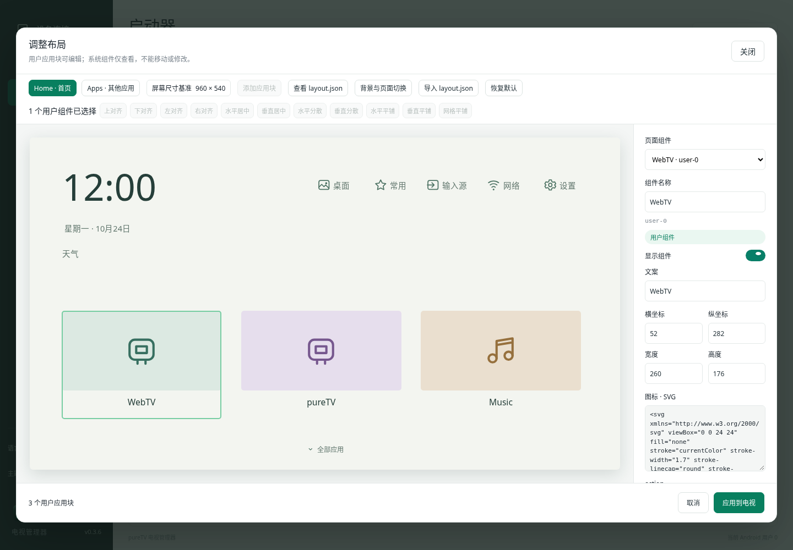
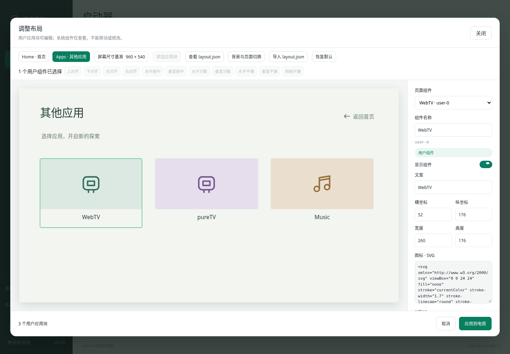

# pureTV 开发与协议文档

本文面向启动器作者、管理器开发者和 MCP 集成开发者。普通安装和使用见[项目首页](../README.md)，APK 资源见[资源目录](README.md)。下列构建命令从仓库根目录开始。

<a id="layoutjson-规范与画面对照"></a>

## layout.json 协议规范与画面对照

### 协议的职责与结构

`layout.json` 是连接电视启动器与电脑管理器显示的**协议文件**，不是管理器私有的草稿格式。启动器负责提供系统组件、可启动应用及当前配置，管理器按同一坐标和字段绘制画布；用户确认后，将修改后的协议写回启动器并读回核对。电视端与管理器共同验证字段，不能只改一端的 JSON 格式。

pureTV Manager 与 Launcher **0.3.6 使用 layout.json v5**。布局由电视和管理器共同读取：顶层 `screen` 定义坐标基准，`home` 和 `apps` 各自包含 `users`、`system`、`background`、`navigation`。不要把屏幕物理分辨率与设计坐标混为一谈；例如基准为 1920×1080，x=960 表示设计画面的水平中点。不同电视分辨率等比缩放，比例不同则留边。

- **users**：可编辑的应用块，`action` 直接使用当前用户已安装、启用且可启动的非系统 APK 包名。可修改位置、尺寸、名称、文案、显示状态、SVG 图标、颜色与背景色。
- **system**：启动器提供的时钟、日期、天气、桌面设置、收藏、输入源、网络、设置、页面入口等系统组件。可以选择和查看，不能拖动、框选排布或修改属性；导入、MCP 和电视接口同样保护这些组件。调整屏幕基准时仅按比例转换其坐标，不改变布局位置。
- **background**：该页独立的背景颜色与可选图片，与组件属性分开。Home 与 Apps 可以使用不同图片。图片存储在 JSON 中，不引用电脑路径；hover 不改变图片的覆盖与居中方式。
- **navigation**：方向键到达当前用户块最上／最下边缘时的切页规则。默认 Home `down: "apps"`，Apps `up: "home"`，恢复首页按下进入应用页的行为；省略某个方向则不切页。

同一份 v5 协议可以支持不同视觉风格：[pureTV](launcher/puretv/) 与 [Nova TV](launcher/nova/) 均使用 `users` / `system`、独立颜色和页面背景。Nova TV 的完整示例见 [layout.example.json](launcher/nova/layout.example.json)，需 Manager 0.3.7 或以上读写；其 provider 为 `content://com.ecojust.novatv.layout`，布局和数据与 pureTV 独立。

完整示例：[layout.example.json](launcher/puretv/layout.example.json)。示例应用来自资源目录，需要先在电视安装对应 APK。`system` 必须使用当前启动器返回的完整内容，不要自行增删或修改。以下为用户块和页面属性的结构片段：

```json
{
  "version": 5,
  "screen": {"width":960,"height":540},
  "home": {
    "background": {"color":"#101419"},
    "navigation": {"down":"apps"},
    "users": [{
      "id":"app-webtv",
      "name":"WebTV",
      "text":"电视直播",
      "frame":{"x":48,"y":220,"width":200,"height":150},
      "action":"com.ecojust.webtv",
      "visible":true,
      "icon":"<svg xmlns=\"http://www.w3.org/2000/svg\" viewBox=\"0 0 24 24\"><path fill=\"currentColor\" d=\"M2 2h20v20H2z\"/></svg>",
      "textColor":"#253E39",
      "iconColor":"#376F60",
      "backgroundColor":"#374959"
    }],
    "system": []
  },
  "apps": {
    "background":{"color":"#16222D"},
    "navigation":{"up":"home"},
    "users":[],
    "system":[]
  }
}
```

上例省略了只读 system 内容以便阅读，不能直接替代完整配置；请使用完整示例或 MCP 返回的配置。

### 每个字段的含义

| 字段 | 规则 |
| --- | --- |
| `version` | 必需整数，当前为 5，用来识别协议版本；不接受未知版本 |
| `screen` | 必需对象，包含 width 和 height，不是组件，也没有 action |
| `home` / `apps` | 必需页面对象，分别代表主页与其他应用页；每页必须包含下面四个字段 |
| `users` | 用户组件数组，可增删、移动和改属性；同一页 action 包名不能重复 |
| `system` | 启动器提供的系统组件数组，顺序及每个字段均只读；变更屏幕基准时坐标按各轴比例换算 |
| `background` | 必需页面外观对象；color 必需、image 可选，作用于整页背景，不是可交互的组件 |
| `navigation` | 必需对象，可为空；up/down 分别定义到达用户块上／下边缘时的页面切换，值为 home/apps |
| `screen.width` / `screen.height` | 320–7680 的整数；所有 frame 坐标和尺寸均以此为基准。基准由启动器提供，管理器弹窗仅显示、不能编辑；组件按文件中的数值显示 |
| `users` / `system` | 每页内 id 不重复；首页最多 24 个用户块，应用页最多 100 个；system 为启动器提供的只读列表 |
| `id` | 组件标识，1–100 字符，字母、数字、短横线或下划线；右侧显示，应用块创建后保持稳定 |
| `name` / `text` | 组件名称／画面文案，各最多 100 字；时钟、天气、网络等系统内容按电视实时状态或语言显示 |
| `frame` | 必需 `{x,y,width,height}`；整数，x/y≥0，宽高≥1，边界不能超出 screen |
| `action` | 必需的 `com.xxx.xxx` 形式标识。用户块为真实 APK 包名；系统组件没有独立 APK 时使用启动器定义的组件标识，由 id 和 action 一起表示固定功能 |
| `visible` | 必需布尔值。用户块可显隐；系统值只读。编辑器中隐藏块淡显以便恢复，电视上不显示 |
| `icon` | 直接存储 SVG 文本，最多 8 KiB，不再使用 music/apps 等枚举名。支持 svg/g/path/rect/circle/ellipse/line/polyline/polygon 与常用静态绘制属性；不支持脚本、事件、外部资源、image、style、DTD。`currentColor` 使用组件 iconColor |
| `textColor` | 组件文案颜色，必需 #RRGGBB，与图标颜色独立 |
| `iconColor` | SVG 中 currentColor 的颜色，必需 #RRGGBB；不覆盖 SVG 自己声明的 fill/stroke |
| `backgroundColor` | 组件背景色，必需 #RRGGBB 或 `transparent`；系统组件默认透明。没有层级属性，也没有每行列数 |
| `background.color` / `background.image` | 页面背景色，以及可选 PNG/JPEG/WebP data URI。单张图片最多 33,000 字符、解码尺寸≤1920×1080；导入时自动缩放压缩，WebKit 不支持 WebP 编码时使用 JPEG |
| `navigation` | 可选方向 up/down 的目标 home/apps；上下键在用户块边缘生效，Home 下键和 Apps 上键默认切到另一页 |

`frame.x`、`frame.y` 分别是组件外框左上角到屏幕基准左边、上边的距离；`frame.width`、`frame.height` 是整个组件外框的宽和高（应用块包含图标卡面与下方文案）。它们都是设计坐标单位，不是当前管理器窗口的 CSS 像素，也不是固定电视 dp。改变管理器窗口大小不改变 JSON。

`name` 用于编辑器识别组件；`text` 是画面文案，二者可以不同。`textColor` 用于文案，`iconColor` 用于 SVG 的 currentColor，SVG 内显式 fill/stroke 保持原值。空 SVG 表示没有自定义静态图形；时钟、天气等系统组件的实时内容和内部图形仍由相应功能生成。`visible=false` 不删除数据，之后可从组件列表重新选择用户块并恢复显示。组件不包含层级字段，固定系统组件由启动器管理，用户块按列表顺序绘制。

Manager 0.4.5 起，在属性面板粘贴 SVG 时会先移除非绘制信息：`role`、`aria-*` 属性，以及只包含文字的 `title`／`desc` 元素。绘图元素、变换和颜色保持原样；其他不支持的内容会明确报错，不会静默删除。此处理仅用于编辑器的 SVG 输入，写入 `layout.json` 的结果仍必须满足上表的静态子集和 8 KiB 限制；直接导入协议文件和 MCP 写入不会自动扩展该子集。

`background.image` 是完整 `data:image/png;base64,...`、`data:image/jpeg;base64,...` 或 `data:image/webp;base64,...` 字符串；省略表示只绘制 color。图片按 cover 居中覆盖，不重复平铺。图片只保存在其所在页面，不会自动覆盖另一页。启动器列表卡片自动匹配 Home 的背景色与背景图，包括未激活的协议启动器。列表不提供选择或移除封面的操作；桌面背景在「调整布局」中修改并应用。导入 APK 时优先读取 assets/layout.json 中的 Home 背景，仅在无法读取布局背景时使用同目录的 thumb.png／APK名.thumb.png；纯色布局不会回退到旧封面。

读取接口额外返回只读 `systemBasis` 元数据（screen/home/apps），保存启动器提供的系统组件原始基准。它不写入 layout.json，用于屏幕基准多次缩放时避免整数舍入累积，确保管理器与电视仍计算出相同系统位置。

读取：Manager 0.3.7 起按已安装 HOME 启动器的包名动态探测布局接口，通过协议验证后绘制可编辑画布，不维护启动器包名白名单；写入：检查 action 是否仍可启动、SVG 是否有效、frame 是否越界、system 是否发生修改。任一失败都不覆盖上一份有效布局。MCP 与 GUI 走同一读写路径；读取未激活启动器的 Home 背景不需要先激活它。

文件为 UTF-8，整体最多 **90 KiB**。旧版 v3/v4 已保存的用户应用块及背景可迁移；v4 的 color 同时迁入 textColor 和 iconColor，用户位置保持不变，系统组件采用新版透明样式。管理器仍支持 v2/v3/v4 APK；要使用 v5，需同时升级到 0.3.6 管理器与启动器。**不读取旧版 apps.json。**

### 第三方启动器接入与动态检测

管理器从电视的 HOME Activity 列表获取已安装启动器，按包名构造 `content://<packageName>.layout`。例如 `org.example.launcher` 使用 `content://org.example.launcher.layout`，无需向管理器注册包名。管理器对当前激活启动器调用 `status`，只有完整返回通过协议验证才显示“调整布局”；未实现接口、返回不支持或格式不合法时，仍可安装和切换，但不开放布局写入。读取封面时可探测其他已安装启动器，按包名去重且不切换桌面。

APK 可在 `assets/layout.json` 提供默认布局及 Home 背景。**仅存在此静态文件不代表能够编辑正在运行的桌面**；启动器还需要实现以下 Android ContentProvider 接口，在读写后使用同一份 layout.json 渲染界面：

这里的接口是 APK 内的 Android `ContentProvider` 组件，安装后由系统按需启动。管理器通过已连接的 ADB 调用，不使用 HTTP、不额外开放端口，也不需要先打开启动器界面。APK 文件本身只是安装包；接口访问的是电视上已安装应用的运行组件与私有布局数据。

例如第三方启动器在清单中声明：

```xml
<provider
    android:name=".LauncherLayoutProvider"
    android:authorities="org.example.launcher.layout"
    android:exported="true"
    android:permission="android.permission.DUMP" />
```

读取当前用户的配置（包名、用户 ID 和电视地址按实际设备替换）：

```sh
adb -s 192.168.1.50:5555 shell content call --uri content://org.example.launcher.layout --user 0 --method status
```

`apply` 使用同一路径的 `--method apply --arg <Base64布局>`；`reset` 使用 `--method reset`。Provider 需实现 `call(method, arg, extras)`，不是仅声明清单或放入 JSON 文件。

| 项目 | 约定 |
| --- | --- |
| Authority | `<packageName>.layout`；可导出，通过 `android.permission.DUMP` 限制 ADB shell 访问，启动器内部也可访问 |
| `status` | 无参数；读取当前有效布局、是否已有自定义和可选用户应用 |
| `apply` | `arg` 为 UTF-8 layout.json 的标准 Base64（无换行）；验证并原子保存，通知桌面刷新；失败时保持上一份布局 |
| `reset` | 无参数；恢复当前启动器默认布局并刷新 |
| 返回 Bundle | 三种方法统一返回字符串键 `result`，值为下面响应 JSON 的 UTF-8 标准 Base64；返回保存或重置之后的实际状态 |

```json
{
  "supported": true,
  "version": 5,
  "custom": false,
  "layout": { "version": 5, "screen": {}, "home": {}, "apps": {} },
  "systemBasis": { "screen": {}, "home": [], "apps": [] },
  "apps": [{ "packageName": "org.example.music", "label": "音乐" }]
}
```

上例只展示响应外壳，`layout` 必须替换为本节定义的完整有效布局；`systemBasis.screen` 为系统组件的原始屏幕基准，`home` / `apps` 为各页完整 `system` 数组。`version` 必须与 `layout.version` 相同。`apps` 最多 100 项，只包含当前用户已安装且可启动的用户应用；可选 `iconPng` 是最多 8 KiB PNG 的 Base64，不带 data URI 前缀。

管理器会验证布局字段、SVG、背景图片、坐标边界、系统基准与用户应用，再开放编辑；保存时再次确认默认 HOME 没有变化，并读取结果复查。启动器也必须独立执行同样的验证，不能仅依赖管理器。参考实现：[Nova Provider](launcher/nova/app/src/main/java/com/ecojust/novatv/LauncherLayoutProvider.java) 和 [布局验证及存储](launcher/nova/app/src/main/java/com/ecojust/novatv/LauncherLayout.java)。

### 文件与画面对照

| 配置与画面 | 管理器示例 |
| --- | --- |
| 完整示例的 Home：上方固定系统组件，下方可框选的用户应用块 |  |
| 完整示例的 Apps：独立背景与用户应用布局 |  |
| 框选用户块后，上对齐、左右分散、水平／垂直／网格平铺 |  |

顶部紧凑工具栏只保留一个「添加应用块」按钮，新增后自动选中，可在右侧改 action；屏幕基准仅显示，不能编辑。JSON 查看器只显示文本，不写入电视。右侧显示组件名称/id、类型，接着为「显示组件」switch 开关，再是文案、坐标尺寸、SVG、action 与独立颜色。Ctrl/Command 点击可切换多选，Shift 点击追加；空白处拖动框选，只选择用户块。系统组件固定，批量操作不会改写它们。所有修改都是本地草稿，确认「应用到电视」后才保存并读回核对。

示例图为管理器测试数据，时钟天气为示意；资源目录封面由对应 APK 的 Android 页面渲染测试生成。完整使用说明见[布局文档](../desktop/docs/launcher-layout.md)。

## 开发与验证

电脑端：[构建与运行](../desktop/README.md)。电视端使用 JDK 17／21、Android SDK Platform 35、Build Tools 34.0.0：

```bash
cd resource/launcher/puretv
./gradlew assembleDebug assembleRelease lintDebug testDebugUnitTest
```

资源校验：`python tools/resource_catalog.py --build-tools <Build Tools 34.0.0 路径>`。资源索引：`python tools/update-resource-index.py`。

项目使用核心、界面、四平台构建、原生管理器 MCP 联调与 Android 布局测试验证。尚未进行电视实机测试。

