# 电视 APK 资源目录

目录分为 `launcher/`（启动器）和 `apps/`（应用）。源码与 APK 放在同一软件目录。每个软件文件夹至少包含一个真实 APK，以及 resource.json、许可证和校验文件；可附对应源码及封面。点击软件名称进入文件夹下载。第三方 APK 保持上游原始二进制与签名。

“支持自定义”指管理器可识别的 layout.json 接口，当前配套启动器使用 v5 users/system 协议。上游截图、纯 TV 渲染示例与相关许可见各文件夹说明。

### 启动器

| 名称 | 作者 | 版本 | APK 大小 | 支持自定义 | 封面截图 |
| --- | --- | --- | --- | --- | --- |
| [Aster TV · 星轨](launcher/aster/) | ecojust / 桔子桑 | 0.1.1 | 443.7 KB | 是 | 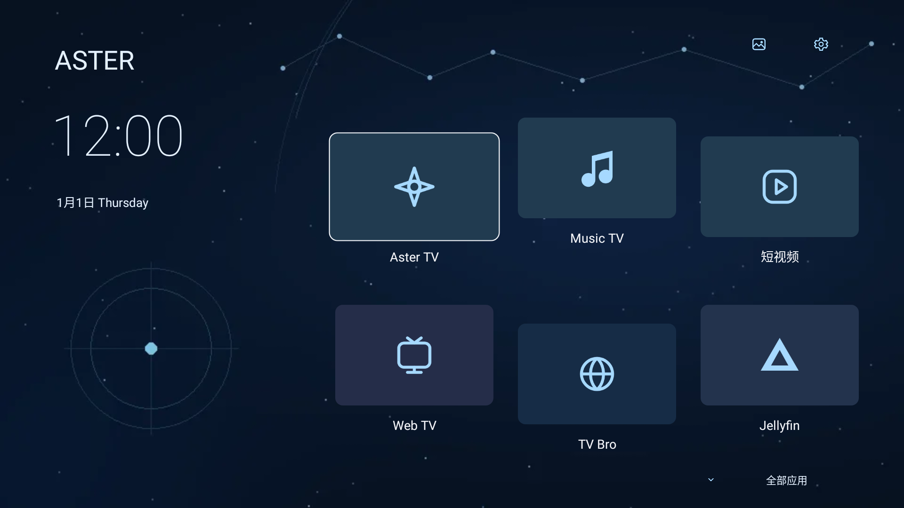 |
| [Circuit TV · 回路](launcher/circuit/) | ecojust / 桔子桑 | 0.1.1 | 435.7 KB | 是 | 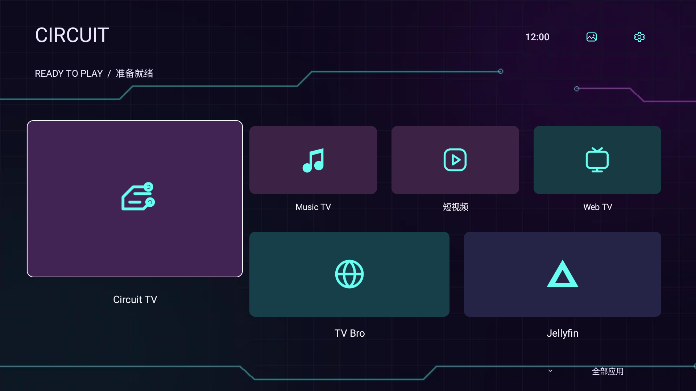 |
| [Drift TV](launcher/drift/) | ecojust / 桔子桑 | 0.1.1 | 475.7 KB | 是 |  |
| [Forma TV](launcher/forma/) | ecojust / 桔子桑 | 0.1.1 | 443.7 KB | 是 | 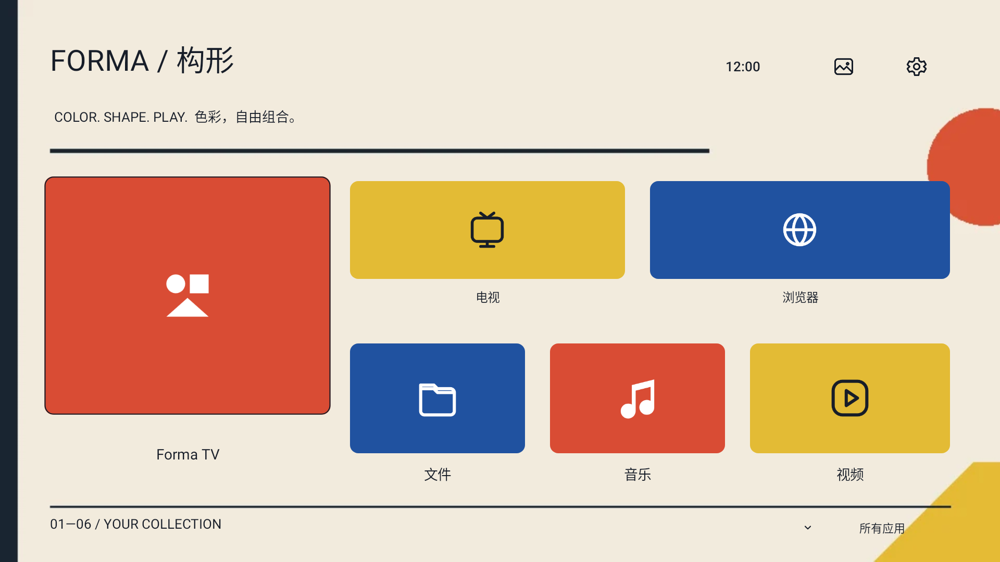 |
| [Mono TV 墨白](launcher/mono/) | ecojust / 桔子桑 | 0.1.1 | 443.7 KB | 是 | 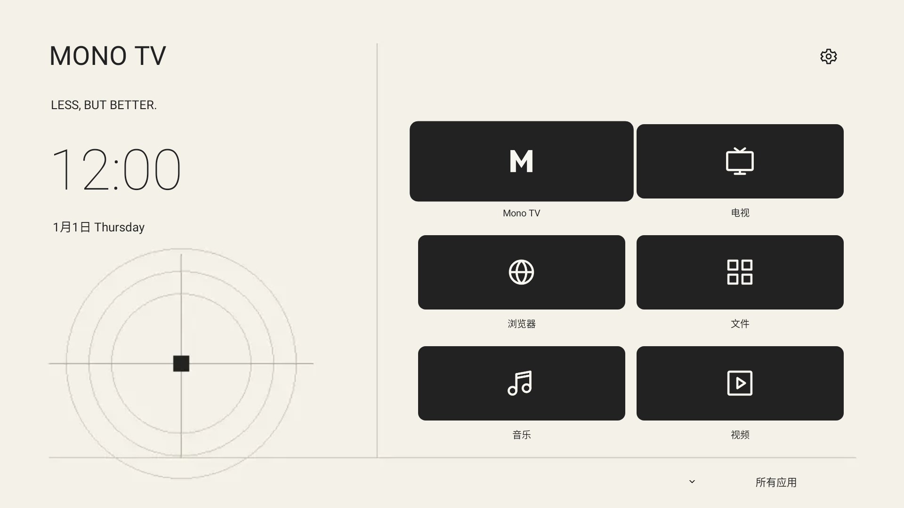 |
| [Moss TV](launcher/moss/) | ecojust / 桔子桑 | 0.1.1 | 487.7 KB | 是 | 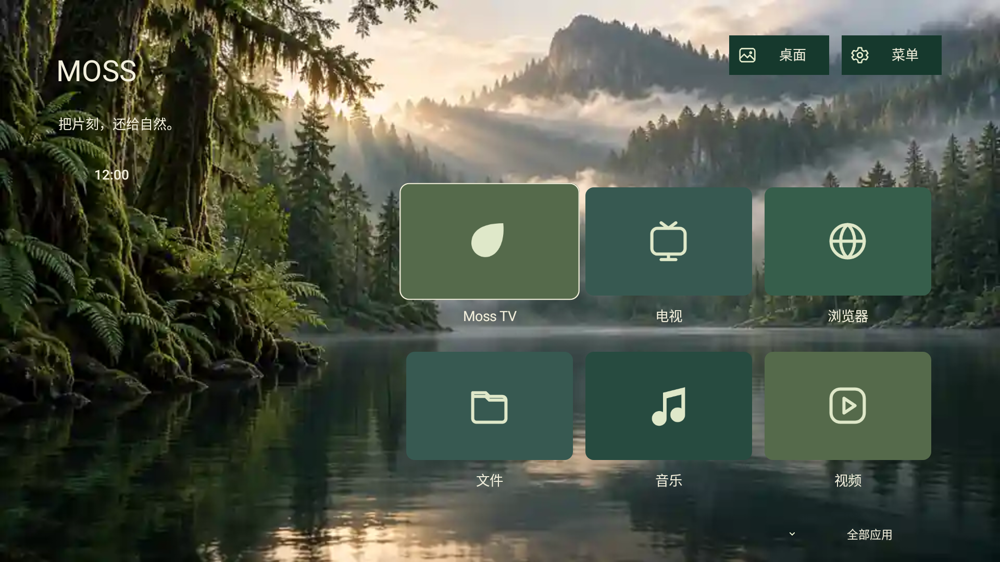 |
| [Nova TV](launcher/nova/) | ecojust / 桔子桑 | 0.1.2 | 495.7 KB | 是 | 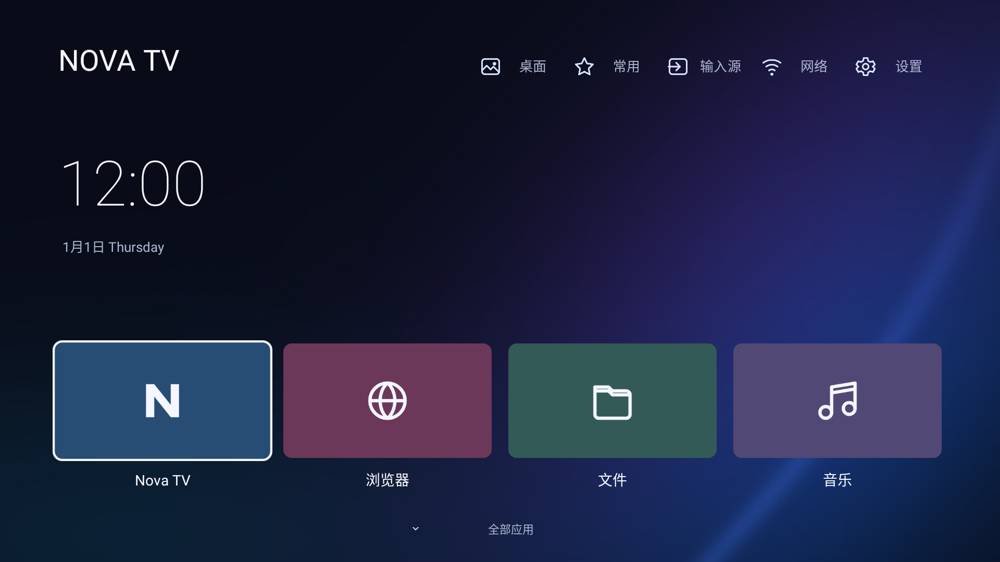 |
| [Pixel TV 像素](launcher/pixel/) | ecojust / 桔子桑 | 0.1.1 | 443.7 KB | 是 | 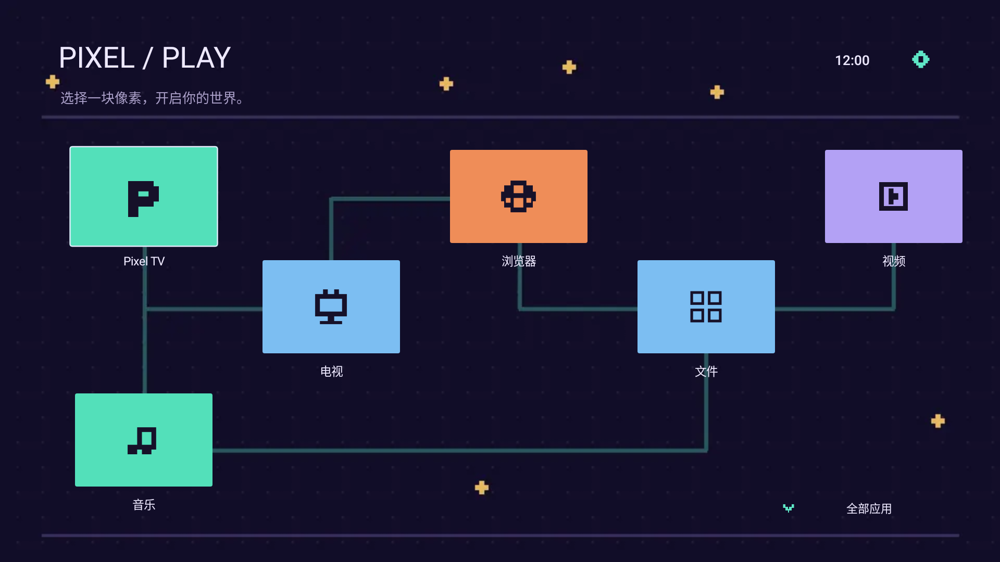 |
| [pureTV Launcher](launcher/puretv/) | ecojust / 桔子桑 | 0.3.7 | 740.1 KB | 是 |  |
| [Sol TV](launcher/sol/) | ecojust / 桔子桑 | 0.1.1 | 439.7 KB | 是 | 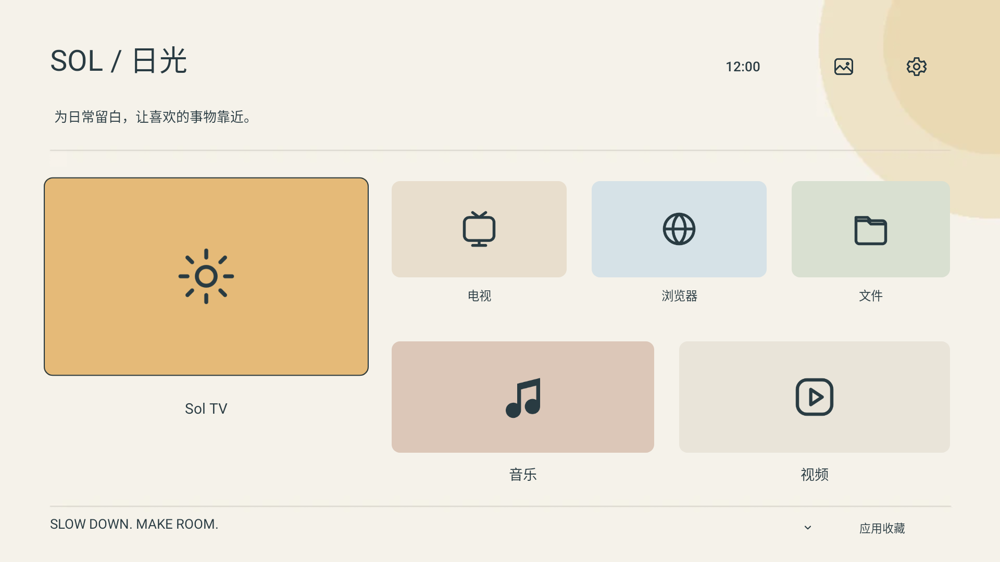 |

### 电视应用

| 名称 | 作者 | 版本 | APK 大小 | 用途 | 封面截图 |
| --- | --- | --- | --- | --- | --- |
| [CCTV Live](apps/cctv/) | ecojust / 桔子桑 | 0.1.0 | 40.9 KB | 央视官网播放器与电视频道导航 |  |
| [HIFINi TV](apps/hifini/) | ecojust / 桔子桑 | 0.1.4 | 201.1 KB | 基于 HiFiNi 的电视音乐播放器 | 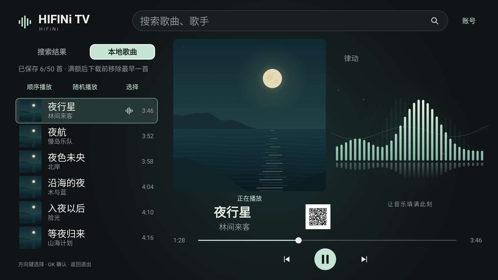 |
| [Jellyfin for Android TV](apps/jellyfin-tv/) | Jellyfin contributors | 0.19.10 | 20.93 MB | Jellyfin 媒体服务器的 Android TV 客户端 |  |
| [Music TV](apps/music/) | ecojust / 桔子桑 | 0.1.3 | 48.8 KB | 原生电视音乐播放器 | 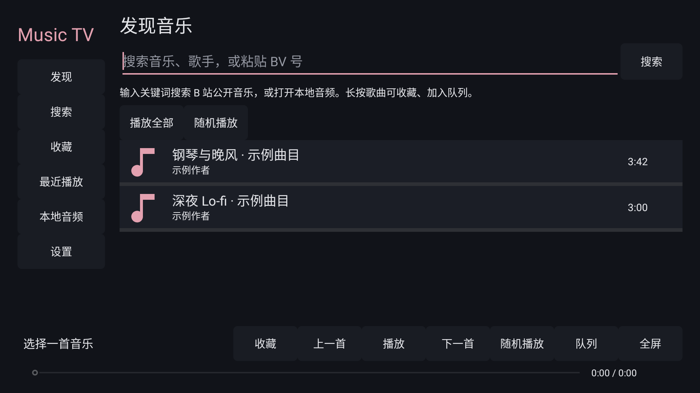 |
| [ShortVideo TV](apps/shortvideo/) | ecojust / 桔子桑 | 0.1.1 | 32.7 KB | 遥控器短视频播放器 | 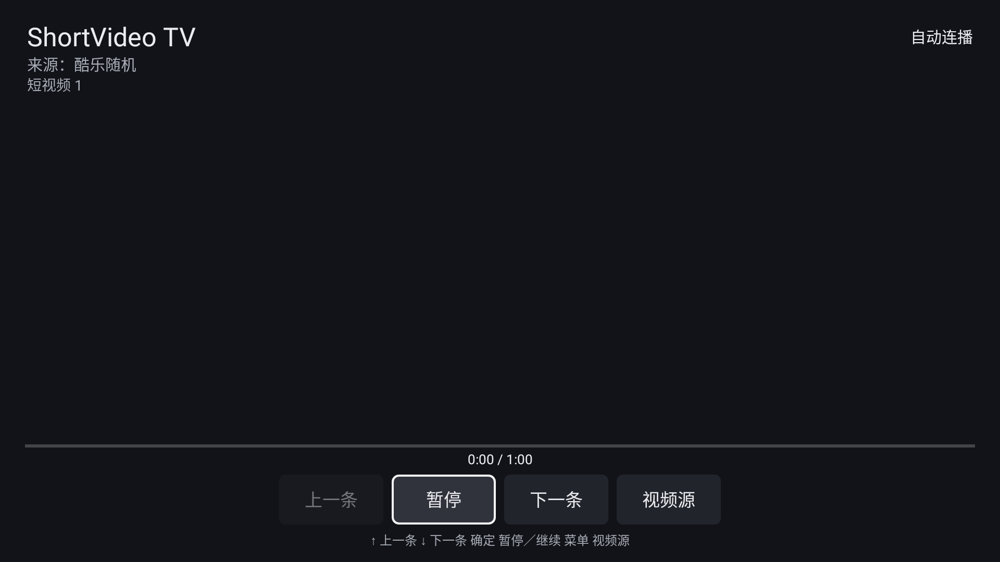 |
| [TV Bro](apps/tvbro/) | Fedir Tsapana (truefedex) | 2.1.6 | 6.48 MB | 适配遥控器的电视浏览器，使用系统 WebView |  |
| [WebTV](apps/webtv/) | ecojust / 桔子桑 | 0.1.1 | 44.8 KB | 电视直播与 M3U 播放器 |  |

开发者请参阅 [开发与协议 README](README-development.md)，包含 layout.json 字段说明、画面对照、构建与测试。

维护校验：`python tools/resource_catalog.py --build-tools <Android Build Tools 34.0.0 目录>`。索引由 `python tools/update-resource-index.py` 根据资源元数据生成。
