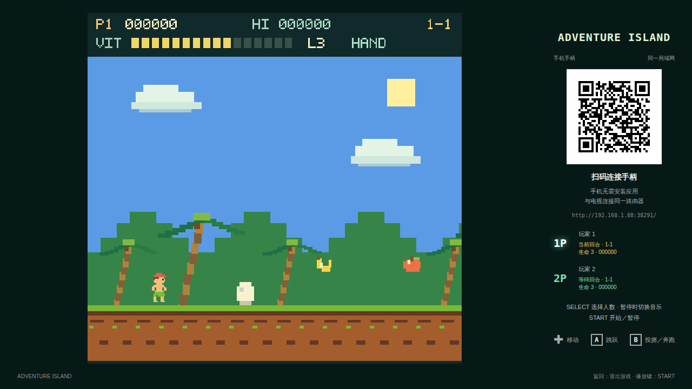
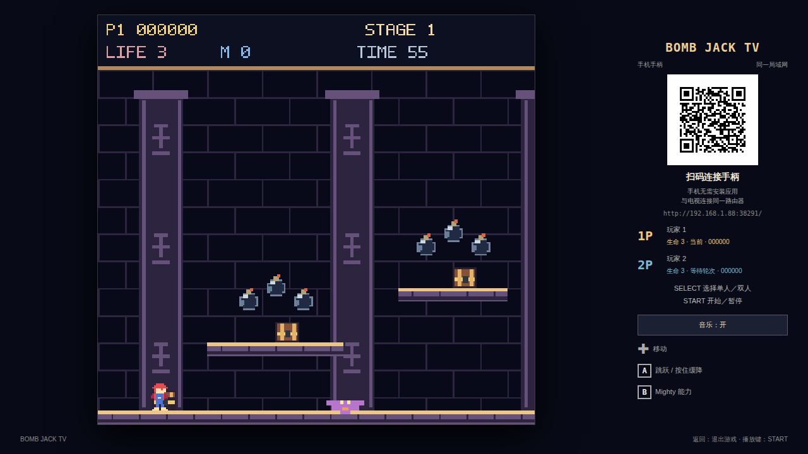
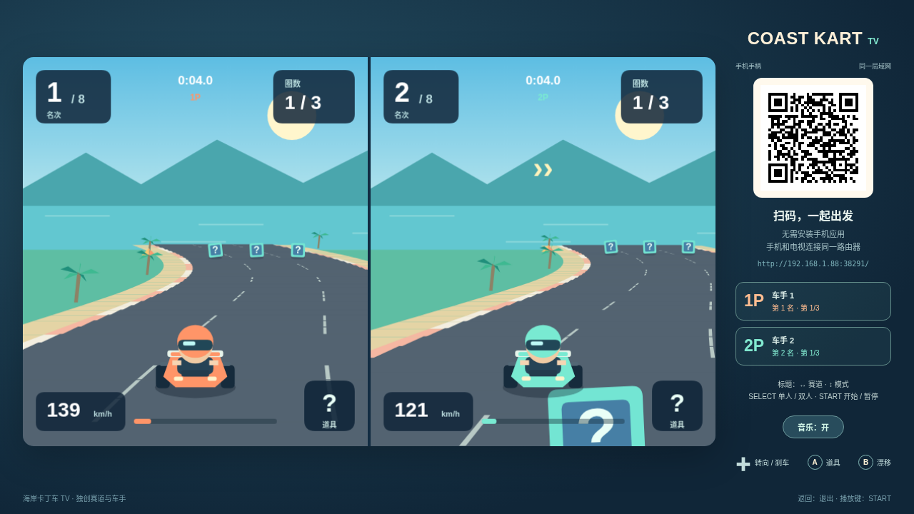
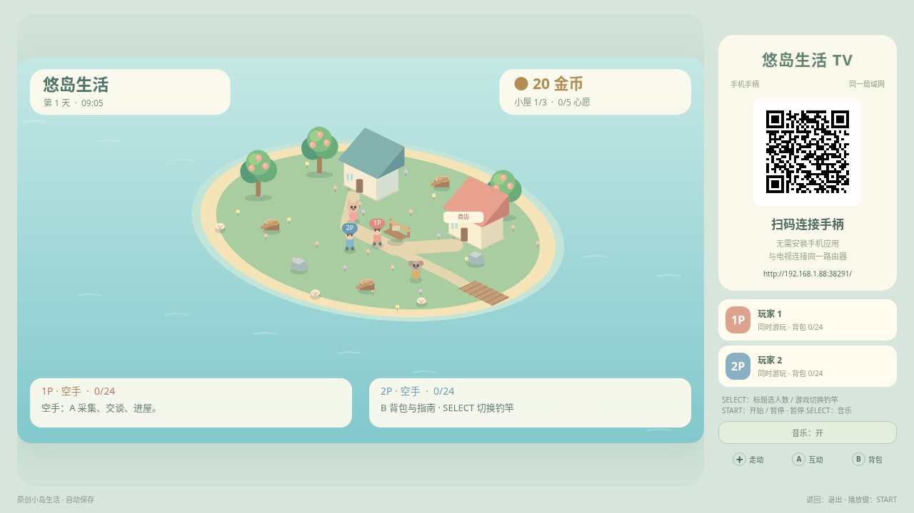
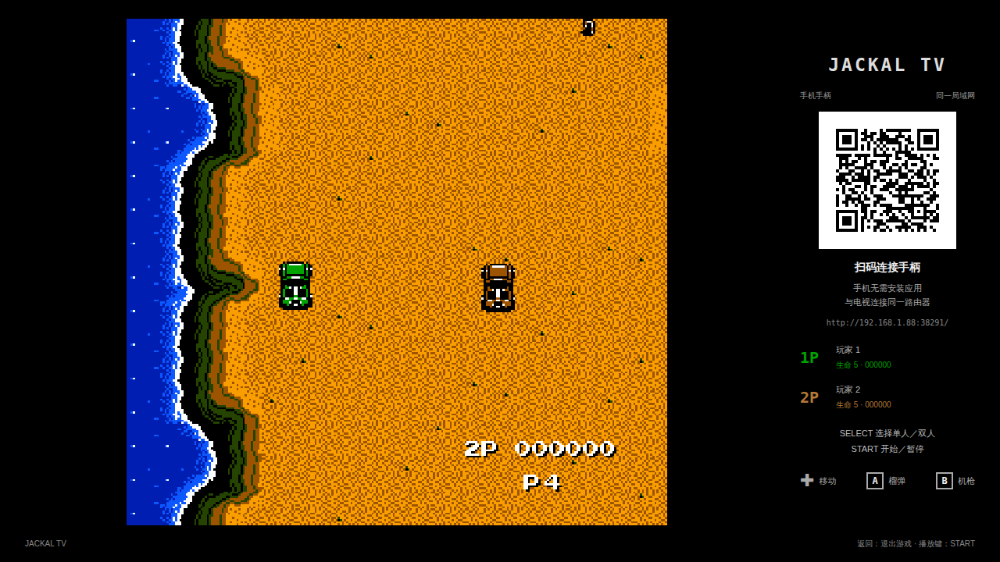
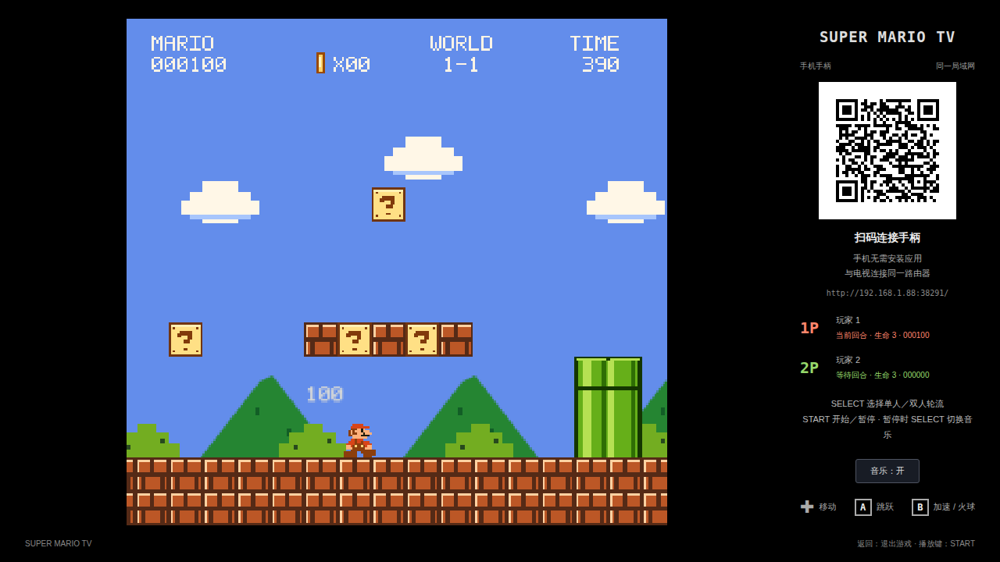
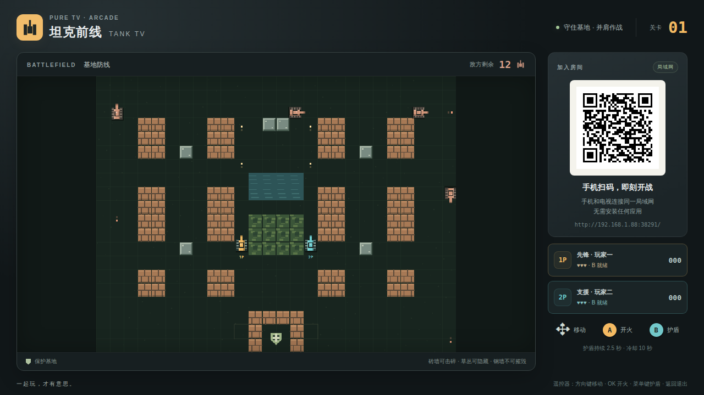
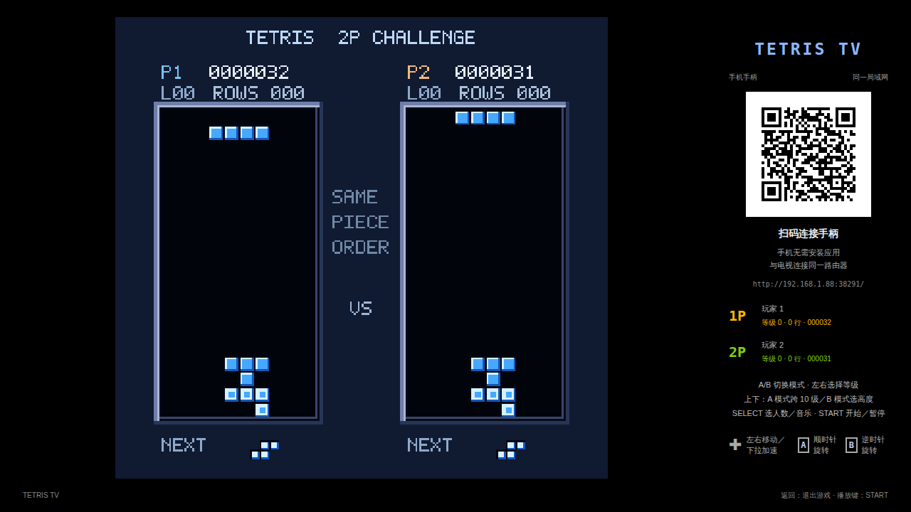
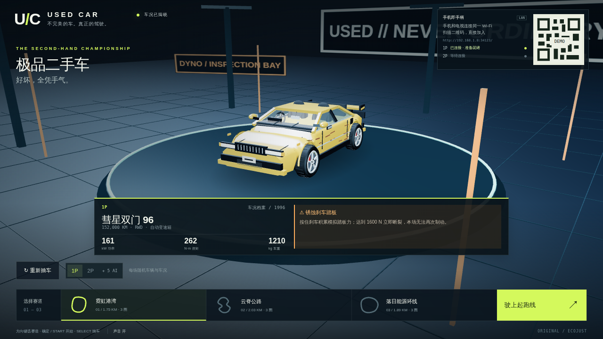

# 电视 APK 资源目录

目录分为 `launcher/`（启动器）和 `apps/`（应用）。源码与 APK 放在同一软件目录。每个软件文件夹至少包含一个真实 APK，以及 resource.json、许可证和校验文件；可附对应源码及封面。点击软件名称进入文件夹下载。当前收录桔子桑（ecojust）开发的启动器和电视应用。

“支持自定义”指管理器可识别的 layout.json 接口，当前配套启动器使用 v5 users/system 协议。界面预览与相关许可见各文件夹说明。

### 启动器

| 名称 | 作者 | 版本 | APK 大小 | 支持自定义 | 封面截图 |
| --- | --- | --- | --- | --- | --- |
| [Aster TV · 星轨](launcher/aster/) | ecojust / 桔子桑 | 0.5.0 | 443.7 KB | 是 |  |
| [Circuit TV · 回路](launcher/circuit/) | ecojust / 桔子桑 | 0.5.0 | 435.7 KB | 是 |  |
| [Drift TV](launcher/drift/) | ecojust / 桔子桑 | 0.5.0 | 475.7 KB | 是 |  |
| [Forma TV](launcher/forma/) | ecojust / 桔子桑 | 0.5.0 | 443.7 KB | 是 |  |
| [Mono TV 墨白](launcher/mono/) | ecojust / 桔子桑 | 0.5.0 | 443.7 KB | 是 |  |
| [Moss TV](launcher/moss/) | ecojust / 桔子桑 | 0.5.0 | 487.7 KB | 是 |  |
| [Nova TV](launcher/nova/) | ecojust / 桔子桑 | 0.5.0 | 495.7 KB | 是 |  |
| [Pixel TV 像素](launcher/pixel/) | ecojust / 桔子桑 | 0.5.0 | 443.7 KB | 是 |  |
| [pureTV Launcher](launcher/puretv/) | ecojust / 桔子桑 | 0.5.0 | 740.1 KB | 是 |  |
| [Sol TV](launcher/sol/) | ecojust / 桔子桑 | 0.5.0 | 439.7 KB | 是 |  |

### 电视应用

| 名称 | 作者 | 版本 | APK 大小 | 用途 | 封面截图 |
| --- | --- | --- | --- | --- | --- |
| [Adventure Island TV](apps/adventure-island/) | ecojust / 桔子桑 | 0.5.2 | 89.4 KB | 8 区域 32 关横版冒险，支持手机扫码单人或双人轮流 |  |
| [Mighty Bomb Jack TV](apps/bomb-jack/) | ecojust / 桔子桑 | 0.5.2 | 85.4 KB | 16 关金字塔跳跃冒险，支持手机扫码单人或双人轮流 |  |
| [CCTV Live](apps/cctv/) | ecojust / 桔子桑 | 0.5.0 | 40.9 KB | 央视官网播放器与电视频道导航 |  |
| [Coast Kart TV](apps/coast-kart/) | ecojust / 桔子桑 | 0.5.2 | 257.6 KB | 原创卡丁车竞速，支持漂移、道具和手机扫码双人分屏 |  |
| [Cozy Island TV](apps/cozy-island/) | ecojust / 桔子桑 | 0.5.2 | 269.6 KB | 原创岛屿生活，支持采集、钓鱼、布置和手机扫码双人游玩 |  |
| [HIFINi TV](apps/hifini/) | ecojust / 桔子桑 | 0.5.0 | 201.1 KB | 基于 HiFiNi 的电视音乐播放器 |  |
| [Jackal TV](apps/jackal/) | ecojust / 桔子桑 | 0.5.2 | 11.95 MB | 独立重写的六关吉普车营救游戏，支持手机扫码双人合作 |  |
| [Magic Jewelry TV](apps/jewel/) | ecojust / 桔子桑 | 0.5.2 | 81.4 KB | 经典三宝石连锁消除，支持手机扫码单人或双人比拼 |  |
| [ShortVideo TV](apps/shortvideo/) | ecojust / 桔子桑 | 0.5.0 | 32.7 KB | 遥控器短视频播放器 |  |
| [Super Mario TV](apps/super-mario/) | ecojust / 桔子桑 | 0.5.2 | 93.4 KB | 8 世界 32 关平台冒险，支持手机扫码单人或双人轮流 |  |
| [Tank TV](apps/tank/) | ecojust / 桔子桑 | 0.5.2 | 258.3 KB | 独立重写的 35 关坦克大战，支持手机扫码双人合作 |  |
| [Tetris TV](apps/tetris/) | ecojust / 桔子桑 | 0.5.2 | 81.4 KB | 经典俄罗斯方块，支持手机扫码单人或双人比拼 |  |
| [极品二手车](apps/used-car-racing/) | ecojust / 桔子桑 | 0.1.0 | 273.5 KB | 随机车况与机械故障的三维赛车，支持手机扫码一至两人竞速和 AI 对手 |  |
| [WebTV](apps/webtv/) | ecojust / 桔子桑 | 0.5.0 | 44.8 KB | 电视直播与 M3U 播放器 |  |

开发者请参阅 [开发与协议 README](README-development.md)，包含 layout.json 字段说明、画面对照、构建与测试。

维护校验：`python tools/resource_catalog.py --build-tools <Android Build Tools 34.0.0 目录>`。索引由 `python tools/update-resource-index.py` 根据资源元数据生成。
