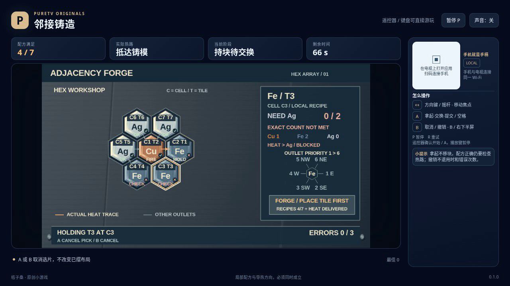

# 邻接铸造 / Adjacency Forge

在七格六边形工坊中交换铜、铁、银块，让每块金属的局部配方满足要求，再让炉源的热路实际抵达铸模。材料总数正确还不够：同样的邻居数量也可能导向堵塞或循环。

- 作者：ecojust / 桔子桑
- 包名：`com.ecojust.adjacencyforgetv`
- 版本：`0.1.0`
- 电视系统：Android 8.0 / API 26 及以上
- 图标：[logo.svg](logo.svg)

发布产物：[APK](adjacency-forge-0.1.0.apk) · [实际游玩视频](docs/gameplay-0.1.0.mp4) · [验证记录](docs/verification.json)



## 操作

手机与电视接入同一局域网，扫描电视画面的二维码。左侧摇杆移动选择框；右侧上半区 A 选择或交换，下半区 B 取消或撤销。

空手时在金属格按 A 拿起该编号块作为预览，再选另一格按 A，原子交换这两个格子的金属块。拿起不挪走金属，所有格子始终被占据；交换后邻接计数、出口和热路会一起刷新。方向选择同时考虑前方距离与侧向偏移，依据实际屏幕位置移动，包含独立的 FORGE 提交区，没有边缘穿越。

拿着金属时，按 B 或在原格按 A 都只取消本次拿起并返回原格，不会撤销上一笔交换。空手按 B 才撤销最近一次交换，恢复完整排列和原来的物理编号，并选回该笔交换的起点。相同材料的不同编号块仍是两个独立实例，交换它们也会真实记录，但不改变材料配方和热路。

空手选中 FORGE 后按 A 才提交当前排列。拿着金属时按 FORGE 不会提交，也不扣错误次数。即使所有条件已满足，仍需主动提交，不会在交换后自动获胜。

键盘使用方向键或 WASD，空格或 Enter 为 A，B 为 B，P 暂停，R 重试。电视遥控器使用方向键、确认键和菜单键；手机 START 开始或暂停。开始与结算菜单可用左右方向选择关卡，B 切换声音。A、B 每次按下触发一次，持续按住不会重复交换或提交。

## 配方与导热

每种金属只要求一种指定邻居材料的**精确数量**，要求跟随材料移动。例如要求两个铁邻居，就必须恰好有两个；其余材料的计数供观察，不是额外隐藏条件。只有实际存在的六边相邻格会被统计，每格只计一次；轮廓外没有邻格，不会绕到另一边。各关公开显示自己的配方。

导热目标是铜 Cu → 铁 Fe → 银 Ag → 铜 Cu。普通格在目标材料邻居中，按界面的固定世界方向优先级 **1 东、2 东南、3 西南、4 西、5 西北、6 东北**，取第一个作为实际出口。多个出口候选时不会自动挑一条能到终点的路；一个也没有就堵塞。即使本格配方不正确，出口也按这个规则计算。

热路从固定炉源沿出口前进。到达固定铸模后立即吸收成功，铸模没有后续出口；遇到无出口的格子则堵塞，再次进入已走过的格子则循环。铸模里的金属仍必须满足自身配方。画面展示的是当前排列的离散导热路径，不是连续温度或真实热力学模拟。

三关采用不同的固定轮廓、配方和炉源/铸模位置。主动提交时，必须同时满足全部七格的局部配方和热路抵达铸模。每次新的错误提交都扣一次错误额度，即使排列没变；累计三次失败。每局有 90 秒有效时间，时间耗尽优先于同一时刻的提交判定。撤销不会退还时间、错误次数、提交次数或累计交换次数；分数由当前配方与热路状态计算，反复交换不会累计刷分，初始分数也不一定为零。

暂停不消耗有效时间。恢复或断线的输入清理不会自动交换、提交或取消已经拿起的预览。终局冻结当前状态，不能再撤销；R 重新开始当前固定关卡，恢复初始排列和次数。

## 源码与验证

公开字段、精确轴坐标邻接、方向优先级、交换历史和评分公式见 [模型契约](docs/model-contract.md)。所有格子、材料、配方和热路都是公开信息；生产模型不内置参考排列、解题器或强制胜利入口。

[独立规则报告](docs/independent-forge-review.json) 用 cube 距离重新建立邻接，用反向可达固定点验证导热，再完整枚举每关 5,040 种物理编号排列。三关到达完整目标最少分别需要 2、3、4 次交换；相同材料的不同编号在计数中仍是不同实例。

独立脚本还用普通模型输入验证了三关胜利、三关配方全对但热路循环的真实拒绝，以及三关热流已到铸模但配方错误的真实拒绝；另核对了 192 个有序焦点对、精确编号撤销、持片提交保护和错误次数不退还。八组数学边界夹具与这些普通输入结果分开标明。

从仓库根目录可复核：

```sh
node resource/apps/adjacency-forge/tests/independent-forge-review.mjs --output /tmp/adjacency-forge-review.json
```

[操作脚本的独立审查](docs/independent-pilot-review.json) 使用另建的合成七格图验证公开观察、持片与空手操作、同材料不同编号、撤销后修复、多个独立控制实例和有界求解；86 次冻结观察没有读取私有字段或写入状态，没有执行生产模型或浏览器。

规则夹具、普通模型输入、操作脚本的合成观察审查和浏览器实录分别记录。模型执行不具备浏览器的真实等待时间，不能替代游玩录像或实体设备测试；实际发布检查及其范围见验证记录。

手机手柄与 Android 宿主组件见 [game-kit](../../game-kit/README.md)。源码与原创素材遵循仓库 [MIT 许可证](../../../LICENSE)。
