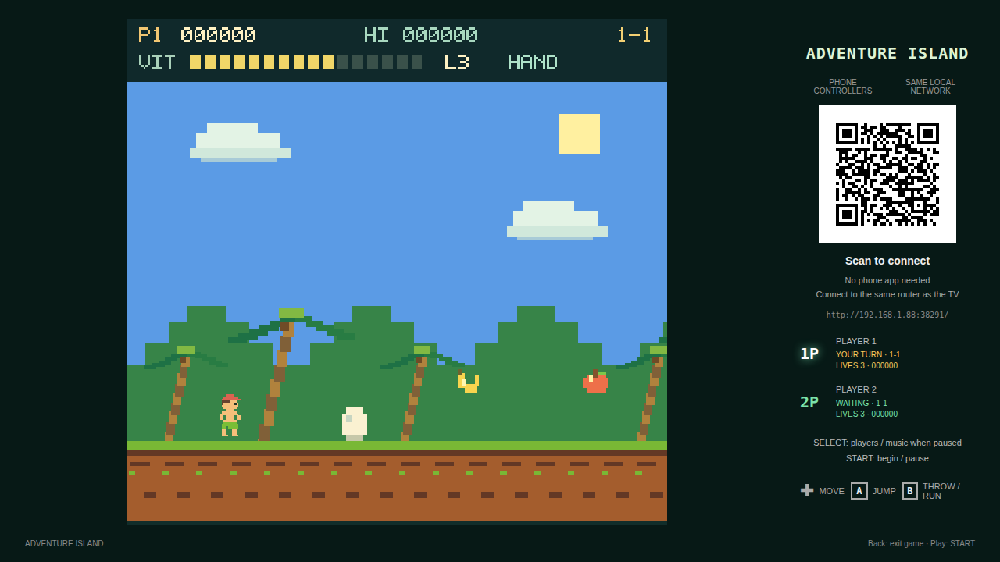
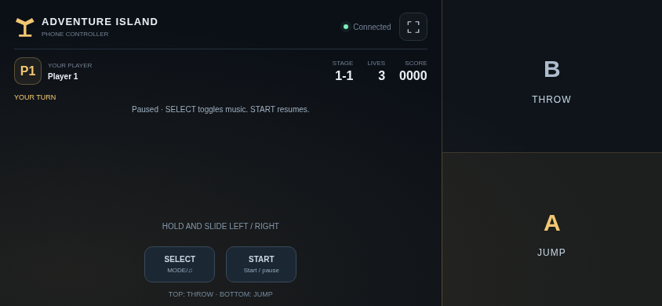
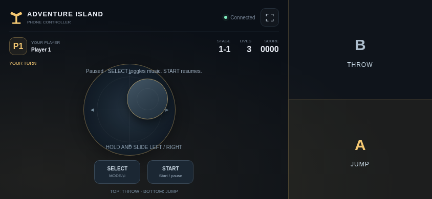

# Adventure Island TV

[中文](README.md) · [English](README.en.md)

An independent recreation inspired by Adventure Island 1: eight areas and 32 stages across forests, caves, coasts and ice. Includes vitality, fruit, axes, fireballs, skateboards, hidden eggs and area bosses.

Version **0.5.2** requires Android 8.0 or later. Package: `com.ecojust.adventureislandtv`. The TV displays the game and a room QR code; phones act as controllers.

<!-- apk-resource:start -->
[Download APK](adventure-island-0.5.2.apk?raw=1) · [Checksums](SHA256SUMS.txt) · [Signing and build provenance](resource.json) · [Source code](src/) · [64×64 SVG icon](logo.svg)

The APK in this directory is signed with the pureTV release certificate. Android cannot update an existing installation of the same package if it uses a different signing certificate. Back up its data and uninstall the old package first.
<!-- apk-resource:end -->

<!-- visual-release:start -->
## 0.5.2 visual update and verification

The current release is **0.5.2**, with its signed APK available in this directory. It uses the same pureTV certificate as 0.5.0/0.5.1, allowing an in-place update that retains local data. See the [0.5.2 visual update record](../../../docs/game-visuals-0.5.2.md) for per-game changes, verification scope and physical-device test status.

The HUD was adjusted toward the original FC/NES Adventure Island presentation: score, stamina and life indicators appear directly over the scene, without an opaque information bar covering it. The corresponding pixel scenery and character proportions remain; independently reconstructed levels and artwork are documented in the reference notes.

See the [reference notes](docs/reference.md) for the implementation scope.

<!-- final-verification -->
Final source 0752b658aecbb1322cb7294e3176500639db1b54 passed Android CI 40843467072: 280 model/render-behavior regressions, 36 compatibility scenarios, 131 controller scenarios and 18 bilingual integration scenarios. Cozy Island input-runtime checks passed 9/9; both WebGL 1 rendering scripts and the Coast Kart combat suite also passed. Android builds, lint, size checks and staging succeeded; 15 modules executed JUnit tasks, including all 9 games, without an inferred JUnit case count. Signing run 40846148068 verified all nine APKs’ source assets, signatures and resource catalog. Chrome 61 syntax checks and old-API simulation in modern Chromium do not establish physical legacy-WebView compatibility. Physical TV/phone acceptance, device FPS and in-place installation/data retention remain untested.
<!-- visual-release:end -->

## 0.5.1 gameplay review

Adds hidden-cloud discovery through weapon clues, a cloud ride, fruit bonuses and a return to the next checkpoint.

Uses the same signing certificate as 0.5.0 and supports an in-place update. See the [fidelity review](../../../docs/game-fidelity-0.5.1.md) for tested behavior and remaining differences.

## Installation and signing

Version 0.5.2 uses the same shared pureTV certificate as 0.5.0/0.5.1 and updates those versions in place while retaining local data. Installations of 0.4.x and earlier signed with the old certificate cannot be updated in place: back up exportable data before uninstalling. Uninstalling clears local saves and records; the project has no automatic cross-certificate migration.

## Play

1. Connect the TV and phones to the same LAN and open the game on the TV.
2. Scan its QR code in a phone browser. Use one phone per player.
3. Press SELECT on the title screen to choose the player count, then START.
4. The left floating joystick stays hidden until touched. Each touch sets its center; drag to move, then release to stop and hide it. The right third of the screen is the action area: touch anywhere in its upper half for B or lower half for A, simultaneously with the stick. START/SELECT remain separate at the bottom left. Long presses in the control area do not select text or open browser menus.

| Control | Action |
| --- | --- |
| Floating joystick | Move left/right |
| Lower right half: A | Jump; hold for a higher jump |
| Upper right half: B | Throw your weapon / run |
| SELECT | Change player count on title; toggle music while paused |
| START | Start, pause / resume |
| TV Back | Confirm exit |

Two players take **alternating turns**, retaining their own lives, score and stage. A lost life passes control to the next player. Phones show whose turn it is; waiting players cannot move the active character. Losing the active controller pauses the game until it reconnects. Manual pause remains paused. High score and music preference are stored on the TV.

## Gameplay changes in 0.5.0

- Broken eggs release physical pickups that rise, land and require contact; shooting an egg from afar no longer equips its contents. Skateboard pickups roll forward.
- Approaching birds commit to a dive height, then climb away, making their attack readable and avoidable.
- New item sprites, shell fragments, floating pickup scores and a distinct eggplant companion show each state clearly.

## Screenshots

Actual bundled game pages rendered in Chromium with a simulated native room bridge, not physical TV captures.







## Room and exit

Up to two phones connect through a local HTTP/WebSocket server. Each launch creates a new port and random room token in the QR code. No cloud service is required. Losing focus, cancelling a touch or disconnecting releases held buttons.

Leaving with TV Home or confirming exit closes the room, disconnects phones, releases workers and wake locks, destroys the WebView and audio, and ends the app process. Scan the new QR code when reopening. Current game progress is not restored after exit.

## Implementation and verification

Maps, graphics, icons, sound effects and music are independently authored. No original ROM, extracted artwork or original soundtrack is bundled. See the [reference and implementation notes](docs/reference.md) for the exact scope and differences; this is not a claim of frame-perfect or tile-for-tile reproduction. Project-authored code and assets use the [MIT license](LICENSE).

```sh
node --test resource/apps/adventure-island/tests/*.test.cjs
node resource/apps/adventure-island/tests/controller.mjs
node resource/apps/adventure-island/tests/compatibility.mjs
node resource/apps/adventure-island/tests/capture.mjs

cd resource/launcher/puretv
./gradlew :adventure-island:assembleRelease :adventure-island:testDebugUnitTest :adventure-island:lintDebug :adventure-island:verifyReleaseSize
```

Browser tests use the desktop npm dependencies and Chromium; set `CHROMIUM_PATH` to select a browser. Physical TV and phone verification is still pending.
