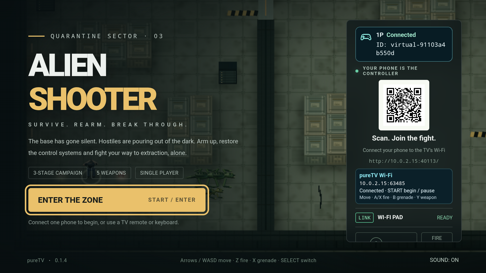
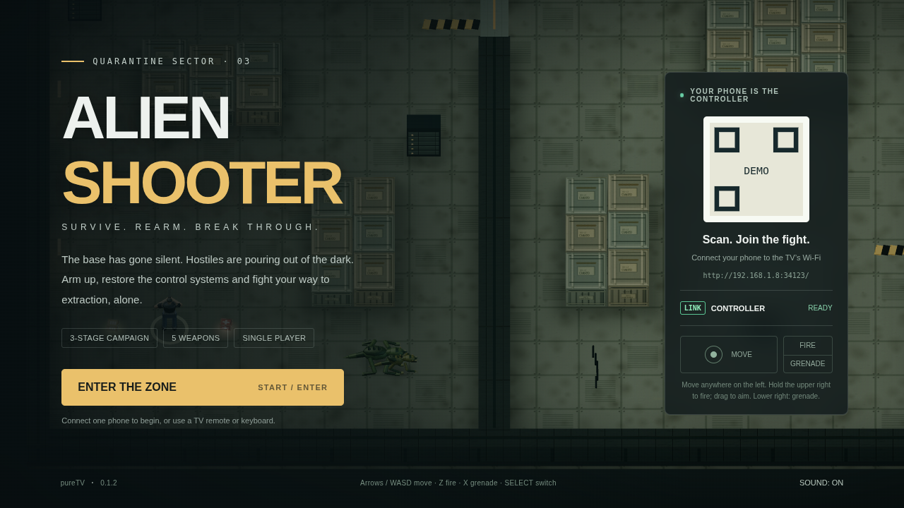
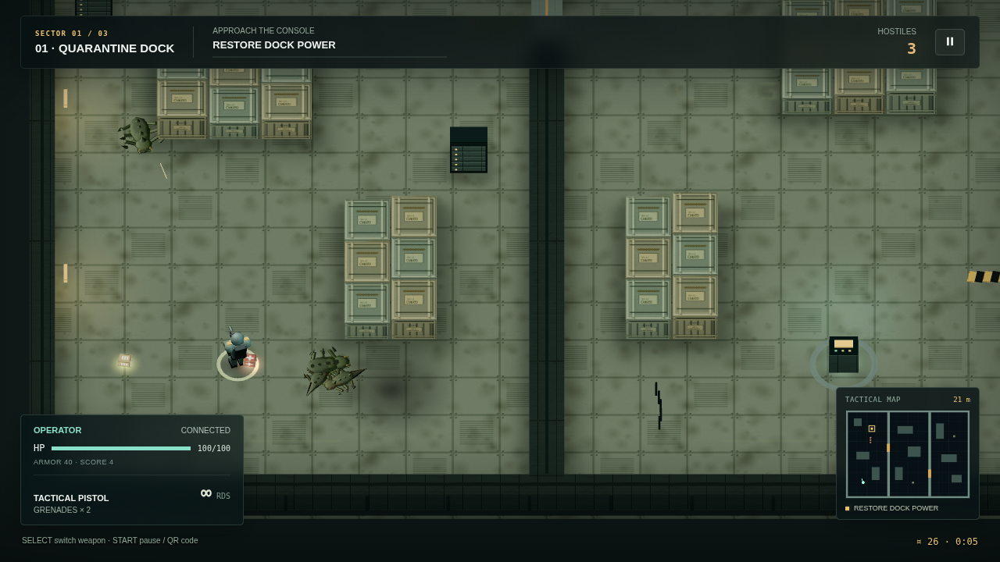
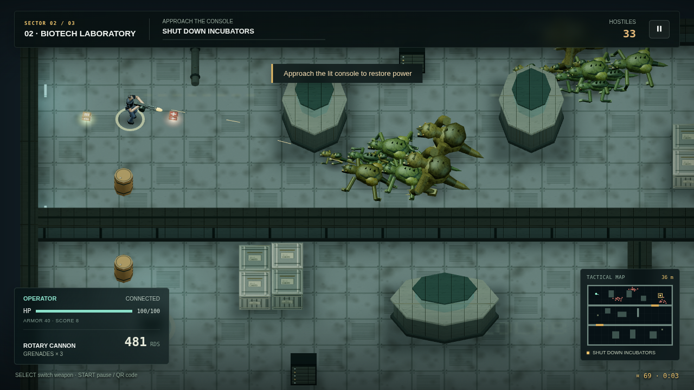
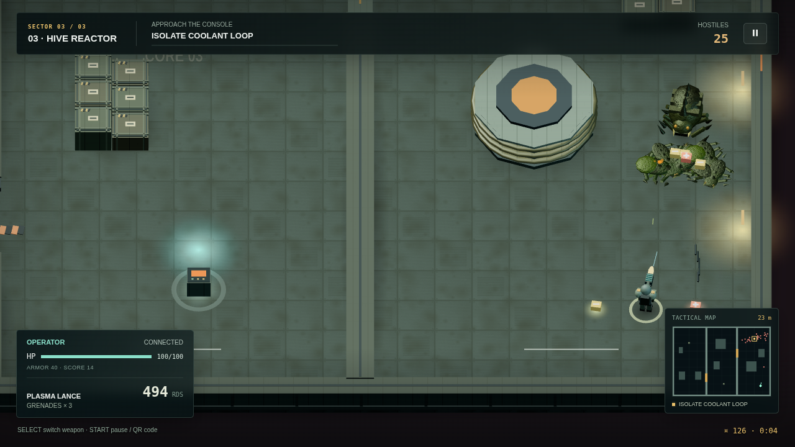

# Alien Shooter TV

<!-- apk-resource:start -->
[Android 0.1.6 APK](alien-shooter-0.1.6.apk?raw=1) · [Windows x64](https://github.com/ecojust/pureTV/releases/download/gameplay-icons-2026.11.21/alien-shooter-windows-x64-setup.exe) · [macOS](https://github.com/ecojust/pureTV/releases/download/gameplay-icons-2026.11.21/alien-shooter-macos.dmg) · [Launcher artwork and installation checks](docs/releases/0.1.6/android-icon-receipt.json) · [Checksums](SHA256SUMS.txt) · [0.1.5 gameplay video](docs/releases/0.1.5/gameplay.mp4?raw=1)
<!-- apk-resource:end -->

## Earlier Android release 0.1.5 · Controllers and phone pairing

[Download the signed APK](alien-shooter-0.1.5.apk?raw=1) · [Checksums](SHA256SUMS.txt) · [Package and source](resource.json)

Connect a keyboard, pair a pureTV Wi-Fi controller, or scan the TV room’s QR code with a phone on the same network. The connection indicator identifies each player while the game keeps its playing area at the same size. [Controller guide](../../../docs/guide/README.en.md#install-a-game-and-connect-a-controller)

The signed APK upgraded Android 0.1.4 in place on an Android TV emulator. The original controller SDK completed 8 checks and received matching acknowledgements for 72 messages. [Gameplay screenshot](docs/releases/0.1.5/gameplay.png) · [Android gameplay recording](docs/releases/0.1.5/gameplay.mp4?raw=1) · [Verification and limitations](docs/releases/0.1.5/verification.json)

[中文](README.md) · [English](README.en.md)

<!-- controller-client-status:start -->
## Earlier release 0.1.4 · Connected controller identity

<!-- previous-apk-resource:start -->
[Download signed APK](alien-shooter-0.1.4.apk?raw=1) · [Checksums](SHA256SUMS.txt) · [Signing and source](resource.json) · [Source](src/) · [Icon](logo.svg)
<!-- previous-apk-resource:end -->

Android **0.1.4 / versionCode 5** shows a controller icon, player seat (1P/2P where supported), and the connected device's complete ID in the side area. Disconnected devices disappear. The default TCP port remains **63485**. Current controller firmware does not report RSSI, so signal strength is not displayed.

[Connected screenshot](docs/releases/0.1.4/connected.png) · [Controller-status recording](docs/releases/0.1.4/controller-status.mp4?raw=1) · [Version verification](docs/releases/0.1.4/verification.json) · [Twenty-game update record](../../../docs/controller-client-status/README.md)

The APK uses the existing release certificate. This update verifies connection identity, disconnect/reconnect status and in-place installation in an Android TV emulator; the capture and video show the menu status checks. It does not repeat full gameplay acceptance. Unchanged model evidence is reused by exact hash, with previous reports retained below. Physical TVs, phones, ESP32 devices and upgrades containing existing user saves remain untested.


<!-- controller-client-status:end -->

An independently built overhead shooter for Android TV. Fight through a quarantined freight depot, a biotech laboratory and a hive reactor. Restore consoles, survive incoming hostiles, buy supplies and defeat the guardian before extracting. Designed for a single player, using one phone as the controller.

Current version **0.1.6** · Package `com.ecojust.alienshootertv` · Android 8.0 or newer.

## Play

1. Connect the TV and phone to the same local network, then launch the game.
2. Scan the code on the title screen with one phone. The room accepts one controller.
3. Press START to enter the zone directly.
4. Stand near the illuminated console to charge it, defeat the incoming enemies and advance. Complete the three objectives, then reach the green extraction marker.

The tactical map shows walls, closed gates, your position, enemies and distance to the current objective. A yellow square marks the active console; green marks extraction.

The QR panel collapses during combat. Press START to pause and show it again. A disconnected controller pauses the fight. Reconnect and press START to resume; combat never resumes on its own. Pressing TV Home or confirming exit ends the run and closes the room.

| Phone control | Action |
| --- | --- |
| Left two thirds | A floating movement stick starts wherever you touch |
| Upper half of the right third | Hold anywhere to fire; drag to aim independently. Holding without dragging uses assisted targeting within line of sight |
| Lower half of the right third | Throw a grenade. Release before throwing another |
| SELECT | Change weapon; select supplies in the shop |
| START | Begin, pause or resume; advance to the next sector from the shop |

Movement and firing support simultaneous touches. Controller zones prevent text selection, long-press menus and scrolling. Cancelled touches, loss of focus and disconnects release controls.

Keyboard: arrows / WASD move, Z / Space fire, X / G throw a grenade, Q / Shift switch weapons, Enter / P begin or pause. Aim with the mouse and hold the left button to fire. A TV remote supports movement, confirmation/fire and the playback key for START.

## Campaign

| Sector | Objectives |
| --- | --- |
| Quarantine dock | Restore power, release the quarantine gate, open extraction access |
| Biotech laboratory | Shut down incubators, purge the corridor, recover research records |
| Hive reactor | Isolate coolant, overload the reactor, destroy the hive guardian |

Weapons include an unlimited-ammunition pistol, SMG, shotgun, rotary cannon and plasma lance with splash damage. The first ammunition pickup unlocks the SMG. Between sectors, purchase weapons, ammunition, medical supplies, armor, grenades or maximum-health upgrades.

Fight crawlers, fast melee runners, ranged spitters, armored brutes and the final guardian. Walls block shots and line of sight. Explosive barrels can break encirclements. Earn credits by eliminating enemies and buy supplies to strengthen your operator. Losing all health ends the mission; restart to try again.

Campaign progress lasts for the current session; quitting ends the run. The sound preference is stored locally. Reopening the app creates a new local room and requires scanning the new code.

## Historical visuals and sound (0.1.1–0.1.2)

Version 0.1.1 uses a bundled 1024 texture atlas to bake crate straps, fasteners, labels and wear onto low-poly geometry. All three stages share one detailed floor material with separate baked contact shading and local lighting. Opaque static scenery is batched; each enemy species shares one instanced draw for its body, animated legs and corpses. Offscreen objects are culled and only used buffer ranges are uploaded.

Version 0.1.2 studies the original game's official public imagery for revised human and alien silhouettes. The human has short hair, a dark shirt, blue-gray trousers and a two-handed weapon stance. Creatures now distinguish low crouched four-limb forms, slender runners and heavier hind-leg-supported forms. Articulated locomotion follows actual displacement, with upper-body aiming handled separately from forward, sideways and backward leg movement. These models and animations are independently authored.

HUD nodes and the static minimap layer are retained, while paused scenes avoid redundant drawing. Projectile, particle and corpse limits remain bounded. Simulation and controller input keep their original update frequency. Weapons, explosions, pickups and industrial ambience are synthesized locally with Web Audio.

See the [historical 0.1.2 character motion comparison and video](docs/character-motion.md), [baking methods](docs/baking.md) and the [0.1.1 environment performance comparison](docs/performance.md).

[Watch historical 0.1.2 campaign gameplay](docs/gameplay-0.1.2.mp4) · [Recording details](docs/gameplay.md). The recording uses the released game page and normal control inputs to demonstrate automated play. It is not physical-TV footage or a human-operated recording.

These captures show the bundled page rendered in Chromium with a simulated Android room bridge. Sector showcases use test scenarios; they are not physical-TV captures or a recording of a complete human playthrough.









## Development

The commands below are reproducible check entry points, not a claim that all checks passed for this release. Current execution results are linked above.

```sh
node --test resource/apps/alien-shooter/tests/*.test.cjs
node resource/apps/alien-shooter/tests/controller.mjs
node resource/apps/alien-shooter/tests/integration.mjs
node resource/apps/alien-shooter/tests/runtime-performance.mjs
node resource/apps/alien-shooter/tests/animation.mjs
node resource/apps/alien-shooter/tests/performance.mjs --samples 6 --warmup 1 --regressions
node resource/apps/alien-shooter/tools/bake-materials.mjs --verify

cd resource/launcher/puretv
./gradlew :alien-shooter:testDebugUnitTest :alien-shooter:lintDebug :alien-shooter:assembleRelease :alien-shooter:verifyReleaseSize
```

Browser tests use the desktop package’s Playwright dependency. `CHROMIUM_PATH` selects Chromium; `ALIEN_SHOOTER_UI_CAPTURE_DIR` selects the capture directory. TV performance, real phone latency and device compatibility still require physical-device validation.

Maps, characters, textures, sound and rules are independently created. See [production notes](docs/reference.md) for scope and sources. Application code and original assets use the [MIT license](LICENSE); the bundled Three.js license is included separately.

## pureTV Wi-Fi controller

Put the TV and controller on the same LAN, open the game and press GPIO 23 Search. The panel shows the actual address, port and discovery state. TCP defaults to **63485**, falls back only if occupied at startup, and keeps the selected port across temporary focus loss. Home or switching apps exits and closes the service. Automatic selection requires exactly one game service on the network.

START begins, pauses or resumes. Directions move. Hold A / X to fire using the existing nearby-enemy aim assist; B throws a grenade; Y changes weapon. Phone QR, TV remote and keyboard controls remain available. Y supplies SELECT in this game; X aliases A.

Disconnects, replaced sessions and changes of control source cancel old input and pause. Release held buttons, then press START after reconnecting; held synchronization never starts an action. This game accepts one Wi-Fi controller.

<!-- controller-client-status-history:start -->
<details>
<summary>Historical 0.1.3 download and acceptance record</summary>

The following describes the previous release; its tests and media do not validate the new controller-ID UI. [Original README at the previous source](https://github.com/ecojust/pureTV/blob/9af9f197855eb7a0ce7174c0e6295c8974b3250d/resource/apps/alien-shooter/README.en.md).

[Download APK](alien-shooter-0.1.3.apk?raw=1) · [Checksums](docs/controller-status-baseline/0.1.3/SHA256SUMS.txt) · [Signing and build provenance](docs/controller-status-baseline/0.1.3/resource.json) · [Source code](src/) · [64×64 SVG icon](logo.svg)

The APK is signed with the existing pureTV release certificate. An in-place installation from 0.1.2 to 0.1.3 succeeded in an Android TV emulator; upgrading an installation with existing saves and retaining its data were not tested. Android cannot update an existing installation of the same package if it uses a different signing certificate. Back up its data and uninstall the old package first.

## 0.1.3 pureTV controller update

Historical version **0.1.3 / versionCode 4** adds pureTV Wi-Fi controller input on default TCP port **63485**, while retaining phone QR and TV remote controls. The APK is signed with the existing release certificate. All 8/8 actual-APK controller acceptance checks passed in an Android TV emulator, including START, gameplay input, pause/resume, reconnect safety and same-sequence ACKs.

See the [historical twenty-game acceptance record](../../../docs/readme-controller-support/README.md) and [rollout status](../../../docs/readme-controller-support/rollout.json) for actual results and limitations. Earlier CI reports, videos and screenshots below remain historical evidence.

Acceptance resources for that historical version: [menu screenshot](docs/releases/0.1.3/menu.png) · [actual APK gameplay video](docs/releases/0.1.3/gameplay.mp4?raw=1) · [verification record](docs/releases/0.1.3/verification.json). Screenshots and recordings use an Android TV emulator; physical-TV testing has not been performed. See the verification record for the archived evidence, exact test scope and limitations.

</details>
<!-- controller-client-status-history:end -->
