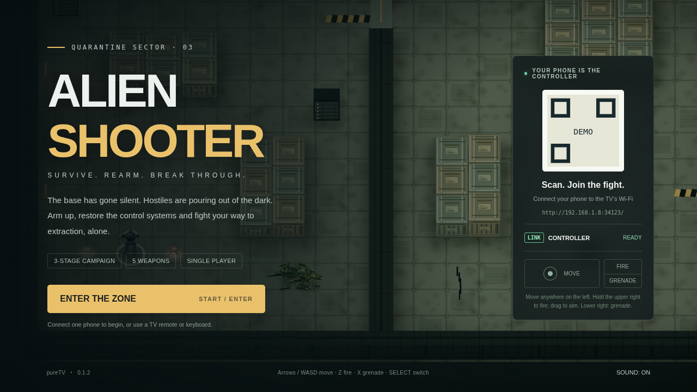
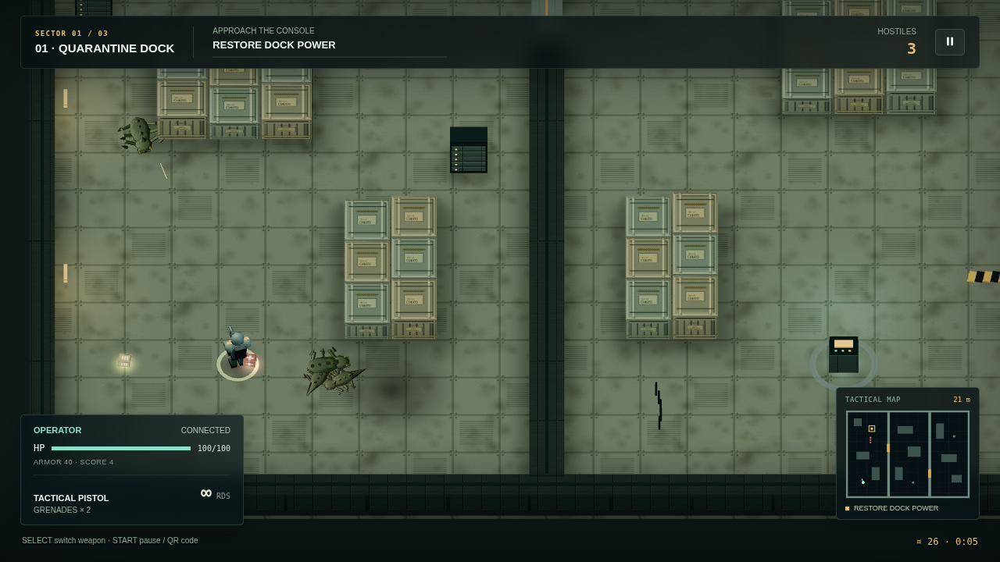

# Alien Shooter TV

[中文](README.md) · [English](README.en.md)

An independently built overhead shooter for Android TV. Fight through a quarantined freight depot, a biotech laboratory and a hive reactor. Restore consoles, survive incoming hostiles, buy supplies and defeat the guardian before extracting. Play solo or cooperate on the same screen with two phone controllers.

Version **0.1.0** · Package `com.ecojust.alienshootertv` · Android 8.0 or newer.

## Play

1. Connect the TV and phones to the same local network, then launch the game.
2. Scan the code on the title screen. Co-op requires two phones.
3. Choose one or two players and press START.
4. Stand near the illuminated console to charge it, defeat the incoming enemies and advance. Complete the three objectives, then reach the green extraction marker.

The tactical map shows walls, closed gates, players, enemies and distance to the current objective. A yellow square marks the active console; green marks extraction. In co-op it moves above the second player’s status panel.

The QR panel collapses during combat. Press START to pause and show it again. A disconnected participating controller pauses the fight. Reconnect and press START to resume; combat never resumes on its own. Pressing TV Home or confirming exit ends the run and closes the room.

| Phone control | Action |
| --- | --- |
| Left two thirds | A floating movement stick starts wherever you touch |
| Upper half of the right third | Hold anywhere to fire; drag to aim independently. Holding without dragging uses assisted targeting within line of sight |
| Lower half of the right third | Throw a grenade. Release before throwing another |
| SELECT | Change weapon; choose player count at the title; select supplies in the shop |
| START | Begin, pause or resume; advance to the next sector from the shop |

Movement and firing support simultaneous touches. Controller zones prevent text selection, long-press menus and scrolling. Cancelled touches, loss of focus and disconnects release controls.

Keyboard: arrows / WASD move, Z / Space fire, X / G throw a grenade, Q / Shift switch weapons, Enter / P begin or pause. Aim with the mouse and hold the left button to fire. A TV remote supports movement, confirmation/fire and the playback key for START.

## Campaign

| Sector | Objectives |
| --- | --- |
| Quarantine dock | Restore power, release the quarantine gate, open extraction access |
| Biotech laboratory | Shut down incubators, purge the corridor, recover research records |
| Hive reactor | Isolate coolant, overload the reactor, destroy the hive guardian |

Weapons include an unlimited-ammunition pistol, SMG, shotgun, rotary cannon and plasma lance with splash damage. The first ammunition pickup unlocks the SMG. Between sectors, purchase weapons, ammunition, medical supplies, armor, grenades or maximum-health upgrades.

Fight crawlers, fast melee runners, ranged spitters, armored brutes and the final guardian. Walls block shots and line of sight. Explosive barrels can break encirclements. Co-op shares credits and supply purchases benefit the entire squad. Approach a downed teammate to revive them; losing the entire squad ends the mission.

Campaign progress lasts for the current session; quitting ends the run. The sound preference is stored locally. Reopening the app creates a new local room and requires scanning the new code.

## Visuals and sound

The game uses bundled WebGL 3D rendering, detailed low-poly characters and procedural high-resolution materials. Static geometry is batched, repeated character parts are instanced, and projectiles, particles and corpses have fixed limits. Weapons, explosions, pickups and industrial ambience are synthesized locally with Web Audio.

These captures show the bundled page rendered in Chromium with a simulated Android room bridge. Sector showcases use test scenarios; they are not physical-TV captures or a recording of a complete human playthrough.






## Development

```sh
node --test resource/apps/alien-shooter/tests/*.test.cjs
node resource/apps/alien-shooter/tests/controller.mjs
node resource/apps/alien-shooter/tests/integration.mjs

cd resource/launcher/puretv
./gradlew :alien-shooter:testDebugUnitTest :alien-shooter:lintDebug :alien-shooter:assembleRelease :alien-shooter:verifyReleaseSize
```

Browser tests use the desktop package’s Playwright dependency. `CHROMIUM_PATH` selects Chromium; `ALIEN_SHOOTER_UI_CAPTURE_DIR` selects the capture directory. TV performance, real phone latency and device compatibility still require physical-device validation.

Maps, characters, textures, sound and rules are independently created. See [production notes](docs/reference.md) for scope and sources. Application code and original assets use the [MIT license](LICENSE); the bundled Three.js license is included separately.
