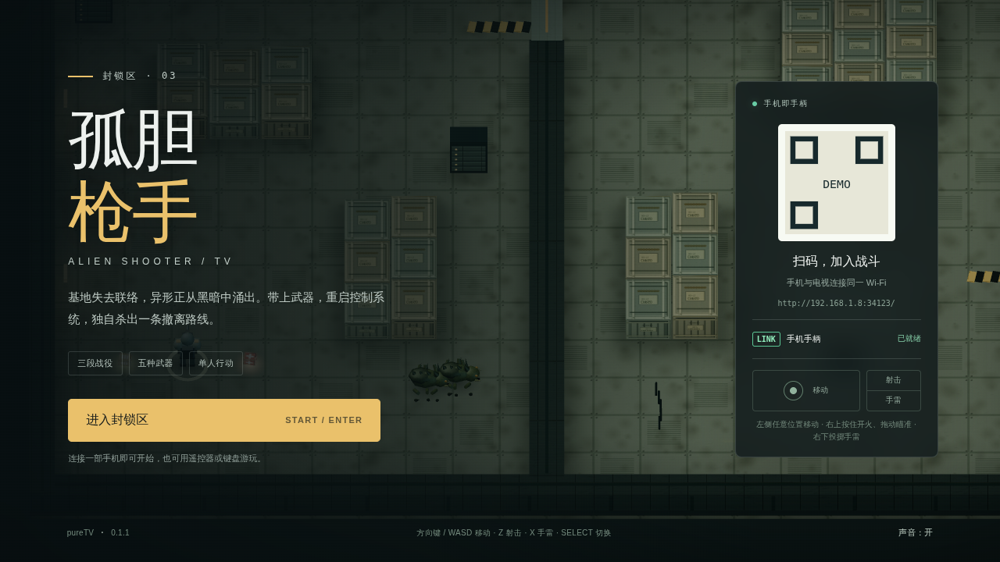
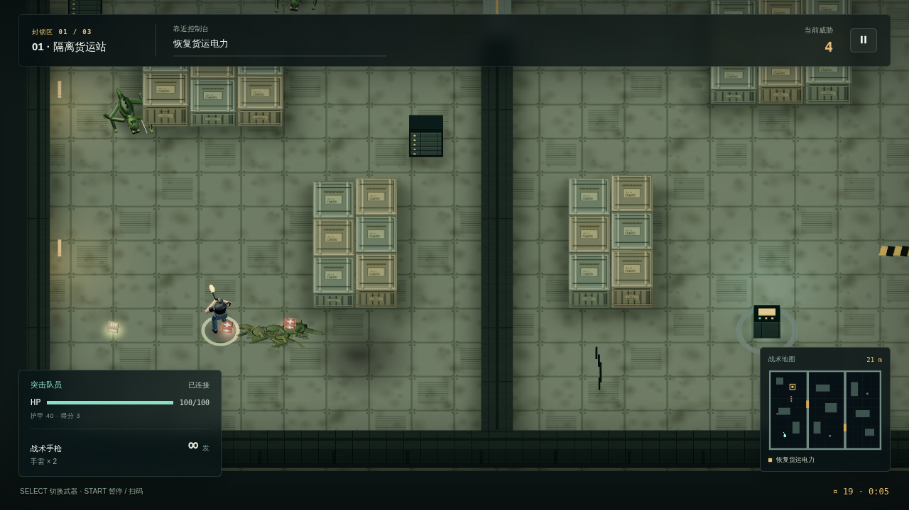
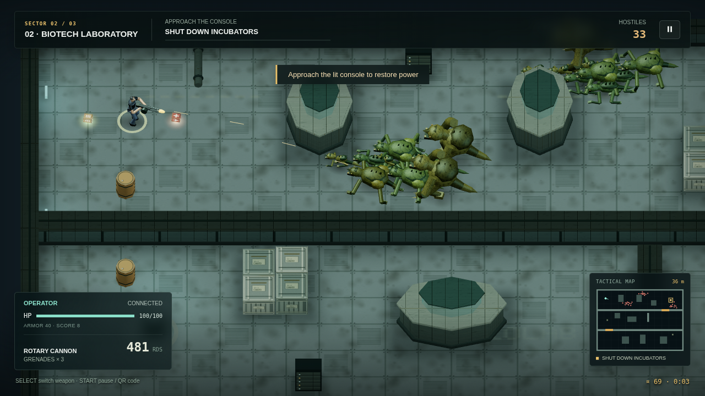
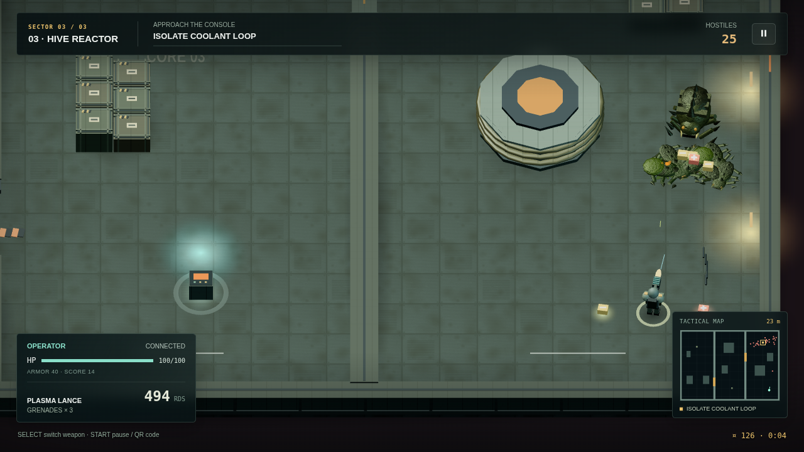

# 孤胆枪手 TV

<!-- apk-resource:start -->
[下载 APK](alien-shooter-0.1.0.apk?raw=1) · [校验值](SHA256SUMS.txt) · [签名及构建来源](resource.json) · [源码](src/) · [64×64 SVG 图标](logo.svg)

此目录内 APK 使用 pureTV 发布证书签名。若设备中存在使用旧证书的同包应用，Android 无法直接覆盖安装；需先备份数据并卸载旧包。
<!-- apk-resource:end -->

[中文](README.md) · [English](README.en.md)

一款独立制作的斜俯视基地射击游戏。进入被异形占据的货运站、实验室和反应堆，恢复控制台、守住怪潮、购买补给，击败母巢守卫后撤离。专为单人游玩设计，支持电视大屏与一部手机扫码操作。

版本 **0.1.1** · 包名 `com.ecojust.alienshootertv` · Android 8.0 及以上。

## 开始游玩

1. 手机和电视连接同一局域网，在电视打开游戏。
2. 用一部手机扫描标题画面右侧的二维码，房间仅接受一个手柄。
3. 按 START 直接进入封锁区。
4. 靠近亮起的控制台充能，击退敌人后进入下一区域。完成三个目标后前往绿色撤离标记。

右下战术地图显示墙体、未开的闸门、玩家、敌人和当前目标距离，黄色方框指向控制台，绿色方框指向撤离点。

战斗时扫码栏会收起，为场景保留空间；按 START 暂停即可再次显示。手柄断线会暂停，重新连接后需要按 START 明确继续。按电视 Home 切出或确认退出会结束本次战役并关闭房间。

| 手机手柄 | 功能 |
| --- | --- |
| 左侧约 2/3 屏幕 | 任意落指位置建立浮动摇杆，控制移动 |
| 右侧 1/3 的上半区 | 任意位置按住连续射击；拖动进行独立瞄准，不拖动时辅助瞄准视线内敌人 |
| 右侧 1/3 的下半区 | 投掷手雷，持续按住只投一枚，松开后可再次投掷 |
| SELECT | 切换已拥有武器；补给站选择商品 |
| START | 开始、暂停、继续；补给站前往下一关 |

移动、瞄准、开火可以同时进行。手柄操作区禁止选中文字、长按菜单与页面滚动，触控取消、失焦或断线会释放动作。

也可使用键盘：方向键 / WASD 移动，Z / 空格射击，X / G 手雷，Q / Shift 切枪，Enter / P 开始或暂停。鼠标可独立瞄准，按住左键开火。电视遥控器支持方向键移动、确认射击、播放键开始或暂停。

## 战役与补给

| 区域 | 任务 |
| --- | --- |
| 隔离货运站 | 恢复货运电力、解除隔离闸门、打开撤离通道 |
| 生物研究设施 | 关闭培养舱、净化通道、回收研究记录 |
| 母巢反应堆 | 切断冷却循环、启动过载、消灭母巢守卫 |

五种武器分别是无限弹药的战术手枪、冲锋枪、霰弹枪、六管重机枪和有溅射伤害的等离子枪。弹药补给可解锁初始冲锋枪；关间补给站可购买其他武器、弹药、治疗、护甲、手雷和最大生命升级。

敌人包括爬行者、快速近战异形、远程喷吐者、重甲兽和最终首领。墙体会挡住射击与视线，爆炸桶可以用于突破包围。击败敌人赚取补给资金，购买装备强化自己；生命耗尽即行动结束，可重新开始战役。

本版战役在本次运行内进行，退出会结束当前战役；声音开关保存在本机。重新打开应用会创建新的局域网房间，请重新扫码。

## 画面与声音

采用本地打包的 WebGL 三维场景和低模角色。0.1.1 将货箱的加固带、铆钉、标签、磨损等细节烘焙进 1024 图集，三关共享高清地板材质，分别使用预烘焙的接触暗部与局部光照图。静态不透明场景合批；同类敌人的身体、步态与尸体共用实例化绘制，屏外对象不提交绘制，动态缓冲只更新使用部分。

界面保留 HUD 节点和小地图静态底图，暂停时停止重复绘制相同场景。弹丸、粒子和尸体保留数量上限，手机输入与游戏逻辑的处理频率保持不变。枪械、爆炸、拾取与工业环境声由 Web Audio 合成，不依赖在线资源。

详见[烘焙方法](docs/baking.md)和[同场景性能对照](docs/performance.md)。

下方截图由实际游戏页面在 Chromium 中渲染，使用模拟的 Android 房间桥接；关卡展示采用测试场景，不代表电视实机画面或完整人工通关录像。









## 开发

```sh
node --test resource/apps/alien-shooter/tests/*.test.cjs
node resource/apps/alien-shooter/tests/controller.mjs
node resource/apps/alien-shooter/tests/integration.mjs
node resource/apps/alien-shooter/tests/runtime-performance.mjs
node resource/apps/alien-shooter/tests/performance.mjs --samples 6 --warmup 1 --regressions
node resource/apps/alien-shooter/tools/bake-materials.mjs --verify

cd resource/launcher/puretv
./gradlew :alien-shooter:testDebugUnitTest :alien-shooter:lintDebug :alien-shooter:assembleRelease :alien-shooter:verifyReleaseSize
```

浏览器检查使用 desktop 的 Playwright 依赖；可以通过 `CHROMIUM_PATH` 指定 Chromium，通过 `ALIEN_SHOOTER_UI_CAPTURE_DIR` 指定截图输出目录。真实电视性能、手机触控延迟及设备兼容性仍需实机验证。

地图、代码、角色、纹理与声音由本项目独立实现；参考范围、素材来源和边界见[制作说明](docs/reference.md)。应用代码与自制素材使用 [MIT](LICENSE)，随包附带 Three.js 的许可证。
