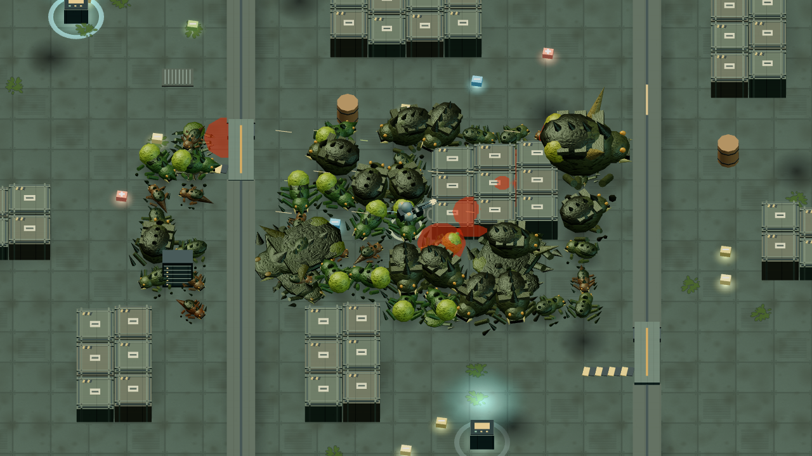
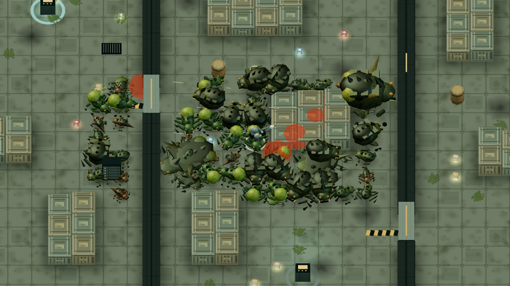

# 孤胆枪手 0.1.1 画面与性能对照

在相同的 1280 × 720 分辨率、镜头与角色状态下，0.1.1 的三关密集场景将 draw call 减少约 45%–47%。48 个敌人全部可见时，三角形减少约 39%–45%，每帧动态 GPU 缓冲上传减少约 81%。画面使用离线制作的货箱、油桶和补给图集，以及三关各自的地面光照与接触暗部贴图。

## 测试条件

基线为提交 `f68f740697f40bec7615a15e83fdaf6ee7419bfd` 的 0.1.0 游戏资源；结果和两侧完整资源 SHA256 保存在 [performance-0.1.1.json](performance-0.1.1.json)。测试使用实际 WebGL 渲染器和游戏地图，固定随机种子、4 秒动画姿态、DPR 1，不推进模拟。

共 12 个场景：三关 × 密集/全地图分布 × 48/96 敌人。48 是当前游戏敌人上限；96 是特意超出游戏上限的渲染压力测试。每个场景另含 10 具五种类型的尸体、24 个补给、32 个血迹/灼痕、64 个粒子、24 条弹道及手雷、爆炸。优化前后 fixture hash 完全一致，没有为了测试减少角色或降低分辨率。

每场预热 2 帧、采样 8 帧。下表使用全部敌人和尸体都在镜头内的密集分布，避免把屏外裁剪的收益混入角色低模收益。

| 地图 | 敌人数 | Draw call / 帧 | 三角形 / 帧 | 三角形减少 |
| --- | ---: | ---: | ---: | ---: |
| 货运站 | 48 | 50 → 27 | 87,132 → 48,138 | 44.8% |
| 货运站 | 96 | 50 → 27 | 142,596 → 83,082 | 41.7% |
| 实验室 | 48 | 51 → 27 | 80,036 → 48,886 | 38.9% |
| 实验室 | 96 | 51 → 27 | 135,500 → 83,830 | 38.1% |
| 反应堆 | 48 | 51 → 28 | 81,928 → 49,812 | 39.2% |
| 反应堆 | 96 | 51 → 28 | 137,392 → 84,756 | 38.3% |

全地图分布下，保守视锥裁剪再跳过屏外对象；48 敌人场景提交 37,372–39,584 个三角形，96 敌人场景提交 61,344–66,596 个。角色仍保留在游戏模拟中，边缘测试确保刚进入镜头的对象不会提前消失。

## 缓冲上传与纹理内存

48 敌人密集场景的动态缓冲上传从每帧 247,612 字节降至 46,680–47,764 字节；96 敌人降至 54,168–55,252 字节。该数据来自实际 `bufferData` / `bufferSubData` 调用，不是仅用可见实例数估算。基线上传及纹理库存是在相同资源、相同 fixture hash 的独立单帧补测中记录，原始 8 帧计时保留。

按 RGBA8 和完整 mipmap 估算，三关纹理总库存从 21.58 MiB 降至 14.92 MiB。首次进入货运站时，已上传纹理反而由 10.92 MiB 增至 12.25 MiB，因为新版新增地面烘焙信息；切遍三关后才体现共享材质的总量收益。此处不包含几何、帧缓冲、驱动或浏览器内存，也不把 PNG 压缩大小当作显存。

测试后端是 Chromium / ANGLE SwiftShader 软件渲染。JSON 保留 CPU 提交耗时及单像素 readback 同步耗时的中位数/p95，但样本少、软件渲染受宿主机负载影响，不能据此承诺电视帧率或固定加速倍数。尚未完成电视 GPU 实测。

## 同镜头画面

以下为相同密集测试场景的渲染截图，无 HUD，包含人工设置的敌人、尸体与特效。不是完整人工游玩录像或电视实拍。低模保留角色轮廓；货箱标签、加固带、铆钉、油桶顶面以及地板细节改由贴图呈现。

0.1.0：



0.1.1：



## 实现与回归

- 静态不透明场景合并为一批；透明玻璃单独绘制。货箱降为 12 个三角形，油桶改用八边形低模和图集。
- 每类敌人的身体、动画腿部和尸体共用实例池；动画属性打包后实际着色器最多使用 9 个顶点属性槽，与旧版预算一致。
- 动态实例只上传使用范围，空池跳过上传；保守视锥裁剪减少屏外提交。
- HUD 保留 DOM 节点，小地图缓存静态底图；暂停、商店和原生挂起时避免重复绘制，输入和游戏逻辑保持原有频率。
- 五张烘焙图片全部解码后才启动，缺失资源显示明确错误。参见[烘焙方法及重建命令](baking.md)。

12 个场景均无 shader/GL 错误，模拟状态保持不变。动画截图产生实际像素变化；四个视野边缘、屏外裁剪、反复切图的资源数量、真实 WebGL 上下文丢失/恢复及销毁计数均通过。运行时专项另覆盖短按输入、暂停零重复绘制、界面节点复用、切图/门状态/尺寸变化、缺失贴图和不支持 WebGL 的错误提示。

## 复测

仓库根目录执行，需要已安装 `desktop` 的 Playwright 依赖及 Chromium：

```sh
CHROMIUM_PATH=/usr/bin/chromium node resource/apps/alien-shooter/tests/performance.mjs \
  --samples 8 --warmup 2 --regressions --output /tmp/alien-shooter-performance
CHROMIUM_PATH=/usr/bin/chromium node resource/apps/alien-shooter/tests/runtime-performance.mjs
node resource/apps/alien-shooter/tools/bake-materials.mjs --verify
```

可用 `--assets /absolute/path/to/assets --label before` 指向基线资源快照，随后在新资源测试中传 `--compare /path/to/before/performance.json`。只有新版使用 `--regressions`，因为其中包含新版的实例上传、裁剪及绘制预算断言。CI 会保存本次运行的 JSON 和 12 张场景截图为独立性能附件。
