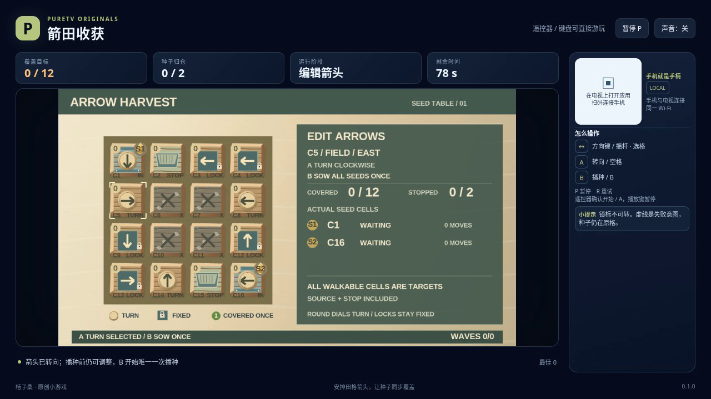

# 箭田收获 / Arrow Harvest

转动田格里的箭头，再一次播种，让多颗种子同步走遍目标田块。每格只能覆盖一次；种子不能进入禁地，也不能在同一拍撞到一起。固定箭头不能调整，播种之后也不能临时改路。

- 作者：ecojust / 桔子桑
- 包名：`com.ecojust.arrowharvesttv`
- 版本：`0.1.0`
- 电视系统：Android 8.0 / API 26 及以上
- 图标：[logo.svg](logo.svg)

发布产物：[APK](arrow-harvest-0.1.0.apk) · [实际游玩视频](docs/gameplay-0.1.0.mp4) · [验证记录](docs/verification.json)

## 操作

手机与电视接入同一局域网，扫描电视画面的二维码。摇杆在4×4田格中移动选择框，A 将可编辑箭头顺时针转90°，B 开始本局唯一一次播种。固定箭头带有区别标记；在固定格、停止格或禁地按 A 不会改变箭头。

键盘使用方向键或 WASD 选择，空格或 Enter 为 A，B 播种，P 暂停，R 重试。电视遥控器使用方向键、确认键和菜单键；手机 START 开始或暂停。开始与结算菜单可用左右方向选择关卡，B 切换声音。游戏中 A、B 每次按下只触发一次，按住不会连续转向或重复播种。

## 同步传播与收获

所有非禁地格都是目标，**包括种子源格和停止格**。播种时，每个源格先计为已覆盖一次。此后每半秒，所有仍在活动的种子沿各自所在格的箭头同时走一步；到达停止格就覆盖该格并停止，这颗种子不再参与后面的传播。

同一拍有两颗种子想进入同一格，或任何种子想进入已经覆盖的格，都会失败。返回源格、进入已经使用的停止格、追入另一颗种子刚离开的格，也属于重复覆盖。箭头形成循环时，种子第一次重访就会结束失败，不会无限运行。

越过棋盘边界或进入禁地也会失败。一拍中的全部拟到达位置先一起检查；只要这批出错，所有种子都保持原位置，覆盖计数也不增加。画面标出的失败目的地不是已经覆盖的田格。

所有种子停止后，每个目标都恰好覆盖一次才获胜；过早停止、留下未覆盖目标则失败。三关分别有12、14、14个目标，2、2、3颗种子，以及5、6、7个可编辑箭头。其它箭头固定，不能靠改动它们解决路线。

播种会保存完整箭头快照。传播期间方向、A 和 B 都不能改路、取消或重新播种；P 可以暂停。每局共有90秒有效时间，编辑和传播都计时，暂停不计时。时间耗尽优先于同一时刻的传播结果。R 重新开始当前固定关卡，恢复原始箭头、空覆盖和完整时间，不保留上次编辑。

分数按实际已覆盖目标与获胜奖励计算。编辑箭头不加分，失败批次的拟到达格也不加分。终局后箭头、种子、覆盖和计时都冻结。

## 源码与验证范围

精确格子角色、固定与可编辑箭头、同步批次、失败顺序、公共字段和三关初态见 [模型契约](docs/model-contract.md)。生产模型只包含公开棋盘与传播规则，不包含参考路线、自动改箭头或强制获胜入口。

播种时已覆盖 S 个源格，每个成功批次至少新增一个目标；有 T 个目标时，最多 T−S 个成功移动批次，下一批必然停止或失败，因此循环有确定终点。停止格也是目标且数量与种子相同，所以全部目标恰好覆盖一次时，所有种子也已到达停止格。

设计可行性探索、规则夹具、普通模型输入与浏览器实录分别记录，实际完成范围以验证报告为准。模型或软件浏览器检查不代表实体电视、手机已经测试。

[独立规则核验](docs/independent-arrow-review.json) 首次通过4组检查：[到达时间表算法](tests/arrow-path-oracle.mjs) 分别计算每颗种子的静态轨迹，再求最早重复到达或禁地事件；[核验脚本](tests/independent-arrow-review.mjs) 只读核对已有的三胜三败记录，以及正式规则测试保存的旧源格重访快照，没有再次运行模型或复制求解路线。另有5个手算小例用于检查该独立算法，属于数学夹具，不是额外的真实游戏局数。

手机手柄与 Android 宿主组件见 [game-kit](../../game-kit/README.md)。源码与原创素材遵循仓库 [MIT 许可证](../../../LICENSE)。
