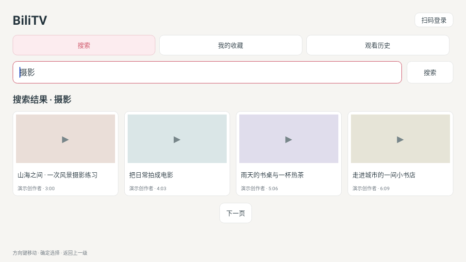

# BiliTV · 哔哩电视

[English](README.en.md) · [64×64 SVG 图标](logo.svg) · [构建说明](docs/BUILD.md)

独立的哔哩哔哩 Android TV 客户端，采用原生极简界面，支持电视遥控器。包名 `com.ecojust.bilitv`，首版 `0.1.0`，最低 Android 4.4 / API 19。界面跟随系统显示中文或英文；视频标题、作者及收藏夹名称保留原文。

## 安装与预览

[下载 BiliTV 0.1.0 APK](bilibili-0.1.0.apk) · [校验清单](SHA256SUMS.txt) · [验证记录](docs/VALIDATION.md)

下载 APK 后，可通过 pureTV 管理器的本地 APK 安装功能安装到电视，也可执行 `adb install -r bilibili-0.1.0.apk`。在电视应用列表中打开 **BiliTV**，直接搜索，或选择右上角「扫码登录」后使用收藏和历史。

上图是应用原生界面使用演示数据的测试渲染，非实体电视截图。更多界面见 [收藏](docs/previews/bilibili-favorites.png)、[历史](docs/previews/bilibili-history.png)和[扫码登录](docs/previews/bilibili-login.png)。二维码图片中的演示内容不可用于实际登录，请扫描应用运行时生成的二维码。

## 功能

- **搜索**：输入关键词，按页浏览视频，查看简介与分P，选择播放。
- **扫码登录**：用官方哔哩哔哩手机应用扫描电视上的二维码并确认。可取消、刷新过期二维码和退出账号；应用不收集账号密码。
- **收藏**：登录后浏览账号收藏夹，在视频详情中明确选择收藏夹并确认添加或移除。
- **历史**：登录后读取账号观看记录并续播；只在实际播放发生后上报进度。未登录时也会保存本机播放位置。
- **播放**：支持平台正常返回的 AVC/H.264 + AAC 音视频分轨和连续分段，提供播放／暂停、快进／后退、选集、清晰度和错误重试。实际清晰度以账号权限和平台返回结果为准。

客户端不接入广告 SDK，不展示开屏广告、横幅、推广推荐流或搜索中的广告条目。视频内容由平台提供，作者在视频内录制的口播或植入不会被剪辑。

## 遥控器

方向键在搜索、收藏、历史、账号及视频卡片之间移动，确定键选择。搜索输入使用电视系统输入法；搜索后使用方向键浏览结果。详情中选择分P进入播放器。

播放控制栏隐藏时，确定键播放／暂停，左右键快进／后退 10 秒，上下键显示控制栏。控制栏显示时，方向键移动焦点或调整进度条，确定键执行当前按钮；返回退出播放器。退出或退到后台会释放播放器和音频焦点，返回后可继续上次位置。扫码页关闭、应用暂停或账号退出后，不会继续后台轮询登录。

## 网络与账号

搜索、详情、登录和账号操作直接请求哔哩哔哩网页客户端使用的 HTTPS 接口，视频直接请求平台提供的媒体地址，不经过项目代理。会话保存在应用私有目录，禁用系统自动备份；退出登录清除会话。账号 cookie 不发送给图片或视频 CDN。

平台接口可能返回登录过期、访问校验、地区或权限限制，应用会显示错误和重试／重新登录入口，不以示例数据替代失败结果。扫码过期后重新扫码；首版不实现未经验证的长期令牌刷新流程。

Android 4.4 启用系统支持的 TLS 1.2，保留系统证书和主机名验证。旧系统根证书、硬件解码能力、平台接口和网络仍会影响实际播放；最低安装版本不等于所有电视已完成实机播放验收。

## 构建与验证

源码和测试见 `src/`，构建、固定证书签名与产物取回见 [BUILD.md](docs/BUILD.md)，具体检查结果见 [验证记录](docs/VALIDATION.md)。0.1.0 为首版预览；真实账号扫码、账号收藏同步和实体电视实际播放尚未完成端到端验收。

本项目是非官方客户端，与哔哩哔哩无隶属关系。应用源码采用 MIT 许可；依赖和商标说明见 [NOTICE.md](NOTICE.md)，依赖许可证副本随 APK 打包于 `assets/licenses/`。
