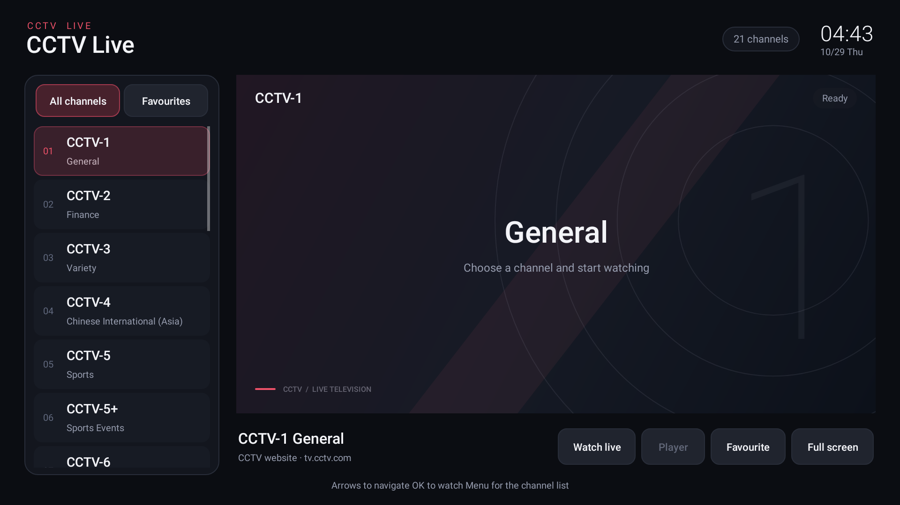

# CCTV Live

<!-- apk-resource:start -->
[Download APK](cctv-0.5.0.apk?raw=1) · [Checksums](SHA256SUMS.txt) · [Signing and build provenance](resource.json) · [Source code](src/) · [64×64 SVG icon](logo.svg)

The APK in this directory is signed with the pureTV release certificate. Android cannot update an existing installation of the same package if it uses a different signing certificate. Back up its data and uninstall the old package first.
<!-- apk-resource:end -->

## 0.5.0 and signature migration

The current release is **0.5.0**, using the new pureTV release certificate shared by the project's own apps and launchers. Its certificate differs from the previously published APK, so Android cannot install it over the old version. Back up any data you can export before uninstalling the old app and installing 0.5.0. Uninstalling clears local favorites, channel selection, website caches and app settings. This project provides no automatic migration tool and does not guarantee that all local data can be exported.

Use the links above for the 0.5.0 APK, checksums and build provenance in `resource.json`.

[English](README.en.md) · [中文](README.md)

An independent CCTV channel player from the pureTV project, designed for Android TV / Google TV remotes. Package: `com.ecojust.cctvlive`; version: `0.5.0`; Android 8.0 or later. The application shell follows the system language and supports Chinese and English. The playback area retains the CCTV website's own content and messages. This is a third-party client, not an official CCTV application.

## Interface and remote controls

The channel list is on the left. On the right, the system WebView opens the selected channel's official CCTV live page and focuses its presentation on the player area.

- Use the directional pad to move between the channel list and controls, then press OK to select a channel. All-channel and favorites lists are available.
- Select “Player” to focus the website player. Playback and pause controls belong to the website; volume is controlled by the TV system.
- Menu returns to the channel list. In fullscreen, Up/Down changes channels and Back exits fullscreen.
- A page-loading failure keeps the current channel and interface visible, with retry or reload available. Playback failure does not automatically close the application.
- Going into the background pauses the WebView and loads `about:blank` to stop the page. Returning to the application reloads the selected channel.

Exiting with Back from the main channel view saves favourites and selection, destroys the WebView, clears callbacks, removes the task, and terminates this app’s process. Leaving fullscreen or moving to the background does not terminate the process.



## Fixed channel file

The channel list is [`src/main/assets/channels.m3u`](src/main/assets/channels.m3u). The application reads this bundled file at startup and uses each channel's `page-url` to open its official live page. Adding or removing channels, changing their order, or updating an official page address requires rebuilding the APK. Existing installations do not automatically receive changes made to the repository file.

After records are merged by `tvg-id`, the list contains **21 channel entries, with corresponding official player pages configured for 20 of them**, including CCTV-4 Asia, Europe and the Americas. CCTV-9 uses `https://tv.cctv.com/live/cctvjilu/`, and CCTV-14 uses `https://tv.cctv.com/live/cctvchild/`; page addresses cannot simply be derived from channel numbers.

CCTV-4K currently has no valid corresponding official player page. Its records explicitly set `page-unavailable="true"` and omit `page-url`. The channel remains in the list; selecting it displays a message that an official player page is currently unavailable.

The original **39 stream URLs**, supplied by the user and identified as **captured from the `tv.cctv.com/live` web player on 2026-10-25**, remain in the file as source material: 21 primary and 18 backup URLs. The application does not request these M3U/HLS addresses directly or automatically switch between primary and backup streams.

```m3u
#EXTM3U
#EXTINF:-1 tvg-id="cctv1.cn" page-url="https://tv.cctv.com/live/cctv1/" tvg-name-en="CCTV-1 General" group-title="CCTV" route-name="Primary" route-name-en="Primary",CCTV-1 General
https://ldncctvwbcdtxy.liveplay.myqcloud.com/ldncctvwbcd/cdrmldcctv1_1/index.m3u8
#EXTINF:-1 tvg-id="cctv4k.cn" page-unavailable="true" tvg-name-en="CCTV-4K Ultra HD" group-title="CCTV" route-name="Primary" route-name-en="Primary",CCTV-4K Ultra HD
https://ldocctvwbcdtxy.liveplay.myqcloud.com/ldocctvwbcd/cdrmldcctv4k_1/index.m3u8
```

Original records sharing a `tvg-id` are merged into one channel, ordered by their first occurrence. They must specify the same `page-url` or the same unavailable status. Available channels use HTTPS official channel pages under `tv.cctv.com/live/...`; `page-unavailable="true"` and `page-url` are mutually exclusive. `tvg-name-en` supplies the English channel name, falling back to the original name when absent. `route-name`, `route-name-en`, and the following stream URL line preserve source metadata and do not select the application's playback destination. The parser retains limits of 512 KiB, 100 channels and four original stream records per channel.

## Website player and verification

The right-hand WebView loads the actual CCTV channel page. The bundled [`player-focus.js`](src/main/assets/player-focus.js) retains the original `#player` DOM and its player content, hides surrounding navigation and programme listings, and adjusts the player's display size. Playback continues in the official page environment, with media resources loaded by the website. The application does not extract streams for a native player or bypass CORS through a proxy or disabled cross-origin protections.

The website player's access restrictions, regional or scheduling messages, and playback errors remain visible. Availability depends on the channel service, network, system WebView and TV capabilities; playback of every channel in every region and at every time cannot be guaranteed. Website changes to the player structure may require a script update.

Interface previews and offline tests check channel selection, page lifecycle and player-area presentation. They do not establish sustained playback of every channel on a physical TV, and capture tests do not fabricate broadcast footage.

## Build

From the repository root, run the script tests and then enter the shared Android project:

```bash
cd resource/apps/cctv
node --test src/test/js/player-focus.test.mjs
cd ../../launcher/puretv
./gradlew :cctv:assembleDebug :cctv:testDebugUnitTest :cctv:lintDebug
./gradlew :cctv:verifyReleaseSize
```

Build outputs are under `resource/apps/cctv/build/outputs/apk/`. Release builds shrink code and resources and must remain below 5 MiB. Catalog APKs are signed separately with the pureTV release certificate.

Set `CCTV_UI_CAPTURE_DIR` while running `:cctv:testDebugUnitTest` to export `cctv-live.png` and `cctv-live.en.png` native previews. For a catalog update, use the Android CI staging workflow followed by `tools/prepare-app-resources.py --app cctv`; see the [resource maintenance guide](../../../docs/resource-maintenance.md).
