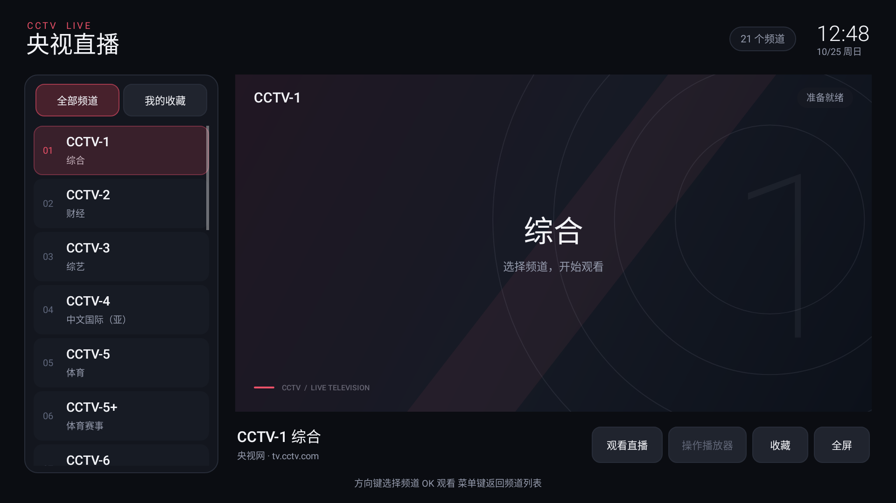

# CCTV Live · 央视直播

<!-- apk-resource:start -->
[下载 APK](cctv-0.1.0.apk?raw=1) · [校验值](SHA256SUMS.txt) · [签名及构建来源](resource.json) · [源码](src/)

此目录内 APK 使用 pureTV 发布证书签名。
<!-- apk-resource:end -->

[中文](README.md) · [English](README.en.md)

pureTV 项目的独立央视频道播放器，适用于 Android TV / Google TV 遥控器。包名 `com.ecojust.cctvlive`，版本 `0.1.0`，要求 Android 8.0 及以上。应用外壳跟随系统语言，支持中文和英文；播放区域保留央视网页面自身的内容与提示。这是第三方客户端，不是央视官方应用。

## 页面与遥控器

左侧为频道列表，右侧通过系统 WebView 打开所选频道的央视网官方直播页，并将页面集中显示为播放器区域。

- 使用方向键在频道列表与操作区移动，确定键选择频道；支持全部频道和收藏列表。
- 选择「操作播放器」将焦点交给网页播放器；播放、暂停等控制由官网播放器提供，音量使用电视系统控制。
- 菜单键返回频道列表；全屏时，上／下键切换频道，返回键退出全屏。
- 页面加载失败时保留当前频道与界面，可选择重试或重新加载；应用不会因为播放失败自动退出。
- 退到后台时暂停 WebView 并加载 `about:blank` 停止当前页面；返回应用后重新加载所选频道。
- 从主界面按返回键退出时，先保存收藏与频道选择、销毁 WebView 并清除回调，再移除任务并结束应用自身进程；全屏返回和切换到后台不触发进程退出。



## 固定频道文件

频道清单位于 [`src/main/assets/channels.m3u`](src/main/assets/channels.m3u)。应用启动时读取这个固定文件，以每个频道的 `page-url` 加载对应的官方直播页。增删频道、调整顺序或修改官网地址后，需要重新构建 APK；已经安装的旧 APK 不会自动取得仓库文件的更新。

当前清单按 `tvg-id` 合并后有 **21 个频道条目，其中 20 个配置了对应的官网播放页**，包括 CCTV-4 亚洲／欧洲／美洲。CCTV-9 使用 `https://tv.cctv.com/live/cctvjilu/`，CCTV-14 使用 `https://tv.cctv.com/live/cctvchild/`，不能直接按频道数字拼接地址。

CCTV-4K 暂无有效的对应官网播放页，清单显式设置 `page-unavailable="true"`，不设置 `page-url`。该频道仍保留在列表中，选中后会提示当前没有可用的官网播放页。

原清单中由用户提供、标注为 **2026-10-25 从 `tv.cctv.com/live` 页面播放器抓取**的 39 个直播流 URL 继续保留为原始资料，包含 21 条主线路和 18 条备用线路。应用不直接请求这些 M3U/HLS 地址，也不在主备流之间自动切换。

```m3u
#EXTM3U
#EXTINF:-1 tvg-id="cctv1.cn" page-url="https://tv.cctv.com/live/cctv1/" tvg-name-en="CCTV-1 General" group-title="央视" route-name="主线路" route-name-en="Primary",CCTV-1 综合
https://ldncctvwbcdtxy.liveplay.myqcloud.com/ldncctvwbcd/cdrmldcctv1_1/index.m3u8
#EXTINF:-1 tvg-id="cctv4k.cn" page-unavailable="true" tvg-name-en="CCTV-4K Ultra HD" group-title="央视" route-name="主线路" route-name-en="Primary",CCTV-4K 超高清
https://ldocctvwbcdtxy.liveplay.myqcloud.com/ldocctvwbcd/cdrmldcctv4k_1/index.m3u8
```

同一 `tvg-id` 的原始记录合并为一个频道，首次出现的位置决定频道顺序；这些记录必须使用一致的 `page-url` 或一致的不可用标记。可播放频道使用 HTTPS 的 `tv.cctv.com/live/...` 官方频道页；`page-unavailable="true"` 与 `page-url` 互斥。`tvg-name-en` 提供英文频道名，缺少时保留原名。`route-name`、`route-name-en` 和记录下一行的流 URL 保留来源信息，不决定应用播放路径。解析器仍限制文件不超过 512 KiB、100 个频道、每频道 4 条原始流记录。

## 官网播放器与验证

右侧 WebView 加载真实的央视网频道页。内置 [`player-focus.js`](src/main/assets/player-focus.js) 保留 `#player` 的原 DOM 及其播放器内容，隐藏外围导航、节目单等区域，并调整播放器的显示尺寸。播放器继续运行在官网页面环境中，由官网加载其媒体资源；应用不提取直播流转交原生播放器，也不通过代理或关闭跨域限制来绕过 CORS。

官网播放器自身的权限限制、地区或时段提示以及播放错误会保留。能否播放取决于频道服务、网络、系统 WebView 和电视支持情况，不能保证所有频道在所有地区、所有时段均可播放。若官网修改播放器结构，可能需要更新展示脚本。

界面预览和离线测试验证的是频道选择、页面生命周期和播放器区域展示逻辑，不代表所有频道已经在电视实机上验证持续播放，也不为截图伪造节目画面。

## 构建

从仓库根目录执行脚本测试，再进入共享 Android 工程：

```bash
cd resource/apps/cctv
node --test src/test/js/player-focus.test.mjs
cd ../../launcher/puretv
./gradlew :cctv:assembleDebug :cctv:testDebugUnitTest :cctv:lintDebug
./gradlew :cctv:verifyReleaseSize
```

APK 输出在 `resource/apps/cctv/build/outputs/apk/`。Release 开启代码和资源压缩，体积上限为 5 MiB；正式资源 APK 使用 pureTV 发布证书单独签名。

设置 `CCTV_UI_CAPTURE_DIR` 后运行 `:cctv:testDebugUnitTest`，可导出 `cctv-live.png` 与 `cctv-live.en.png` 中英文原生页面预览。正式更新使用 Android CI 的资源暂存流程，再运行 `tools/prepare-app-resources.py --app cctv`；完整步骤见[资源维护说明](../../../docs/resource-maintenance.md)。
