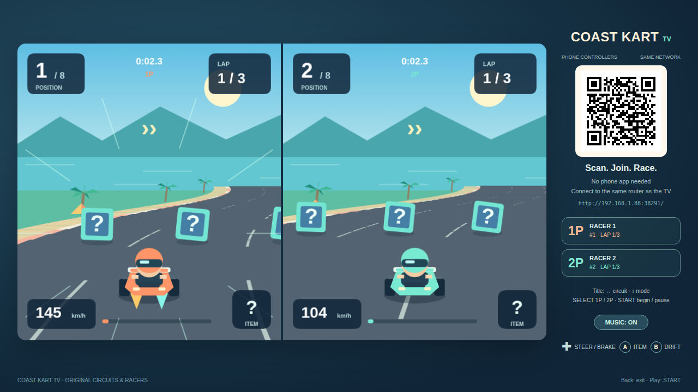
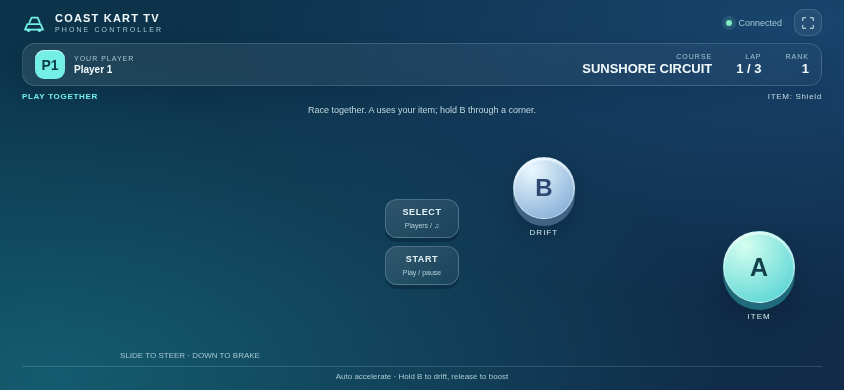
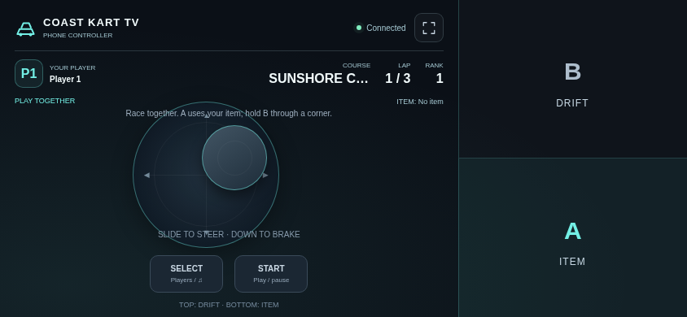

# Coast Kart TV

[中文](README.md) · [English](README.en.md)

An independently made TV kart racer with smooth perspective graphics, four original tracks, drift boosts, items, computer opponents and split-screen play using LAN phone controllers.

The planned **0.5.0** release requires Android 8.0 or later. Package: `com.ecojust.coastkarttv`.

<!-- apk-resource:start -->
[Download APK](coast-kart-0.1.0.apk?raw=1) · [Checksums](SHA256SUMS.txt) · [Build provenance](resource.json) · [Source](src/) · [64×64 SVG icon](logo.svg)

Signed with the pureTV release certificate.
<!-- apk-resource:end -->

## 0.5.0 release preparation and installation

All nine games are being prepared as version 0.5.0 with a new game release certificate. Package IDs stay unchanged, so Android cannot use the new certificate to replace an installation signed with the old one. Back up any data your device can export before uninstalling the old app and installing 0.5.0. Uninstalling clears local game saves and records. This project has no automatic save migration tool and cannot guarantee recovery of old saves.

Publication is complete only when the 0.5.0 APK, checksums and `resource.json` have all been updated.

## Play

1. Connect the TV and phones to the same LAN, then open the game on the TV.
2. Scan the room QR code with a phone browser. Use one phone per player; no phone app is required.
3. Choose the player count on the title screen, then press START.
4. Touch anywhere in the left joystick area to set its center. Drag to move; releasing hides it and clears movement. A/B work simultaneously with the joystick.

The right third of the phone is the action area: B fills the upper half and A fills the lower half. Touch anywhere in either region while using the floating stick on the left. START and SELECT remain separate at the bottom left. Gameplay controls suppress text selection and long-press browser menus.

| Control | Action |
| --- | --- |
| Floating joystick | Steer left/right; pull down to brake/reverse; automatic acceleration |
| A | Use the current item |
| B | Hold while steering at speed to drift; charge for at least 0.65 seconds, then release to boost |
| SELECT | Choose 1P/2P on title; toggle music while paused |
| START | Start, pause / resume |

On the title screen, move the stick left/right to select a course and up/down to select a mode. Choose a quick race, a four-round championship or a time trial. Quick race and championship support 1–2 humans plus six computer opponents. Time trial uses 1P only, without computer opponents or items. Races run for three laps, with ordered checkpoints, off-road slowdown and opponent items. Best times and music preference persist on the TV. See the [game notes](docs/reference.md) for modes, scoring and scope.

Changes in 0.5.0: drifting has three charge thresholds (0.65, 1.6 and 2.4 seconds), with blue, gold and purple sparks and stronger release boosts. Staying in a moving rival’s wake for 1.2 seconds grants a slipstream boost. Braking, going off-road or getting hit cancels drift charge.

## Screenshots

Actual bundled game pages rendered in Chromium with a simulated native room bridge, not physical-TV captures.







## Saves, room and exit

The current race is not restored after exit; best times and preferences remain.

Up to two phones connect through a local HTTP/WebSocket room with a fresh port and random token on each launch. Input is released on touch cancellation, loss of focus or disconnection. Losing a participating phone pauses play; reconnecting resumes automatic pause but preserves manual pause.

TV Home or confirmed exit closes the room, disconnects phones, releases workers and wake locks, destroys the WebView/audio and ends the app process. Scan the new room code when reopening.

## Development and scope

This is an independent game with original maps, artwork, residents/racers and synthesized music. It does not bundle Nintendo software, ROMs or extracted assets and does not claim the complete content of a commercial Switch title. See the [reference and scope notes](docs/reference.md). Project-authored code and assets use [MIT](LICENSE).

```sh
node --test resource/apps/coast-kart/tests/*.test.cjs
node resource/apps/coast-kart/tests/controller.mjs
node resource/apps/coast-kart/tests/compatibility.mjs
node resource/apps/coast-kart/tests/capture.mjs

cd resource/launcher/puretv
./gradlew :coast-kart:assembleRelease :coast-kart:testDebugUnitTest :coast-kart:lintDebug :coast-kart:verifyReleaseSize
```

Browser tests use desktop npm dependencies and Chromium (`CHROMIUM_PATH`). Physical TV and phone verification remains pending.
