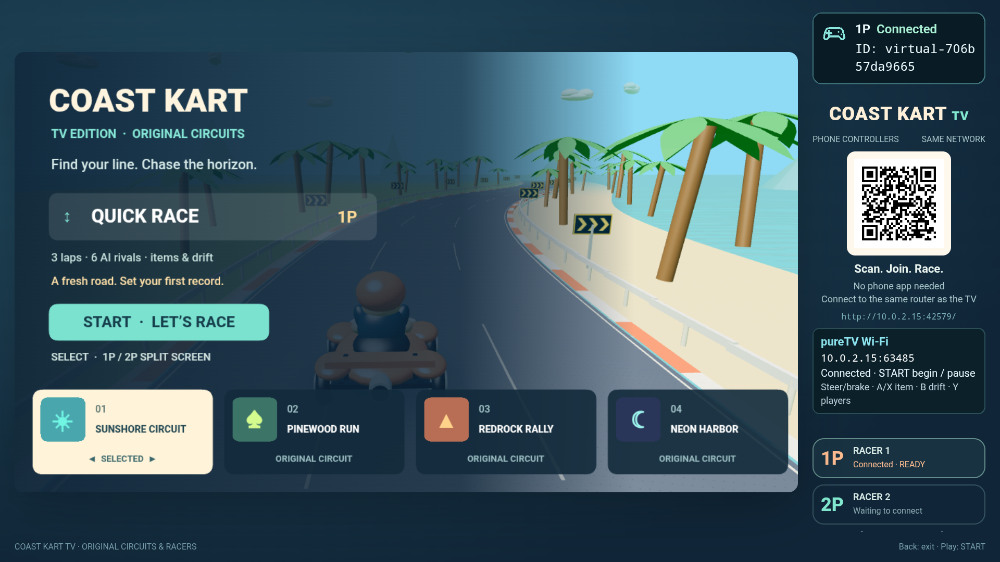
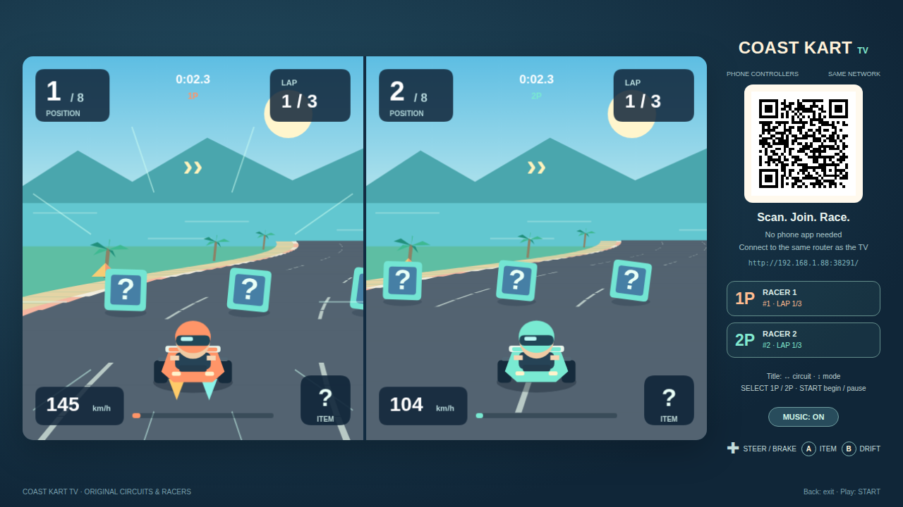
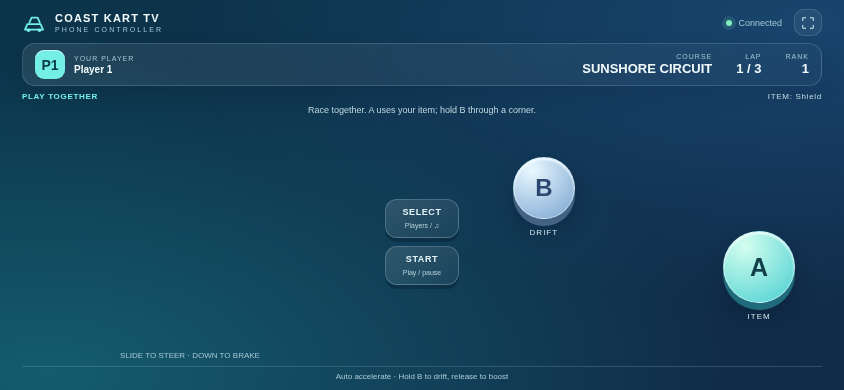
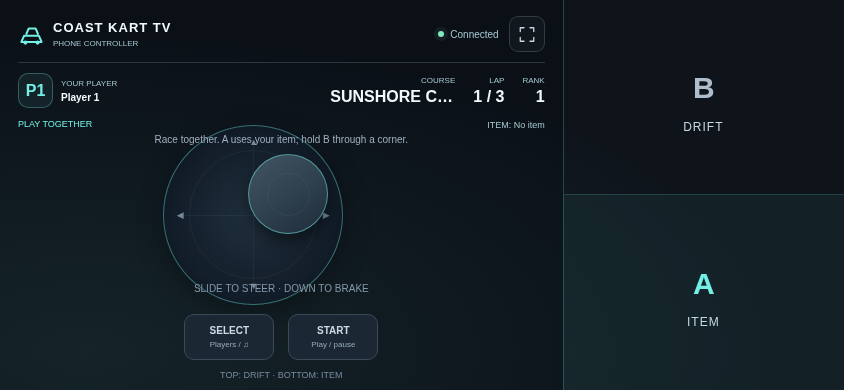

# Coast Kart TV

## Android 0.5.5 · Controllers and phone pairing

<!-- apk-resource:start -->
[Download the signed APK](coast-kart-0.5.5.apk?raw=1) · [Checksums](SHA256SUMS.txt) · [Package and source](resource.json)
<!-- apk-resource:end -->

Connect a keyboard, pair a pureTV Wi-Fi controller, or scan the TV room’s QR code with a phone on the same network. The connection indicator identifies each player while the game keeps its playing area at the same size. [Controller guide](../../../docs/guide/README.en.md#install-a-game-and-connect-a-controller)

The signed APK upgraded Android 0.5.4 in place on an Android TV emulator. The original controller SDK completed 9 checks and received matching acknowledgements for 109 messages. [Gameplay screenshot](docs/releases/0.5.5/gameplay.png) · [Android gameplay recording](docs/releases/0.5.5/gameplay.mp4?raw=1) · [Verification and limitations](docs/releases/0.5.5/verification.json)

[中文](README.md) · [English](README.en.md)

<!-- controller-client-status:start -->
## Earlier release 0.5.4 · Connected controller identity

<!-- previous-apk-resource:start -->
[Download signed APK](coast-kart-0.5.4.apk?raw=1) · [Checksums](SHA256SUMS.txt) · [Signing and source](resource.json) · [Source](src/) · [Icon](logo.svg)
<!-- previous-apk-resource:end -->

Android **0.5.4 / versionCode 6** shows a controller icon, player seat (1P/2P where supported), and the connected device's complete ID in the side area. Disconnected devices disappear. The default TCP port remains **63485**. Current controller firmware does not report RSSI, so signal strength is not displayed.

[Connected screenshot](docs/releases/0.5.4/connected.png) · [Controller-status recording](docs/releases/0.5.4/controller-status.mp4?raw=1) · [Version verification](docs/releases/0.5.4/verification.json) · [Twenty-game update record](../../../docs/controller-client-status/README.md)

The APK uses the existing release certificate. This update verifies connection identity, disconnect/reconnect status and in-place installation in an Android TV emulator; the capture and video show the menu status checks. It does not repeat full gameplay acceptance. Unchanged model evidence is reused by exact hash, with previous reports retained below. Physical TVs, phones, ESP32 devices and upgrades containing existing user saves remain untested.


<!-- controller-client-status:end -->

An independently made TV kart racer with actual WebGL 1 3D scenes and a following camera, four original tracks, drift boosts, items, computer opponents and split-screen play using LAN phone controllers.

Current version **0.5.5** requires Android 8.0 or later. Package: `com.ecojust.coastkarttv`.

<!-- visual-release:start -->
## Historical: 0.5.2 visual update and verification

The following preserves the **0.5.2** visual changes, source and verification records. These historical results do not verify the current pureTV controller update. That release retained the pureTV certificate used by 0.5.0/0.5.1. See the [0.5.2 visual update record](../../../docs/game-visuals-0.5.2.md) for its per-game changes, verification scope and physical-device test status.

That visual update uses Mario Kart 8 Deluxe as the visual reference for rebuilding karts, courses and camera as actual WebGL 1 3D scenes. Courses and characters are independently created; drift, items, racing and LAN two-player flows remain part of the game; focused results are recorded below. This is not a complete port of the commercial game.

See the [reference notes](docs/reference.md) for the implementation scope. 3D rendering uses locally bundled Three.js r124 under MIT, with no CDN dependency.

<!-- final-verification -->
The historical frozen source 0752b658aecbb1322cb7294e3176500639db1b54 passed Android CI 40843467072: 280 model/render-behavior regressions, 36 compatibility scenarios, 131 controller scenarios and 18 bilingual integration scenarios. Cozy Island input-runtime checks passed 9/9; both WebGL 1 rendering scripts and the Coast Kart combat suite also passed. Android builds, lint, size checks and staging succeeded; 15 modules executed JUnit tasks, including all 9 games, without an inferred JUnit case count. Signing run 40846148068 verified all nine APKs’ source assets, signatures and resource catalog. Chrome 61 syntax checks and old-API simulation in modern Chromium do not establish physical legacy-WebView compatibility. At that time, physical TV/phone acceptance, device FPS and in-place installation/data retention had not been tested.

Earlier checks for that release verified WebGL 1 drawing for all four themes, split views, resource reuse, no-WebGL fallback, context loss/restoration, the non-instanced 3D path and disposal. Continuous split-view drawing retained 25 geometries and 5 textures. These Chromium checks used ANGLE/SwiftShader software rendering and do not establish TV GPU frame rates. The historical frozen source 0752b65 passed the complete browser and native checks in Android CI 40843467072, including the near-camera rival-occlusion regression. Physical-TV image quality, FPS, thermals and long sessions have not been tested.
<!-- visual-release:end -->

## Historical: 0.5.1 gameplay review

Adds held-item defense, directional throws, rank-based item strategy and incoming warnings, with swept collisions across the finish line.

Uses the same signing certificate as 0.5.0 and supports an in-place update. See the [fidelity review](../../../docs/game-fidelity-0.5.1.md) for tested behavior and remaining differences.

## Installation and signing

Historical version 0.5.3 used the same pureTV release certificate as 0.5.0/0.5.1/0.5.2. An in-place 0.5.2 → 0.5.3 installation succeeded in an Android TV emulator; upgrading with existing saves and retaining data were not tested. Installations of 0.4.x and earlier signed with the old certificate cannot be updated in place: back up exportable data before uninstalling. Uninstalling clears local saves and records; the project has no automatic cross-certificate migration.

## Play

1. Connect the TV and phones to the same LAN, then open the game on the TV.
2. Scan the room QR code with a phone browser. Use one phone per player; no phone app is required.
3. Choose the player count on the title screen, then press START.
4. Touch anywhere in the left joystick area to set its center. Drag to move; releasing hides it and clears movement. A/B work simultaneously with the joystick.

The right third of the phone is the action area: B fills the upper half and A fills the lower half. Touch anywhere in either region while using the floating stick on the left. START and SELECT remain separate at the bottom left. Gameplay controls suppress text selection and long-press browser menus.

| Control | Action |
| --- | --- |
| Floating joystick | Steer left/right; pull down to brake/reverse; automatic acceleration |
| A | Press for boost/shield; hold trap/pulse to guard, release to throw; stick ↑↓ aims forward/backward |
| B | Hold while steering at speed to drift; charge for at least 0.65 seconds, then release to boost |
| SELECT | Choose 1P/2P on title; toggle music while paused |
| START | Start, pause / resume |

On the title screen, move the stick left/right to select a course and up/down to select a mode. Choose a quick race, a four-round championship or a time trial. Quick race and championship support 1–2 humans plus six computer opponents. Time trial uses 1P only, without computer opponents or items. Races run for three laps, with ordered checkpoints, off-road slowdown and opponent items. Item odds favor defense for leaders and speed/attacks for chasers. A held item blocks one rear pulse; the TV shows incoming attacks and interceptions. Best times and music preference persist on the TV. See the [game notes](docs/reference.md) for modes, scoring and scope.

Changes in 0.5.0: drifting has three charge thresholds (0.65, 1.6 and 2.4 seconds), with blue, gold and purple sparks and stronger release boosts. Staying in a moving rival’s wake for 1.2 seconds grants a slipstream boost. Braking, going off-road or getting hit cancels drift charge.

## Historical screenshots (0.5.2)

Actual bundled game pages rendered in Chromium with a simulated native room bridge, not physical-TV captures.







## Saves, room and exit

The current race is not restored after exit; best times and preferences remain.

Up to two phones connect through a local HTTP/WebSocket room with a fresh port and random token on each launch. Input is released on touch cancellation, loss of focus or disconnection. Losing a participating phone pauses play; reconnecting resumes automatic pause but preserves manual pause.

TV Home or confirmed exit closes the room, disconnects phones, releases workers and wake locks, destroys the WebView/audio and ends the app process. Scan the new room code when reopening.

## Development and scope

This is an independent game with original maps, artwork, residents/racers and synthesized music. It does not bundle Nintendo software, ROMs or extracted assets and does not claim the complete content of a commercial Switch title. See the [reference and scope notes](docs/reference.md). Project-authored code and assets use [MIT](LICENSE).

```sh
node --test resource/apps/coast-kart/tests/*.test.cjs
node resource/apps/coast-kart/tests/controller.mjs
node resource/apps/coast-kart/tests/combat.mjs
node resource/apps/coast-kart/tests/compatibility.mjs
node resource/apps/coast-kart/tests/capture.mjs

cd resource/launcher/puretv
./gradlew :coast-kart:assembleRelease :coast-kart:testDebugUnitTest :coast-kart:lintDebug :coast-kart:verifyReleaseSize
```

Browser tests use desktop npm dependencies and Chromium (`CHROMIUM_PATH`). Physical TV and phone verification remains pending.

## pureTV Wi-Fi controller

Put the TV and controller on the same LAN, open the game and press GPIO 23 Search. The panel shows the actual address, port and discovery state. TCP defaults to **63485**, falls back only if occupied at startup, and keeps the selected port across temporary focus loss. Home or switching apps exits and closes the service. Automatic selection requires exactly one game service on the network.

START begins, pauses or resumes. Left/right steer, Down brakes/reverses; A / X uses items; hold B to drift. Y changes player count at the title and toggles music while paused. Phone QR, TV remote and keyboard controls remain available. Y supplies SELECT in this game; X aliases A.

Disconnects, replaced sessions and changes of control source cancel old input and pause. Release held buttons, then press START after reconnecting; held synchronization never starts an action. Two-player mode accepts two distinct Wi-Fi controllers; choose the player count at the title as required by the game.

<!-- controller-client-status-history:start -->
<details>
<summary>Historical 0.5.3 download and acceptance record</summary>

The following describes the previous release; its tests and media do not validate the new controller-ID UI. [Original README at the previous source](https://github.com/ecojust/pureTV/blob/9af9f197855eb7a0ce7174c0e6295c8974b3250d/resource/apps/coast-kart/README.en.md).

[Download APK](coast-kart-0.5.3.apk?raw=1) · [Checksums](docs/controller-status-baseline/0.5.3/SHA256SUMS.txt) · [Signing and build provenance](docs/controller-status-baseline/0.5.3/resource.json) · [Source code](src/) · [64×64 SVG icon](logo.svg)

The APK is signed with the existing pureTV release certificate. An in-place installation from 0.5.2 to 0.5.3 succeeded in an Android TV emulator; upgrading an installation with existing saves and retaining its data were not tested. Android cannot update an existing installation of the same package if it uses a different signing certificate. Back up its data and uninstall the old package first.

## 0.5.3 pureTV controller update

Historical version **0.5.3 / versionCode 5** adds pureTV Wi-Fi controller input on default TCP port **63485**, while retaining phone QR and TV remote controls. The APK is signed with the existing release certificate. All 9/9 actual-APK controller acceptance checks passed in an Android TV emulator, including START, gameplay input, pause/resume, reconnect safety and same-sequence ACKs.

See the [historical twenty-game acceptance record](../../../docs/readme-controller-support/README.md) and [rollout status](../../../docs/readme-controller-support/rollout.json) for actual results and limitations. Earlier CI reports, videos and screenshots below remain historical evidence.

Acceptance resources for that historical version: [menu screenshot](docs/releases/0.5.3/menu.png) · [actual APK gameplay video](docs/releases/0.5.3/gameplay.mp4?raw=1) · [verification record](docs/releases/0.5.3/verification.json). Screenshots and recordings use an Android TV emulator; physical-TV testing has not been performed. See the verification record for the archived evidence, exact test scope and limitations.

</details>
<!-- controller-client-status-history:end -->
