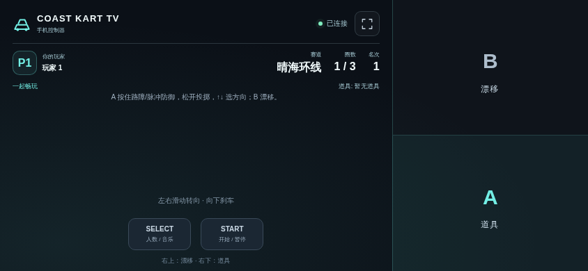
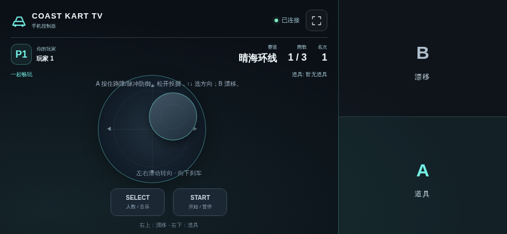

# 海岸卡丁车 TV

<!-- apk-resource:start -->
[下载 APK](coast-kart-0.5.1.apk?raw=1) · [校验值](SHA256SUMS.txt) · [签名及构建来源](resource.json) · [源码](src/) · [64×64 SVG 图标](logo.svg)

此目录内 APK 使用 pureTV 发布证书签名。若设备中存在使用旧证书的同包应用，Android 无法直接覆盖安装；需先备份数据并卸载旧包。
<!-- apk-resource:end -->

[中文](README.md) · [English](README.en.md)

一款参考现代卡丁车竞速玩法、独立制作的电视游戏。采用平滑透视画面，包含四条原创赛道、三级漂移加速、尾流超车、道具、电脑对手和手机扫码双人分屏。

当前版本 **0.5.1**，适用于 Android 8.0 及以上电视，包名 `com.ecojust.coastkarttv`。
## 0.5.1 还原度升级

加入持物防御、前后投掷、名次道具策略及来袭提示，修复高速与终点线碰撞。

沿用 0.5.0 证书，可直接覆盖更新；本轮核对结果与剩余差距见[还原度复核](../../../docs/game-fidelity-0.5.1.md)。

## 安装与签名

0.5.1 沿用 0.5.0 的 pureTV 统一发布证书，可以覆盖安装 0.5.0 并保留本机数据。使用旧证书的更早版本不能直接覆盖，请先备份可导出的数据再卸载；卸载会清除本机存档和记录，本项目没有跨证书自动迁移工具。

## 开始游玩

1. 手机和电视接入同一局域网，在电视上打开游戏。
2. 手机浏览器扫描房间二维码，每位玩家使用一部手机，无需安装手机端应用。
3. 标题画面选择人数，再按 START 开始。
4. 左侧浮动摇杆以落指位置为中心；拖动控制，松开释放。右侧屏幕三分之一整块用于动作，上半区 B、下半区 A，任意位置按下都有效，可与摇杆同时操作。START／SELECT 独立位于左侧底部；游戏操作区禁止选中文字和长按菜单。

| 控件 | 功能 |
| --- | --- |
| 浮动摇杆 | 左右转向；向下刹车／倒车，默认自动加速 |
| A | 加速/护盾按下使用；路障/脉冲按住防御、松开投掷；摇杆 ↑↓ 选择前后 |
| B | 速度足够且转向时按住漂移，积蓄 0.65／1.6／2.4 秒后松开，获得三级加速 |
| SELECT | 标题选择单人／双人；暂停时切换音乐 |
| START | 开始、暂停／继续 |

标题画面用摇杆左右选择赛道、上下选择模式。可选择单场比赛、四站锦标赛或计时挑战。单场与锦标赛支持 1–2 名玩家及 6 名电脑对手；计时挑战只使用 1P，不设电脑对手或道具。每场比赛三圈；注意赛道检查点、路外减速和对手道具。跟随前车保持同车道约 1.2 秒可获得尾流冲刺；漂移火花和蓄力条显示当前加速等级。道具按名次分配不同概率；前排更多防御，后排更多冲刺与攻击。持物可挡一次后方脉冲，电视会提示来袭与拦截。最佳计时与音乐偏好保存在电视本机。具体模式、计分和重建范围见[游戏说明](docs/reference.md)。

## 画面

截图来自实际游戏页面在 Chromium 中的渲染，使用模拟房间桥接，不是电视实机截图。






## 存档、房间与退出

比赛不会跨退出保存；最佳计时与偏好会保留。

最多两部手机通过本地 HTTP/WebSocket 房间连接，每次启动产生新的端口与随机令牌。触控中断、失焦和断线会释放按键；正在参与游戏的手机断线会自动暂停，重连恢复自动暂停，手动暂停仍然保留。

按电视 Home 离开或确认退出，会关闭房间、断开手机、释放线程与唤醒锁、销毁 WebView 和音频并结束应用进程。重新打开后请扫描新的二维码。

## 开发与实现范围

地图、画面、角色与合成音乐均独立制作，不包含任天堂软件、ROM 或提取素材，也不代表 Switch 商业原作的完整内容。具体实现与差异见[参考说明](docs/reference.md)。项目自写代码和素材使用 [MIT](LICENSE)。

```sh
node --test resource/apps/coast-kart/tests/*.test.cjs
node resource/apps/coast-kart/tests/controller.mjs
node resource/apps/coast-kart/tests/combat.mjs
node resource/apps/coast-kart/tests/compatibility.mjs
node resource/apps/coast-kart/tests/capture.mjs

cd resource/launcher/puretv
./gradlew :coast-kart:assembleRelease :coast-kart:testDebugUnitTest :coast-kart:lintDebug :coast-kart:verifyReleaseSize
```

浏览器测试使用 desktop 的 npm 依赖和 Chromium，可通过 `CHROMIUM_PATH` 指定浏览器。尚未完成电视／手机实机验证。
