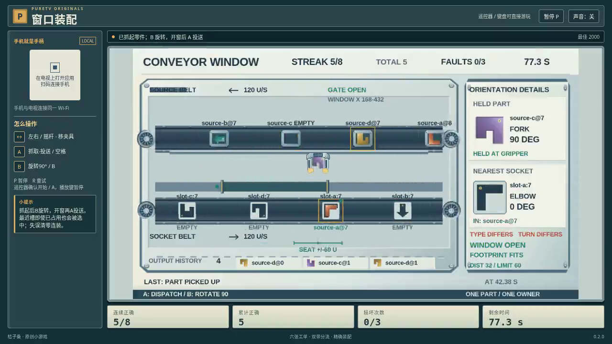

# 窗口装配 · Conveyor Window

0.2.0：[签名安装包](conveyor-window-0.2.0.apk) · [六关实际游玩录像](docs/gameplay-0.2.0.mp4) · [验证记录](docs/verification.json)

本版共六关，新增三关。浏览器普通输入验证已完成；尚未进行实体电视或手机测试。



原创双键传送线装配游戏，版本 `0.2.0`（versionCode 2），包名 `com.ecojust.conveyorwindowtv`。作者：ecojust / 桔子桑。

左右移动磁性夹具，从上层传送带抓取零件，调整朝向，在快门开放时投送到下层匹配槽位。零件的完整宽度必须处于窗口内，目标槽位还必须满足距离、空闲、形状和朝向要求。游戏始终选择最近槽位，不会跳过已占用或不匹配的近处槽位。

正确装配增加连续计数；错误投送损坏手中零件并清零连续计数。累计三次损坏或到达关卡期限失败。达到要求的连续装配数获胜；同一最终时间步同时达到目标和期限时，胜利优先。单纯横向持物等待不会因快门关闭而损坏零件。

## 操作

| 输入 | 作用 |
| --- | --- |
| 左 / 右 | 移动夹具 |
| A / 空格 | 空手时抓取；持物时投送 |
| B | 将手中零件顺时针旋转 90° |
| Enter | 从菜单开始 |
| P | 暂停 / 继续 |
| R | 重新开始当前关卡 |

A、B 每次按住只触发一次，松开后可再次操作。两键同时触发时先旋转再抓取或投送。暂停冻结模拟；重新开始恢复初始零件、槽位和计数。

## 六张工单

| 关卡 | 传送带方向 | 连续装配目标 | 期限 |
| --- | --- | --- | --- |
| 铜件初装 | 上、下层向右，不同速度 | 6 件 | 84 秒 |
| 逆送三件 | 上层向左、下层向右 | 6 件 | 90 秒 |
| 对流精装 | 上层向右、下层向左 | 5 件 | 90 秒 |
| 双向换线 | 两层向左，下层更快；四种部件 | 7 件 | 110 秒 |
| 窄窗快装 | 上层高速向右；120 单位窄窗 | 6 件 | 110 秒 |
| 夜班协同 | 上层向左、下层高速向右；错相快门 | 8 件 | 120 秒 |

菜单蓝图显示各关零件、目标朝向与快门周期。已装入的零件随槽位移动，到出口进入完成区，不重复增加装配计数。

0.2.0 保留原三关，新增不同带速、方向、窗口宽度和快门节奏的三张工单。界面采用工厂操作台：左侧控制柜放连接和操作说明，右侧双层传送线占据主舞台，底部仪表显示当前生产状态。菜单展开完整工单蓝图和六关选择。

## 0.2.0 规则与操作验证

```bash
node --test resource/apps/conveyor-window/tests/game-model.test.cjs
node resource/apps/conveyor-window/tests/browser-checks.mjs --assets /absolute/build/assets --output /absolute/scratch/browser
```

23 项规则测试包含原有形式化边界，以及全部六张工单的正常输入通关、零件归属、旋转、重开、自然失败、取消隔离和终局冻结。浏览器专项检查六关菜单、普通输入以及 960×540 / 1280×720 的文字边界和滚动。

共享 QA 使用 `tests/automation.mjs`，可从实际未操作过的短暂停留状态开始观察；六关连续录像使用 `tests/recording-automation.mjs` 和 `tests/recipe.json`。自动器只读取当前公开快照、投送回执和有限的快门时段，再发送正常按键；切关也使用结果页的方向键与 Enter。

## 0.1.0 安装与历史证据

签名安装包为 [conveyor-window-0.1.0.apk](conveyor-window-0.1.0.apk)。完整规则和公开状态接口见 [模型合同](docs/model-contract.md)。

以下均为原 0.1.0 发布证据，保留原样，不作为 0.2.0 的画面或验证证据。旧版通过 20 项正式机制测试、最终来源的三胜三负普通输入回合及基于这些记录的独立审计。正式测试包含明确标注的合成边界 fixture；独立审计没有重玩游戏。早期六回合在导航停止策略修正前已通过，仍作为历史证据保留，未冒充最终策略的结果。

最终浏览器检查包含 10 项共享检查、8 项界面检查和 1 项 QR 信息布局检查。两次候选菜单布局问题及其修正保留在发布证据中；最终候选界面通过审阅。一次实际录制自然取得 6 连装、零失误、1900 分；成片长 50.6 秒。最终 9 张成片抽帧和 12 张界面原图均经 root 与 QA 代理分别逐张审阅。封面取自实际成片中已审阅的游戏画面。

详细来源、签名、检查范围和历史记录见 [发布验证](docs/verification-0.1.0.json)、[独立审计](docs/independent-conveyor-review.json)、[美术审阅](docs/art-review.json) 和 [录像说明](docs/gameplay-0.1.0.json)。

验证环境为软件 Chromium。尚未进行实体电视、实体手机或真实扫码连接测试；QR 图仅验证布局。视频导出帧率不代表设备实测帧率，抽帧审阅也不等于逐帧检查整段录像。

本文件作为发布文档生成，不属于已签名安装包的冻结源码；补充此说明不改变安装包、游戏规则或录像。

本项目采用 [MIT 许可证](LICENSE)。
