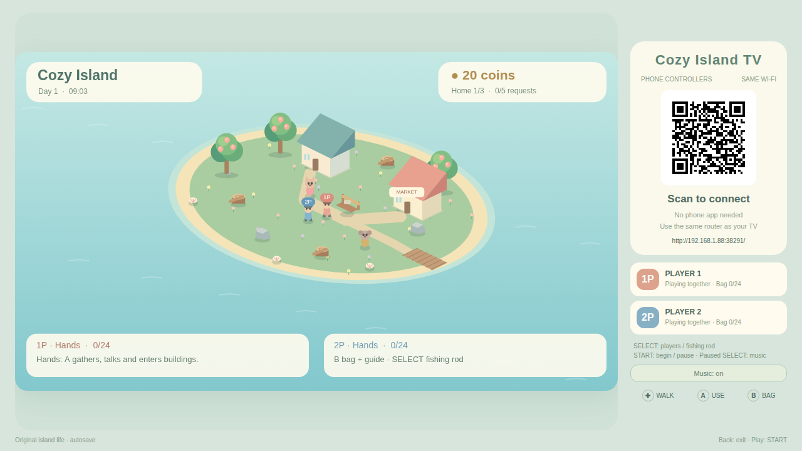
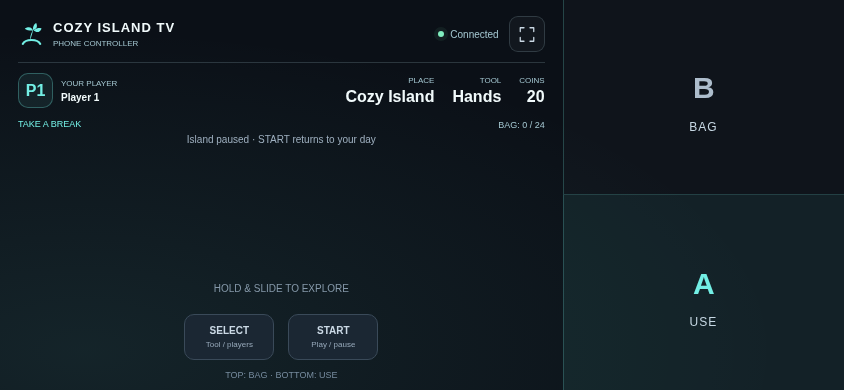
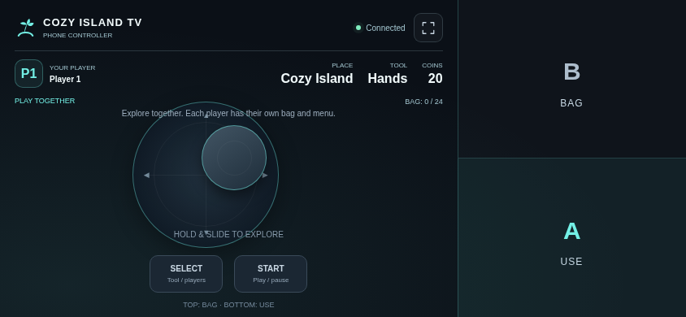

# Cozy Island TV

[中文](README.md) · [English](README.en.md)

An independently made island-life TV game with smooth isometric graphics. Gather materials, fish, help original residents, craft and place furniture, and upgrade your home on an original island.

Version **0.5.0** requires Android 8.0 or later. Package: `com.ecojust.cozyislandtv`.

<!-- apk-resource:start -->
[Download APK](cozy-island-0.5.0.apk?raw=1) · [Checksums](SHA256SUMS.txt) · [Signing and build provenance](resource.json) · [Source code](src/) · [64×64 SVG icon](logo.svg)

The APK in this directory is signed with the pureTV release certificate. Android cannot update an existing installation of the same package if it uses a different signing certificate. Back up its data and uninstall the old package first.
<!-- apk-resource:end -->

## 0.5.0 release and installation

All nine games are released as version 0.5.0 with the new shared pureTV release certificate. Package IDs stay unchanged, so Android cannot use the new certificate to replace an installation signed with the old one. Back up any data your device can export before uninstalling the old app and installing 0.5.0. Uninstalling clears local game saves and records. This project has no automatic save migration tool and cannot guarantee recovery of old saves.

## Play

1. Connect the TV and phones to the same LAN, then open the game on the TV.
2. Scan the room QR code with a phone browser. Use one phone per player; no phone app is required.
3. Choose the player count on the title screen, then press START.
4. Touch anywhere in the left joystick area to set its center. Drag to move; releasing hides it and clears movement. A/B work simultaneously with the joystick.

The right third of the phone is the action area: B fills the upper half and A fills the lower half. Touch anywhere in either region while using the floating stick on the left. START and SELECT remain separate at the bottom left. Gameplay controls suppress text selection and long-press browser menus.

| Control | Action |
| --- | --- |
| Floating joystick | Move / select menu entries |
| A | Interact, gather, fish or confirm |
| B | Open inventory / go back |
| SELECT | Cycle tools; rotate while placing; choose 1P/2P on title; toggle music while paused |
| START | Start, pause / resume |

One or two players can explore simultaneously, with separate inventories and interaction menus and shared island progress. One player can enter the house while the other stays outside. The game offers a finite set of resident tasks and home upgrades; see the [game notes](docs/reference.md) for content and scope.

Changes in 0.5.0: five fish species appear at different island hours. Watch the bobber distinguish gentle nibbles from the final bite; the reaction window depends on the species. The shared fish journal records catches and largest sizes, saves across sessions and gives 10 coins for each first discovery. The save format remains compatible with older data, but this certificate-changing release does not migrate saves from the old installation. Caught fish still count as the fish resource for requests and selling.

## Screenshots

Actual bundled game pages rendered in Chromium with a simulated native room bridge, not physical-TV captures.







## Saves, room and exit

Item and building transactions save immediately; positions save periodically. The save format remains compatible with older data, but the certificate change in 0.5.0 prevents an in-place update and does not migrate the old installation’s save. Uninstalling or confirming a save reset removes progress.

Up to two phones connect through a local HTTP/WebSocket room with a fresh port and random token on each launch. Input is released on touch cancellation, loss of focus or disconnection. Losing a participating phone pauses play; reconnecting resumes automatic pause but preserves manual pause.

TV Home or confirmed exit closes the room, disconnects phones, releases workers and wake locks, destroys the WebView/audio and ends the app process. Scan the new room code when reopening.

## Development and scope

This is an independent game with original maps, artwork, residents and synthesized music. It does not bundle Nintendo software, ROMs or extracted assets and does not claim the complete content of a commercial Switch title. See the [reference and scope notes](docs/reference.md). Project-authored code and assets use [MIT](LICENSE).

```sh
node --test resource/apps/cozy-island/tests/*.test.cjs
node resource/apps/cozy-island/tests/controller.mjs
node resource/apps/cozy-island/tests/compatibility.mjs
node resource/apps/cozy-island/tests/capture.mjs

cd resource/launcher/puretv
./gradlew :cozy-island:assembleRelease :cozy-island:testDebugUnitTest :cozy-island:lintDebug :cozy-island:verifyReleaseSize
```

Browser tests use desktop npm dependencies and Chromium (`CHROMIUM_PATH`). Physical TV and phone verification remains pending.
