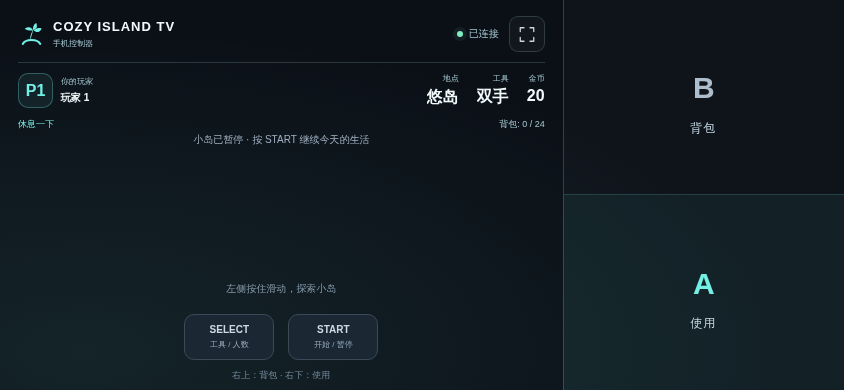
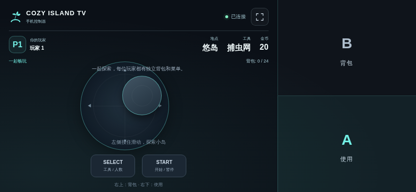

# 悠岛生活 TV

[中文](README.md) · [English](README.en.md)

一款参考岛屿生活经营玩法、独立制作的电视游戏。采用平滑等距画面，在原创岛屿中采集、昼夜钓鱼、记录鱼类图鉴、完成居民任务、制作和布置家具，并逐步升级小屋。

发布目标版本 **0.5.0**，适用于 Android 8.0 及以上电视，包名 `com.ecojust.cozyislandtv`。

<!-- apk-resource:start -->
[下载 APK](cozy-island-0.1.0.apk?raw=1) · [校验值](SHA256SUMS.txt) · [构建来源](resource.json) · [源码](src/) · [64×64 SVG 图标](logo.svg)

安装包使用 pureTV 发布证书签名。
<!-- apk-resource:end -->

## 0.5.0 发布准备与安装

本轮九款游戏统一准备发布 0.5.0，并更换游戏发布证书。包名保持不变，Android 无法用新证书的安装包覆盖旧证书版本。安装前请先备份设备能够导出的数据，再卸载旧版并安装 0.5.0；卸载会清除本机游戏存档和记录。本项目没有自动存档迁移工具，不能保证旧存档恢复。

发布完成以 0.5.0 APK、校验值及 `resource.json` 同步更新为准。

## 开始游玩

1. 手机和电视接入同一局域网，在电视上打开游戏。
2. 手机浏览器扫描房间二维码，每位玩家使用一部手机，无需安装手机端应用。
3. 标题画面选择人数，再按 START 开始。
4. 左侧浮动摇杆以落指位置为中心；拖动控制，松开释放。右侧屏幕三分之一整块用于动作，上半区 B、下半区 A，任意位置按下都有效，可与摇杆同时操作。START／SELECT 独立位于左侧底部；游戏操作区禁止选中文字和长按菜单。

| 控件 | 功能 |
| --- | --- |
| 浮动摇杆 | 移动角色／选择菜单项 |
| A | 交互、采集、钓鱼或确认 |
| B | 打开背包／返回 |
| SELECT | 切换工具；摆放时旋转；标题选人数；暂停时切换音乐 |
| START | 开始、暂停／继续 |

单人或两人可以同时活动。背包与交互菜单分别操作，共享岛屿建设进度；一人进入小屋时，另一人仍可继续在户外活动。五种鱼按岛上时间出现；浮标会轻轻试探，真正咬钩后及时按 A。图鉴记录每种鱼的捕获次数和最大尺寸，首次发现奖励 10 金币，存档格式兼容旧数据，但本次换证书安装不会自动迁移旧应用的存档。游戏提供有限且可完成的居民任务与小屋升级目标，具体物品、任务和范围见[游戏说明](docs/reference.md)。

## 画面

截图来自实际游戏页面在 Chromium 中的渲染，使用模拟房间桥接，不是电视实机截图。






## 存档、房间与退出

重要物品与建设操作会保存，角色位置定期保存。存档格式兼容旧数据，但 0.5.0 更换证书后无法覆盖安装，也不会自动迁移旧应用的存档；卸载或确认重置存档会清除进度。

最多两部手机通过本地 HTTP/WebSocket 房间连接，每次启动产生新的端口与随机令牌。触控中断、失焦和断线会释放按键；正在参与游戏的手机断线会自动暂停，重连恢复自动暂停，手动暂停仍然保留。

按电视 Home 离开或确认退出，会关闭房间、断开手机、释放线程与唤醒锁、销毁 WebView 和音频并结束应用进程。重新打开后请扫描新的二维码。

## 开发与实现范围

地图、画面、角色与合成音乐均独立制作，不包含任天堂软件、ROM 或提取素材，也不代表 Switch 商业原作的完整内容。具体实现与差异见[参考说明](docs/reference.md)。项目自写代码和素材使用 [MIT](LICENSE)。

```sh
node --test resource/apps/cozy-island/tests/*.test.cjs
node resource/apps/cozy-island/tests/controller.mjs
node resource/apps/cozy-island/tests/compatibility.mjs
node resource/apps/cozy-island/tests/capture.mjs

cd resource/launcher/puretv
./gradlew :cozy-island:assembleRelease :cozy-island:testDebugUnitTest :cozy-island:lintDebug :cozy-island:verifyReleaseSize
```

浏览器测试使用 desktop 的 npm 依赖和 Chromium，可通过 `CHROMIUM_PATH` 指定浏览器。尚未完成电视／手机实机验证。
