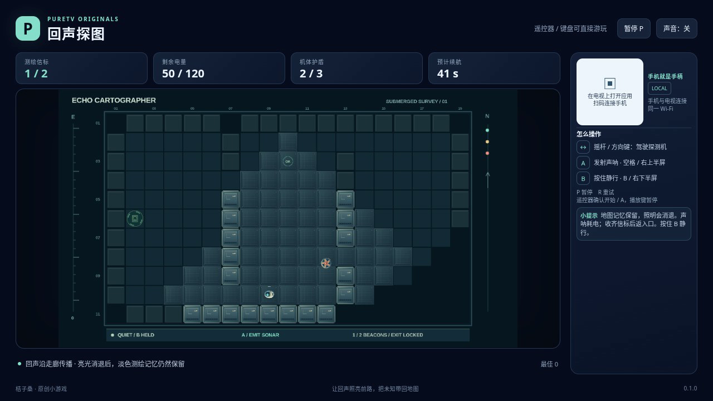

# 回声探图 / Echo Cartographer

在暗室中寻找信标，再沿记忆地图返回入口。声呐沿可通行的走廊传播，遇到墙壁便停止穿透；回声到达后，地形短暂变亮，随后留下淡色测绘记忆。未知区域不会提前显示真实墙体，移动中的巡逻机只在当前可见区域显形。

- 作者：ecojust / 桔子桑
- 包名：`com.ecojust.echocartographertv`
- 版本：`0.1.0`
- 电视系统：Android 8.0 / API 26 及以上
- 图标：[logo.svg](logo.svg)

[下载安装包](echo-cartographer-0.1.0.apk) · [实际游玩视频](docs/gameplay-0.1.0.mp4) · [验证记录](docs/verification.json)



## 操作

手机与电视接入同一局域网，扫描电视画面中的二维码。左侧任意位置拖动摇杆移动；右侧上半区发射声呐，下半区按住慢速静行。声呐每次消耗 3 点主电量，冷却 1.1 秒；长按不会连续发射。

键盘方向键或 WASD 移动，空格扫描，B 静行，Enter 开始，P 暂停，R 重试。电视遥控器方向键移动，确认键扫描，菜单键静行。开始与结算菜单可用左右方向选择海图，手机 START 开始或暂停。

静行降低移动速度和脚步噪声，适合在巡逻机发现你之前接近或绕行。已被追踪时，松开 B 才能更快拉开距离；静行不会免除碰撞伤害。护盾可承受三次撞击，两次有效受击之间有短暂无敌保护。

三张海图分别需要收集 2、3、3 个信标。已收集的信标不会因光线消退而丢失；必须带齐后实际回到入口，才算完成测绘。主电池持续为照明供电，扫描额外耗电；主电池耗尽后还有 10 秒备用灯光，期间不能扫描。主电池与备用灯光同时耗尽，或护盾耗尽，都会结束本局。界面显示的预计续航按当前电量估算，扫描会缩短它。

## 实现与验证

规则采用固定步长。声呐以发射时的位置为固定源，按四邻走廊图的距离传播；它是格点声学近似。亮部持续四秒，永久保留的淡图用于记忆路线。近身灯光另做墙体遮挡，未知墙体不作为导航信息交给自动操作脚本。

```bash
node --test resource/apps/echo-cartographer/tests/game-model.test.cjs
node resource/apps/echo-cartographer/tests/independent-echo-review.mjs
node resource/apps/echo-cartographer/tests/independent-pilot-review.mjs
```

独立模型检查使用距离矩阵和线段交点计算，核对声波距离、传播时序与近灯遮挡，并检查静行感知、电量和返航条件，结果见 [独立模型报告](docs/independent-echo-review.json)。自动操作脚本另接受相同可见信息、不同隐藏世界的配对检查，禁止读取隐藏地形、目标和巡逻路线，结果见 [隐藏信息隔离报告](docs/independent-pilot-review.json)。这些测试使用受控场景，与普通输入游玩证据分别记录。构建与手机手柄组件见 [game-kit](../../game-kit/README.md)。最终验证结果及实际运行录像随发布产物保存在本目录中；浏览器验证不代表实体电视或手机实测。

源码与原创素材遵循仓库 [MIT 许可证](../../../LICENSE)。
