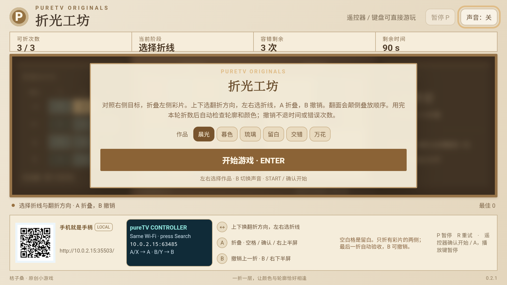

# 折光工坊 / Glass Fold

**0.2.1 · pureTV 手柄更新：** [签名安装包](glass-fold-0.2.1.apk) · [Android 实包手柄回归录像](docs/releases/0.2.1/gameplay.mp4) · [版本验证](docs/releases/0.2.1/verification.json) · [本轮接入记录](../../../docs/readme-controller-support/README.md)

新增 pureTV Wi-Fi 手柄支持，默认端口 **63485**，显示真实连接状态，断线时暂停并清除输入。保留原六关及规则，遥控器和扫码手机仍可使用。

本版 APK 已签名，并在 Android TV API 36 模拟器中完成同证书覆盖安装验证，通过全部 8 项手柄验收，覆盖开始、实际游戏操作、暂停恢复、断线重连、九键输入及逐消息 ACK。下图和上方录像来自本版本实际 APK；录像记录手柄回归过程，不是六关通关录像。尚未进行实体电视、手机或 ESP32 测试。



历史 0.2.0：[签名安装包](glass-fold-0.2.0.apk) · [六关实际游玩录像](docs/gameplay-0.2.0.mp4) · [旧版验证记录](https://github.com/ecojust/pureTV/blob/bf58393ba8fa8bb3bdf731ab24f9ab09d90f5075/resource/apps/glass-fold/docs/verification.json)。这些旧版记录作为未改变规则的回归依据，不代表本轮界面、手柄链路或 Android 实包验收。

沿折线翻折半透明彩片，让重叠后的轮廓和颜色与目标花窗一致。移动部分会翻面并颠倒层序，同样的颜色换一个叠放顺序，也可能得到不同的花窗。

- 作者：ecojust / 桔子桑
- 包名：`com.ecojust.glassfoldtv`
- 版本：`0.2.1`（versionCode 3）
- 电视系统：Android 8.0 / API 26 及以上
- 图标：[logo.svg](logo.svg)

历史 0.1.0：[APK](glass-fold-0.1.0.apk) · [实际游玩视频](docs/gameplay-0.1.0.mp4) · [验证记录](docs/verification-0.1.0.json)

## 操作

手机与电视接入同一局域网，扫描电视画面的二维码。左侧摇杆上下选择向右、向左、向下、向上翻折，左右选择第 1、2、3 条折线。右侧上半区 A 执行折叠，下半区 B 撤销上一折。

键盘方向键或 WASD 选择，空格或 Enter 折叠，B 撤销，P 暂停，R 重试。电视遥控器方向键选择、确认键折叠、菜单键撤销。手机 START 开始或暂停；开始与结算菜单可用左右方向选择关卡，B 切换声音。

六关分别允许 3、3、4、2、3、4 次折叠。新增“留白拱窗”使用 12 片玻璃组成非矩形目标，“交错层光”以 13 片玻璃练习不对称层序，“万花凝珠”要求将完整花窗压成指定色彩的一格；最后两关只提供两次验收机会。每次选定一条横向或纵向折线及移动侧，整侧翻向另一边。两侧都必须有彩片，且翻折后所有彩片都要留在 4×4 工作区内；彩片重叠后仍保留各自的颜色和层次。

用完本轮折叠次数后，等 0.6 秒折叠动画结束，系统自动检查作品。轮廓与各区域的最终颜色全部相同才算完成；不要求照着唯一的一条路线折。检查不符会记一次错误，此时可用 B 撤销修正，再完成最后一折重新检查。

撤销会恢复上一折之前的几何、层序、所选折线与剩余折叠次数，不退回已用时间或错误次数。折叠动画期间暂不接受选择、折叠或撤销，也不会排队延后执行。累计达到本关错误检查上限，或 90 秒有效游戏时间耗尽，本局结束；最后一折必须在时限前完成动画。暂停不消耗有效时间；重试会开始一局全新的作品。

## 界面与关卡

0.2.0 将工坊改成浅色纸张、黄铜边框与双花窗工作台，放大左右花窗，折线选择与作品验收分列两侧，连接二维码和工具说明横置在底部。六幅作品可独立选择，选关按钮会随关卡数量展开。

0.2.0 的安装包、真实游戏画面与验收记录见上方历史入口；0.2.1 将菜单遮罩限制在游戏区域，连接二维码与手柄说明在菜单中保持清晰。历史 0.1.0 证据保留在版本化文件中。

## 源码与验证

这是整数网格上的彩片折叠谜题。每关的全部材料在折叠中保留（12、13 或 16 片），移动堆栈倒序后放到静止堆栈上方。每层使用一半透明度，按从底到顶的顺序累积颜色，只在最终显示为 8 位 RGB 时舍入。目标比较轮廓和最终 RGB；隐藏的材料编号或折叠历史不参与答案判定。

规则与测试见 [0.2.0 模型补充](docs/model-contract-0.2.0.md)与[原模型契约](docs/model-contract.md)。

```bash
node --test resource/apps/glass-fold/tests/game-model.test.cjs
node resource/apps/glass-fold/tests/independent-fold-review.mjs
node resource/apps/glass-fold/tests/independent-pilot-review.mjs --output /tmp/glass-fold-pilot-review
```

旧版[独立折叠报告](docs/independent-fold-review.json)采用另一套整数中心反射与精确分数混色算法，核对可达折叠、材料守恒、颜色层序、撤销和时限；解法只从公开棋盘及目标搜索，不读取参考路线。其中的合成颜色、计时用例与旧版三关的普通输入解法分别记录，不作为新版浏览器录像或实体设备验证。0.2.0 的独立复核已扩展到六关，本轮按未改变的模型哈希复用其规则证据。

[操作脚本独立报告](docs/independent-pilot-review.json)通过受控公开棋盘检查搜索上限、按键释放、预测结果核对及禁止读取私有历史。这些小型用例不执行生产模型，也不作为关卡通关证明。

手机手柄与 Android 宿主组件见 [game-kit](../../game-kit/README.md)。源码与原创素材遵循仓库 [MIT 许可证](../../../LICENSE)。

## pureTV Wi-Fi 手柄

从 0.2.1 起，电视游戏提供 pureTV TCP 手柄服务，默认端口 **63485**。电视和手柄连同一个局域网，在游戏显示连接地址后按手柄 GPIO23 搜索键；同网仅保留一个目标游戏服务，固件才会自动选中。若端口被占用，以游戏显示的实际端口为准。

- 方向键：对应游戏内方向操作和菜单选关。
- START：开始、暂停或继续。
- A / X：折叠。
- B / Y：撤销。

断线或切换控制来源会暂停并清除旧输入；重新连接后松开按键，再按 START 继续。临时失焦时保留TCP连接并隔离输入，真正退出游戏时关闭服务。遥控器、键盘和扫码手机入口继续可用。

虚拟手柄联调：`python3 puretv-joystick/bridge.py 电视IP --port 63485`，再打开 `http://127.0.0.1:8767/`。使用备用端口时替换命令中的端口。验证范围见[20款游戏接入记录](../../../docs/readme-controller-support/README.md)。
