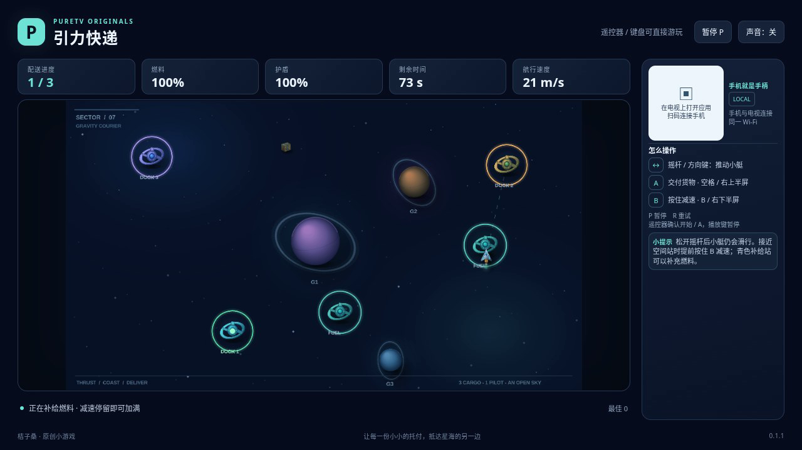

# 引力快递 / Gravity Courier

驾驶一艘有惯性的小艇，把三份包裹送到星海中的收件站。用推力规划航线，提前减速避开星体；燃料耗尽后仍会滑行，也可以靠近补给站重新补充。星体引力、低速交付和有限燃料构成这款游戏的核心规则。

- 作者：ecojust / 桔子桑
- 包名：`com.ecojust.gravitycouriertv`
- 版本：`0.1.1`
- 电视系统：Android 8.0 / API 26 及以上
- 图标：[logo.svg](logo.svg)

[下载安装包](gravity-courier-0.1.1.apk) · [查看实际游玩视频](docs/gameplay-0.1.1.mp4) · [验证记录](docs/verification.json)



## 操作

手机与电视接入同一局域网后，扫描电视画面中的二维码。左侧任意位置拖动摇杆提供推力；右侧上半区交付货物，下半区按住减速。松手后小艇仍会按惯性滑行。靠近当前货箱并减速即可自动拾取，到对应收件站低速停靠后按 A 交付。

键盘方向键或 WASD 提供推力，空格交付，B 减速，Enter 开始，P 暂停，R 重试。电视遥控器方向键和确认键也可游玩，菜单键对应 B。开始和结算菜单可用左右方向选择航线，按 B 切换声音。练习、标准与挑战有不同的引力和时间限制；三份包裹全部交付后获胜，护盾耗尽或超时结束。

## 实现与验证

规则模型与绘制分离，物理采用固定步长子步，包含引力软化、速度限制和碰撞保护时间。场景使用原创平滑图集与合批绘制，没有像素风缩放，也不包含第三方 ROM、模型或贴图。

```bash
node --test resource/apps/gravity-courier/tests/game-model.test.cjs
```

测试涵盖推力、惯性、引力、燃料、交付条件、补给、碰撞、胜负、重试与低帧率稳定性。`tests/automation.mjs` 只通过普通键盘输入导航，不修改模型状态。构建和公共组件见 [game-kit](../../game-kit/README.md)。最终包与录像验证结果随发布产物保存在本目录中。

0.1.1 修复侧栏提示裁切与滚动问题，并从打包配置显示版本号。本次重新完成 16 项模型测试、10 项共享浏览器回归和 12 项补充交互检查，核对了 960×540 与 1280×720 的菜单、暂停和真实胜利页面。新录像使用 0.1.1 的实际打包资源，时长 50.4 秒、2.45 MB，正常完成 3/3 配送。此次未连接实体电视或手机。

源码与原创素材遵循仓库 [MIT 许可证](../../../LICENSE)。

## 历史版本

[0.1.0 APK](gravity-courier-0.1.0.apk) · [0.1.0 录像](docs/gameplay-0.1.0.mp4) · [0.1.0 验证记录](docs/verification-0.1.0.json)。这些文件保留原始内容，仅代表历史版本。后续原 APK 检查发现 960×540 侧栏存在裁切，旧记录中“无裁切”的概括已被纠正；当前界面验收与录像以 0.1.1 为准。
