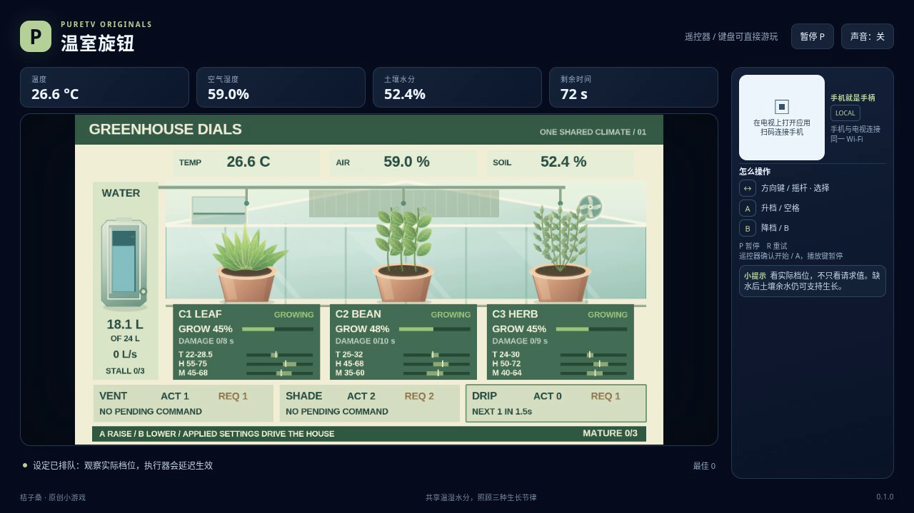

# 温室旋钮 / Greenhouse Dials

调节通风、遮阳与滴灌，让同一座温室中的叶菜、豆苗和香草全部成熟。三种作物各有温度、空气湿度和土壤水分适宜区；操作需要等待执行，水箱也不会自动补满。

- 方向键或手机摇杆选择通风、遮阳、滴灌。
- **A 升档**，**B 降档**；每个旋钮有 0、1、2 三档。
- 暂停使用独立的 P / START 入口。R 重试会重新开始当前关卡。

每次升降档先改变目标档位，再经过本关规定的延迟改变实际档位。已排队的命令依次执行，切换选择器不会取消它们。请观察目标档、实际档和剩余等待时间；窗口、遮阳和水流跟随实际执行结果。第一、二、三关的延迟分别为 1.5、2、2.5 秒。

通风提供冷却、降低空气湿度并加快土壤蒸发；遮阳减少热输入和蒸发，遮得过多也可能使温度低于作物适宜区。滴灌实际消耗水箱储水，为土壤补水并提高空气湿度。土壤已湿透时继续滴灌仍会耗水，水耗尽后滴灌不会继续生效。

作物只有在三项环境指标同时适宜时才积累成熟进度。过热时不会继续增长；超出更宽的安全区还会积累不可逆损伤。先成熟的作物仍可能受致命损伤，直到三种作物全部成熟并结算。

水箱空了以后，残余土壤水分仍可支持生长。如果所有尚未成熟的作物连续 3 秒都没有增长，本局会因缺水停长而结束。任一作物达到致命损伤阈值也会失败；每局另有 90 秒有效时间限制。暂停会冻结环境、成长、损伤和执行队列，重试会清空队列并恢复本关初始状态。

三关使用同一套规则，天气热输入、初始环境、储水、执行延迟和作物成熟时长不同。每种作物必须分别成熟，不能用另一种作物的进度抵扣。

温度、湿度和土壤水分采用便于观察的游戏近似；这不是农业控制或植物生理模拟。公开字段、数值、命令队列和结算顺序见[模型合同](docs/model-contract.md)。

作者：ecojust / 桔子桑。包名：`com.ecojust.greenhousedialstv`。版本：`0.1.0`。电视系统：Android 8.0 / API 26 及以上。

键盘使用方向键或 WASD 选择旋钮，空格或 Enter 为 A，B 为减档，P 暂停，R 重试。电视遥控器使用方向键、确认键和菜单键；手机 START 开始或暂停。菜单可以切换三关。A/B 每次按下只改变一档，持续按住不会重复。左右选择与上下选择都不从边缘绕回。

获胜要求三种作物在同一局中分别成熟，不要求耗完水。结算先检查作物死亡，再检查全部成熟，随后检查缺水停长和超时；因此截止时刻刚好完成最后一格进度可以获胜，同时达到致命损伤则失败。分数来自各自成熟比例，胜利另加 1000 和剩余整升水量；反复调节旋钮不加分。

发布产物：[APK](greenhouse-dials-0.1.0.apk) · [实际游玩视频](docs/gameplay-0.1.0.mp4) · [验证记录](docs/verification.json)



定向规则测试：

```sh
node --test resource/apps/greenhouse-dials/tests/game-model.test.cjs
```

测试中的合成边界夹具、独立普通输入回合、浏览器录像与实体设备测试分别记载。合成夹具会明确修改环境或计数来验证边界，不作为正常游玩证明。模型和浏览器结果不代表实体电视表现，未声称完成实体电视测试。共享手柄与 Android 宿主见 [game-kit](../../game-kit/README.md)。源码和原创素材采用 [MIT 许可证](LICENSE)。
