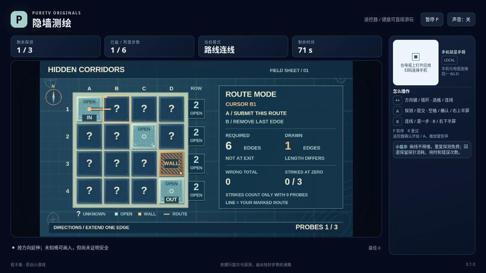

# 隐墙测绘 / Hidden Corridors

只凭每行的通路格数、入口到出口的最短距离，以及有限的探针，推断隐藏墙体的位置。最后画出一条长度正确、避开真实墙体的路线。

- 作者：ecojust / 桔子桑
- 包名：`com.ecojust.hiddencorridorstv`
- 版本：`0.1.0`
- 电视系统：Android 8.0 / API 26 及以上
- 图标：[logo.svg](logo.svg)

发布产物：[APK](hidden-corridors-0.1.0.apk) · [实际游玩视频](docs/gameplay-0.1.0.mp4) · [验证记录](docs/verification.json)



## 操作

手机与电视接入同一局域网，扫描电视画面的二维码。左侧摇杆控制选择框或路线，右侧上半区 A 探测或提交，下半区 B 连线或回退。

在探测模式中，方向自由移动选择框，A 用一枚探针揭示当前未知格。每次只揭示这一格，不揭示邻格；入口和出口免费标明可通行。重复探测已知格不再消耗探针。B 从入口开始连线，并记住之前的探测光标。

在连线模式中，方向向相邻且未经过的格子延长路线。已知墙体不能进入，未知格允许标记，但这不代表它一定安全；画线不会偷看墙体或触发隐藏碰撞。到达出口后不再延长，按 A 提交。B 每次撤回一格，退到入口后再按 B 返回探测模式。回退不返还探针或时间。

键盘使用方向键或 WASD，空格或 Enter 为 A，B 为 B，P 暂停，R 重试。电视遥控器使用方向键、确认键和菜单键；手机 START 开始或暂停。开始与结算菜单可用左右方向选择关卡，B 切换声音。A、B 按每次按下触发，持续按住不会重复探测、提交或回退。

## 线索与判定

每行数字包含这一整行的所有可通行格，包括入口、出口。距离提示是入口到出口的真实最短**边数**：例如 6 步路线包含 7 个格子。它不一定等于两点的曼哈顿距离。

三关分别有 3、4、5 枚探针，每局有 90 秒有效时间。探针用尽后仍可推理、连线和提交，不会立即失败。路线必须从入口出发、不重复格子、走相邻格到达出口，且边数恰好等于提示，再由真实墙体检验安全性。到达出口不会自动获胜；只修改玩家标记也不能绕过真实墙体。

每次错误提交都会记录，但只有**提交时探针已经用尽**的错误才增加耗尽后的失败次数。累计三次这类错误才会失败；先前的错误不会在最后一枚探针用掉后被追溯计入。时间耗尽也会结束本局。错误反馈不会指出未探明的哪一格是墙，短路线或错误长度也不能当成免费探针。

暂停不消耗有效时间。恢复或断线时的输入清理不会自动探测、提交或改变已经画出的路线。R 重新开始当前固定关卡，恢复资源、次数和时间，但隐藏布局不会偷偷换一张。

## 源码与验证

公开字段、两种操作模式、输入顺序、失败计数与评分公式见 [模型契约](docs/model-contract.md)。真实墙体存放在模型内部的 WeakMap 中，不传给画面、手机控制页面或操作脚本。普通 JSON 快照是观察数据，不能还原为可继续运行的模型状态。这是运行时的信息边界，并不声称能防止查看 JavaScript 源码。

独立审查从全部 65,536 种格图中筛选公开线索，得到三关分别 9、40、90 个初始候选；开局的公共格交集均不足以直接提交。双结果决策树及其下界证书证明，最坏需要 2、2、3 次探测，均在各关预算以内。真实地图的线索校验使用多个全新同关模型，每次只普通探测一格；这些合并观察仅用于测试，不送入实际游玩的推理脚本。

[独立规则报告](docs/independent-corridor-review.json) 将边界夹具与三关公开策略的普通模型输入分开记录；模型输入验证不是浏览器录像或实体设备测试。可从仓库根目录复核：

```sh
node resource/apps/hidden-corridors/tests/independent-corridor-review.mjs --output /tmp/hidden-corridors-review.json
node resource/apps/hidden-corridors/tests/independent-corridor-math.mjs --output /tmp/hidden-corridors-math/report.json
```

[操作脚本的独立审查](docs/independent-pilot-review.json) 使用合成公开观察，检查私有信息隔离、输入松开、探测延迟及提示过期；这部分没有执行生产模型，也不作为通关录像。正式模型测试、浏览器录像和实体设备验证另行记录，具体结果见发布验证记录。

手机手柄与 Android 宿主组件见 [game-kit](../../game-kit/README.md)。源码与原创素材遵循仓库 [MIT 许可证](../../../LICENSE)。
