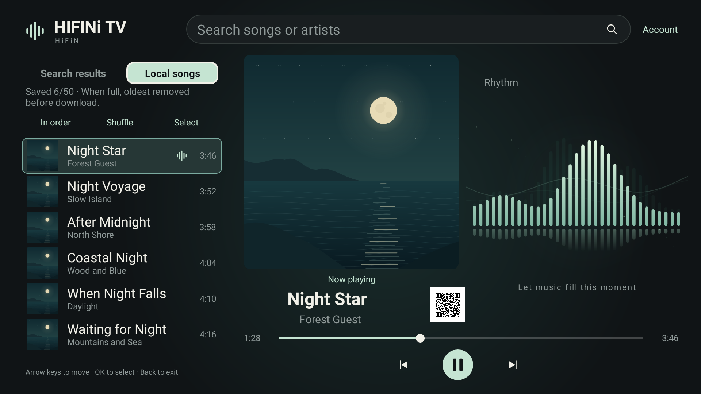

# HIFINi TV

<!-- apk-resource:start -->
[Download APK](hifini-0.1.3.apk?raw=1) · [Checksums](SHA256SUMS.txt) · [Signing and build provenance](resource.json) · [Source code](src/)

The APK in this directory is signed with the pureTV release certificate. Android cannot update an existing installation of the same package if it uses a different signing certificate. Back up its data and uninstall the old package first.
<!-- apk-resource:end -->

[English](README.en.md) · [中文](README.md)

An independent HiFiNi music client for Android TV remotes, requiring Android 8.0 or later. Package: `com.ecojust.hifinitv`; version: `0.1.3`. It installs alongside Music TV and does not access or modify Music TV data.



## Search and playback

- Search by song or artist after signing in to HiFiNi, or enter an official forum page containing static player data, such as `https://www.hifini.net/thread-6544.htm`.
- Switch between Search results and Local songs. Select a search result to play it. The local list provides Play in order and Shuffle; shuffle avoids repeats within a round. Queues contain up to 50 tracks; this does not sample the entire site catalog.
- Search uses `musicparse-search.htm?keyword=...`, preserving each NetEase/Kuwo source ID, title, artist, artwork, and duration, including tracks without a forum topic.
- New songs are downloaded through `musicparse-play.htm?source=...&id=...`, saved in a private library once complete, and played locally using Android MediaPlayer. A `.mp3` URL suffix is not required. Downloads show a percentage or byte count and can be cancelled. Saved songs play directly without downloading again.
- A QR code beside the current song title contains the remote URL used for this download and remains available after failure. Select it to enlarge the code and view the full URL and playback error for testing on a phone. This is the remote download entry, not the private file path on the TV.
- Each audio file is limited to 64 MiB and downloads to 90 seconds. Cancellation, track changes, and service shutdown remove incomplete temporary files. Completed songs remain saved across app exits and restarts. HTTP media is limited to public NetEase and Kuwo music CDNs; account and search traffic remain HTTPS, and HiFiNi session cookies are never forwarded to third-party CDNs.
- Source artwork and artist details accompany a native rhythm animation. The animation runs during playback and rests when paused, stopped, or off-screen. It does not record a microphone or analyze the audio spectrum. Lyrics are not included.
- Play/pause, previous/next, seeking, background playback, system media keys, and playback notifications.

Use the directional pad to navigate and OK to select. Back cancels a pending search. The interface follows the system language, with Chinese and English resources.

## Local songs and the 50-track limit

Local songs lists fully saved audio and its count. Select a song or shuffle the library offline without signing in. Titles, artists, and durations are saved with each track. Artwork still uses the source image URL and falls back to the default illustration when unavailable offline.

Playback controls are inside the local list. Select individual songs or all songs for batch deletion. Deleting songs removes their audio files and library entries, and stops playback first if the current song is included. Deleted songs also leave the active playback queue.

The library keeps up to **50 songs**, ordered by when they were first saved. Before downloading a 51st new song, the oldest saved audio file is deleted and the list updated. If the new download fails or is cancelled, the library temporarily contains 49 songs. Replaying a saved song does not consume another slot or change its order. Only complete downloads enter the library. Uninstalling the app or clearing app data removes the library.

## Sign-in and saved credentials

Open **Account** at the top right to show a single account panel. This label does not mean you are signed out, and reopening the app does not force a new sign-in. The registration QR code sits above the username, password, and sign-in button. Existing users can sign in directly; new users can scan with a phone to visit `https://www.hifini.net/user-create.htm`. The QR code is generated locally, contains only this official URL, and has no separate open-registration button. The account screen has no visible website or browser navigation controls; use the remote Back key to leave.

Your username and password are encrypted locally using Android Keystore AES-GCM, never logged or included in system backups. An explicit press of Sign in fills and submits the official HTTPS form in the background. Once confirmed, the panel displays “Signed in successfully” and returns to playback after 1500 milliseconds. Failed attempts or site verification requirements show feedback and keep the panel open; the app does not bypass verification. Saved credentials are restored to the native input fields; submission still requires an explicit press of Sign in.

The official WebView session cookies are retained locally and shared with native requests to HiFiNi. A valid session avoids repeated sign-in. Expiration, verification, or account changes can still require interaction. You can refill saved credentials, forget them, or clear the local session.

Credentials are not sent to the desktop manager or an agent. Session cookies are not attached to third-party artwork or audio requests. Native playback does not execute website scripts; the account screen processes the official sign-in form in an invisible system WebView.

## Build and verification

```bash
cd resource/launcher/puretv
./gradlew :hifini:testDebugUnitTest :hifini:lintDebug :hifini:verifyReleaseSize
```

From the repository root, run `node --test resource/apps/hifini/src/test/js/login-autofill.test.mjs` to verify the actual autofill script's form and origin checks (Node.js 22).

Release outputs are under `resource/apps/hifini/build/outputs/apk/release/`; catalog APKs are signed separately with the pureTV certificate. Set `HIFINI_UI_CAPTURE_DIR` to export native Chinese and English previews. Parser tests use a sanitized search excerpt supplied by the user and synthetic boundary fixtures; see their [provenance](src/test/resources/hifini/README.md).

Production dependencies are jsoup for HTML parsing and ZXing Core for generating registration and audio URL QR codes locally; Android MediaPlayer handles audio. Release builds shrink code and resources and must remain below 5 MiB. Artwork has a 4 MiB memory cache and a 2 MiB per-download limit; queues are limited to 50 tracks. See [NOTICE.md](NOTICE.md) for licenses.

**Live verification status:** The user has confirmed that search works on their TV and that version 0.1.2 plays successfully after downloading the audio locally. The development environment still cannot reach HiFiNi, so real account sign-in and online playback have not been independently verified here. Version 0.1.3's persistent library and 50-track eviction use automated tests and still need testing on a TV. Native UI, parser fixture, and playback state tests do not replace TV testing. Site changes, verification, media formats, and regional connectivity may affect availability. The adapter uses official search/playback entries and explicitly supplied page data; it does not execute decryption scripts or use third-party resolver services.
