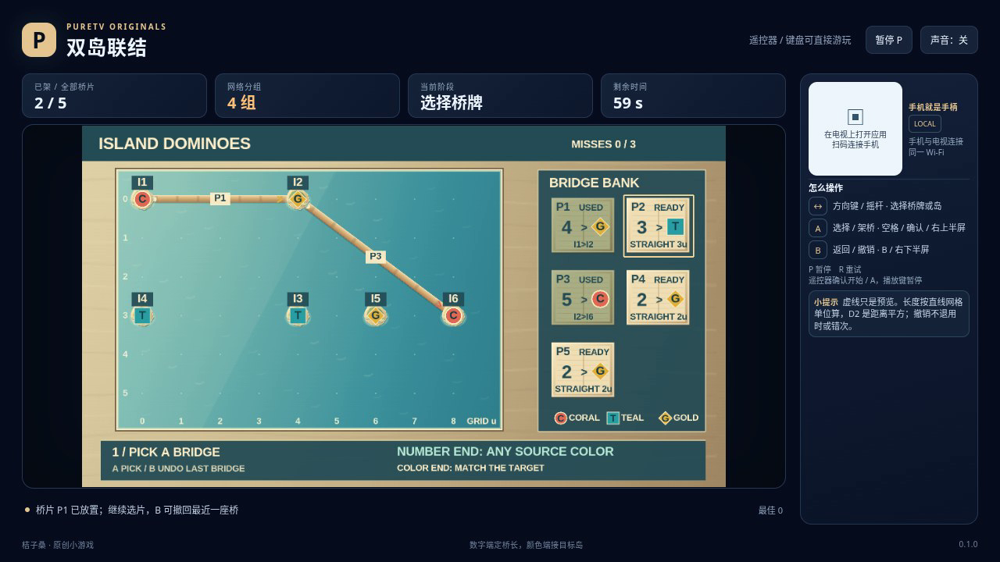

# 双岛联结 / Island Dominoes

为岛屿选择合适的双端桥片：数字规定直线桥长，颜色规定目标岛。把所有桥片用完，让每座岛接入同一个网络，同时避开交叉、重叠和途中的其他岛。

- 作者：ecojust / 桔子桑
- 包名：`com.ecojust.islanddominoestv`
- 版本：`0.1.0`
- 电视系统：Android 8.0 / API 26 及以上
- 图标：[logo.svg](logo.svg)

发布产物：[APK](island-dominoes-0.1.0.apk) · [实际游玩视频](docs/gameplay-0.1.0.mp4) · [验证记录](docs/verification.json)



## 操作

手机与电视接入同一局域网，扫描电视画面的二维码。左侧摇杆移动选择框；右侧上半区 A 选择或架桥，下半区 B 返回或撤销。

在桥片栏中，按方向选择对应方向上最近的可用桥牌，已用桥片会被跳过。按 A 拿起桥片，再用方向选择起点岛，按 A 确定起点。继续选目标岛，按 A 尝试放置。岛屿间的方向选择也会选取输入方向上最近的岛，不会只筛选可放置的目标；放置前可查看长度、目标颜色和相交提示。

B 在目标阶段返回起点选择，并把光标放回刚才的起点；在起点阶段返回桥片栏。在桥片栏按 B 才会撤销最近一座已放置的桥，归还同一块编号桥片。两块桥片即使数字与颜色相同，也保持各自的编号。拿起、预览和取消都不占用桥片或改变连接关系。

键盘使用方向键或 WASD，空格或 Enter 为 A，B 为 B，P 暂停，R 重试。电视遥控器使用方向键、确认键和菜单键；手机 START 开始或暂停。开始与结算菜单可用左右方向选择关卡，B 切换声音。A、B 每次按下触发一次，持续按住不会反复架桥或撤销。

## 架桥规则

数字使用直线网格距离。例如横向相差 3、纵向相差 4 的两座岛，可以用长度 5 的桥连接。它不是沿格子绕行的步数。数字端的起点颜色不限，彩色端的**目标岛**必须同色；反向放置时，新的目标也必须符合颜色要求。界面同时用 C/T/G 文字辅助区分颜色。

桥必须连接不同的岛，不能穿过第三座岛。两座桥可以仅在同一座岛的端点相接；交叉、共线重叠、接触另一座桥的内部，以及重复连接同一对岛都不允许。共享一个岛并不能使重叠变合法。

局部可放置的预览只说明这一座桥符合长度、颜色和几何规则。连接关系按无向网络计算，所有岛都必须连通；有环或桥数足够并不代表孤岛已经接入。最后一块桥片的预览会单独提示放置后的连通情况。

三关分别有 6、6、7 座岛和 5、5、6 块桥片，每局有 90 秒有效时间。最后一块合法桥片放下后自动结算：全图连通则获胜，仍有分离的组件则失败。目标阶段累计三次非法放置也会失败；非法放置不消耗桥片，但撤销和取消不会退还错误次数、尝试次数或时间。时间耗尽优先于同一时刻的放置判定。

暂停不消耗有效时间。恢复或断线时的输入清理不会自动架桥、取消已拿起的桥片或改变网络。终局不能再撤销；R 重新开始当前固定关卡，恢复桥片、次数和时间。

## 源码与验证

字段、精确整数几何、选择规则、撤销账本与评分公式见 [模型契约](docs/model-contract.md)。岛屿、桥片属性和预览结果都是公开信息；生产模型不内置解法或强制胜利入口。

[独立规则报告](docs/independent-island-review.json) 使用精确有理交点、独立连通分量计算和公开配置枚举。三关均找到连通解，并通过普通模型输入完成；另有一段局部合法、用完全部桥片却仍断网的普通模型输入，确认有环不会被误判为全图连通。还检查了 2,109 个公开预览和 125 个剩余桥片选择子集，以及同编号撤销后错误次数不退还。

从仓库根目录可复核：

```sh
node resource/apps/island-dominoes/tests/independent-island-review.mjs --output /tmp/island-dominoes-review.json
```

[操作脚本的独立审查](docs/independent-pilot-review.json) 另用合成公开观察验证三阶段输入、同属性不同编号的桥片、返回与撤销，以及私有字段隔离；没有执行生产模型或浏览器。整数几何夹具、普通模型输入和浏览器实录也分开记录。模型验证没有浏览器的真实等待时间，不作为游玩录像或实体设备测试；具体发布结果见验证记录。

手机手柄与 Android 宿主组件见 [game-kit](../../game-kit/README.md)。源码与原创素材遵循仓库 [MIT 许可证](../../../LICENSE)。
