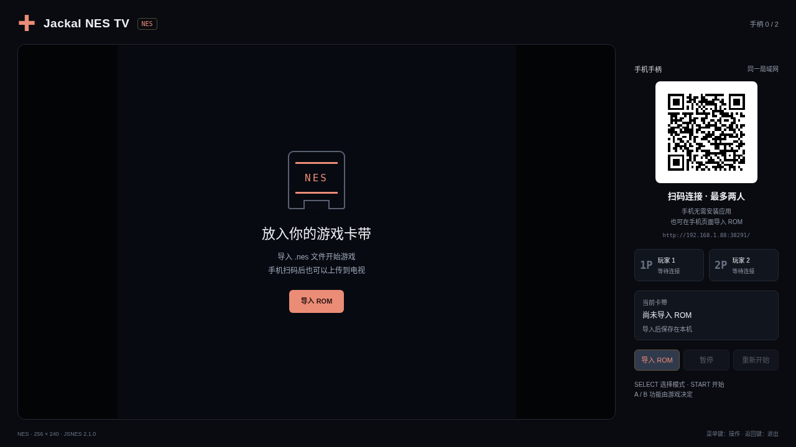

# Jackal NES TV · 赤色要塞 ROM 版

[中文](README.md) · [English](README.en.md)

[下载 APK](jackal-nes-0.1.0.apk?raw=1) · [校验值](SHA256SUMS.txt) · [版本与签名](resource.json)

使用 NES 模拟核心运行你导入的游戏 ROM，通过电视二维码连接手机手柄。Jackal NES TV 与独立重写版使用不同包名，可以同时安装；当前版本为 `0.1.0`，包名 `com.ecojust.jackalnestv`，适用于 Android 8.0 及以上电视。

**APK 不包含《赤色要塞 / Jackal》ROM。** 第一次使用时导入自己的对应 `.nes` 文件。游戏的关卡、画面、声音与规则由导入的 ROM 执行，应用提供模拟器、电视显示和局域网手柄。

## 开始游玩

1. 安装 APK，让电视和手机连接同一局域网。
2. 打开应用，扫描电视上的房间二维码。
3. 在手机页面导入对应的 `.nes` 文件，等待传输和加载完成；电视上的「导入 ROM」也可调用系统文件选择器。
4. 手机左侧为方向摇杆，右侧为 A / B；使用 SELECT 选择原作菜单中的单人或双人模式，START 开始游戏。
5. 第二部手机扫描相同二维码即可加入 P2。两部手机控制同一台电视上运行的游戏。

导入成功的 ROM 保存在此应用的私有目录，再次打开会加载它；两个应用的文件互相独立。保存 ROM 不等于保存游戏进度。

| 控件 | 功能 |
| --- | --- |
| 方向摇杆 | NES 十字键 |
| A / B | 对应 NES A / B 按钮，具体作用由游戏决定 |
| SELECT | NES SELECT，通常用于原作菜单选择 |
| START | NES START，通常用于开始或原作暂停 |
| 电视返回键 | 显示退出确认 |

截图展示随 APK 打包的实际界面在 Chromium 中的运行结果，原生房间桥接使用测试数据，不是电视实机截图，也不是原作游戏画面。

## 房间与退出

手机控制和 ROM 导入经过电视启动的 HTTP / WebSocket 服务，只在可互通的网络内使用；没有云端中转。二维码携带本次房间的随机令牌，重新打开应用后以新二维码为准。手机失去连接或切到后台时会释放按键，避免持续移动或开火。

切到后台会关闭房间并暂停模拟与声音。确认退出时还会销毁 WebView、停止工作线程并结束本应用进程。已导入的 ROM 保留供下次使用。

## 模拟核心、构建与来源

模拟核心为 [JSNES 2.1.0](https://github.com/bfirsh/jsnes)，使用 Apache-2.0 许可证。随 APK 打包的核心通过 esbuild 0.25.12 转译为 Chrome 61 兼容语法，不刻意修改模拟器行为；应用集成代码使用仓库 MIT 许可证。第三方核心的许可不覆盖用户导入的游戏文件。

共享源码与构建说明见 [../tank-nes/shared/](../tank-nes/shared/)。这两个应用使用同一套模拟器与手柄实现，分别保存自己的 ROM。未使用原作 ROM 完成实机全流程测试；支持格式、测试覆盖和限制以[共享实现说明](../tank-nes/shared/README.md)为准。
