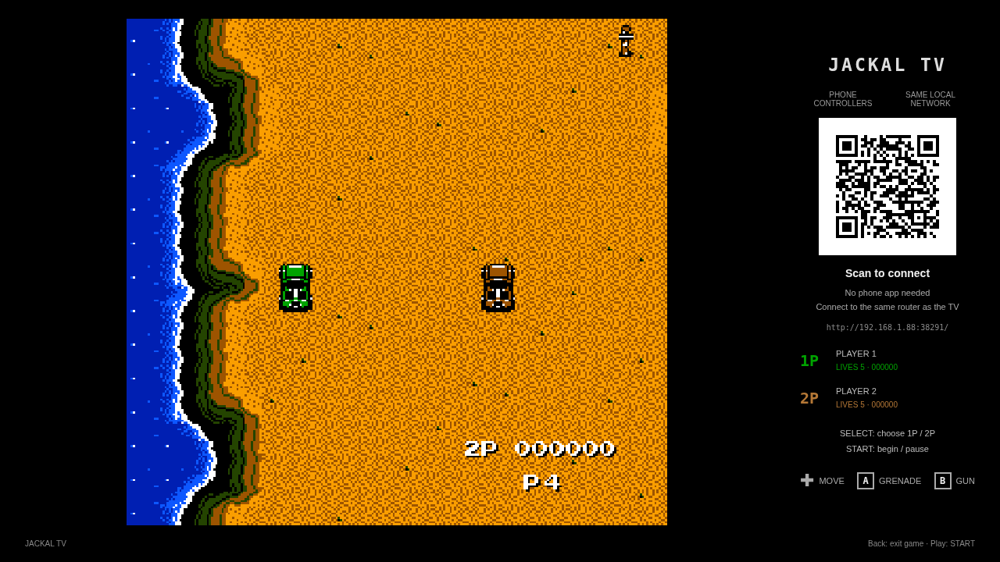
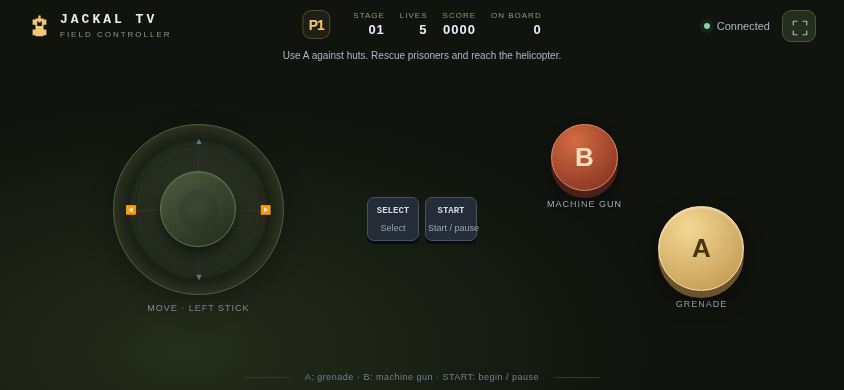
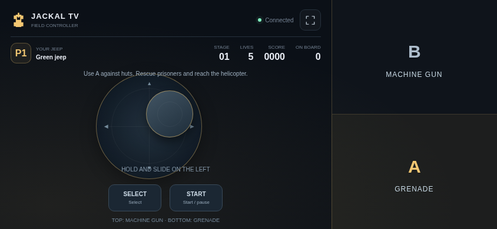

# Jackal TV

[中文](README.md) · [English](README.en.md)

Jackal TV independently reimplements the six-stage NES version of Jackal: jeep movement, prisoner rescue, helicopter extraction, weapon upgrades and six distinct boss encounters. The TV displays the game and a room QR code. One or two phones join over the local network with a left joystick, right A/B buttons, and START/SELECT controls.

The current release is **0.5.0**. Install and play without importing a ROM; the package ID stays unchanged. This version includes the six-stage rewrite, with remaining differences in AI, some collisions, animation timing and sound. Physical-TV and frame-by-frame comparisons are incomplete.

<!-- visual-release:start -->
## 0.5.2 visual update (release pending)

The source version is **0.5.2**; full-group acceptance, Android CI and the signed release are not yet complete. Existing downloads still point to the published **0.5.1** package. This update keeps the current pureTV release certificate. See the [0.5.2 visual update record](../../../docs/game-visuals-0.5.2.md) for confirmed changes, validation results and pending work.

This round reviewed the visual reference to NES USA Jackal and retained the existing pixel stages. The Jackal renderer was not changed.

See the [reference notes](docs/reference.md) for the implementation scope.
<!-- visual-release:end -->

## 0.5.1 gameplay review

Stage 3 now selects the correct long or short laser and warning endpoints from the actual map event.

Uses the same signing certificate as 0.5.0 and supports an in-place update. See the [fidelity review](../../../docs/game-fidelity-0.5.1.md) for tested behavior and remaining differences.

## Installation and signing

Version 0.5.1 uses the same shared pureTV certificate as 0.5.0, so it updates 0.5.0 in place and keeps local data. Versions signed with the older certificate cannot be updated in place: back up any exportable data before uninstalling them. Uninstalling clears local saves and records; the project has no automatic migration across signing certificates.

## Floating joystick and compatibility

Fixes startup failures and missing player status on older TV WebViews. Room status updates independently of the game; startup and rendering errors display a readable message. The phone joystick is hidden at rest: touch anywhere in the left control area to set its center, drag to move, and release to stop and hide it. Movement and A/B support simultaneous touches; interrupted touches, backgrounding and disconnects clear input. A remains grenade/rocket and B remains the machine gun.

## APK

<!-- apk-resource:start -->
[Download APK](jackal-0.5.1.apk?raw=1) · [Checksums](SHA256SUMS.txt) · [Signing and build provenance](resource.json) · [Source code](src/) · [64×64 SVG icon](logo.svg)

The APK in this directory is signed with the pureTV release certificate. Android cannot update an existing installation of the same package if it uses a different signing certificate. Back up its data and uninstall the old package first.
<!-- apk-resource:end -->

Requires Android 8.0 or later. Package: `com.ecojust.jackaltv`. The current APK version is `0.5.1`.

## Controller changes in 0.5.0

The right third of the phone screen is an edge-to-edge action area. The upper half fires the machine gun (B); the lower half throws a grenade or fires a rocket (A). The left area retains the floating joystick. START and SELECT sit separately at the bottom left. Touches are independent, and cancellation, focus loss or disconnect clears held input. Selection, dragging and long-press context menus are suppressed across the controller.

## Controls

1. Connect the phones and TV to the same local network; the TV may use Ethernet.
2. Open the app and scan its room QR code. The first phone controls green P1; the second controls brown P2.
3. Use **SELECT** on the title screen to choose one or two players, then press **START**. Connecting a second phone does not automatically change a selected single-player game.

| Control | Action |
| --- | --- |
| Left touch area | Touch to set the floating joystick center, drag to drive in eight directions, and release to stop and hide |
| A | Throw a grenade or fire a rocket in the current direction; press again for each shot |
| B | Fire the machine gun toward the top of the screen; hold for repeated fire |
| START | Start, pause/resume, or confirm the Continue menu choice |
| SELECT | Choose the player count at the title or toggle the Continue menu choice |
| A + B | An eliminated co-op player borrows a life from a teammate who has at least two remaining |
| TV Back button | Show exit confirmation |

The native 256×240 display scrolls across six 512-pixel-wide stages. Each player starts with five lives. The machine gun always points north; the main weapon progresses from grenade to rocket, horizontal splash rocket, and cross-shaped splash rocket.

Different huts release two prisoners, four prisoners, or one flashing weapon-upgrade prisoner; some buildings are tank garages. Prisoners leave in a queue and board a nearby jeep, without the old eight-passenger cap. Helipads unload them one at a time, upgrading the main weapon at 4, 9 and 15 deliveries. Completing the walk into the helicopter awards the relevant score; the stage tally separately rewards delivered prisoners. Passengers still aboard carry over to the next stage. See the [reference and implementation notes](docs/reference.md) for constants, sources and verification limits.

## Rooms and exit

No controller app is required on the phones. The TV provides a local HTTP/WebSocket server on an assigned port, with a random room token in the QR code. Up to two players connect directly, without a cloud relay.

Backgrounding, locking or disconnecting a phone releases held controls. Reconnection attempts to restore its player slot, and the game pauses when all controllers disconnect. Pressing Home closes the room. Confirming exit disconnects phones, closes listening ports and server threads, destroys the game page and terminates the app process. Reopening creates a new room.

If the QR link cannot connect, check that both devices share a local network and that guest-network or Wi-Fi client isolation is disabled.

## Development builds and assets

The logic consists of newly written JavaScript state machines. It contains no ROM loader, CPU emulator or third-party game program implementation. The six maps, events, images and note data retain their provenance. This APK includes the reference assets required to run it; the original artwork, music and designs remain credited to Konami. The MIT license for the application code does not grant a new license to that material. The app does not execute the original program, but does use extracted and transcribed reference data.

The renderer requires stage tile/sprite atlases, a HUD font, sprite metadata, boss background patches, cinematic timelines and note data. Installing the APK in this directory requires no additional assets. Source builds require the complete artwork directory passed through `-PjackalArtworkDir`; see the [build guide](docs/local-preview-build.md). Data origins, attribution and remaining comparisons are documented in the [reference notes](docs/reference.md), [audio notes](docs/reference-audio.md) and [enemy/boss notes](docs/reference-enemies.md).

Verify logic and data from the repository root:

```sh
node resource/apps/jackal/tools/build-levels.cjs --check
node --test resource/apps/jackal/tests/game.test.cjs resource/apps/jackal/tests/enemies.test.cjs resource/apps/jackal/tests/scenes.test.cjs
```

After preparing the required assets, build Android:

```sh
cd resource/launcher/puretv
./gradlew :jackal:assembleDebug :jackal:testDebugUnitTest :jackal:lintDebug \
  -PjackalArtworkDir=/absolute/path/to/artwork
```

APKs appear under `resource/apps/jackal/build/outputs/apk/`. Android tests cover the LAN protocol, service shutdown and process exit; Node tests cover game rules. Browser tests and captures establish page behavior, not physical TV performance, phone latency or complete original-game parity. See [resource maintenance](../../../docs/resource-maintenance.md) for the release workflow.

## Screenshots

These images show the actual game page running in Chromium with simulated room data. They are not physical-TV captures.





The joystick appears at the initial touch point while dragging:


