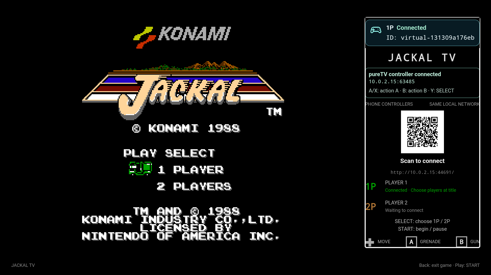
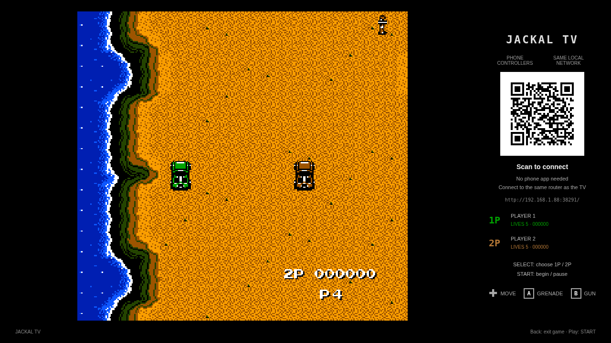
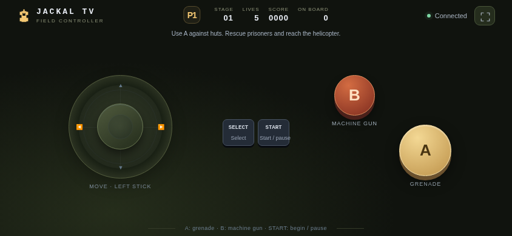
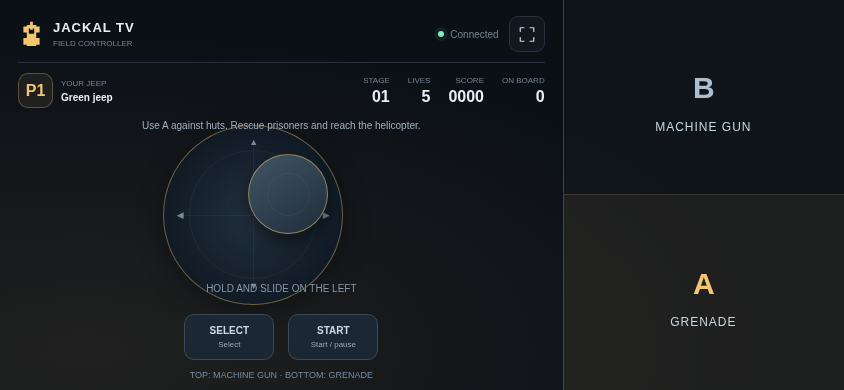

# Jackal TV

<!-- apk-resource:start -->
[Android 0.5.8 APK](jackal-0.5.8.apk?raw=1) · [Windows x64](https://github.com/ecojust/pureTV/releases/download/gameplay-icons-2026.11.21/jackal-windows-x64-setup.exe) · [macOS](https://github.com/ecojust/pureTV/releases/download/gameplay-icons-2026.11.21/jackal-macos.dmg) · [Launcher artwork and installation checks](docs/releases/0.5.8/android-icon-receipt.json) · [Checksums](SHA256SUMS.txt) · [0.5.7 gameplay video](docs/releases/0.5.7/gameplay.mp4?raw=1)
<!-- apk-resource:end -->

## Earlier Android release 0.5.7 · Controllers and phone pairing

[Download the signed APK](jackal-0.5.7.apk?raw=1) · [Checksums](SHA256SUMS.txt) · [Package and source](resource.json)

The phone room stays responsive if the first frame fails to draw. On 720 × 480 TVs, the QR code and both player seats fit inside the screen. Connect a keyboard, pair a pureTV Wi-Fi controller, or scan the TV room’s QR code with a phone on the same network. The connection indicator identifies each player while the game keeps its playing area at the same size. [Controller guide](../../../docs/guide/README.en.md#install-a-game-and-connect-a-controller)

The signed APK upgraded 0.5.6 in place on an Android TV emulator. The verification record links each tested upgrade from the published 0.5.4 release. The original controller SDK completed 9 checks and received matching acknowledgements for 97 messages. [Gameplay screenshot](docs/releases/0.5.7/gameplay.png) · [Android gameplay recording](docs/releases/0.5.7/gameplay.mp4?raw=1) · [Verification and limitations](docs/releases/0.5.7/verification.json)

[中文](README.md) · [English](README.en.md)

<!-- controller-client-status:start -->
## Earlier release 0.5.4 · Connected controller identity

<!-- previous-apk-resource:start -->
[Download signed APK](jackal-0.5.4.apk?raw=1) · [Checksums](SHA256SUMS.txt) · [Signing and source](resource.json) · [Source](src/) · [Icon](logo.svg)
<!-- previous-apk-resource:end -->

Android **0.5.4 / versionCode 8** shows a controller icon, player seat (1P/2P where supported), and the connected device's complete ID in the side area. Disconnected devices disappear. The default TCP port remains **63485**. Current controller firmware does not report RSSI, so signal strength is not displayed.

[Connected screenshot](docs/releases/0.5.4/connected.png) · [Controller-status recording](docs/releases/0.5.4/controller-status.mp4?raw=1) · [Version verification](docs/releases/0.5.4/verification.json) · [Twenty-game update record](../../../docs/controller-client-status/README.md)

The APK uses the existing release certificate. This update verifies connection identity, disconnect/reconnect status and in-place installation in an Android TV emulator; the capture and video show the menu status checks. It does not repeat full gameplay acceptance. Unchanged model evidence is reused by exact hash, with previous reports retained below. Physical TVs, phones, ESP32 devices and upgrades containing existing user saves remain untested.


<!-- controller-client-status:end -->

Jackal TV independently reimplements the six-stage NES version of Jackal: jeep movement, prisoner rescue, helicopter extraction, weapon upgrades and six distinct boss encounters. The TV displays the game and a room QR code. One or two phones join over the local network with a left joystick, right A/B buttons, and START/SELECT controls.

The current version is **0.5.8**. Install and play without importing a ROM; the package ID stays unchanged. This version includes the six-stage rewrite, with remaining differences in AI, some collisions, animation timing and sound. Physical-TV and frame-by-frame comparisons are incomplete.

<!-- visual-release:start -->
## Historical: 0.5.2 visual update and verification

The following preserves the **0.5.2** visual changes, source and verification records. These historical results do not verify the current pureTV controller update. That release retained the pureTV certificate used by 0.5.0/0.5.1. See the [0.5.2 visual update record](../../../docs/game-visuals-0.5.2.md) for its per-game changes, verification scope and physical-device test status.

That visual update reviewed the visual reference to NES USA Jackal and retained the existing pixel stages. The Jackal renderer was not changed.

See the [reference notes](docs/reference.md) for the implementation scope.

<!-- final-verification -->
The historical frozen source 0752b658aecbb1322cb7294e3176500639db1b54 passed Android CI 40843467072: 280 model/render-behavior regressions, 36 compatibility scenarios, 131 controller scenarios and 18 bilingual integration scenarios. Cozy Island input-runtime checks passed 9/9; both WebGL 1 rendering scripts and the Coast Kart combat suite also passed. Android builds, lint, size checks and staging succeeded; 15 modules executed JUnit tasks, including all 9 games, without an inferred JUnit case count. Signing run 40846148068 verified all nine APKs’ source assets, signatures and resource catalog. Chrome 61 syntax checks and old-API simulation in modern Chromium do not establish physical legacy-WebView compatibility. At that historical release, physical TV/phone acceptance, device FPS and in-place installation/data retention were untested.
<!-- visual-release:end -->

## Historical: 0.5.1 gameplay review

Stage 3 now selects the correct long or short laser and warning endpoints from the actual map event.

The historical 0.5.1 release used the same signing certificate as 0.5.0 and supported an in-place update. See the [fidelity review](../../../docs/game-fidelity-0.5.1.md) for tested behavior and remaining differences.

## Installation and signing

Historical version 0.5.3 retained the shared pureTV certificate used by 0.5.0/0.5.1/0.5.2. An in-place `adb install -r` update from 0.5.2 succeeded on an Android TV emulator. This check did not seed existing saves and does not verify retention of saves or other user data. Installations of 0.4.x and earlier signed with the old certificate cannot be updated in place: back up exportable data before uninstalling. Uninstalling clears local saves and records; the project has no automatic cross-certificate migration.

## Floating joystick and compatibility

Fixes startup failures and missing player status on older TV WebViews. Room status updates independently of the game; startup and rendering errors display a readable message. The phone joystick is hidden at rest: touch anywhere in the left control area to set its center, drag to move, and release to stop and hide it. Movement and A/B support simultaneous touches; interrupted touches, backgrounding and disconnects clear input. A remains grenade/rocket and B remains the machine gun.

## APK

Requires Android 8.0 or later. Package: `com.ecojust.jackaltv`. The APK version is `0.5.4`; see [this release verification](docs/releases/0.5.4/verification.json) for signing, in-place update and runtime acceptance.

## Historical: controller changes in 0.5.0

The right third of the phone screen is an edge-to-edge action area. The upper half fires the machine gun (B); the lower half throws a grenade or fires a rocket (A). The left area retains the floating joystick. START and SELECT sit separately at the bottom left. Touches are independent, and cancellation, focus loss or disconnect clears held input. Selection, dragging and long-press context menus are suppressed across the controller.

## Controls

1. Connect the phones and TV to the same local network; the TV may use Ethernet.
2. Open the app and scan its room QR code. The first phone controls green P1; the second controls brown P2.
3. Use **SELECT** on the title screen to choose one or two players, then press **START**. Connecting a second phone does not automatically change a selected single-player game.

| Control | Action |
| --- | --- |
| Left touch area | Touch to set the floating joystick center, drag to drive in eight directions, and release to stop and hide |
| A | Throw a grenade or fire a rocket in the current direction; press again for each shot |
| B | Fire the machine gun toward the top of the screen; hold for repeated fire |
| START | Start, pause/resume, or confirm the Continue menu choice |
| SELECT | Choose the player count at the title or toggle the Continue menu choice |
| A + B | An eliminated co-op player borrows a life from a teammate who has at least two remaining |
| TV Back button | Show exit confirmation |

The native 256×240 display scrolls across six 512-pixel-wide stages. Each player starts with five lives. The machine gun always points north; the main weapon progresses from grenade to rocket, horizontal splash rocket, and cross-shaped splash rocket.

Different huts release two prisoners, four prisoners, or one flashing weapon-upgrade prisoner; some buildings are tank garages. Prisoners leave in a queue and board a nearby jeep, without the old eight-passenger cap. Helipads unload them one at a time, upgrading the main weapon at 4, 9 and 15 deliveries. Completing the walk into the helicopter awards the relevant score; the stage tally separately rewards delivered prisoners. Passengers still aboard carry over to the next stage. See the [reference and implementation notes](docs/reference.md) for constants, sources and verification limits.

## Rooms and exit

No controller app is required on the phones. The TV provides a local HTTP/WebSocket server on an assigned port, with a random room token in the QR code. Up to two players connect directly, without a cloud relay.

Backgrounding, locking or disconnecting a phone releases held controls. Reconnection attempts to restore its player slot, and the game pauses when all controllers disconnect. Pressing Home closes the room. Confirming exit disconnects phones, closes listening ports and server threads, destroys the game page and terminates the app process. Reopening creates a new room.

If the QR link cannot connect, check that both devices share a local network and that guest-network or Wi-Fi client isolation is disabled.

## Development builds and assets

The commands below are reproducible check entry points, not a claim that all checks passed for this release. Current execution results are linked above.

The logic consists of newly written JavaScript state machines. It contains no ROM loader, CPU emulator or third-party game program implementation. The six maps, events, images and note data retain their provenance. This APK includes the reference assets required to run it; the original artwork, music and designs remain credited to Konami. The MIT license for the application code does not grant a new license to that material. The app does not execute the original program, but does use extracted and transcribed reference data.

The renderer requires stage tile/sprite atlases, a HUD font, sprite metadata, boss background patches, cinematic timelines and note data. Installing the APK in this directory requires no additional assets. Source builds require the complete artwork directory passed through `-PjackalArtworkDir`; see the [build guide](docs/local-preview-build.md). Data origins, attribution and remaining comparisons are documented in the [reference notes](docs/reference.md), [audio notes](docs/reference-audio.md) and [enemy/boss notes](docs/reference-enemies.md).

Verify logic and data from the repository root:

```sh
node resource/apps/jackal/tools/build-levels.cjs --check
node --test resource/apps/jackal/tests/game.test.cjs resource/apps/jackal/tests/enemies.test.cjs resource/apps/jackal/tests/scenes.test.cjs
```

After preparing the required assets, build Android:

```sh
cd resource/launcher/puretv
./gradlew :jackal:assembleDebug :jackal:testDebugUnitTest :jackal:lintDebug \
  -PjackalArtworkDir=/absolute/path/to/artwork
```

APKs appear under `resource/apps/jackal/build/outputs/apk/`. Android tests cover the LAN protocol, service shutdown and process exit; Node tests cover game rules. Browser tests and captures establish page behavior, not physical TV performance, phone latency or complete original-game parity. See [resource maintenance](../../../docs/resource-maintenance.md) for the release workflow.

## Historical screenshots (0.5.2)

These images show the actual game page running in Chromium with simulated room data. They are not physical-TV captures.





The joystick appears at the initial touch point while dragging:



## pureTV Wi-Fi controller

Connect the TV and controller to the same LAN, open the game, then press the controller Search key (GPIO 23). The TV shows its actual TCP address and discovery state. Default port: **63485**; a fallback is chosen only if that port is already occupied. The port stays fixed while the app runs. With multiple game services on the network, close the others before searching.

The D-pad drives. Each **A/X** press throws a grenade/fires a rocket; hold **B** to fire the machine gun toward the top of the screen. **Y (SELECT)** changes the player count at the title and changes the Continue menu option. **START** begins, pauses or resumes. Two Wi-Fi controllers can occupy the two player seats. Phone QR controllers and TV remote controls remain available.

Disconnecting or switching controller sources pauses gameplay. Release held keys, then press START again; reconnecting or synchronizing held buttons does not perform an action. Temporary focus loss retains the listener while isolating game input. Home or switching apps still exits the game and closes services through the existing exit flow.

<!-- controller-client-status-history:start -->
<details>
<summary>Historical 0.5.3 download and acceptance record</summary>

The following describes the previous release; its tests and media do not validate the new controller-ID UI. [Original README at the previous source](https://github.com/ecojust/pureTV/blob/9af9f197855eb7a0ce7174c0e6295c8974b3250d/resource/apps/jackal/README.en.md).

[Download APK](jackal-0.5.3.apk?raw=1) · [Checksums](docs/controller-status-baseline/0.5.3/SHA256SUMS.txt) · [Signing and build provenance](docs/controller-status-baseline/0.5.3/resource.json) · [Source code](src/) · [64×64 SVG icon](logo.svg)

This APK is signed with the existing pureTV release certificate and has passed an in-place update from the previous version. See the controller update for that historical version’s Android controller acceptance results. Android cannot update an existing installation of the same package if it uses a different signing certificate. Back up its data and uninstall the old package first.

## 0.5.3 pureTV controller update

Version **0.5.3 / versionCode 7** adds pureTV Wi-Fi controller input on default TCP port **63485**, while retaining phone QR and TV remote controls. The signed APK passed all 9/9 controller checks on an Android TV emulator and an in-place `adb install -r` update from the previous version. Upgrading with pre-existing saves and retaining user data were not tested.

See the [historical twenty-game acceptance record](../../../docs/readme-controller-support/README.md) and [rollout status](../../../docs/readme-controller-support/rollout.json) for actual results and limitations. Earlier CI reports, videos and screenshots below remain historical evidence.

That historical version’s acceptance resources: [menu screenshot](docs/releases/0.5.3/menu.png) · [actual APK recording](docs/releases/0.5.3/gameplay.mp4?raw=1) · [verification record](docs/releases/0.5.3/verification.json). Images and recordings come from an Android TV emulator; no physical television has been tested. The verification record gives the exact acceptance scope and results; emulator checks do not establish physical-TV compatibility or save-data retention during an upgrade.

</details>
<!-- controller-client-status-history:end -->
