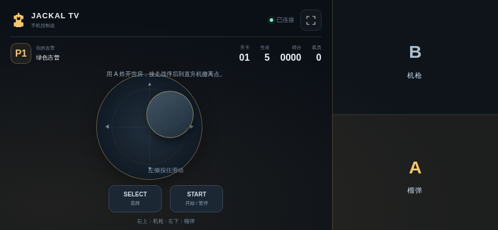

# Jackal TV · 赤色要塞

<!-- apk-resource:start -->
[下载 APK](jackal-0.5.1.apk?raw=1) · [校验值](SHA256SUMS.txt) · [签名及构建来源](resource.json) · [源码](src/) · [64×64 SVG 图标](logo.svg)

此目录内 APK 使用 pureTV 发布证书签名。若设备中存在使用旧证书的同包应用，Android 无法直接覆盖安装；需先备份数据并卸载旧包。
<!-- apk-resource:end -->

[中文](README.md) · [English](README.en.md)

Jackal TV 独立重写红白机 NES 版《赤色要塞》的六关玩法：吉普车驾驶、营救战俘、直升机撤离、武器升级和六种首领战。电视显示游戏和房间二维码，手机扫码后使用左侧摇杆、右侧 A/B 与 START/SELECT 控制，支持 1–2 人局域网合作。

当前发布版本为 **0.5.1**。安装后即可游玩，无须导入 ROM；包名保持不变。此版本包含六关重写内容，AI、部分碰撞、动画时序与音色尚有差异，尚未完成电视实机及逐帧对照验证。

<!-- visual-release:start -->
## 0.5.2 视觉更新（待发布）

源码版本为 **0.5.2**，整组验收、Android CI 和签名发布尚未完成；现有下载仍指向已发布的 **0.5.1**。本轮沿用现有 pureTV 发布证书。已经确认的改动、验证结果及待验收项目见[0.5.2 视觉更新记录](../../../docs/game-visuals-0.5.2.md)。

本轮只读核对 NES 美版《Jackal》的视觉对应关系，保留已有像素关卡；没有修改 Jackal 渲染器。

具体还原范围见[参考说明](docs/reference.md)。
<!-- visual-release:end -->

## 0.5.1 还原度升级

修复第 3 关两段激光长度和预警端点，按实际地图切换长、短光束。

沿用 0.5.0 证书，可直接覆盖更新；本轮核对结果与剩余差距见[还原度复核](../../../docs/game-fidelity-0.5.1.md)。

## 安装与签名

0.5.1 沿用 0.5.0 的 pureTV 统一发布证书，可以覆盖安装 0.5.0 并保留本机数据。使用旧证书的更早版本不能直接覆盖，请先备份可导出的数据再卸载；卸载会清除本机存档和记录，本项目没有跨证书自动迁移工具。

## 浮动摇杆与兼容性

修复旧版电视 WebView 的启动黑屏与玩家状态不显示。房间状态独立于游戏绘制更新，启动或绘制失败时会显示可读提示。手机手柄改为浮动摇杆：默认隐藏，在左侧操作区任意位置按下确定本次中心，拖动驾驶，松手立即停止并隐藏。移动与 A/B 支持多指同时操作；触控中断、切后台或断线时清空输入。A 仍为榴弹／火箭，B 仍为机枪。

## APK
适用于 Android 8.0 及以上电视，包名 `com.ecojust.jackaltv`。当前 APK 版本为 `0.5.1`。

## 0.5.0 手柄升级

手机右侧三分之一屏幕为无空隙的动作区，上半区为机枪（B），下半区为榴弹／火箭（A）。左侧保留浮动摇杆，START、SELECT 在左侧底部独立放置。支持多指同时操作，触控取消、失焦或断线均释放输入；整页抑制文字选择、拖拽和长按菜单。

## 操作

1. 将手机与电视连接到同一局域网；电视可以使用网线。
2. 打开应用，扫描电视上的房间二维码。第一部手机控制绿色 P1，第二部控制棕色 P2。
3. 在标题画面用 **SELECT** 选择一人或两人模式，按 **START** 开始。第二部手机连接房间不会自行改变已选的单人模式。

| 控件 | 功能 |
| --- | --- |
| 左侧触控区 | 按下确定浮动摇杆中心，拖动八方向驾驶，松手停止并隐藏 |
| A | 沿当前方向投掷手雷或发射火箭；每次按下发射一次 |
| B | 向画面上方发射机枪；按住连续射击 |
| START | 开始游戏、暂停/继续、确认 Continue 选项 |
| SELECT | 标题画面选择人数，Continue 画面切换选项 |
| A + B | 双人模式中，已失去全部生命的玩家向仍有至少两条生命的队友借一条生命 |
| 电视返回键 | 显示退出确认 |

游戏使用 256×240 原生画面，在宽 512 像素的六关地图中横向及纵向卷动。每人初始五条生命；机枪始终朝北，主武器依次升级为手雷、火箭、横向爆风火箭、十字爆风火箭。

不同囚室释放两人、四人或一名闪烁的升级战俘；有些建筑实际是坦克库。战俘依次走出，靠近后上车，没有旧版的八人载客限制。停机坪按顺序卸载，累计送达 4、9、15 人时升级主武器。战俘完成走向直升机的动作后获得对应分数，关卡结算另按已送达人数计算奖励；仍在车上的战俘进入下一关。具体常量、来源和验证范围见[参考与实现说明](docs/reference.md)。

## 房间与退出

手机浏览器无需安装控制器应用。房间 HTTP/WebSocket 服务只在电视局域网内工作，端口在启动时分配，二维码包含本次房间的随机令牌；最多两名玩家，不经过云端中转。

手机切到后台、锁屏或断线时会释放所有按键，重新连接后尝试恢复原玩家位置。全部控制器断开时自动暂停。按 Home 离开应用会关闭房间；确认退出会断开手机连接、关闭监听端口和服务线程、销毁游戏页面并结束应用进程。再次启动会创建新房间。

无法扫码连接时，检查设备是否位于同一局域网，以及路由器是否启用了访客网络或 AP 隔离。

## 开发构建与素材

逻辑是新写的 JavaScript 状态机，不包含 ROM 加载器、CPU 模拟器或第三方游戏程序实现。六关地图、事件、图像和音符参考数据保留来源记录。本 APK 包含运行所需的参考素材；原作图像、音乐和设计的版权仍属于 Konami，应用代码的 MIT 许可不构成对这些内容的再授权。实现没有直接运行原作程序，但使用了提取和转录的参考资料。

渲染器需要关卡图块/精灵图集、HUD 字体、精灵元数据、首领背景补丁、演出时间线和音符数据。安装此目录内 APK 无须另行准备；从源码构建时，应按[构建说明](docs/local-preview-build.md)提供完整素材目录，并通过 `-PjackalArtworkDir` 指定。数据来源、署名和仍待对照的细节见[参考与实现说明](docs/reference.md)、[音频说明](docs/reference-audio.md)及[敌人与首领说明](docs/reference-enemies.md)。

从仓库根目录验证逻辑与数据：

```sh
node resource/apps/jackal/tools/build-levels.cjs --check
node --test resource/apps/jackal/tests/game.test.cjs resource/apps/jackal/tests/enemies.test.cjs resource/apps/jackal/tests/scenes.test.cjs
```

准备好所需素材后构建 Android：

```sh
cd resource/launcher/puretv
./gradlew :jackal:assembleDebug :jackal:testDebugUnitTest :jackal:lintDebug \
  -PjackalArtworkDir=/absolute/path/to/artwork
```

APK 输出在 `resource/apps/jackal/build/outputs/apk/`。局域网协议、服务关闭和进程退出由 Android 测试验证；游戏规则由 Node 测试验证。浏览器测试和截图只能说明页面行为，不能代表电视性能、手机网络时延或全部原作一致性。发布资源的维护流程见[资源维护说明](../../../docs/resource-maintenance.md)。

## 页面截图

以下图片来自实际游戏页面在 Chromium 中的运行，使用模拟房间连接；不是电视实机截图。


按住拖动时，摇杆出现在本次触点位置：


