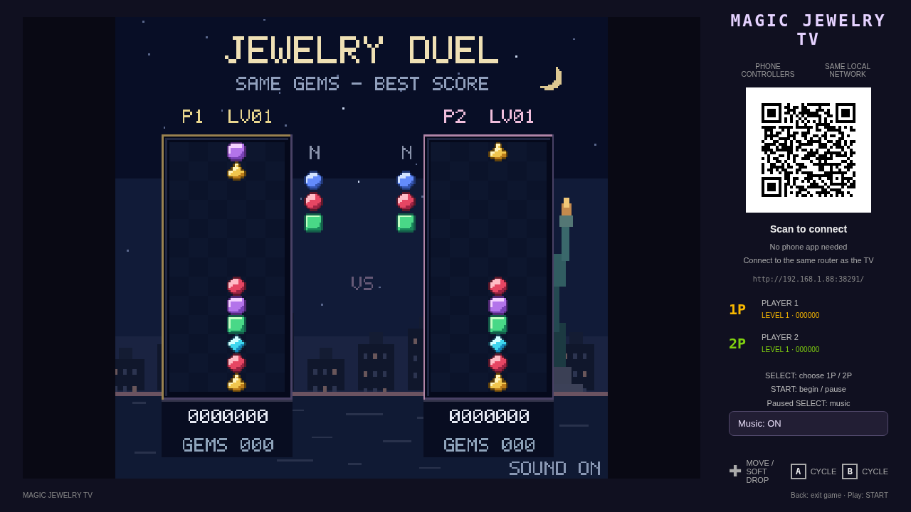
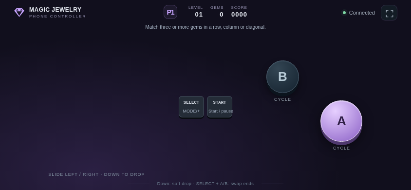
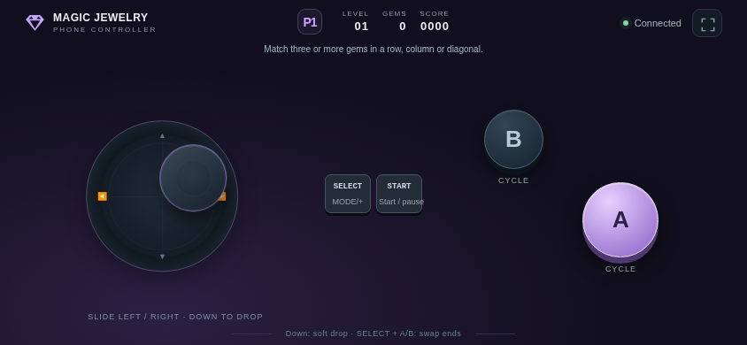

# Magic Jewelry TV

[中文](README.md) · [English](README.en.md)

An independent recreation of the classic NES Magic Jewelry rules: three gems fall as a column onto a 6×13 board. Match three or more of the same color horizontally, vertically or diagonally, with gravity chains and magic columns.

Version **0.1.0**, for Android 8.0+ TVs. Package: `com.ecojust.jeweltv`. The TV displays the board and room QR code, and phones scan it to become controllers. No ROM import is required.

<!-- apk-resource:start -->
[Download APK](jewel-0.1.0.apk?raw=1) · [Checksums](SHA256SUMS.txt) · [Signing and build provenance](resource.json) · [Source code](src/) · [64×64 SVG icon](logo.svg)

The APK in this directory uses the pureTV release certificate.
<!-- apk-resource:end -->

## Play

1. Connect the phones and TV to the same local network and open the TV app.
2. Scan its QR code in a phone browser. For two players, each phone joins separately.
3. Press SELECT at the title to choose one or two players, then START. Both players must connect for two-player play.
4. The left joystick stays hidden until touched. Each initial touch sets its center; drag to control and release to stop and hide it.

| Control | Action |
| --- | --- |
| Left floating stick | Move left/right; hold down for soft drop; release to stop |
| A / B | Cycle the three gems in the same direction |
| SELECT + A / B | Swap the top and bottom gems of the current column |
| SELECT | Choose one/two players at the title; toggle music while paused |
| START | Start, pause or resume |
| TV Back | Exit confirmation |

Every 70 cleared gems advances the level and awards a magic column, which clears the color it lands on. Two players receive the same gem sequence and keep separate boards and scores, without sending garbage. This local two-player competition is an additional mode.

High scores stay on the TV and survive an app update. Uninstalling clears the app data.

## Screenshots

These are captures of the actual game page rendered in Chromium with a simulated room connection, not physical-TV captures.







## Rooms and exit

Up to two phones connect directly to the local HTTP/WebSocket room. Its QR code includes a port and random room token for this launch, without a cloud relay. Backgrounding, interrupted touches and disconnections release controls. Losing an active player pauses the boards until they reconnect.

Pressing TV Home closes the room. Confirming exit closes ports and server threads, disconnects controllers, destroys the WebView and audio, and terminates the app process. Scan the new QR code after reopening.

## Build and verify

```sh
# Repository root
node --test resource/apps/jewel/tests/*.test.cjs
node resource/apps/jewel/tests/controller.mjs
node resource/apps/jewel/tests/compatibility.mjs
node resource/apps/jewel/tests/capture.mjs

cd resource/launcher/puretv
./gradlew :jewel:assembleRelease :jewel:testDebugUnitTest :jewel:lintDebug :jewel:verifyReleaseSize
```

Browser tests require the desktop npm dependencies and Chromium, optionally selected with `CHROMIUM_PATH`. Gradle emits an unsigned release APK; the public directory contains a package signed with the pureTV release certificate.

See [reference notes](docs/reference.md) for rule sources and implementation differences. Artwork, icons, effects and 8-bit music are independently created; no original ROM, extracted artwork or soundtrack recording is included. Project-authored code and assets use [MIT](LICENSE). Physical TV/phone and frame-by-frame comparisons remain unverified.
