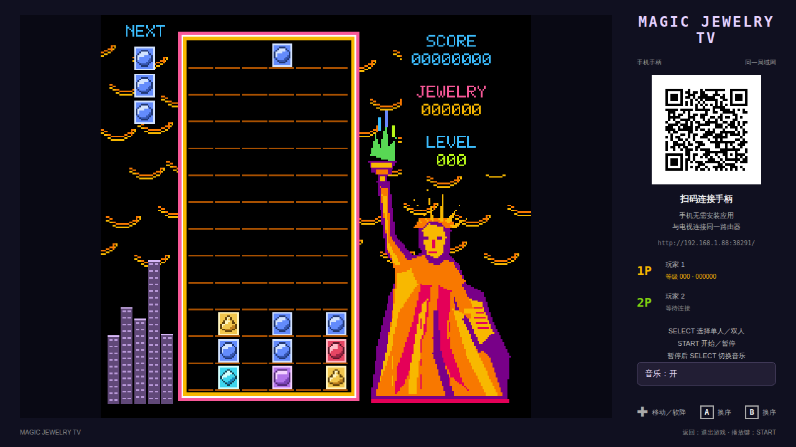
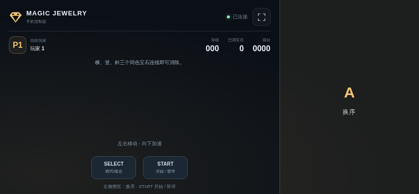
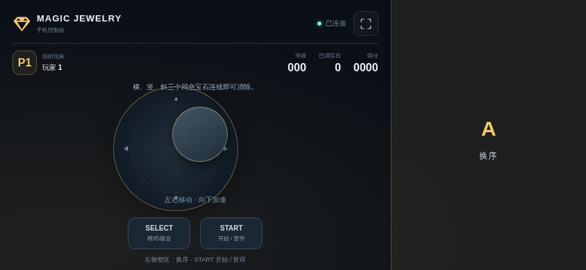

# 钻石方块 TV

<!-- apk-resource:start -->
[下载 APK](jewel-0.5.2.apk?raw=1) · [校验值](SHA256SUMS.txt) · [签名及构建来源](resource.json) · [源码](src/) · [64×64 SVG 图标](logo.svg)

此目录内 APK 使用 pureTV 发布证书签名。若设备中存在使用旧证书的同包应用，Android 无法直接覆盖安装；需先备份数据并卸载旧包。
<!-- apk-resource:end -->

[中文](README.md) · [English](README.en.md)

独立重写经典红白机《Magic Jewelry》：三颗宝石成列下落，在 6×13 棋盘上横、竖、斜三个及以上同色连线消除，支持重力连锁和魔法列。

当前版本 **0.5.1**，适用于 Android 8.0 及以上电视，包名 `com.ecojust.jeweltv`。电视显示棋盘与房间二维码，手机扫码作为手柄；不需要导入 ROM。
<!-- visual-release:start -->
## 0.5.2 视觉更新（待发布）

源码版本为 **0.5.2**，整组验收、Android CI 和签名发布尚未完成；现有下载仍指向已发布的 **0.5.1**。本轮沿用现有 pureTV 发布证书。已经确认的改动、验证结果及待验收项目见[0.5.2 视觉更新记录](../../../docs/game-visuals-0.5.2.md)。

单人画面改为接近 FC《Magic Jewelry》布局的大棋盘、左侧 NEXT、右侧完整举火炬雕像和计数；重画宝石及夜景，等级从原版的 000 起显示，并同步电视、侧栏与手机。双人布局保留各自棋盘和状态。这是独立重画，未宣称逐像素复刻。

具体还原范围见[参考说明](docs/reference.md)。
<!-- visual-release:end -->

## 0.5.1 还原度升级

修正大连锁的逐列奖励、魔法列救场及落稳后变速，加入八阶段独立场景配色。

沿用 0.5.0 证书，可直接覆盖更新；本轮核对结果与剩余差距见[还原度复核](../../../docs/game-fidelity-0.5.1.md)。

## 安装与签名

0.5.1 沿用 0.5.0 的 pureTV 统一发布证书，可以覆盖安装 0.5.0 并保留本机数据。使用旧证书的更早版本不能直接覆盖，请先备份可导出的数据再卸载；卸载会清除本机存档和记录，本项目没有跨证书自动迁移工具。

## 开始游玩

1. 将手机和电视连接同一局域网，在电视上打开游戏。
2. 手机浏览器扫描电视二维码；单人一部手机，双人分别扫描加入。
3. 在标题画面按 SELECT 选择人数，按 START 开始。双人模式需要两名玩家都连接。
4. 左侧摇杆默认隐藏，按下的位置就是本次中心；拖动控制，松开停止并隐藏。右侧屏幕三分之一都是动作区，可在区域内任意位置操作。START／SELECT 独立位于左侧底部；操作区禁止文字选择和长按菜单。

| 控件 | 功能 |
| --- | --- |
| 左侧浮动摇杆 | 左右移动，下拉软降；松手停止 |
| 右侧整区 A | 循环三颗宝石的顺序；保留键盘 B 同功能 |
| SELECT + 右侧动作区 | 交换当前列最上与最下的宝石 |
| SELECT | 标题画面切换单／双人；暂停时开关音乐 |
| START | 开始、暂停／继续 |
| 电视返回键 | 退出确认 |

每消除 70 颗宝石会升级并奖励魔法列，接触普通宝石后清除棋盘上该颜色的宝石。消除后悬空宝石逐格坠落，全部落稳后才检查下一波连锁；侧栏显示距下一次魔法列奖励的进度。两名玩家使用相同的宝石序列，分别消除、计分，不向对方投放障碍。双人比拼是新增的局域网玩法。

最高分保存在电视本机。从旧证书版本迁移到 0.5.0 需要卸载，原有记录会被清除，无法自动迁移。

## 画面

以下截图由实际游戏页面在 Chromium 中渲染，使用模拟房间连接；不是电视实机截图。







## 房间与退出

最多两部手机通过本地 HTTP/WebSocket 房间连接。二维码包含本次启动的端口与随机房间令牌，不经过云端中转。手机切到后台、触控中断或断线会释放按键；参与游戏的玩家断线时暂停棋盘，重连后恢复。

按电视 Home 离开会关闭房间；确认退出会关闭端口与服务线程、断开手机、销毁 WebView 和音频并结束应用进程。重新打开后请扫描新的二维码。

## 构建与验证

```sh
# 仓库根目录
node --test resource/apps/jewel/tests/*.test.cjs
node resource/apps/jewel/tests/controller.mjs
node resource/apps/jewel/tests/compatibility.mjs
node resource/apps/jewel/tests/capture.mjs

cd resource/launcher/puretv
./gradlew :jewel:assembleRelease :jewel:testDebugUnitTest :jewel:lintDebug :jewel:verifyReleaseSize
```

浏览器测试需要 desktop 的 npm 依赖及 Chromium，可用 `CHROMIUM_PATH` 指定浏览器。Gradle 默认生成未签名 release APK，公开目录中的安装包使用 pureTV 发布证书签名。

玩法依据与独立实现的差异见[参考说明](docs/reference.md)。画面、图标、音效和 8-bit 配乐由项目独立制作，不包含原作 ROM、图像提取或原声音轨；项目自写代码与素材使用 [MIT](LICENSE)。尚未完成电视／手机实机及逐帧对照验证。
