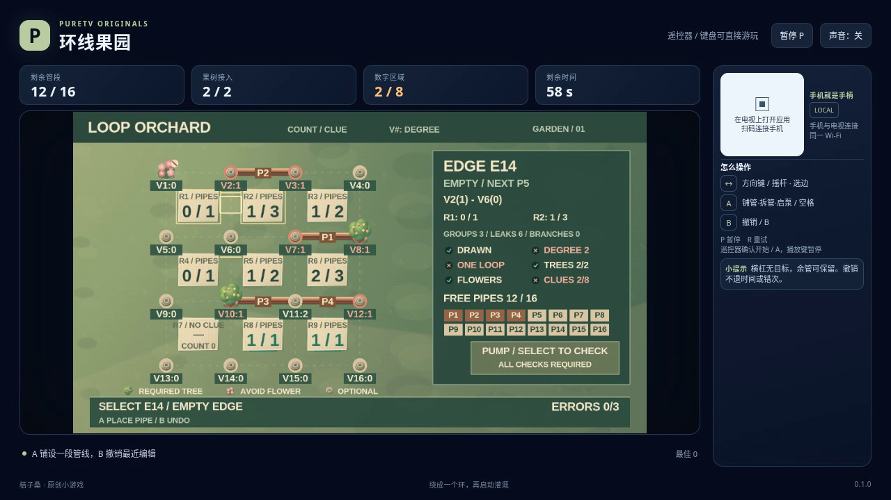

# 环线果园 / Loop Orchard

在果园的格点之间铺设一条闭合管线，经过全部需要灌溉的树，避开禁水花坛，并满足区域的管段数提示。两个各自闭合的小环仍不是一条完整灌溉环线。

- 作者：ecojust / 桔子桑
- 包名：`com.ecojust.looporchardtv`
- 版本：`0.1.0`
- 电视系统：Android 8.0 / API 26 及以上
- 图标：[logo.svg](logo.svg)

发布产物：[APK](loop-orchard-0.1.0.apk) · [实际游玩视频](docs/gameplay-0.1.0.mp4) · [验证记录](docs/verification.json)



## 操作

手机与电视接入同一局域网，扫描电视画面的二维码。左侧摇杆在管段和独立的 PUMP 水泵按钮之间移动选择框；右侧上半区 A 铺管或拆管，下半区 B 撤销。

在空边按 A，放置库存中编号最小的一根管；在已有管的边上按 A，拆除并归还原来的那根管。每根管只占相邻两个格点之间的一条完整水平或竖直边，不能斜接。方向选择依据实际屏幕位置，同时考虑前方距离和侧向偏移，不会从边界绕回另一边。

B 撤销最近一次成功的铺管或拆管，恢复原来的管件编号和位置，并把焦点放回该边。撤销拆管会把同一编号的管放回原位；撤销铺管则把它归还库存。库存不足时不能在空边铺管，但仍可拆管；失败的库存尝试不会进入撤销历史，也不扣错误次数。

选择 PUMP 后按 A 才启动检查。画出正确图形不会自动过关，尚未提交的管线也不代表水已成功流通。A、B 每次按下只触发一次，持续按住不会连续铺拆或提交。

键盘使用方向键或 WASD，空格或 Enter 为 A，B 为撤销，P 暂停，R 重试。电视遥控器使用方向键、确认键和菜单键；手机 START 开始或暂停。开始与结算菜单可用左右方向选择关卡，B 切换声音。

## 管线与提示

三关共用 4×4 格点、24 条可铺设的边和 16 根带唯一编号的管，树、花坛与提示布局不同。允许剩余管件，不必用完库存。

启动水泵时，所有已铺管段必须组成**一个连通的闭环**：每个接管的格点恰好连接两段管，不能有漏口或分叉，也不能留下第二个独立小环。没接管的普通格点可以闲置。“一个环”是对当前图形的要求，不要求谜题只有一种解法。

管线必须经过所有标记果树的格点，不能触及禁水花坛格点。花坛只是被环线围住、但没有任何管段接到它，不算违规。画面里的果树已接管状态只是覆盖提示，真正的灌溉成功仍以水泵检查为准。

每个小区域的数字表示它四条边上应有的管段数，必须精确相等。内部共用边会给两侧区域各计一段；沿同一区域转弯经过两条边，也应计两段。数字 0 表示该区域四边都不能铺管；“— / 无提示”表示该区域没有计数约束，不能把它当成 0 或已完成的数字提示。

每次新的错误启动都会累计一次错误，连续提交同一错误图形也会计次；三次错误或 90 秒有效时间耗尽时失败。水泵按空图、分叉、漏口、多环、漏树、碰花、数字不符的顺序给出首要原因，其余检查结果仍可查看。

撤销不会退还用时、错误次数、提交次数或累计编辑次数。分数由当前管段、正确数字提示和已覆盖果树计算，反复拆装不会累加刷分。暂停不消耗有效时间；输入清理不会改变已画管线或库存。终局冻结后不能继续撤销，R 会重新开始当前固定关卡。

## 源码与验证范围

公开字段、区域边界计数、管件库存、编辑历史和评分公式见 [模型契约](docs/model-contract.md)。生产模型只保存公开布局与规则，不包含参考环线、解题器或强制胜利入口。

[独立数学报告](docs/independent-cycle-space-review.json) 从九个单位区域的边界构造全部 512 种偶度边集合，再用完整闭合路径区分单环、多环和分叉。固定网格有 213 个简单单环；完整九区提示下，没有任何双环、三环或四环与单环具有同一提示向量。实际关卡明确保留一个无提示区域，让“局部条件全对但仍有两个环”成为需要真正检查的情况。

[独立规则报告](docs/independent-loop-review.json) 只读取模型公开布局，每关完整筛选 512 种集合，分别找到一条有效单环和一个仅拓扑失败的双环。普通模型输入确认三关可以显式启动获胜，也确认双环在树、禁水、数字和各节点度数均正确时仍被拒绝；另检查全部 24 条边的铺拆与同编号撤销、库存耗尽和 625 个有序焦点对。

[独立操作脚本审查](docs/independent-pilot-review.json) 使用另造的九区完整提示棋盘，8 组检查覆盖 71 次深冻结公开观察（含工厂与诊断共 80 次调用）。私有字段读取和输入修改均为零；检查同编号铺管、拆管、撤销和显式启动，不把合成观察当作正常通关。首次检查因夹具误设一条同长导航路线而停止；原记录保留，修正预期后通过，生产脚本未改。

从仓库根目录可复核：

```sh
node resource/apps/loop-orchard/tests/independent-loop-review.mjs --output /tmp/loop-orchard-review.json
```

数学边界夹具、普通模型输入、操作脚本的合成观察审查和浏览器实录分别记录。模型测试不能替代真实游玩录像或实体设备测试；实际发布检查及其范围见验证记录。

手机手柄与 Android 宿主组件见 [game-kit](../../game-kit/README.md)。源码与原创素材遵循仓库 [MIT 许可证](../../../LICENSE)。
