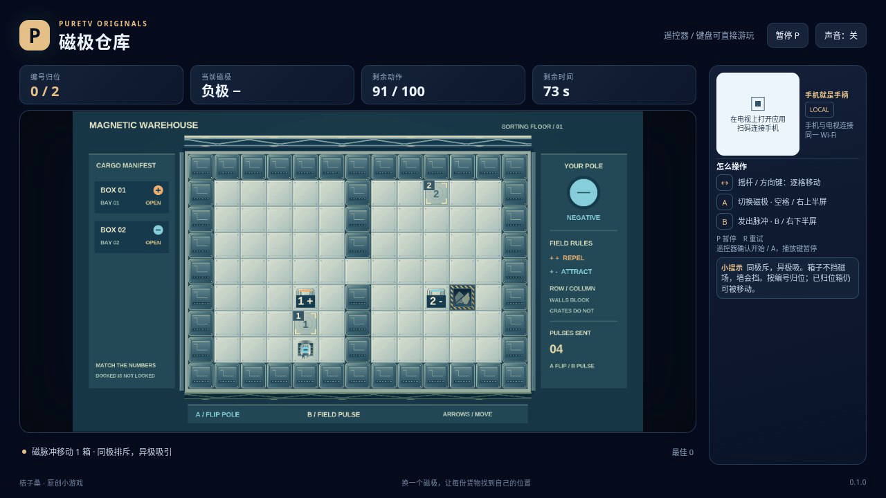

# 磁极仓库 / Magnetic Warehouse

驾驶磁力搬运器，把每个编号的货箱送到对应货位。切换自身磁极后发出脉冲：异极相吸，同极相斥。一次脉冲会同时作用于同行、同列且未被墙体遮挡的箱子，每个箱子最多移动一格。

- 作者：ecojust / 桔子桑
- 包名：`com.ecojust.magneticwarehousetv`
- 版本：`0.1.0`
- 电视系统：Android 8.0 / API 26 及以上
- 图标：[logo.svg](logo.svg)

发布产物：[APK](magnetic-warehouse-0.1.0.apk) · [实际游玩视频](docs/gameplay-0.1.0.mp4) · [验证记录](docs/verification.json)



## 操作

手机与电视接入同一局域网，扫描电视画面的二维码。左侧拖动摇杆逐格移动；右侧上半区切换磁极，下半区发出磁力脉冲。这两个动作都按下触发，长按不会连续触发。

摇杆换向时立即走一格，持续保持方向约三分之一秒后开始连走，随后约每六分之一秒走一格。松开或换向会重新计算这个初始等待。

键盘方向键或 WASD 移动，空格切换磁极，B 发出脉冲，Enter 开始，P 暂停，R 重试。电视遥控器方向键移动，确认键切换磁极，菜单键发出脉冲。手机 START 开始或暂停；开始与结算菜单可用左右方向选择关卡。

墙体会挡住磁力，其他箱子不会。箱子不能进入搬运器所在格，也不能穿过墙或互相交换穿透；一整列箱子可以同时向末端空位移动。如果两个箱子同时争用同一格，它们都留在原地。箱子停在货位上后仍可再次移动，必须让所有编号同时对应，才算完成搬运。

三关分别搬运 2、3、4 个箱子，行动预算为 100、130、160。成功移动一格、切换一次磁极、发出一次脉冲，各消耗一次行动；空脉冲也会消耗行动。撞墙或被箱子挡住的移动不会扣除行动数。搬运器不会进入废料槽。

每局还有 90 秒时限。任何箱子进入标记的废料槽会立即失败；行动耗尽后仍未完成货位，或时间耗尽，也会结束本局。最后一次行动若恰好完成所有货位，仍可通关。

## 源码与验证

本作采用离散格点规则。同步磁力移动会先从同一份局面提出全部移动，再处理目标冲突与占位依赖；不按箱子的遍历顺序逐个推动。构建和局域网手机手柄组件见 [game-kit](../../game-kit/README.md)。

```bash
node --test resource/apps/magnetic-warehouse/tests/game-model.test.cjs
node resource/apps/magnetic-warehouse/tests/independent-magnetic-review.mjs
```

[独立规则报告](docs/independent-magnetic-review.json)使用穷举移动子集的方法检查同步磁力，另核对编号、预算、时限和三条独立推导的普通按键解法。受控局面会改写测试初态；三条解法仅调用普通方向与按钮输入，不改写游戏状态。模型验证与实际浏览器录像分别记录，模型执行时间不代表视频时长。

最终 APK、浏览器检查与录像结果随发布产物提供；浏览器验证不代表实体电视或手机实测。

源码与原创素材遵循仓库 [MIT 许可证](../../../LICENSE)。
