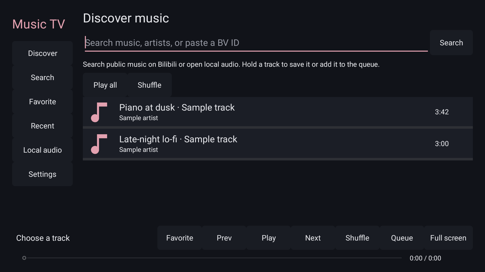

# Music TV

[English](README.en.md) · [中文](README.md)

<!-- apk-resource:start -->
[Download APK](music-0.1.3.apk?raw=1) · [Checksums](SHA256SUMS.txt) · [Signing and build provenance](resource.json) · [Source code](src/) · [64×64 SVG icon](logo.svg)

The APK in this directory is signed with the pureTV release certificate.
<!-- apk-resource:end -->

## Preparing 0.5.0 and migrating signatures

The planned release is **0.5.0**, using the new pureTV release certificate shared by the project's own apps and launchers. Android cannot install it over an old version signed with the previous certificate. Back up any data you can export, uninstall the old app, then install 0.5.0. Uninstalling clears local favorites, recent tracks, queues and settings. There is no automatic migration tool, and not all local data can necessarily be exported.

The package is still being prepared. The download link above remains the previous release until the APK and `resource.json` are updated.

Music TV is a native music player for Android TV remotes. It requires Android 8.0 or later; package: `com.ecojust.music`. The interface follows the TV's Chinese or English language setting.

## Playback

- Search publicly available Bilibili music videos or enter a BV identifier or full video link.
- Stream the available AAC audio through Android MediaPlayer, without downloading the video.
- Play, pause, seek, skip tracks, and use ordered or shuffled playback. Shuffle avoids repeating tracks within a round.
- Save favorites, recent tracks and queues locally. Long-press a track to open its actions; queues hold up to 50 tracks.
- Open a local audio file through Android's system file picker, without requesting broad storage access.
- Background playback supports audio focus, media keys and a playback notification.

Use the directional pad to move focus, OK to select and Back to close a dialog or leave. Searching requires a system keyboard. Local audio selection requires a system file picker.



## Build and verification

From the repository root:

```sh
cd resource/launcher/puretv
./gradlew :music:assembleDebug :music:verifyReleaseSize :music:lintDebug :music:testDebugUnitTest
```

Catalog releases are signed separately; see the [resource maintenance guide](../../../docs/resource-maintenance.md). `MUSIC_UI_CAPTURE_DIR` enables Chinese and English native UI previews during tests. APK size is recorded in `resource.json`; the release limit is 5 MiB.

The player has no production third-party dependencies or bundled media decoder. Public service endpoints may change or restrict access by network, region or authorization; the app displays errors and does not bypass those restrictions. Automated parser, playback-state and UI tests do not replace playback and memory testing on a physical TV. See the [Chinese documentation](README.md) for detailed limits, historical changes and implementation references.
