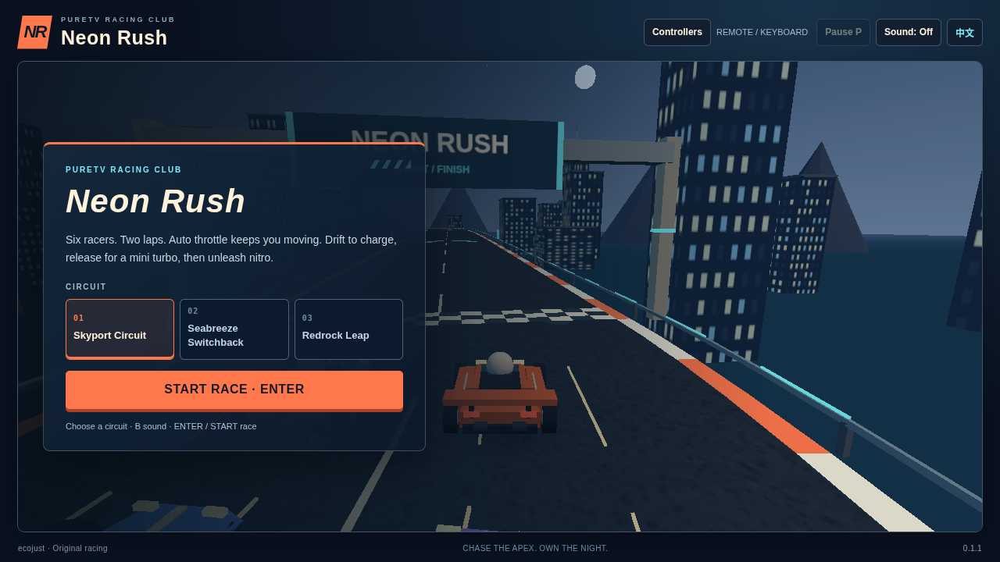

# Neon Rush TV · 霓虹飞车

[中文](README.md) · [Design](docs/DESIGN.md) · [Reference](docs/REFERENCE.md) · [Licenses](NOTICE.md)

Six racers, three original circuits, and a two-lap finish. Drift to charge nitro, release a clean drift for a mini turbo, and use the straights and canyon ramp to gain ground. Auto throttle keeps the car moving; you control the racing line, steering, and brakes.

**0.1.1 · Release-signed APK: 443,884 bytes (about 444 KB).** [Download APK](https://raw.githubusercontent.com/ecojust/pureTV/master/resource/apps/neon-rush/neon-rush-0.1.1.apk) · [Gameplay video](docs/releases/0.1.1/gameplay.mp4) · [Verification](docs/releases/0.1.1/verification.json) · [Icon](logo.svg)



Package: `com.ecojust.neonrushtv`. Requires Android 8.0/API26 or later and an Android System WebView with WebGL support. Update the system WebView if the game reports that 3D graphics cannot start. The minimum Android version is not a claim that every TV has been tested.

## Start a race

1. Choose a circuit and select Start Race or press Enter/remote OK. The car accelerates automatically after the countdown.
2. Steer left or right. Brake before a corner, then hold drift while turning. Release drift on the exit for a mini turbo.
3. When the nitro meter is full, trigger nitro on a straight. Pass the checkpoints in order and complete two laps. A race ends after three minutes of game time if you have not finished.

You race against five computer-controlled cars. The result shows your position, time, drift count, and nitro use. Finishing does not necessarily mean first place. Barrier and car contact reduce speed; riding a barrier cannot replace steering through a corner.

| Circuit | Character |
| --- | --- |
| Skyport Circuit | Elevated straights and broad turns for learning steering and nitro timing. |
| Seabreeze Switchback | Coastal turns and rolling hills that reward a clean line. |
| Redrock Leap | Canyon straights, boost pads, and a launch ramp. |

A car stalled for four seconds returns to its latest safe point. The race clock keeps running; recovery never awards a lap or checkpoint.

## Controls

| Action | Keyboard / TV remote | Phone controller |
| --- | --- | --- |
| Steer | Left / Right arrows | Move the left stick sideways |
| Brake | Down arrow | Pull the left stick down |
| Drift | Hold Shift / Space; hold remote OK during a race | Hold Drift while steering |
| Nitro | B / Ctrl | Tap Nitro |
| Start / resume | Enter / remote OK or the on-screen button | START |
| Pause / resume | P or the pause button | START during a race |
| Restart the whole race | R or Race Again after finishing | Use the TV's restart button |

You do not need to hold the accelerator. Drift charge requires a real turn and enough speed; holding drift on a straight earns no charge. Braking, losing focus, or cancelled input does not count as a successful drift release.

The installed TV app shows its QR panel on menu and pause screens. Connect the phone and TV to the same Wi-Fi, then scan the code. In the browser preview, click Phone to see the controls. The left stick steers and brakes; the two right-hand regions control drift and nitro. The race pauses when the phone disconnects. Touchscreens also have local steering, brake, drift, and nitro buttons. The QR controller requires the installed app's LAN service; the standalone static preview does not host that service.

## pureTV Wi-Fi controller

Version 0.1.1 adds the nine-key pureTV TCP controller and mDNS service advertisement. Put the TV and controller on the same network, wait for the game's discovery status, and press the controller's Search key. START starts/pauses; Left/Right steer; Down brakes; A/X drift; B/Y trigger nitro. Disconnecting clears input and pauses the race. Press START again after reconnecting.

The repository's original virtual controller also works: run `python3 puretv-joystick/bridge.py TV_IP --port 8765`, then open `http://127.0.0.1:8767/`. Use the advertised port if the default port was occupied. See [protocol and controls](docs/WIFI-CONTROLLER.md).

All 66 native regressions and six actual-game checks through the original virtual page/SDK passed. NSD registration/lifecycle was tested in software; physical TV/ESP32 discovery and control remain untested.

## Presentation

The original cars, roads, city, coast, canyon scenery, textures, and sound are generated locally. Gameplay does not need online art or audio downloads. The HUD shows a minimap, position, laps, time, speed, and drift/nitro feedback. Sound can be toggled in the top bar or with B / remote Menu while on the race menu. The installed app initially follows the system Chinese/English language; mouse and touch users can also switch it in the top bar.

The game takes inspiration from the referenced repository's arcade drifting experience. It uses an independent name, vehicles, circuits, and implementation; no Tencent branding, official track layouts, or upstream game source code has been copied. See the [reference record](docs/REFERENCE.md).

## Development and validation

Editable modules are in [source](source/); generated APK assets are in [src/main/assets](src/main/assets/). From this directory:

```sh
npm ci
npm test
npm run build
npm run build:check
python3 tools/prepare-web.py --output /tmp/neon-rush-web
python3 -m http.server 8080 --directory /tmp/neon-rush-web
```

Open `http://127.0.0.1:8080/tv.html`. Browser results and physical TV tests are reported separately. Software-renderer speed and recording frame rate are not device performance measurements. See [0.1.1 verification](docs/releases/0.1.1/verification.json) for current input, UI, native, signature and recording results. The unchanged model/tracks reuse 45 rule checks from 0.1.0; its complete three-track races remain historical baseline evidence. See the [evidence index](docs/README.md). Physical TVs, phones and ESP32 devices have not been tested.

Android builds and the existing release certificate follow the [Game Kit build instructions](../../game-kit/BUILD.md). Local builds are unsigned; source, payload, signature, and evidence must match before an APK is published.
