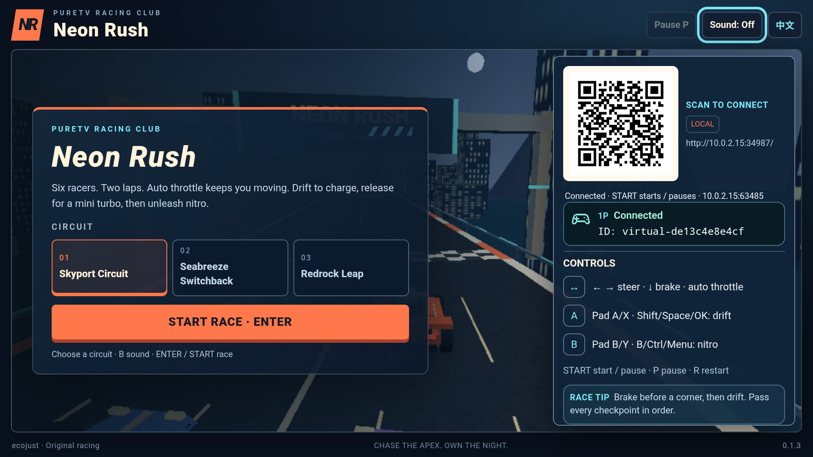
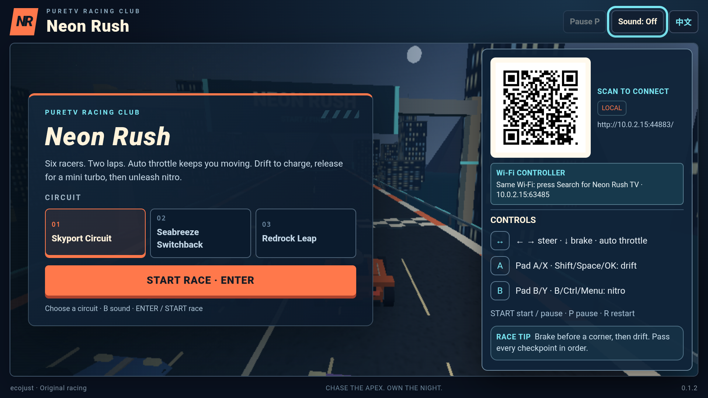

# 霓虹飞车 · Neon Rush TV

## Android 0.1.4 · 手柄与手机连接

<!-- apk-resource:start -->
[下载签名 APK](neon-rush-0.1.4.apk?raw=1) · [校验值](SHA256SUMS.txt) · [安装包与源码](resource.json)
<!-- apk-resource:end -->

可用键盘、pureTV Wi-Fi 手柄，或用同一局域网内的手机扫描电视房间二维码。连接标识区分玩家，连接与断开时保留游戏画布尺寸。[连接手柄指南](../../../docs/guide/README.md#安装游戏与连接手柄)

此签名 APK 已从 0.1.3 在 Android TV 模拟器完成覆盖安装。原版手柄 SDK 通过 8 项检查，实际发出的 76 条消息全部收到同序号确认。[游戏截图](docs/releases/0.1.4/gameplay.png) · [Android 玩法录像](docs/releases/0.1.4/gameplay.mp4?raw=1) · [验证记录与测试范围](docs/releases/0.1.4/verification.json)

[English](README.en.md) · [玩法设计](docs/DESIGN.md) · [参考来源](docs/REFERENCE.md) · [许可说明](NOTICE.md)

<!-- controller-client-status:start -->
## 历史版本 0.1.3 · 手柄连接标识

<!-- previous-apk-resource:start -->
[下载签名 APK](neon-rush-0.1.3.apk?raw=1) · [校验值](SHA256SUMS.txt) · [签名与来源](resource.json) · [源码](src/) · [图标](logo.svg)
<!-- previous-apk-resource:end -->

Android **0.1.3 / versionCode 4**：手柄连接后，侧边显示手柄图标、玩家席位（按游戏人数显示 1P/2P）和设备完整连接 ID；断开后隐藏。默认 TCP 端口仍为 **63485**。当前手柄固件未上报 RSSI，因此不显示信号强弱。

[连接截图](docs/releases/0.1.3/connected.png) · [连接状态专项录像](docs/releases/0.1.3/controller-status.mp4?raw=1) · [版本验证](docs/releases/0.1.3/verification.json) · [20 款更新记录](../../../docs/controller-client-status/README.md)

安装包沿用原发布证书。本轮在 Android TV 模拟器中验证连接身份、断开／重连状态及同证书覆盖安装；截图和录像记录菜单中的连接状态专项，没有重做完整玩法验收。未改规则模型按精确哈希复用历史依据，旧版报告继续保留。尚未验证实体电视、手机、ESP32 或带已有存档的升级与数据保留。



**macOS 0.1.4：** [通用 DMG](macos/NeonRush-0.1.4-macos-universal.dmg?raw=1) · [通用 ZIP](macos/NeonRush-0.1.4-macos-universal.zip?raw=1) · [安装与手柄说明](macos/README.md)。需要 macOS 11+ 和 WebGL；比赛中以及菜单／暂停时收起操作栏后，仍显示连接手柄的 ID。
<!-- controller-client-status:end -->

六辆赛车、三条原创赛道、两圈决胜。用漂移积攒氮气，出弯松手获得小喷，在直道冲刺、在山谷跳台腾空。车辆自动加油，你负责选择路线、转向和刹车。

包名为 `com.ecojust.neonrushtv`。需要 Android 8.0/API26 或更新系统，以及支持 WebGL 的 Android System WebView；若提示无法建立 3D 画面，请先更新系统 WebView。最低系统版本不等于所有电视均已验证。

## 开始一局

1. 选择赛道，按“开始竞速”或遥控器确认键。倒计时结束后自动加速。
2. 左右转向，弯前按下方向键刹车。入弯后同时按住转向与漂移，出弯时松开漂移获得小喷。
3. 氮气储备满后，在直道按氮气键。按顺序经过检查点，完成两圈；游戏计时达到 3 分钟仍未完赛则结束本局。

赛场包含你和五名电脑对手。完成两圈会显示名次、用时、漂移和氮气次数；完赛并不一定是第一名。护栏和赛车碰撞会损失速度，始终贴着护栏不能代替转向过弯。停滞 4 秒后会自动回到最近的安全点，计时继续，圈数和检查点不会因此增加。

| 赛道 | 玩法重点 |
| --- | --- |
| 星港夜航 | 高架直道与宽弯，适合熟悉转向和氮气时机。 |
| 海风回廊 | 海岸连续转向和起伏，保持线路，安排刹车与漂移。 |
| 赤岩跃谷 | 红岩山谷、加速带和跳台，腾空后稳住方向。 |

## 操作

| 动作 | 键盘 / 电视遥控器 | 手机手柄 |
| --- | --- | --- |
| 转向 | `←` / `→` | 左侧摇杆左右移动 |
| 刹车 | `↓` | 左侧摇杆向下 |
| 漂移 | 按住 `Shift` / `空格`；比赛中按住遥控器确认键 | 按住“漂移”区，同时转向 |
| 氮气 | `B` / `Ctrl` / 遥控器菜单键 | 点按“氮气”区 |
| 开始 / 继续 | `Enter` / 确认键，或界面按钮 | `START` |
| 暂停 / 继续 | `P`，或界面暂停按钮 | 比赛中按 `START` |
| 重开整局 | `R`，或结束后的“再跑一场” | 通过电视端按钮重开 |

不必一直按加速键。漂移需要实际转向和一定车速；直行按住漂移不会积气。按下刹车、离开窗口或发生输入取消，不会被当作一次成功的出弯松手。

电视安装版在菜单和暂停页直接显示二维码。让手机与电视连接同一 Wi-Fi，扫码打开手柄。浏览器预览可点顶部“手机手柄”查看说明。连接后用左侧摇杆转向、下拉刹车，右侧两块区域分别控制漂移和氮气。手机断开时比赛会暂停。触屏设备也提供画面内的方向、刹车、漂移和氮气按钮。扫码手柄依赖安装版提供的局域网服务，单独的静态网页预览不提供电视端服务。

## pureTV Wi-Fi 实体手柄

Android 客户端自 0.1.2 起提供 pureTV 九键 TCP 手柄与 mDNS 自动发现，默认端口 **63485**。电视与手柄连接同一网络，游戏显示连接地址后按手柄 GPIO23 搜索键；当前固件仅在同网发现一个目标服务时自动连接。START 开始/暂停，左右转向，下键刹车，A/X 漂移，B/Y 氮气。断线或切换控制来源会清除输入并暂停，重连后先松开按键，再按 START 继续。真正退出游戏时关闭服务。

也可以在电脑运行仓库的 `python3 puretv-joystick/bridge.py 电视IP --port 63485`，打开 `http://127.0.0.1:8767/` 使用原版虚拟手柄；若服务使用备用端口，请填写实际端口。操作和协议见[Wi-Fi 手柄说明](docs/WIFI-CONTROLLER.md)。

历史 0.1.1 完成了 66 项原生回归和 6 项原版虚拟手柄实际游戏联调；这些历史计数不代表本次连接标识更新重新执行。历史 Android 0.1.2 已完成的 8 项实包手柄验收、同证书覆盖安装结果及来源哈希见[版本验证](docs/releases/0.1.2/verification.json)和[历史手柄接入记录](../../../docs/readme-controller-support/README.md)。实体电视、手机和 ESP32 的同网搜索、连接尚未实测。

## 画面与声音

原创三维赛车、赛道、城市、海岸和山谷由本地代码生成，游戏内容不依赖在线图片、模型或音频下载。界面提供小地图、名次、圈数、计时、时速，以及漂移和氮气提示。声音可在顶部按钮开启或关闭，菜单中也可用 B / 遥控器菜单键切换。安装版首次跟随系统中英文，使用鼠标或触屏时也可点顶部语言按钮切换。

本作参考指定仓库中飞车游戏的漂移竞速体验，采用独立名称、车型、赛道和实现；未复制腾讯品牌、官方赛道或上游源码。参考记录与实际验证范围分别保留，详见[参考来源](docs/REFERENCE.md)。

## 开发与验证

规则、赛道和渲染源文件位于 [source](source/)，生成后的 APK 资产位于 [src/main/assets](src/main/assets/)。在本目录执行：

```sh
npm ci
npm test
npm run build
npm run build:check
python3 tools/prepare-web.py --output /tmp/neon-rush-web
python3 -m http.server 8080 --directory /tmp/neon-rush-web
```

打开 `http://127.0.0.1:8080/tv.html` 查看实际宿主页面。浏览器预览和实体电视测试分别记录；软件渲染速度、录屏帧率不能当作设备帧率。历史 Android 0.1.2 的验证范围见[20款游戏接入记录](../../../docs/readme-controller-support/README.md)。Android 0.1.2 的规则模型与已交付 macOS 0.1.3 的修正模型一致，按精确哈希复用其规则与方向回归依据；独立方向和三赛道记录见 [Mac 验证记录](macos/docs/verification-0.1.3/README.md)。[Android 0.1.1 验证](docs/releases/0.1.1/verification.json)及其复用的 0.1.0 规则检查、三赛道录像仅作历史基线，不作为 Android 0.1.2 转向修复的证据。原始报告见 [docs/README.md](docs/README.md)。尚未在实体电视、手机或 ESP32 上测试。

Android 构建和固定证书签名沿用 [Game Kit 构建说明](../../game-kit/BUILD.md)。本地 builder 只生成未签名包；只有源码、资产、签名和验证证据核对完成的 APK 才作为发布包。

<!-- controller-client-status-history:start -->
<details>
<summary>历史 0.1.2 安装包与验收记录</summary>

以下为旧版发布记录，其测试与画面不代表本次连接 ID 界面验收。[原提交中的完整说明](https://github.com/ecojust/pureTV/blob/9af9f197855eb7a0ce7174c0e6295c8974b3250d/resource/apps/neon-rush/README.md)。

**Android 0.1.2 · 正式签名 APK：447,980 字节（约 448 KB）。** [下载安装包](https://raw.githubusercontent.com/ecojust/pureTV/master/resource/apps/neon-rush/neon-rush-0.1.2.apk) · [Android 实包手柄回归录像](docs/releases/0.1.2/gameplay.mp4) · [版本验证](docs/releases/0.1.2/verification.json) · [当时接入记录](../../../docs/readme-controller-support/README.md) · [图标](logo.svg)

当时将 pureTV 手柄默认端口改为 **63485**，补充连接状态与地址说明，短暂失焦或扫码房间刷新时保留 TCP 连接并隔离输入。macOS 0.1.3 已交付的左右转向修复也已进入此 Android 安装包。

该历史版 APK 已签名，并在 Android TV API 36 模拟器中完成同证书覆盖安装验证，通过全部 8 项手柄验收，覆盖开始、实际游戏操作、暂停恢复、断线重连、九键输入及逐消息 ACK。下图和上方录像来自 Android 0.1.2 实际 APK，录像记录当时手柄回归过程。尚未进行实体电视、手机或 ESP32 测试。

历史 Android 0.1.1：[旧版菜单](docs/controller-update-baseline/0.1.1/thumb.png) · [实玩录像](docs/releases/0.1.1/gameplay.mp4) · [验证记录](docs/releases/0.1.1/verification.json)。这些记录保留为旧版依据，不代表 0.1.2 的画面、转向或手柄验收。

**macOS 0.1.3：** [下载通用 DMG](https://raw.githubusercontent.com/ecojust/pureTV/master/resource/apps/neon-rush/macos/NeonRush-0.1.3-macos-universal.dmg) · [ZIP、安装与手柄说明](macos/README.md)。需要 macOS 11+ 和 WebGL，包含 Apple 芯片／Intel 代码，支持键盘与 pureTV Wi-Fi 手柄。macOS 0.1.3 安装包保持原样，其左右转向修复现也包含在 Android 0.1.2 中。



</details>
<!-- controller-client-status-history:end -->
