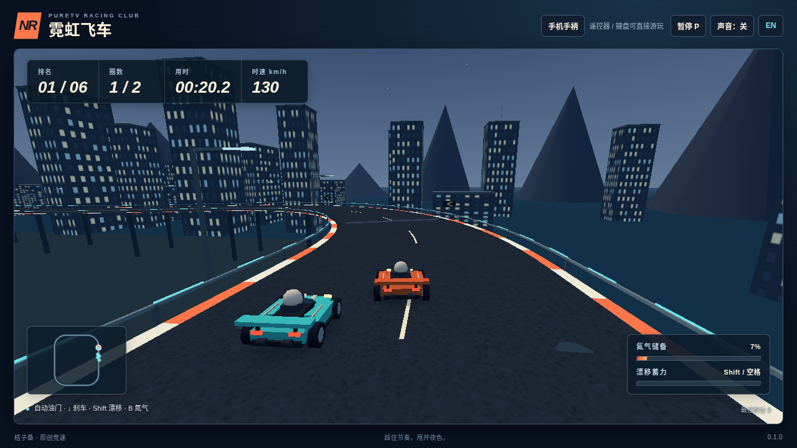

# 霓虹飞车 · Neon Rush TV

[English](README.en.md) · [玩法设计](docs/DESIGN.md) · [参考来源](docs/REFERENCE.md) · [许可说明](NOTICE.md)

六辆赛车、三条原创赛道、两圈决胜。用漂移积攒氮气，出弯松手获得小喷，在直道冲刺、在山谷跳台腾空。车辆自动加油，你负责选择路线、转向和刹车。

**0.1.0 · 正式签名 APK：435,692 字节（约 436 KB）。** [下载安装包](https://raw.githubusercontent.com/ecojust/pureTV/master/resource/apps/neon-rush/neon-rush-0.1.0.apk) · [实玩录像](docs/gameplay-0.1.0.mp4) · [验证记录](docs/verification.json) · [图标](logo.svg)



包名为 `com.ecojust.neonrushtv`。需要 Android 8.0/API26 或更新系统，以及支持 WebGL 的 Android System WebView；若提示无法建立 3D 画面，请先更新系统 WebView。最低系统版本不等于所有电视均已验证。

## 开始一局

1. 选择赛道，按“开始竞速”或遥控器确认键。倒计时结束后自动加速。
2. 左右转向，弯前按下方向键刹车。入弯后同时按住转向与漂移，出弯时松开漂移获得小喷。
3. 氮气储备满后，在直道按氮气键。按顺序经过检查点，完成两圈；游戏计时达到 3 分钟仍未完赛则结束本局。

赛场包含你和五名电脑对手。完成两圈会显示名次、用时、漂移和氮气次数；完赛并不一定是第一名。护栏和赛车碰撞会损失速度，始终贴着护栏不能代替转向过弯。停滞 4 秒后会自动回到最近的安全点，计时继续，圈数和检查点不会因此增加。

| 赛道 | 玩法重点 |
| --- | --- |
| 星港夜航 | 高架直道与宽弯，适合熟悉转向和氮气时机。 |
| 海风回廊 | 海岸连续转向和起伏，保持线路，安排刹车与漂移。 |
| 赤岩跃谷 | 红岩山谷、加速带和跳台，腾空后稳住方向。 |

## 操作

| 动作 | 键盘 / 电视遥控器 | 手机手柄 |
| --- | --- | --- |
| 转向 | `←` / `→` | 左侧摇杆左右移动 |
| 刹车 | `↓` | 左侧摇杆向下 |
| 漂移 | 按住 `Shift` / `空格`；比赛中按住遥控器确认键 | 按住“漂移”区，同时转向 |
| 氮气 | `B` / `Ctrl` / 遥控器菜单键 | 点按“氮气”区 |
| 开始 / 继续 | `Enter` / 确认键，或界面按钮 | `START` |
| 暂停 / 继续 | `P`，或界面暂停按钮 | 比赛中按 `START` |
| 重开整局 | `R`，或结束后的“再跑一场” | 通过电视端按钮重开 |

不必一直按加速键。漂移需要实际转向和一定车速；直行按住漂移不会积气。按下刹车、离开窗口或发生输入取消，不会被当作一次成功的出弯松手。

电视安装版在菜单和暂停页直接显示二维码。让手机与电视连接同一 Wi-Fi，扫码打开手柄。浏览器预览可点顶部“手机手柄”查看说明。连接后用左侧摇杆转向、下拉刹车，右侧两块区域分别控制漂移和氮气。手机断开时比赛会暂停。触屏设备也提供画面内的方向、刹车、漂移和氮气按钮。扫码手柄依赖安装版提供的局域网服务，单独的静态网页预览不提供电视端服务。

## 画面与声音

原创三维赛车、赛道、城市、海岸和山谷由本地代码生成，游戏内容不依赖在线图片、模型或音频下载。界面提供小地图、名次、圈数、计时、时速，以及漂移和氮气提示。声音可在顶部按钮开启或关闭，菜单中也可用 B / 遥控器菜单键切换。安装版首次跟随系统中英文，使用鼠标或触屏时也可点顶部语言按钮切换。

本作参考指定仓库中飞车游戏的漂移竞速体验，采用独立名称、车型、赛道和实现；未复制腾讯品牌、官方赛道或上游源码。参考记录与实际验证范围分别保留，详见[参考来源](docs/REFERENCE.md)。

## 开发与验证

规则、赛道和渲染源文件位于 [source](source/)，生成后的 APK 资产位于 [src/main/assets](src/main/assets/)。在本目录执行：

```sh
npm ci
npm test
npm run build
npm run build:check
python3 tools/prepare-web.py --output /tmp/neon-rush-web
python3 -m http.server 8080 --directory /tmp/neon-rush-web
```

打开 `http://127.0.0.1:8080/tv.html` 查看实际宿主页面。浏览器预览和实体电视测试分别记录；软件渲染速度、录屏帧率不能当作设备帧率。规则与几何测试 45 项通过；三条赛道的实际比赛、输入、画面与签名结果见[最终验证](docs/verification.json)，原始报告及保留的初次失败记录见 [docs/qa](docs/qa/)。尚未在实体电视或实体手机上测试。

Android 构建和固定证书签名沿用 [Game Kit 构建说明](../../game-kit/BUILD.md)。本地 builder 只生成未签名包；只有源码、资产、签名和验证证据核对完成的 APK 才作为发布包。
