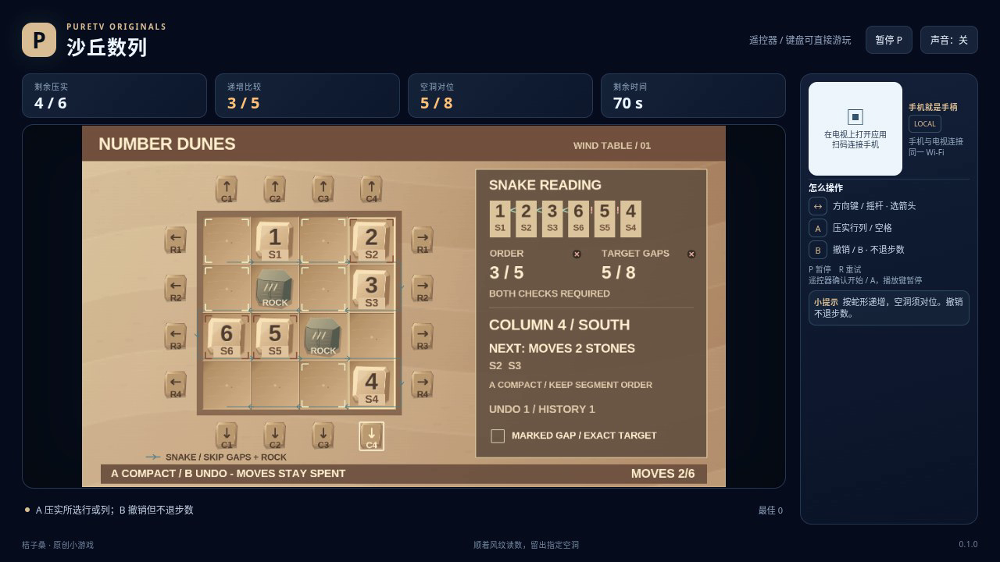

# 沙丘数列 / Number Dunes

选择沙盘边缘的箭头，把对应一行或一列中的数字石压向一端。固定岩柱把压实范围分成独立段；数字石不会合并，也不会在段内自动排序。目标是让蛇形读数严格递增，同时把所有空洞留在指定位置。

- 作者：ecojust / 桔子桑
- 包名：`com.ecojust.numberdunestv`
- 版本：`0.1.0`
- 电视系统：Android 8.0 / API 26 及以上
- 图标：[logo.svg](logo.svg)

发布产物：[APK](number-dunes-0.1.0.apk) · [实际游玩视频](docs/gameplay-0.1.0.mp4) · [验证记录](docs/verification.json)



## 操作

手机与电视接入同一局域网，扫描电视画面的二维码。摇杆移动沙盘四周的箭头选择框，A 压实选中的整行或整列，B 撤销最近一次真正移动石块的压实。共有16个方向箭头，选择箭头本身不会移动石块。

键盘使用方向键或 WASD 选择，空格或 Enter 为 A，B 撤销，P 暂停，R 重试。电视遥控器使用方向键、确认键和菜单键；手机 START 开始或暂停。开始与结算菜单可用左右方向选择关卡，B 切换声音。A、B 每次按下只触发一次，持续按住不会连续压实或撤销。

## 压实、读数与步数

每关有4×4格沙盘、固定岩柱、带唯一编号的数字石和公开的目标空洞。三关分别有6、7、8块石头，成功压实的次数上限为6、7、8。

压实时，只处理所选的一行或一列。岩柱两侧分别处理，石块不能穿柱或落在柱上。每一段里的石块保持原有相对次序，集中到箭头所指的一端；向右或向下压实也不会把石块次序反转。所选行或列以外的格位保持不变。一次压实可以移动多块石头，但只消耗一次。

蛇形读数从左上角开始：第一行从左到右，第二行从右到左，依次交替，跳过岩柱和当前空格。保留下来的每两个相邻数字都必须严格递增，相等也不合格。与此同时，所有空沙格必须与目标空洞集合完全相同；仅空洞数量相同，或只有读数顺序正确，都不能过关。岩柱不是空洞。

如果选中方向不会移动任何石块，这次尝试不消耗步数，也不会进入撤销历史。B 恢复最近一次有效压实之前的完整石块编号、位置及该动作的选择焦点，但**不退还已消耗的压实次数或用时**。撤销不是往反方向再压一次，撤销后仍需用剩余步数解题。一次真正移动之后再尝试无效方向，B 仍撤销上一次真正移动。

有效压实后，两项目标同时达成即自动获胜，最后一次允许的压实也可以过关。达到压实上限仍未完成则失败。90秒有效时间耗尽优先于任何输入和成功判定；预览中的可完成提示只说明预测布局符合目标，不保证能越过时间限制。

暂停不消耗有效时间，预览与石块移动动画不占用额外石块或改变已提交的局面。分数按当前正确相邻读数、正确空洞及获胜奖励计算，不因反复尝试累加。终局冻结后不能继续撤销；R 重新开始当前固定关卡。

## 源码与验证范围

精确公开字段、动作顺序、石块身份与历史记录见 [模型契约](docs/model-contract.md)。生产模型只包含关卡公开布局与规则，没有参考操作路线、自动排序或强制胜利入口。界面预览和操作脚本都依据公开状态。

[独立规则报告](docs/independent-dunes-review.json) 的10组检查使用逐石排名计算压实结果，与生产模型的实现分别核对；公开状态的有界逐层搜索独立找到三关4、5、6次的最短解，以及每关“顺序对但空洞错”和“空洞对但顺序错”的可达反例。普通模型输入确认撤销后仍计入已用步数、三关可以完成、预算耗尽确实失败，并验证最后一步恰好完成仍能获胜。

另有324个明确标注的四格几何夹具、256个有序焦点对，以及重复数值和最后时刻边界检查。快速模型输入的耗时不能当作实际浏览器录像时长。可从仓库根目录运行：

```sh
node resource/apps/number-dunes/tests/independent-dunes-review.mjs --expected-model 76087949d8fab9fc112034b93443e64862662f7982f1e8f80c2d6535a94cedb5 --output /tmp/number-dunes-review.json
```

[独立操作脚本报告](docs/independent-pilot-review.json) 使用另造的2块与4块石头公开夹具，通过10组检查、74次有界接口调用，核对永久动作凭据、动画过期后的观察、精确编号和撤销不退步数。36次观察调用包括2次预期拒绝；私有字段读取和状态写入均为0。这些合成观察没有运行生产模型，也不作为关卡通关或浏览器录像证据。可复现命令：

```sh
node resource/apps/number-dunes/tests/independent-pilot-review.mjs --app resource/apps/number-dunes --output /tmp/number-dunes-pilot-review.json --expected-pilot d7ff4e890abc19c9f43ca2e4dca9092f35a3ce5607882f982cb186594dea8d13
```

独立数学夹具、普通模型输入、操作脚本合成观察和浏览器实录分别记录。检查结果及实际完成范围以发布后的验证记录为准；模型验证不代表实体电视或手机已经测试。

手机手柄与 Android 宿主组件见 [game-kit](../../game-kit/README.md)。源码与原创素材遵循仓库 [MIT 许可证](../../../LICENSE)。
