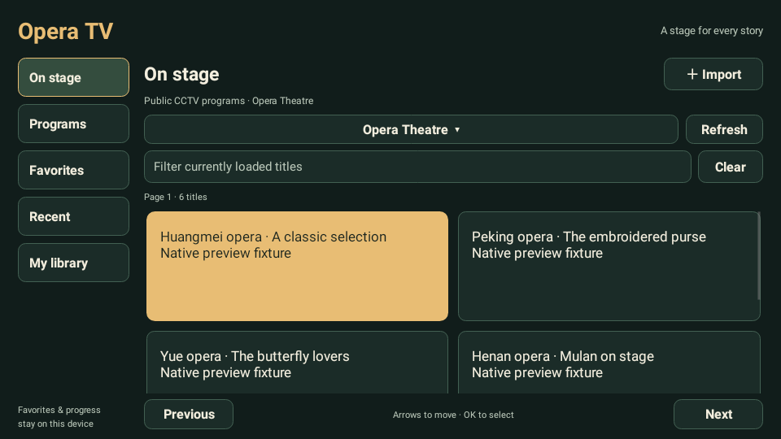

# Opera TV · 梨园 TV

[中文](README.md) · [Original SVG icon](logo.svg) · [Source](src/main/) · [Public sources](docs/research/SOURCES.md)

**[Download Opera TV 0.1.0 APK](https://raw.githubusercontent.com/ecojust/pureTV/master/resource/apps/opera/opera-0.1.0.apk)** · 54,011 bytes (~53 KiB) · Android 4.4+ · [Checksums](SHA256SUMS.txt) · [Validation](docs/VALIDATION.md)



An independent remote-friendly opera player with public CCTV programs, personal video and playlist imports, favorites, recent viewing and resume playback. Package `com.ecojust.operatv`, initial version 0.1.0, Android 4.4/API19 or later. The interface follows the system's Chinese/English language.

The application bundles no native `.so` libraries and uses Android's platform player. Video format support still depends on the device decoder and source availability. This is a separate application from Qixing Opera, with a separate package and data.

Built-in public programs are available immediately after installation with an internet connection. Imports add your own content; they are optional. The built-in library consists of the listed CCTV columns and does not reproduce Qixing's full catalog.

Browse five public program catalogs with pagination. **Search filters titles and groups on the currently loaded page**, not the entire service or the web. Open a title to play or save it. Favorites and playback progress stay on this device; no account is required.

Import a direct HTTP/HTTPS video link, a network M3U/JSON playlist, or a file selected through Android's document picker. LAN HTTP servers are supported. Devices without a document picker can use network links. Removing a library entry does not delete the original video; failed imports preserve existing entries.

Use arrows and OK to navigate, and Back to return. Playback offers pause/resume and seeking; press Up to reveal hidden controls. Exiting playback saves actual progress. Source or decoder errors provide retry instead of treating a launch request as successful playback.

Playlists are limited to 1 MiB/500 items, favorites to 200, and recent entries to 100. JSON accepts `{"items":[{"title":"My video","url":"https://example.com/video.mp4","group":"Personal"}]}` or the equivalent array. Extended M3U supports `#EXTINF` and `group-title`. Replace example URLs with real addresses. Relative network references use the playlist's final URL. HLS manifests are one playable item, not separate segment entries; a local HLS document cannot grant access to adjacent files.

Public CCTV playback addresses are resolved at playback time. Provider restrictions and unavailable sources are reported. Content belongs to its providers; this application does not supply paid-content, login or protected-resource access flows.

Version 0.1.0 is a release-signed preview. All 73 tests passed locally and in CI. A Linux Android TV 16/API36 emulator verified installation, M3U import, favorites, actual playback/pause and resume after process restart. A public CCTV Opera Theatre program also played through four seconds. Full-program playback, audible sound, Mac Apple Silicon emulators and physical TVs have not been tested.

The preview above uses Robolectric native graphics and fixture content. The [actual public-playback screenshot](docs/validation/ci-42825506718/runtime/06-public-paused.png) and [raw runtime report](docs/validation/ci-42825506718/runtime/report.json) are recorded separately.

Build from `resource/launcher/puretv` with JDK17, SDK35 and BuildTools34.0.0:

```sh
./gradlew :opera:assembleDebug :opera:verifyReleaseSize :opera:testDebugUnitTest :opera:lintDebug
```

`OPERA_UI_CAPTURE_DIR` enables Robolectric native preview exports. `tools/test-opera-emulator.py` exercises a disposable real Android AVD and uninstalls its test application afterward. Release signing uses the existing pureTV certificate in an isolated CI job after successful checks.
